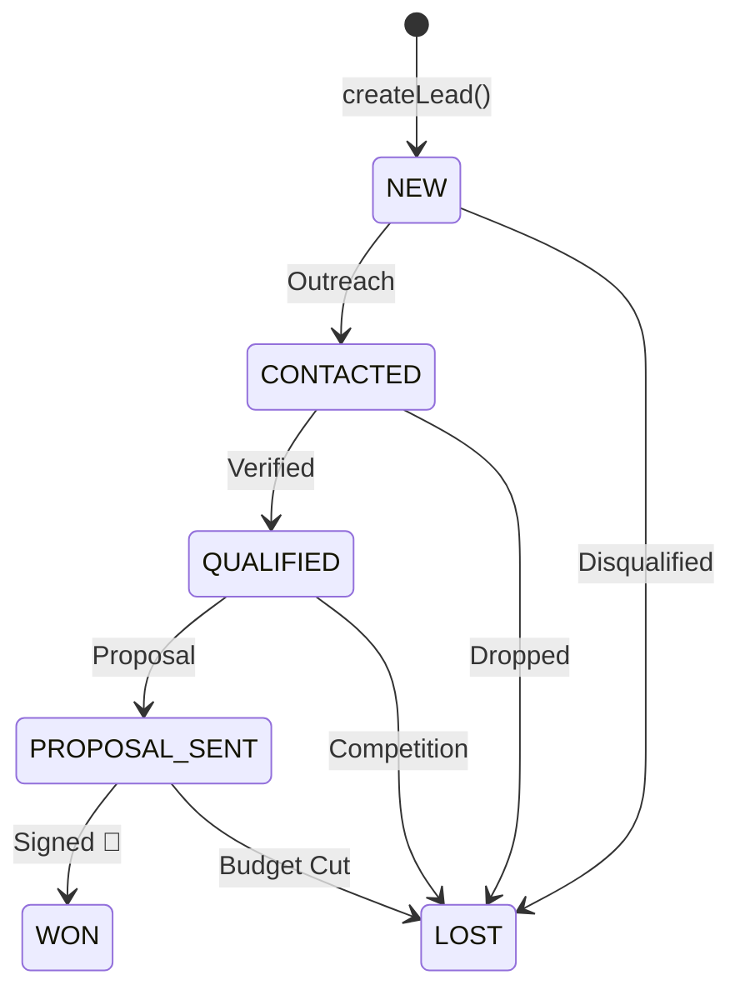

# 🪐 OrbitoX Platform Master Engineering Skill

You are an expert on the **OrbitoX Platform**, its core kernel, modular plugins, and the `@orbitox-io` package ecosystem. Use this guide to write clean, idiomatic, enterprise-grade code across any OrbitoX application.

---

## 📦 Package Ecosystem & Installation

All packages are published under the GitHub Organization scope `@orbitox-io` on GitHub Packages (`https://npm.pkg.github.com`).

### 1-Command Automated Onboarding
```bash
# Auto-configures .npmrc with token and generates local development keys
npx @orbitox/cli setup --token=ghp_yourTokenHere

# Auto-installs and wires a plugin
npx @orbitox/cli add crm
```

### Manual `.npmrc` Configuration
```ini
@orbitox-io:registry=https://npm.pkg.github.com
//npm.pkg.github.com/:_authToken=${NODE_AUTH_TOKEN}
always-auth=true
```

---

## 🚀 1. Fast 1-Line Client Initialization (`createOrbitoX`)

Instead of manual security wiring, initialize any backend or fullstack app in **1 line**:

```typescript
import { createOrbitoX } from '@orbitox-io/plugin-engine';
import * as crm from '@orbitox-io/crm';

const app = await createOrbitoX({
  license: process.env.ORBITOX_LICENSE_KEY, // Auto-verified if provided
  domain: 'portal.apollohospitals.com',      // Enforces cryptographic domain lock
  plugins: [crm],                            // Automatically mounted into app.crm
  strictSecurity: false,                     // Set to true in production
});

// Direct fluent access:
const lead = app.crm.createLead({
  name: 'Dr. Ramesh Sharma',
  email: 'sharma@apollo.com',
  company: 'Apollo Healthcare Network',
  estimatedValue: 4500000,
});
```

---

## 🌐 2. Smart Multi-Tenancy & Custom Domains (`createMultiTenantEngine`)

The `MultiTenantEngine` provides sub-millisecond RAM TTL caching (~6 µs), wildcard routing, and automatic tenant data isolation.

### 1-Line Express / Connect HTTP Middleware
```javascript
const express = require('express');
const { createMultiTenantEngine } = require('@orbitox-io/plugin-engine');
const crm = require('@orbitox-io/crm');

const app = express();
app.use(express.json());

const engine = createMultiTenantEngine({
  cacheTtlMs: 5 * 60 * 1000, // 5m RAM Cache
  wildcardRootDomain: 'orbito.com', // Routes *.orbito.com (e.g. apollo.orbito.com)
  domains: {
    'portal.apollohospitals.com': {
      tenantId: 'tenant_apollo_01',
      name: 'Apollo Hospital Network',
      tier: 'enterprise',
      features: ['ai_diagnostics', 'telehealth'],
    },
    'crm.maxhealthcare.com': {
      tenantId: 'tenant_max_02',
      name: 'Max Healthcare Group',
      tier: 'growth',
      features: ['telehealth'],
    },
  },
  // Dynamic async DB lookup for customer domains
  resolveTenant: async (host) => {
    return await prisma.tenant.findUnique({ where: { customDomain: host } });
  },
  plugins: [crm],
});

// Attach middleware (sets req.tenant, req.app, req.tenantSession)
app.use(engine.middleware());

// Route with automatic tenant scoping
app.post('/api/leads', (req, res) => {
  const safeData = req.tenantSession.scopeData(req.body);
  const lead = req.app.crm.createLead(safeData);
  res.json({ tenant: req.tenant.name, lead });
});

// Feature-protected Route (Enterprise only)
app.post('/api/ai-summary',
  engine.requireTier('enterprise'),
  engine.requireFeature('ai_diagnostics'),
  (req, res) => {
    const summary = req.app.crm.generateAiSummary(req.body.leadId);
    res.json({ summary });
  }
);

app.listen(3000);
```

### Zero-Boilerplate Context Access (`getActiveTenant`)
```typescript
import { getActiveTenant } from '@orbitox-io/plugin-engine';

export async function processPayment(amount: number) {
  const session = getActiveTenant(); // Retrieves current async request's tenant without req drilling!
  console.log(`Processing payment for Tenant: ${session?.tenant.name}`);
}
```

---

## 🛡️ 3. Cryptographic Security & Anti-Tamper Engine

### 1. Digital Signatures (`CryptoSigner` & `IntegrityVerifier`)
```typescript
import { CryptoSigner, IntegrityVerifier } from '@orbitox-io/plugin-engine';

// Generate signing keypair (Ed25519 or RSA)
const { publicKey, privateKey } = CryptoSigner.generateSigningKeyPair('ed25519');

// Sign payload
const signature = CryptoSigner.signPayload(manifest, privateKey);

// Verify signature
const isValid = IntegrityVerifier.verifyPayloadSignature(manifest, signature, publicKey);
```

### 2. Enterprise Licensing & Domain Lock (`LicenseEnforcer`)
```typescript
import { LicenseEnforcer } from '@orbitox-io/plugin-engine';

// Issue RSA-signed license token
const token = LicenseEnforcer.issueLicenseToken({
  licenseId: 'lic_apollo_100',
  issuedTo: 'Apollo Hospitals',
  allowedDomain: 'hospital.apollo.com',
  allowedTenants: 50,
  features: ['ai_diagnostics', 'telehealth'],
  issuedAt: new Date().toISOString(),
  expiresAt: '2028-12-31T23:59:59Z',
  tier: 'enterprise',
}, privateKeyPem);

// Verify token on boot
const check = LicenseEnforcer.verifyLicenseToken(token, publicKeyPem, {
  currentDomain: 'hospital.apollo.com',
  activeTenantsCount: 30,
});
```

### 3. Zero-Trust Sandbox Guard (`SandboxGuard`)
```typescript
import { SandboxGuard } from '@orbitox-io/plugin-engine';

// Deeply freeze facades to prevent monkey-patching or prototype pollution
SandboxGuard.freezeAllFacades(runtime);

// Restrict access to private keys and internal symbols
const safeProxy = SandboxGuard.createSandboxedProxy(runtime, ['security', 'database']);
```

---

## 💼 4. CRM Domain Engine (`@orbitox-io/crm`)

The CRM package enforces strict sales lifecycle state machines:



### Code Example:
```typescript
import { HeadlessCrmService, LeadStateMachine } from '@orbitox-io/crm';

const crm = new HeadlessCrmService();

// 1. Create Lead (Calculates qualification score 0-100 automatically)
const lead = crm.createLead({
  name: 'Max Healthcare',
  email: 'procurement@maxhealthcare.com',
  estimatedValue: 12500000,
});

// 2. Validate transitions before update
if (LeadStateMachine.canTransition(lead.status, 'CONTACTED')) {
  crm.updateLeadStatus(lead.id, 'CONTACTED');
  crm.updateLeadStatus(lead.id, 'QUALIFIED');
  crm.updateLeadStatus(lead.id, 'PROPOSAL_SENT');
  crm.updateLeadStatus(lead.id, 'WON');
}

// 3. Generate AI summary
const summary = crm.generateAiSummary(lead.id);
```

---

## 🛠️ 5. Built-In CLI Commands (`@orbitox/cli`)

| Command | Usage |
| :--- | :--- |
| `orbitox setup --token=<token>` | Auto-configures `.npmrc` authentication and generates local signing keys. |
| `orbitox add <plugin>` | Automatically installs and generates boilerplate for a plugin (e.g. `orbitox add crm`). |
| `orbitox keygen --type=ed25519` | Generates Ed25519 or RSA-2048 signing keys. |
| `orbitox package <plugin>` | Builds, strips source maps, hashes files, and cryptographically signs plugin bundle. |
| `orbitox verify <plugin>` | Validates digital signature and manifest integrity against public key. |
| `orbitox license issue` | Issues an RSA-signed enterprise license token with domain & quota lock. |

---

## 🚨 Best Practices & Production Checklist

1. **Always use `req.tenantSession.scopeData(data)`** when persisting user input to prevent tenant ID spoofing.
2. **Never commit `keys/private.pem`** or `.npmrc` with personal tokens to public repositories.
3. **Use `engine.invalidateCache(domain)`** immediately whenever a customer updates custom domain or subscription settings.
4. **Compile production packages with `tsconfig.prod.json`** (`sourceMap: false`, `removeComments: true`).
