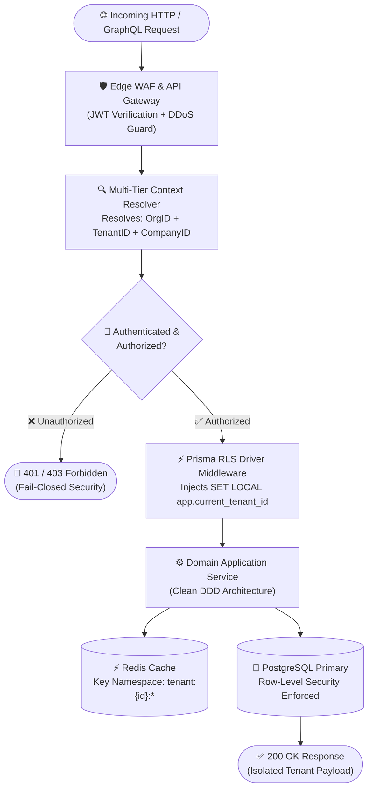
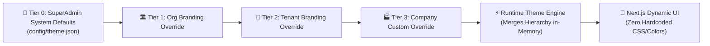

# 01 — Business Requirements & Enterprise Security Specification

> **Foundation Document:** All platform architecture, multi-tenant isolation, role-based security, and white-label customization trace directly to these core business requirements.

---

## Executive Summary

The **OrbitoX Business OS** is built to serve multi-tiered enterprise organizations operating under white-label B2B2C paradigms. The architecture enforces strict multi-tenancy isolation via **PostgreSQL Row-Level Security (RLS)**, configuration-driven customization, zero hardcoded business logic, and modular extensibility ready for enterprise CRM, ERP, HRMS, Payroll, and E-commerce extensions.

---

## 1. 5-Tier Role & Hierarchy Architecture Matrix

All platform capabilities and data access boundaries are governed by a **5-Tier Hierarchical Structure**. Each tier inherits baseline permissions from above while retaining absolute boundary isolation from horizontal peers.

| Tier | Role Title | Scope & Governance Boundary | Primary RLS Scoping Key | Dynamic Config Pointer |
|---|---|---|---|---|
| **Tier 0** | **SuperAdmin** | Platform Owner / Global Infrastructure, Tenant Provisioning, System Audits | Global (No RLS Restriction) | `config/roles.json` (`roles.superadmin`) |
| **Tier 1** | **Organisation Admin** | Holding Group / Master Enterprise, Cross-Tenant Reporting & Aggregation | `org_id` | `config/roles.json` (`roles.organisation`) |
| **Tier 2** | **Tenant Admin** | Regional Operator / Franchise Owner, Billing, Custom Domains, Plan Upgrades | `tenant_id` | `config/roles.json` (`roles.tenant`) |
| **Tier 3** | **Company Admin** | Client Business Owner, API Key Management, Internal Team RBAC | `company_id` | `config/roles.json` (`roles.company`) |
| **Tier 4** | **Consumer / End-User** | End-user of the B2B2C application (Members, Customers, Affiliates) | `user_id` + `tenant_id` | `config/roles.json` (`roles.consumer`) |

---

## 2. Multi-Tier Security & Data Isolation Architecture

The diagram below illustrates how an incoming request is authenticated, resolved across the 5-tier context, and scoped securely before touching the database or cache.

---

## 3. Comprehensive Fine-Grained Permission Matrix

Permissions operate on a **declarative `action:resource` model** defined in `config/permissions.yaml`. Access is evaluated hierarchically with fail-closed default logic.

| Permission Key | SuperAdmin | Organisation Admin | Tenant Admin | Company Admin | Consumer | Config Override Key |
|---|---|---|---|---|---|---|
| `platform:read` | ✅ | ✅ | ✅ | ✅ | ❌ | `perm.platform.read` |
| `platform:configure` | ✅ | ⚠️ Limited | ❌ | ❌ | ❌ | `perm.platform.config` |
| `organisation:create` | ✅ | ✅ | ❌ | ❌ | ❌ | `perm.org.create` |
| `tenant:manage` | ✅ | ✅ | ✅ (Own Tenant) | ❌ | ❌ | `perm.tenant.manage` |
| `company:manage` | ✅ | ✅ | ✅ | ✅ (Own Company) | ❌ | `perm.company.manage` |
| `billing:manage` | ✅ | ✅ | ✅ | ✅ | ❌ | `perm.billing.manage` |
| `analytics:export` | ✅ | ✅ | ✅ | ✅ | ❌ | `perm.analytics.export` |
| `feature:toggle` | ✅ | ✅ | ✅ (Allowed Tier) | ⚠️ Tier Restricted | ❌ | `perm.feature.toggle` |
| `member:impersonate` | ✅ | ⚠️ Audit Logged | ⚠️ Audit Logged | ❌ | ❌ | `perm.member.impersonate` |
| `audit:view` | ✅ | ✅ | ✅ | ✅ (Own Scope) | ❌ | `perm.audit.view` |

---

## 4. White-Label Cascading Customization Architecture

All UI theming, branding, typography, component layouts, and feature availability are evaluated dynamically at runtime through a **hierarchical cascade resolution engine**.

### Configuration Resolution Matrix

| Config File | Scope | Merge Priority | Purpose & Customization Capability |
|---|---|---|---|
| `config/theme.json` | Global / Cascading | SuperAdmin (1) → Org (2) → Tenant (3) → Company (4) | Defines CSS design tokens, primary and secondary colors, gradients, font families, logo/favicon URLs. |
| `config/uiOverrides.yaml` | Per-Tier / Entity | Merged at Company level | Customizes dashboard component layouts, hide/show sidebar modules, custom navigation schemas. |
| `config/featureFlags.yaml` | Global & Tiered | Evaluated at Tenant runtime | Toggles module availability (`feature.analytics`, `feature.webhooks`, `feature.commissions`). |
| `config/billing.yaml` | Tier / Subscription | SuperAdmin Controlled | Configures multi-tier revenue share splits, subscription pricing models, and payment gateways. |

---

## 5. Enterprise Security & Compliance Governance Matrix

OrbitoX enforces bank-grade security protocols across all application layers and data storage infrastructure.

| Security Domain | Implementation Standard | Technical Mechanism | Compliance Standard |
|---|---|---|---|
| **Data Isolation** | Row-Level Security (RLS) | PostgreSQL RLS policies auto-injected per session (`app.current_tenant_id`). | SOC2 Type II / ISO-27001 |
| **Data Encryption** | AES-256-GCM & TLS 1.3 | All storage volumes encrypted at rest; strict TLS 1.3 in transit with HSTS. | PCI-DSS Level 1 / HIPAA |
| **Authentication** | JWT RS256 + MFA | Asymmetric key signed JWTs, OTP via SMS/App, OAuth2/OIDC SSO integrations. | NIST SP 800-63B |
| **Audit Logging** | Immutable Append-Only Log | Crypto-signed append-only logs stored in ElasticSearch with tamper-evident hashing. | GDPR Art. 30 / SOC2 |
| **Privacy & GDPR** | Automated PII Anonymization | Configurable data retention policies (`config/compliance.yaml`) with right-to-be-forgotten purges. | GDPR / CCPA |
| **Rate Limiting** | Sliding Window Counter | Redis-backed sliding window rate limiter per IP, User, Company, and Tenant. | OWASP API Security |

---

## 6. Non-Functional SLA & Performance Benchmarks

| Metric Category | Target Standard | Measurement Threshold | Tuning Configuration Key |
|---|---|---|---|
| **Availability SLA** | 99.99% Uptime | $\le 52.56$ minutes total downtime per year | `config/performance.yaml` (`sla.target`) |
| **Peak Throughput** | 50,000 req/sec | Horizontally auto-scaled Kubernetes stateless pods | `config/performance.yaml` (`scaling.maxPods`) |
| **Latency (P99)** | $< 200\text{ ms}$ | Measured across all authenticated API calls | `config/performance.yaml` (`latency.p99MaxMs`) |
| **Database Scaling** | $100\text{M+}$ rows/tenant | Sharded by `tenant_id` with read replicas & connection pooling | `config/performance.yaml` (`db.poolSize`) |
| **Disaster Recovery** | RPO: 5 min · RTO: 1 hr | Automated PostgreSQL WAL archiving & Terraform auto-spin DR | `config/performance.yaml` (`dr.rpoMinutes`) |
