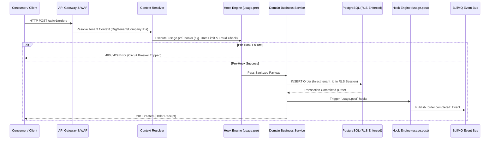
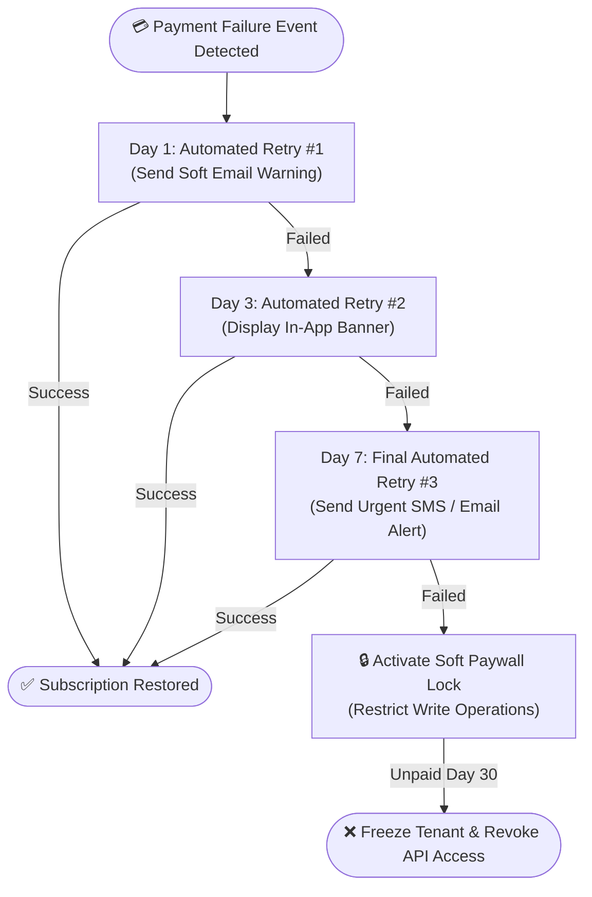

# 02 — Multi-Tenant Flows, Lifecycles & Event-Driven Hook Engine

> **Architectural Blueprint:** Describes end-to-end entity lifecycles, automated state machines, runtime hook pipelines, and asynchronous event bus orchestration.

---

## Executive Summary

All business operations within the **OrbitoX Business OS**—from tenant onboarding to daily usage transactions and automated dunning—follow **declarative, event-driven state machines**.

Every lifecycle transition exposes **pre-hooks (`*.pre`)** and **post-hooks (`*.post`)** configured in `config/flowHooks.yaml`. This enables platform owners to inject custom logic, commission calculators, compliance audits, and third-party webhooks without modifying core application code.

---

## 1. Comprehensive Tenant & Entity Lifecycle Phase Matrix

| Lifecycle Phase | Description & Business Purpose | Triggering Event | Automated Hook File | Target State | Recovery / Failure Action |
|---|---|---|---|---|---|
| **Onboarding** | Resource allocation, database tenant creation, sub-domain DNS binding | `tenant.signup` | `hooks/onboarding.yaml` | `Pending_Activation` | Rollback schema & notify admin |
| **Activation** | Payment method verification or admin manual approval | `payment.success` | `hooks/activation.yaml` | `Active` | Freeze tenant & render onboarding paywall |
| **Usage** | Core transactional operations (orders, wallet payouts, bookings) | `api.request` | `hooks/usage.yaml` | `Active` | Reject transaction with standard exception |
| **Suspension** | Soft account lock due to policy violation or failed subscription | `tenant.suspend` | `hooks/suspension.yaml` | `Suspended` | Render paywall lock card on login |
| **Dunning** | Automated retry matrix for failed subscription billing | `billing.failed` | `hooks/dunning.yaml` | `Grace_Period` | Initiate 3-stage retry schedule + alerts |
| **Termination** | Final account deprovisioning, API key revocation, data freeze | `tenant.terminate` | `hooks/termination.yaml` | `Terminated` | Move data to cold storage vault |
| **GDPR Purge** | Safe cryptographic data erasure following compliance retention | `retention.expired` | `hooks/purge.yaml` | `Purged` | Immutable purge audit log generated |

---

## 2. Tenant Lifecycle State Machine Architecture

The diagram below details the deterministic state transitions enforced by the core state machine.

```mermaid
flowchart TD
    Signup(["NEW SIGNUP<br/>Tenant / Company"]) --> Pending["STATE: Pending_Activation<br/>(Resource Allocation & DNS setup)"]
    
    Pending -->|Payment Verified / Admin Approved| Active["STATE: Active<br/>(Full Platform Capabilities)"]
    
    Active -->|Billing Failure Event| Grace["STATE: Grace_Period<br/>(7-Day Active Trial / Warning Banner)"]
    
    Grace -->|Payment Recovered| Active
    Grace -->|Dunning Exhausted (Day 7)| Suspended["STATE: Suspended<br/>(Soft Lock: Paywall Card Rendered)"]
    
    Suspended -->|Payment Resolved| Active
    Suspended -->|Unresolved after 30 Days| Terminated["STATE: Terminated<br/>(API Keys Revoked / Resources Frozen)"]
    
    Terminated -->|Compliance Period Expired| Purged(["STATE: Purged<br/>(GDPR Safe Erasure & Audit Sealed)"])
```

---

## 3. End-to-End Business Request & Hook Execution Pipeline

Every business request flows through a strict, multi-stage pipeline: **Context Resolution $\rightarrow$ Pre-Hook Execution $\rightarrow$ Business Service Logic $\rightarrow$ Row-Level Security Persistence $\rightarrow$ Post-Hook Async Event Emission**.



---

## 4. Configurable Hook Pipeline Architecture

Hooks are defined declaratively in `config/flowHooks.yaml`. Each phase supports multiple synchronous or asynchronous plugin execution steps.

```yaml
# Example Configuration: config/flowHooks.yaml
phase: usage
pre:
  - plugin: "plugin-fraud-check"
    action: "validateRiskScore"
    timeoutMs: 1500
    onFailure: "abort"

post:
  - plugin: "plugin-commission"
    action: "calculateMultiTierPayout"
    async: true
  - plugin: "plugin-notification"
    action: "sendCustomerReceipt"
    async: true
```

### Hook Execution Policy Matrix

| Hook Phase | Execution Mode | Default Failure Policy | Max Execution Timeout | Target Use Case |
|---|---|---|---|---|
| `onboarding.pre` | Synchronous | `abort` (Rollback) | 5,000 ms | Domain availability check, quota verification |
| `onboarding.post` | Asynchronous | `retry` (Exponential) | 30,000 ms | Provision S3 buckets, seed default database tables |
| `usage.pre` | Synchronous | `abort` (Fail-Closed) | 1,000 ms | Fraud prevention, rate limit checks, feature gating |
| `usage.post` | Asynchronous | `dead_letter_queue` | 10,000 ms | Commission calculations, analytics aggregations |
| `dunning.post` | Asynchronous | `escalate_to_admin` | 15,000 ms | Automated email/SMS payment failure alerts |
| `termination.pre` | Synchronous | `abort` | 10,000 ms | Check for outstanding ledger balances |

---

## 5. Automated Dunning & Revenue Recovery Pipeline Flow

When subscription billing fails, the system executes an automated, 3-stage dunning workflow before placing accounts into soft suspension.



---

## 6. Non-Functional Flow Resilience & Timeout Controls

All state engine transitions and plugin hooks enforce defensive stability parameters specified in `config/flowSettings.yaml`.

| Resilience Knob | Default Setting | Description & Purpose | Fallback Behavior |
|---|---|---|---|
| `flow.timeoutMs` | 3,000 ms | Maximum execution window for synchronous flow hooks | Trip circuit breaker & reject request |
| `flow.retryCount` | 3 Retries | Max retry attempts for transient asynchronous hooks | Move message to BullMQ Dead Letter Queue |
| `flow.circuitBreaker.threshold` | 5 Failures / 60s | Tripping threshold for external plugin webhooks | Bypass non-critical hooks & log warning |
| `flow.concurrencyLimit` | 500 Workers | Maximum concurrent asynchronous hook workers | Queue jobs in Redis with backpressure |
