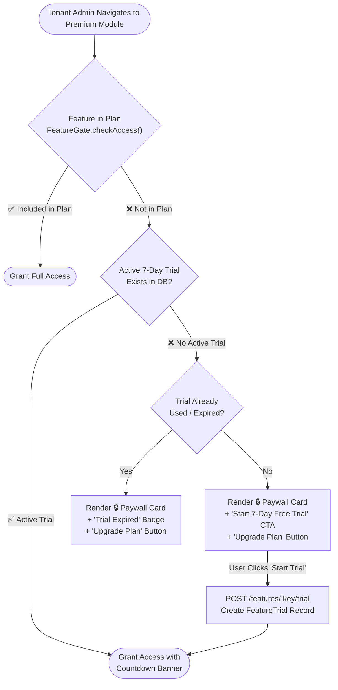

# Paid Feature Gating & Monetization Engine Specification

---

## Executive Summary

The platform provides a **SuperAdmin Monetization Engine** that allows platform owners to gate specific platform modules (e.g., Advanced Analytics, Custom Branding, Automated Commissions, Webhooks) behind subscription plan tiers (`Starter`, `Growth`, `Enterprise`).

When a user attempts to access a feature not included in their active plan, the system renders an **Interactive Paywall Card** offering a **7-Day Free Trial** or an **Upgrade Plan** call-to-action.



---

## 1. Comprehensive Feature Tiering Matrix

All platform capabilities are categorized into feature keys in configuration:

| Feature Key | Module Name | Starter ($0/mo) | Growth ($149/mo) | Enterprise ($499/mo) | Config Key | Quota / Limit Override |
|---|---|---|---|---|---|---|
| `feature.members` | User & Member Management | ✅ Enabled | ✅ Enabled | ✅ Enabled | `features.core.members` | Starter: Max 500 members |
| `feature.products` | Product Catalog | ✅ Enabled | ✅ Enabled | ✅ Enabled | `features.core.products` | Starter: Max 50 products |
| `feature.orders` | Order Processing | ✅ Enabled | ✅ Enabled | ✅ Enabled | `features.core.orders` | Starter: Max 1,000 orders/mo |
| `feature.commissions` | Automated Commission Engine | ❌ Locked | ✅ Enabled | ✅ Enabled | `features.growth.commissions` | Growth: Standard plans |
| `feature.wallets` | Multi-Currency Ledger | ❌ Locked | ✅ Enabled | ✅ Enabled | `features.growth.wallets` | Growth: Max 3 currency wallets |
| `feature.reports` | Advanced Data Exports | ❌ Locked | ✅ Enabled | ✅ Enabled | `features.growth.reports` | Growth: CSV/XLSX export |
| `feature.kyc_advanced` | Automated ID Verification | ❌ Locked | ✅ Enabled | ✅ Enabled | `features.growth.kyc` | Growth: 100 verifications/mo |
| `feature.branding` | Full White-Label & Custom Domain | ❌ Locked | ❌ Locked | ✅ Enabled | `features.ent.branding` | Enterprise: Unlimited CNAMEs |
| `feature.webhooks` | Real-time Outbound Webhooks | ❌ Locked | ❌ Locked | ✅ Enabled | `features.ent.webhooks` | Enterprise: Max 10 endpoints |
| `feature.sub_tenants` | Multi-Tenant Provisioning | ❌ Locked | ❌ Locked | ✅ Enabled | `features.ent.subtenants` | Enterprise: Max 50 sub-tenants |
| `feature.custom_gateway` | Private Payment Gateways | ❌ Locked | ❌ Locked | ✅ Enabled | `features.ent.gateways` | Enterprise: Custom Stripe/Razorpay |

---

## 2. Feature Trial Lifecycle States Table

| Trial State | `isActive` Flag | `expiresAt` Condition | UI Representation | Allowed User Actions |
|---|---|---|---|---|
| **NOT_STARTED** | N/A (No Row) | N/A | 🔒 Paywall Card with "Start 7-Day Free Trial" CTA | Start Trial · Upgrade Plan |
| **ACTIVE_TRIAL** | `true` | `NOW() < expiresAt` | ⏳ Top Countdown Banner + Unlocked Content | Use Feature · Upgrade Plan |
| **EXPIRED_TRIAL**| `false` | `NOW() >= expiresAt` | 🔒 Paywall Card with "Trial Expired" Badge | Upgrade Plan |
| **PLAN_UPGRADED**| N/A | Feature included in Plan | ✅ Full Access (No Trial Banner) | Use Feature |

---

## 3. Feature Gate API Endpoint Matrix

| Method | Endpoint | Access Role | Description | Response Envelope |
|---|---|---|---|---|
| `GET` | `/api/v1/features/catalog` | Authenticated | List all features with tenant access status | `FeatureCatalogResponse` |
| `GET` | `/api/v1/features/:key/check` | Authenticated | Check single feature access status | `{ granted: boolean, isTrial: boolean, expiresAt?: string }` |
| `POST` | `/api/v1/features/:key/trial` | Tenant Admin | Start 7-day free trial for feature | `FeatureTrialEntity` |
| `PATCH` | `/api/v1/features/:key/override` | SuperAdmin | Grant custom tenant feature override | `{ granted: boolean, Reason: string }` |

---

## 4. Feature Trial Database Model Schema

```prisma
// Prisma Schema Definition for Feature Gating
model FeatureTrial {
  id          String   @id @default(uuid()) @db.Uuid
  tenantId    String   @map("tenant_id") @db.Uuid
  featureKey  String   @map("feature_key") @db.VarChar(100)
  startedAt   DateTime @default(now()) @map("started_at") @db.Timestamptz(6)
  expiresAt   DateTime @map("expires_at") @db.Timestamptz(6)
  isActive    Boolean  @default(true) @map("is_active")

  tenant      Tenant   @relation(fields: [tenantId], references: [id], onDelete: Cascade)

  @@unique([tenantId, featureKey])
  @@map("feature_trials")
}
```

---

## 5. NestJS Backend Feature Guard Pattern

```typescript
// NestJS Custom Decorator and Guard for Feature Gating
export const RequireFeature = (featureKey: string) => SetMetadata('featureKey', featureKey);

@Injectable()
export class FeatureGateGuard implements CanActivate {
  constructor(
    private reflector: Reflector,
    private featureGateService: FeatureGateService,
  ) {}

  async canActivate(context: ExecutionContext): Promise<boolean> {
    const featureKey = this.reflector.get<string>('featureKey', context.getHandler());
    if (!featureKey) return true;

    const request = context.switchToHttp().getRequest();
    const tenantId = request.tenantId;

    const access = await this.featureGateService.checkFeatureAccess(tenantId, featureKey);
    if (!access.granted) {
      throw new ForbiddenException({
        errorCode: 'FEATURE_LOCKED',
        message: `Feature ${featureKey} requires a plan upgrade or active trial.`,
        paywallUrl: `/settings/billing?feature=${featureKey}`,
      });
    }

    return true;
  }
}
```

---

## 6. Frontend `<FeatureGate>` Paywall Component Pattern

```tsx
// Reusable Frontend Feature Gate Wrapper
export const FeatureGate = ({ featureKey, children }: { featureKey: string; children: React.ReactNode }) => {
  const { hasAccess, isLoading, isTrial, expiresAt, startTrial } = useFeatureGate(featureKey);

  if (isLoading) return <LoadingSpinner />;

  if (hasAccess) {
    return (
      <>
        {isTrial && <TrialBanner expiresAt={expiresAt} featureKey={featureKey} />}
        {children}
      </>
    );
  }

  return (
    <PaywallCard 
       featureKey={featureKey}
       onStartTrial={startTrial}
       onUpgrade={() => router.push(`/settings/billing?feature=${featureKey}`)}
    />
  );
};
```

---

## 7. Feature Gating Webhook & Notification Events Table

| Event Identifier | Trigger Condition | Notification Target | Payload Data |
|---|---|---|---|
| `feature.trial_started` | User initiates 7-day trial | Tenant Admin (Email & Push) | `{ tenantId, featureKey, expiresAt }` |
| `feature.trial_expiring_soon` | 24 hours remaining on trial | Tenant Admin (Email & Banner) | `{ tenantId, featureKey, hoursRemaining: 24 }` |
| `feature.trial_expired` | Trial countdown reaches 0 | Tenant Admin (Email & Alert) | `{ tenantId, featureKey, expiredAt }` |
| `feature.plan_upgraded` | Tenant upgrades subscription plan | SuperAdmin & Tenant Admin | `{ tenantId, oldPlan, newPlan, unlockedFeatures }` |
