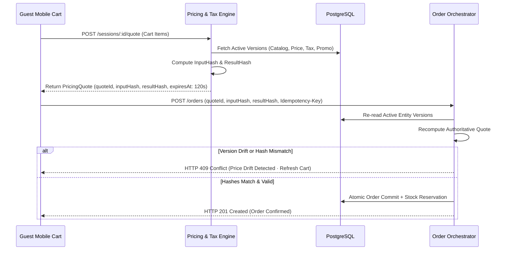
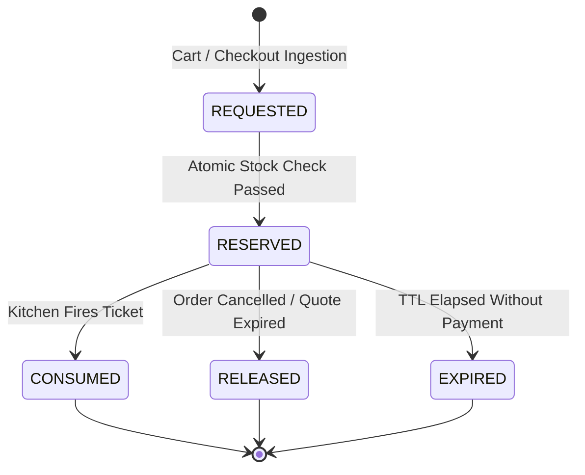
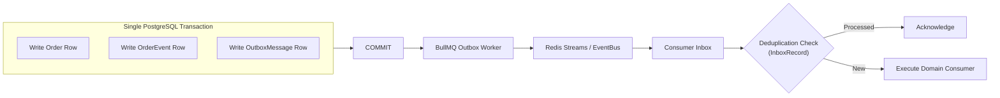

# 🍳 OrbitoX RestaurantOS v2.1: Master Architecture & Commerce Operations Blueprint

> **Enterprise Architecture Reference & Operational Domain Handbook**  
> **Classification:** Internal Architecture Blueprint · OrbitoX Vertical Core  
> **Status:** Production Architecture Baseline (v2.1 Hardened & Provable)  
> **Security Targets:** SOC 2 Type II Readiness · PCI DSS Aligned (Scope-Minimized Processor-Hosted Flow) · GDPR-Ready Privacy Architecture · OWASP API Top 10 Aligned  
> **Availability Targets:** Cloud High Availability (99.99%) · Local LAN Resilience · Offline-Capable Edge Mesh  
> **Certification Governance:** Subject to independent formal validation and third-party audit per deployment topology.

---

## Executive Summary & Positioning

**OrbitoX RestaurantOS** is a programmable, multi-tenant, cloud-native, and edge-resilient restaurant commerce and operating system. In this architecture, **QR table ordering is not the product**—it is simply one guest-facing entry point into an end-to-end operational engine.

```
┌─────────────────────────────────────────────────────────────────────────────┐
│                         ORBITOX RESTAURANTOS v2.1                           │
│                Scan · Discover · Order · Track · Pay · Return               │
│   A programmable operating system for Guests, Kitchen, Waitstaff, Managers,  │
│             Franchises, Multi-Brand Groups, and the Platform Owner.          │
└─────────────────────────────────────────────────────────────────────────────┘
```

Modern restaurant platforms (such as Square, Toast, and Deliverect) confirm that QR table ordering, Kitchen Display Systems (KDS), group tab consolidation, multi-station kitchen routing, omnichannel menu synchronization, and customer retention are converging into a single operating category.

The strategic differentiation of OrbitoX RestaurantOS stems from its **zero-trust tenancy**, **decoupled state machines**, **deterministic pricing & quotation engine**, **production kitchen scheduling DAG**, **semantic Experience Studio**, and **hardened edge mesh**.

---

## 1. Conceptual Architecture Hierarchy

To provide an unambiguous mental model for software engineers and AI coding agents, RestaurantOS structures its software abstractions into eight distinct tiers:

```mermaid
flowchart TD
    classDef plat fill:#334155,color:#fff,stroke:#1e293b,rx:8
    classDef prim fill:#0284c7,color:#fff,stroke:#0369a1,rx:8
    classDef agg fill:#0f766e,color:#fff,stroke:#0d9488,rx:8
    classDef srv fill:#059669,color:#fff,stroke:#047857,rx:8
    classDef eng fill:#d97706,color:#fff,stroke:#b45309,rx:8
    classDef flow fill:#7c3aed,color:#fff,stroke:#5b21b6,rx:8
    classDef chan fill:#be185d,color:#fff,stroke:#db2777,rx:8
    classDef int fill:#dc2626,color:#fff,stroke:#b91c1c,rx:8

    T1["1. ORBITOX PLATFORM PRIMITIVES\nTenancy (RLS/ALS) · Identity (RS256) · Policy (JSONLogic) · CryptoSigner · EventBus"]:::plat
    T2["2. DOMAIN PRIMITIVES\nLocation · Table · DiningSession · Participant · CatalogItem · Order · PreparationTask · Payment · Customer · Event"]:::prim
    T3["3. DOMAIN AGGREGATES\nDiningSessionAggregate · OrderAggregate · InventoryBalanceAggregate · MenuAggregate"]:::agg
    T4["4. DOMAIN SERVICES\nOrderOrchestrationService · KdsSchedulerService · StockLedgerService · BillingService"]:::srv
    T5["5. SPECIALIZED ENGINES\nPricing · Tax · Availability · Recommendation · Capacity · Incident · Outbox/Inbox"]:::eng
    T6["6. WORKFLOWS & STATE MACHINES\nCommercialWorkflow · FulfillmentWorkflow · PaymentWorkflow · TableSessionWorkflow"]:::flow
    T7["7. CHANNELS & EXPERIENCES\nGuest PWA (390×844) · Waiter Tablet · Kitchen KDS · Counter POS · Semantic Studio"]:::chan
    T8["8. INTEGRATION HUB & EDGE MESH\nOrbitoX Edge Node · Aggregators (Swiggy/Zomato) · Hardware HAL (ESC/POS) · Payment Gateways"]:::int

    T1 --> T2 --> T3 --> T4 --> T5 --> T6 --> T7 --> T8
```



---

## 2. The Dual-Hierarchy Model: Governance vs. Operational Topology

The platform cleanly separates **Universal Platform Governance** from the **Restaurant Operational Topology** and **Customer Identity Progression**:

```
ORBITOX UNIVERSAL GOVERNANCE
├── Tier 0: SUPER ADMIN (Platform Owner · Licensing · Global Registry)
│   └── Tier 1: ORGANISATION (Holding Group · Master Franchise · Reseller)
│       └── Tier 2: TENANT (Regional Franchisee · Operating Division)
│           └── Tier 3: COMPANY / RESTAURANT BRAND (Corporate Merchant Entity)
│
RESTAURANT OPERATIONAL TOPOLOGY
└── COMPANY / RESTAURANT BRAND
    ├── LOCATION / OUTLET (Ludhiana · Chandigarh · Delhi · Dubai)
    │   ├── Floor / Service Area (Main Dining · Terrace · Bar Lounge)
    │   ├── Physical Table & TableOccupancy (Table 14 · Bar Stool 03)
    │   │   └── DiningSession (Active Party · Tab Total · Session Clock)
    │   │       ├── Participant A (Device 1 · Cart · Orders)
    │   │       └── Participant B (Device 2 · Cart · Orders)
    │   ├── Workstations & Hardware (POS Terminals · Receipt Printers)
    │   ├── Kitchen Stations & KDS (Curry · Tandoor · Beverage · Expo)
    │   └── Assigned Staff & Shifts (Managers · Captains · Chefs · Runners)
    ├── Brand Catalog & Recipes (Central Recipes · Core Ingredients)
    └── Brand Marketing & CRM (Cross-Outlet Loyalty · Global Campaigns)
│
CUSTOMER IDENTITY PROGRESSION
└── CONSUMER / GUEST
    ├── Anonymous Guest (Scans QR at Table 14 · Ephemeral guest capability)
    ├── Identified Guest (Provides mobile number / OTP for receipt & loyalty)
    ├── Customer Profile (First-party CRM record: dining history, allergens)
    └── Loyalty Tier Member (Earned points, member perks, personalized offers)
```

---

## 3. The 10 Core Primitives & 11 Specialized Engines

### The 10 Core Primitives

| # | Primitive | Purpose | Key Invariant / Attributes |
|---|---|---|---|
| **1** | `Location` | Physical outlet with unique taxes, timezone, operating hours, and inventory. | `id`, `companyId`, `timezone`, `taxProfileId`, `currency`, `operatingHours` |
| **2** | `Table` | Physical piece of restaurant furniture within a service area. | `id`, `locationId`, `serviceAreaId`, `label`, `capacity`, `qrIdentityId` |
| **3** | `DiningSession` | The living temporal lifecycle of a dining party at a table; hosts participants and consolidated tab. | `id`, `tableId`, `locationId`, `status`, `version`, `tabTotal`, `openedAt`, `closedAt` |
| **4** | `Participant` | An individual actor seated within a DiningSession (guest or assisted staff). | `id`, `sessionId`, `type` (`ANONYMOUS`, `IDENTIFIED`, `STAFF`), `phone`, `cartId` |
| **5** | `CatalogItem` | Central culinary definition of what the brand sells (decoupled from presentation/menus). | `id`, `companyId`, `name`, `baseCostMinor`, `allergens[]`, `recipeId`, `modifiers[]` |
| **6** | `Order` | An immutable commercial increment submitted during a session or channel. | `id`, `sessionId`, `orderNumber`, `quoteId`, `version`, `commercialState`, `items[]` |
| **7** | `PreparationTask` | Granular preparation task scheduled to a station with explicit dependencies and fire times. | `id`, `orderItemId`, `stationId`, `dependencies[]`, `fireAt`, `targetDurationMin`, `state` |
| **8** | `Payment` | Tokenized monetary settlement against a DiningSession or Order. | `id`, `sessionId`, `provider`, `amountMinor`, `status`, `idempotencyKey`, `processorRef` |
| **9** | `Customer` | First-party profile capturing lifetime preferences, dietary notes, and CRM relationship. | `id`, `companyId`, `phone`, `email`, `allergens[]`, `lifetimeSpendMinor`, `loyaltyTier` |
| **10** | `Event` | Immutable record of something that occurred across the system with monotonic sequencing. | `eventId`, `sequenceNumber`, `aggregateId`, `eventType`, `schemaVersion`, `causationId` |

### The 11 Specialized Domain Engines

1. **Availability Engine:** Computes item accessibility based on time, inventory, kitchen load, and channel.
2. **Pricing Engine:** Evaluates price lists, volume discounts, dynamic surcharges, and location rules.
3. **Tax Engine:** Resolves jurisdictional tax rules, exemptions, inclusive/exclusive policies, and rounding.
4. **Recommendation Engine:** Generates guardrailed, margin- and capacity-aware pairing recommendations.
5. **Workflow Engine:** Orchestrates configurable status transitions per restaurant concept.
6. **Notification Engine:** Dispatches web push, WebSockets, SMS, and WhatsApp messages.
7. **Inventory Engine:** Manages atomic stock reservations, recipe consumption, and immutable ledgers.
8. **Analytics Engine:** Computes financial KPIs (RevPASH, COGS) and operational latency metrics.
9. **AI Engine & Tool Gateway:** Executes scoped domain tools for copilot and forecasting workflows.
10. **Integration Engine:** Handles stateful external connectors (aggregators, POS, accounting) via Outbox/Inbox.
11. **Experience Engine:** Powers the semantic visual canvas and theme token compilation.

---

## 4. Hardened v2.1 Architectural Pillars

### 1. Four Orthogonal Domain States + Projection of Customer Visibility

In v2.1, domain state machines are decoupled into **four authoritative states**, while customer visibility is treated strictly as an **ephemeral computed projection**:

```
ORDER (#4821)
├── 1. CommercialState (Authoritative Domain State)
│   DRAFT ➔ SUBMITTED ➔ CONFIRMED ➔ CANCELLED | COMPLETED
│
├── 2. FulfillmentState (Authoritative Domain State)
│   UNFULFILLED ➔ IN_PROGRESS ➔ PARTIALLY_FULFILLED ➔ FULFILLED
│
├── 3. PaymentState (Authoritative Domain State)
│   UNPAID ├── AUTHORIZATION_PENDING ➔ AUTHORIZED ➔ CAPTURE_PENDING ➔ PAID
│          │                                      └── AUTHORIZATION_FAILED
│          ├── PARTIALLY_PAID
│          ├── PAID ➔ REFUND_PENDING ➔ REFUNDED | PARTIALLY_REFUNDED
│          └── PAYMENT_FAILED
│
├── 4. KitchenState (Authoritative Domain State)
│   QUEUED ➔ PREPARING ➔ READY ➔ EXPO
│
└── 5. CustomerVisibilityState (COMPUTED PROJECTION — Not Stored Authoritatively)
    ProjectionFunction(CommercialState, KitchenTasks[], FulfillmentState, ConceptWorkflow)
    Outputs: "Order Confirmed" | "Chef is Cooking" | "Almost Ready" | "Ready for Table" | "Served"
```

*By deriving CustomerVisibilityState dynamically, the platform eliminates drift between what the kitchen is executing and what the guest sees.*

---

### 2. Physical Table vs. Decoupled `DiningSession` & `Participant`

The domain model separates the physical furniture (`Table`) from the temporal dining event (`DiningSession`):

```
Table 14 (Physical Asset · Occupancy: OCCUPIED · Version: 14)
└── Active DiningSession (#TS-9821 · Elapsed: 48m · Tab: ₹2,205 · Version: 8)
    ├── Participant A (Anonymous Guest · Device 1 · Cart 1)
    ├── Participant B (Identified Guest · Device 2 · Cart 2)
    ├── Participant C (Captain Rick · Assisted Mode)
    ├── Order Rounds: [Round 1 (#ORD-1001), Round 2 (#ORD-1002)]
    ├── Active Requests: [Call Water (Acknowledged)]
    └── Payments: [Payment 1: ₹1,000 (Card), Payment 2: ₹1,205 (UPI)]
```

*Capabilities: Order for myself, order for table, order for another guest, transfer item, and itemized split bills.*

---

### 3. Deterministic `PricingQuote` with Cryptographic Version Hashes

Never rely solely on a TTL or client-side arithmetic. In v2.1, quotes are secured using **input and result hashes** validated against authoritative server-side entity versions:

$$\text{InputHash} = \text{SHA256}(\text{SessionId} + \text{ParticipantId} + \text{LineItemsJson})$$
$$\text{ResultHash} = \text{SHA256}(\text{PriceVersion} + \text{TaxVersion} + \text{PromoVersion} + \text{TotalsJson})$$



---

### 4. Durable PostgreSQL Idempotency & Redis Fast-Path

Critical endpoints (`/orders`, `/payments`, `/coupons/redeem`) enforce durable idempotency:

```prisma
model IdempotencyRecord {
  key          String    @id
  tenantId     String    @map("tenant_id")
  actorId      String    @map("actor_id")
  endpoint     String
  requestHash  String    @map("request_hash")
  responseCode Int       @map("response_code")
  responseBody JsonB     @map("response_body")
  resourceId   String?   @map("resource_id")
  createdAt    DateTime  @default(now()) @map("created_at")
  expiresAt    DateTime  @map("expires_at")

  @@index([tenantId, actorId])
  @@map("platform_idempotency_records")
}
```

*Redis serves as the sub-millisecond fast-path deduplicator; PostgreSQL serves as the authoritative, durable deduplication store. Even if a Redis key expires during an aggressive network retry, the transaction cannot execute twice.*

---

### 5. Optimistic Concurrency Control Across All Aggregates

Every core aggregate contains an integer `version` field. State mutations enforce optimistic locking:

```sql
UPDATE restaurant_dining_sessions 
SET tab_total = tab_total + 42000, version = version + 1
WHERE id = $1 AND version = $2;
```

If zero rows are updated, the service immediately throws `409 Conflict`, prompting the caller to reload and reapply modifications. This prevents simultaneous race conditions between waitstaff transfers, cashier bill splits, and guest checkouts.

---

### 6. Explicit `InventoryReservation` State Machine

Stock reservation is decoupled from physical on-hand inventory:



$$\text{AvailableToSell} = \text{PhysicalStock} - \text{ReservedStock} - \text{QuarantinedStock}$$

---

### 7. Explicit Cloud vs. Edge Authority Matrix

The local restaurant **OrbitoX Edge Node** operates over an mTLS tunnel with strict data ownership boundaries:

| Domain | Cloud Authority | Edge Authority (During Cloud Disconnect) | Conflict Resolution Rule |
|---|---|---|---|
| **Customers & CRM** | **Authoritative Ground Truth** | Read-Only (Local Cache) | Cloud always wins; local CRM updates buffered |
| **Payments & Billing** | **Authoritative Ground Truth** | Processor-Dependent / Offline Voucher | Cloud reconciliation upon reconnect |
| **Catalog & Taxes** | **Authoritative Ground Truth** | Read-Only Local Replica | Local writes strictly forbidden offline |
| **KDS Queue & Stations** | Cloud Sync Mirror | **Authoritative Ground Truth** | **Edge wins**; cloud updates state from edge sequence |
| **Printers & Hardware** | Cloud Sync Mirror | **Authoritative Ground Truth** | **Edge wins**; print jobs execute locally |
| **Table Occupancy** | Cloud Sync Mirror | **Authoritative Ground Truth** | **Edge wins**; floor staff local state takes priority |
| **Order Intake Buffer** | Eventual Ingestion | Buffered Append-Only Log | Edge sequences replayed to cloud via Outbox |

*Conflict reconciliation relies on `(aggregateId, aggregateVersion, sequenceNumber, occurredAt)`—never relying on timestamps alone.*

---

### 8. Monotonic Event Sequences & Schema Versioning

Every domain event emitted across the platform adheres to a strict schema:

```typescript
export interface DomainEvent<T = any> {
  eventId: string;             // UUIDv7
  sequenceNumber: bigint;      // Monotonically increasing per aggregate
  aggregateId: string;         // e.g., order_id
  aggregateType: string;       // "Order" | "DiningSession" | "InventoryBalance"
  aggregateVersion: number;    // Aggregate version after event application
  eventType: string;           // "OrderConfirmed"
  schemaVersion: number;       // 1, 2, 3...
  causationId: string;         // Event or Command ID that caused this
  correlationId: string;       // Root trace ID across distributed components
  actor: ActorContext;         // Who initiated this action
  origin: 'CLOUD' | 'EDGE';    // Node origin
  occurredAt: string;          // ISO-8601 UTC
  payload: T;                  // Typed event data
}
```

---

### 9. Transactional Outbox + Deduplicating Inbox Pattern

Eliminates dual-write failures between relational databases and asynchronous message brokers:



---

### 10. Explicit Command vs. Query Responsibility (CQRS)

Endpoints and service contracts cleanly separate state-mutating **Commands** from side-effect-free **Queries**:

- **Commands:** Require authentication, scoped capabilities, `Idempotency-Key`, optimistic `version` verification, transaction boundaries, and audit event emission (e.g., `POST /orders`, `POST /orders/:id/confirm`, `POST /tables/:id/transfer`).
- **Queries:** Stateless, cacheable, read-only queries with projection shaping and RLS scoping (e.g., `GET /menu`, `GET /tables`, `GET /kds/queue`).

---

### 11. BOLA, BFLA & BOPLA: 3-Layer Authorization Enforcement

Complies directly with the OWASP API Security Top 10 by checking three distinct authorization layers on every invocation:

1. **Object-Level Authorization (BOLA):** Validates that the requested resource (e.g., `Table 14`) belongs strictly to the authenticated `Location` and `Tenant`.
2. **Function-Level Authorization (BFLA):** Validates that the actor role possesses the discrete capability (e.g., `orders.void` vs. `orders.create`).
3. **Property-Level Authorization (BOPLA):** Validates that the actor is authorized to mutate the specific fields in the request payload. For example, a captain may modify `quantity`, but **cannot** alter `unitPrice`, `taxRate`, or `discountAmount`.

---

### 12. Universal `ActorContext`

Every mutation and audit record captures the full actor context:

```typescript
export interface ActorContext {
  actorType: 'ANONYMOUS_GUEST' | 'IDENTIFIED_GUEST' | 'CAPTAIN' | 'CHEF' | 'CASHIER' | 'MANAGER' | 'OWNER' | 'SYSTEM' | 'AI_AGENT' | 'EDGE_NODE';
  actorId: string;
  actorSessionId?: string;
  deviceId?: string;
  tenantId: string;
  companyId: string;
  locationId: string;
  impersonatedBy?: string;
  reason?: string;
}
```

---

### 13. Tool-First AI Security & Execution Context Isolation

AI agents **never receive raw SQL or database credentials**. Interactions occur exclusively through typed domain tools where the tenant, company, and location scope are resolved from the **trusted execution context**, not the LLM prompt:

```
[User Prompt: "Show me sales for Company X"]
               │
               ▼
   Trusted Execution Context (Injected via AsyncLocalStorage)
   Actor: Manager Rick · Company: company_bistro · Location: loc_ldh_01
               │
               ▼
   AI Tool Gateway: restaurant.get_sales_summary
   Tool parameter `companyId` is FORCED to 'company_bistro'
   (Prompt cannot override tenant or company boundaries)
```

---

### 14. Minor-Unit Integer Financial Discipline (`Money`)

Floating-point numbers and strings are strictly prohibited in financial calculations. All monetary fields are modeled as 64-bit integers in minor currency units:

```typescript
export interface Money {
  amountMinor: bigint; // e.g., ₹125.50 = 12550n
  currency: 'INR' | 'USD' | 'EUR' | 'GBP' | 'AED';
}
```

---

### 15. The 13-Scenario System Failure Matrix

| Failure Scenario | Detection Mechanism | Immediate Fallback | Data Authority | Recovery / Reconciliation Action |
|---|---|---|---|---|
| **1. Cloud API Unavailable** | Edge heartbeat timeout ($> 5\text{s}$) | Edge Node enters autonomous local LAN mode | Local Edge Node | Buffered edge events replayed to cloud upon reconnect |
| **2. Redis Cache Down** | Health check connection refused | Fall back to direct PostgreSQL reads with rate throttle | PostgreSQL | Reconnect; warm critical cache keys asynchronously |
| **3. PostgreSQL Down** | Connection pool exhaustion error | Read replicas serve menu queries; commands return 503 | Read Replicas (Read-Only) | Failover to standby database; retry queued outbox |
| **4. Edge Node Offline** | Cloud tunnel disconnect alert | Frontline devices switch to cloud API direct endpoints | Cloud Platform | Re-establish mTLS tunnel; run delta sync cursor |
| **5. KDS Screen Offline** | Edge WebSocket ping timeout | Auto-route tickets to backup KDS station or thermal printer | Edge Node Queue | Resend unacknowledged tickets upon KDS reconnection |
| **6. Kitchen Printer Offline** | ESC/POS socket connection dropped | Spool tickets in memory; alert expo screen to reroute | Edge Spooler | Drain spooled buffer immediately upon printer recovery |
| **7. Payment Gateway Timeout** | HTTP 504 after $15\text{s}$ timeout | Recheck payment status via query API; preserve intent | Payment Provider | Poll gateway transaction status before unlocking order |
| **8. Duplicate Webhook** | Webhook deduplication key exists | Acknowledge HTTP 200 immediately without reprocessing | Deduplication Inbox | Discard duplicate message; log duplicate metric |
| **9. Duplicate Order Request** | PostgreSQL `IdempotencyRecord` hit | Return stored original response with HTTP 200 | Idempotency Store | Zero duplicate tickets or inventory reservations created |
| **10. Client Clock Drift** | Clock skew check against server | Reject timestamps; assign server UTC timestamps | Cloud / Edge Server | Client uses monotonic event sequences instead of local time |
| **11. Catalog Publish in Rush** | High order volume lock detected | Queue publish for off-peak or apply versioned release | Catalog Engine | Active dining sessions retain their active `menuVersion` |
| **12. Inventory Stock Race** | Optimistic lock conflict / zero rows | Reject secondary cart with `409 Insufficient Stock` | PostgreSQL Atomic Lock | Inform guest item was just ordered by an adjacent table |
| **13. Policy Engine Down** | Engine evaluation timeout | Fail-closed security rule (deny all privileged access) | Hardcoded Security Core | Log critical security incident; alert DevOps immediately |

---

### 16. Service Level Objectives (SLOs) & Downtime Definitions

| Service Metric | Target SLO | Measurement Window | Definition of Downtime |
|---|---|---|---|
| **Guest Menu Availability** | **99.95%** | Monthly Rolling | Inability of a guest to fetch the active menu within $2,000\text{ms}$. |
| **Order Submission API** | **99.99%** | Monthly Rolling | HTTP 5xx responses or latency $> 3,000\text{ms}$ on `POST /orders`. |
| **KDS Local Availability** | **99.99%** | Monthly Rolling | Inability of a kitchen screen to receive a fired ticket locally within $500\text{ms}$. |
| **Event Stream Durability** | **99.999%** | Annual Rolling | Any acknowledged order event failing to persist to disk. |
| **Recovery Point Objective (RPO)** | **$< 0\text{s}$ (Local) / $< 5\text{s}$ (Cloud)**| Incident Window | Maximum allowable data loss during an ungraceful hardware failure. |
| **Recovery Time Objective (RTO)** | **$< 30\text{s}$ (Local) / $< 5\text{m}$ (Cloud)** | Incident Window | Time required to restore full order intake after node failure. |

---

### 17. The 27-Point Production-Readiness Gate Checklist

Before designating any OrbitoX RestaurantOS deployment as **Production Ready**, all 27 automated tests must pass without exception:

```
[ ] 01. State Machine: All invalid transition permutations throw explicit DomainExceptions.
[ ] 02. Concurrency: 100 concurrent requests attempting to buy the last 2 stock items result in exactly 2 successes and 98 HTTP 409s.
[ ] 03. Double-Submit: Identical POST /orders with identical Idempotency-Key returns the identical response with zero double-charging.
[ ] 04. Payment Retries: Payment gateway timeouts gracefully recheck status without generating duplicate charges.
[ ] 05. Quote Expiry: Submitting an order with an expired quote (> 120s) triggers re-validation and price refresh.
[ ] 06. Price Change in Checkout: Altering product price while guest has cart open safely rejects stale quote.
[ ] 07. Duplicate Webhook: Re-delivering identical payment webhooks results in exactly one database mutation.
[ ] 08. Outbox Recovery: Simulating worker process termination guarantees zero lost domain events.
[ ] 09. Event Replay: Rebuilding order state from the OrderEvent stream results in 100% bit-for-bit parity.
[ ] 10. Edge Disconnect: Severing WAN connection preserves 100% local KDS, POS, and printing capabilities.
[ ] 11. Edge Reconnect: Restoring WAN smoothly syncs buffered edge orders to cloud without conflict.
[ ] 12. Printer Failure: Unplugging network printer reroutes tickets to backup display and spools remaining jobs.
[ ] 13. KDS Failure: Terminating primary KDS screen redistributes queue to backup display without ticket loss.
[ ] 14. Database Failover: Simulating primary PostgreSQL restart recovers within the RTO target.
[ ] 15. Redis Failover: Redis crash gracefully falls back to direct database reads with rate limits.
[ ] 16. Tenancy Penetration: Manipulating JWT claims or tenant headers fails to leak adjacent tenant data.
[ ] 17. BOLA/BFLA/BOPLA: Attempting to access another table's bill or modify read-only properties returns HTTP 403.
[ ] 18. Guest Capability: Ephemeral QR tokens cannot invoke administrative or manager endpoints.
[ ] 19. Coupon Abuse: Rapid concurrent coupon redemption across 10 devices succeeds exactly once.
[ ] 20. Rate Limiting: Flooding order creation endpoints triggers HTTP 429 after configured velocity threshold.
[ ] 21. AI Tool Boundary: Injected prompt instructing tool to query unauthorized tenant is rejected.
[ ] 22. Schema Migration: Upgrading Experience Studio schema seamlessly migrates legacy published experiences.
[ ] 23. Backup Restoration: Restoring daily database backup verifies complete relational integrity.
[ ] 24. Disaster Recovery: Re-deploying entire stack in alternate cloud region completes within SLA.
[ ] 25. Audit Completeness: Every state mutation records actor, timestamp, causationId, and before/after values.
[ ] 26. Trace Correlation: OpenTelemetry traceId links guest QR scan to final KDS ticket completion.
[ ] 27. Peak Load Simulation: Simulating 500 concurrent tables placing orders maintains sub-second response times.
```

---

## 5. Master Schema Specification (Prisma v2.1)

```prisma
// Core Hardened Prisma Schema for RestaurantOS v2.1

model Location {
  id              String         @id @default(uuid())
  tenantId        String         @map("tenant_id")
  companyId       String         @map("company_id")
  name            String
  code            String         // e.g., "LDH-01"
  timezone        String         @default("Asia/Kolkata")
  currency        String         @default("INR")
  isActive        Boolean        @default(true)
  version         Int            @default(1)
  
  serviceAreas    ServiceArea[]
  tables          Table[]
  stations        KitchenStation[]
  diningSessions  DiningSession[]
  orders          Order[]
  inventoryStock  InventoryStock[]
  
  createdAt       DateTime       @default(now()) @map("created_at")
  updatedAt       DateTime       @updatedAt @map("updated_at")

  @@index([tenantId, companyId])
  @@map("restaurant_locations")
}

model Table {
  id              String         @id @default(uuid())
  locationId      String         @map("location_id")
  serviceAreaId   String         @map("service_area_id")
  label           String         // e.g., "T-14"
  capacity        Int            @default(4)
  qrTokenHash     String         @unique @map("qr_token_hash")
  occupancyStatus String         @default("VACANT") @map("occupancy_status") // VACANT, OCCUPIED, RESERVED, DIRTY
  version         Int            @default(1)
  
  serviceArea     ServiceArea    @relation(fields: [serviceAreaId], references: [id])
  location        Location       @relation(fields: [locationId], references: [id])
  sessions        DiningSession[]

  @@map("restaurant_tables")
}

model DiningSession {
  id              String         @id @default(uuid())
  locationId      String         @map("location_id")
  tableId         String         @map("table_id")
  status          String         @default("OPEN") // OPEN, ORDERING, ORDERED, PREPARING, BILL_REQUESTED, PAID, CLOSED
  guestCount      Int            @default(1) @map("guest_count")
  openedAt        DateTime       @default(now()) @map("opened_at")
  closedAt        DateTime?      @map("closed_at")
  version         Int            @default(1)
  
  tabSubtotalMinor BigInt        @default(0) @map("tab_subtotal_minor")
  tabDiscountMinor BigInt        @default(0) @map("tab_discount_minor")
  tabTaxMinor      BigInt        @default(0) @map("tab_tax_minor")
  tabTotalMinor    BigInt        @default(0) @map("tab_total_minor")
  paidAmountMinor  BigInt        @default(0) @map("paid_amount_minor")
  
  table           Table          @relation(fields: [tableId], references: [id])
  location        Location       @relation(fields: [locationId], references: [id])
  participants    Participant[]
  orders          Order[]
  payments        PaymentRecord[]
  requests        GuestRequest[]

  @@map("restaurant_dining_sessions")
}

model Participant {
  id              String         @id @default(uuid())
  sessionId       String         @map("session_id")
  type            String         @default("ANONYMOUS_GUEST") // ANONYMOUS_GUEST, IDENTIFIED_GUEST, STAFF_ASSISTED
  displayName     String         @default("Guest") @map("display_name")
  phone           String?
  customerId      String?        @map("customer_id")
  deviceFingerprint String?      @map("device_fingerprint")
  
  session         DiningSession  @relation(fields: [sessionId], references: [id])
  orderItems      OrderItem[]

  @@map("restaurant_session_participants")
}

model PricingQuote {
  id              String         @id @default(uuid())
  sessionId       String         @map("session_id")
  catalogVersion  String         @map("catalog_version")
  menuVersion     String         @map("menu_version")
  priceVersion    String         @map("price_version")
  taxVersion      String         @map("tax_version")
  promotionVersion String        @map("promotion_version")
  
  inputHash       String         @map("input_hash")
  resultHash      String         @map("result_hash")
  lineItemsJson   JsonB          @map("line_items_json")
  discountsJson   JsonB          @map("discounts_json")
  taxesJson       JsonB          @map("taxes_json")
  totalMinor      BigInt         @map("total_minor")
  expiresAt       DateTime       @map("expires_at")
  createdAt       DateTime       @default(now()) @map("created_at")

  @@index([sessionId, expiresAt])
  @@map("restaurant_pricing_quotes")
}

model Order {
  id                   String         @id @default(uuid())
  sessionId            String         @map("session_id")
  locationId           String         @map("location_id")
  orderNumber          String         @unique @map("order_number")
  quoteId              String         @map("quote_id")
  source               String         // QR_TABLE, POS, CAPTAIN, KIOSK, AGGREGATOR
  fulfillmentType      String         // DINE_IN, TAKEAWAY, DELIVERY
  version              Int            @default(1)
  
  // 4 Authoritative Domain States
  commercialState      String         @default("SUBMITTED") @map("commercial_state")
  fulfillmentState     String         @default("UNFULFILLED") @map("fulfillment_state")
  paymentState         String         @default("UNPAID") @map("payment_state")
  kitchenState         String         @default("QUEUED") @map("kitchen_state")
  
  roundNumber          Int            @default(1) @map("round_number")
  businessSnapshotJson JsonB          @map("business_snapshot_json")
  
  items                OrderItem[]
  events               OrderEvent[]
  session              DiningSession  @relation(fields: [sessionId], references: [id])
  location             Location       @relation(fields: [locationId], references: [id])
  
  createdAt            DateTime       @default(now()) @map("created_at")

  @@map("restaurant_orders")
}

model OrderItem {
  id              String         @id @default(uuid())
  orderId         String         @map("order_id")
  participantId   String?        @map("participant_id")
  productId       String         @map("product_id")
  productName     String         @map("product_name")
  quantity        Int            @default(1)
  unitPriceMinor  BigInt         @map("unit_price_minor")
  selectedModifiers JsonB        @default("[]") @map("selected_modifiers")
  recipeVersionId String         @map("recipe_version_id")
  status          String         @default("QUEUED") // QUEUED, PREPARING, READY, SERVED, VOIDED
  version         Int            @default(1)
  
  order           Order          @relation(fields: [orderId], references: [id])
  participant     Participant?   @relation(fields: [participantId], references: [id])
  tasks           PreparationTask[]

  @@map("restaurant_order_items")
}

model PreparationTask {
  id                String         @id @default(uuid())
  orderItemId       String         @map("order_item_id")
  stationId         String         @map("station_id")
  status            String         @default("QUEUED") // QUEUED, PREPARING, READY, COMPLETED
  fireAt            DateTime       @map("fire_at")
  targetDurationMin Int            @map("target_duration_min")
  dependencies      JsonB          @default("[]") // Array of prerequisite Task IDs
  version           Int            @default(1)
  startedAt         DateTime?      @map("started_at")
  completedAt       DateTime?      @map("completed_at")
  
  station           KitchenStation @relation(fields: [stationId], references: [id])
  orderItem         OrderItem      @relation(fields: [orderItemId], references: [id])

  @@map("restaurant_preparation_tasks")
}

model OrderEvent {
  id              String         @id @default(uuid())
  orderId         String         @map("order_id")
  sequenceNumber  BigInt         @map("sequence_number")
  schemaVersion   Int            @default(1) @map("schema_version")
  eventType       String         @map("event_type")
  payload         JsonB          @default("{}")
  causationId     String?        @map("causation_id")
  correlationId   String?        @map("correlation_id")
  actorJson       JsonB          @map("actor_json")
  createdAt       DateTime       @default(now()) @map("created_at")

  order           Order          @relation(fields: [orderId], references: [id])

  @@unique([orderId, sequenceNumber])
  @@index([orderId, createdAt])
  @@map("restaurant_order_events")
}

model OutboxMessage {
  id              String         @id @default(uuid())
  tenantId        String         @map("tenant_id")
  aggregateType   String         @map("aggregate_type")
  aggregateId     String         @map("aggregate_id")
  eventType       String         @map("event_type")
  payload         JsonB
  status          String         @default("PENDING") // PENDING, PUBLISHED, FAILED
  retryCount      Int            @default(0) @map("retry_count")
  createdAt       DateTime       @default(now()) @map("created_at")
  processedAt     DateTime?      @map("processed_at")

  @@index([status, createdAt])
  @@map("platform_outbox_messages")
}
```

---

## 6. Conclusion & Architectural Freeze

OrbitoX RestaurantOS v2.1 completes the transition from an architectural blueprint to a **hardened, provable engineering contract**. 

By formalizing the conceptual hierarchy, decoupling domain state machines from customer visibility projections, enforcing cryptographic version hashes on pricing quotes, guaranteeing durable PostgreSQL idempotency, and defining explicit failure and offline behavior matrices, the platform establishes an unshakeable foundation for production execution.
