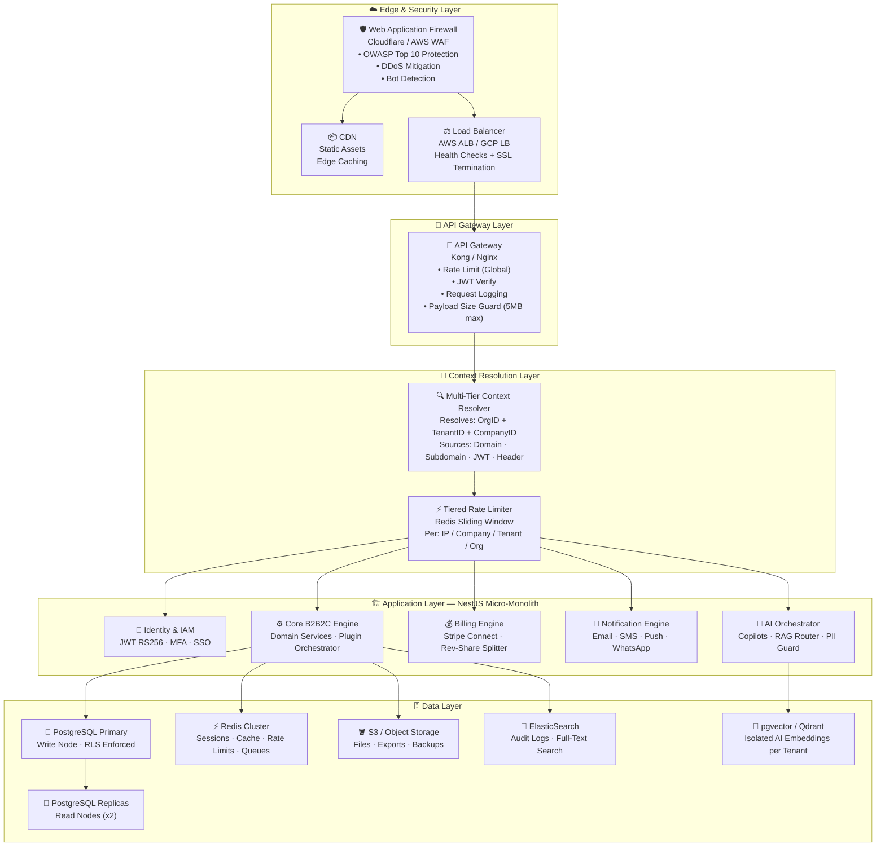
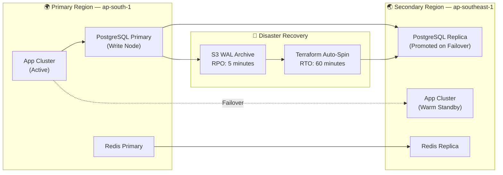
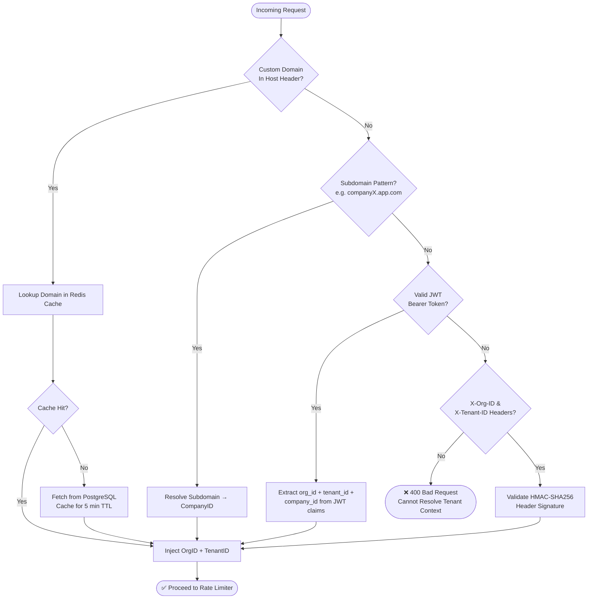
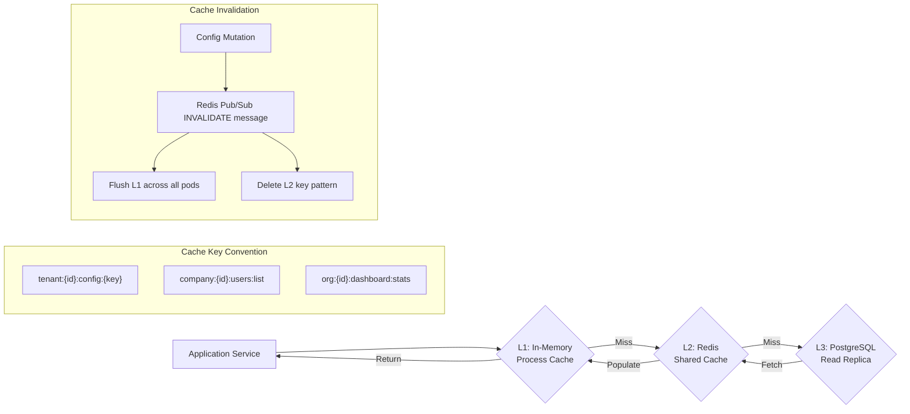

# 01 — High-Level Architecture

> **System topology reference** – shows every layer from edge security to data store, with caching strategy and disaster recovery posture.

---

## System Topology — Full Layer Diagram

---

## Theme & Branding Configuration Table

| Config File | Scope | Description |
|-------------|-------|-------------|
| `config/theme.json` | Global | Default color palette, typography, logo URLs (overridable per tier) |
| `config/uiOverrides.yaml` | Per‑Tier | Allows tenants or companies to replace component UI schemas |
| `config/featureFlags.yaml` | Global/Tier | Feature flag toggles controlling module activation |

All UI theming is consumed at runtime by a **Theme Service** that merges the hierarchy (SuperAdmin → Organisation → Tenant → Company). No hard‑coded colors remain in the codebase.

---

## Multi‑Region Deployment Topology

---

## Request Context Resolution — Decision Tree

---

## Multi‑Tier Caching Architecture

---

## Non‑Functional Requirements Summary

| Category | Requirement |
|----------|-------------|
| Availability | 99.99 % SLA (≤ 52 min downtime/year) |
| Throughput | 50 k req/s peak |
| Latency (P99) | < 200 ms for authenticated requests |
| DB Scale | 100 M+ rows/tenant with partitioning |
| Recovery | RPO 5 min · RTO 1 hr |

All knobs are exposed via `config/performance.yaml` for easy tuning.
