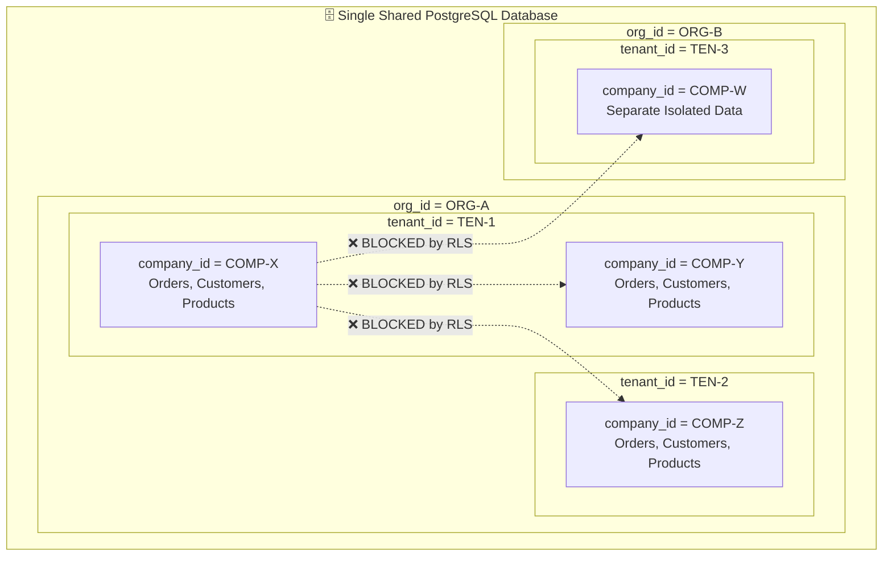
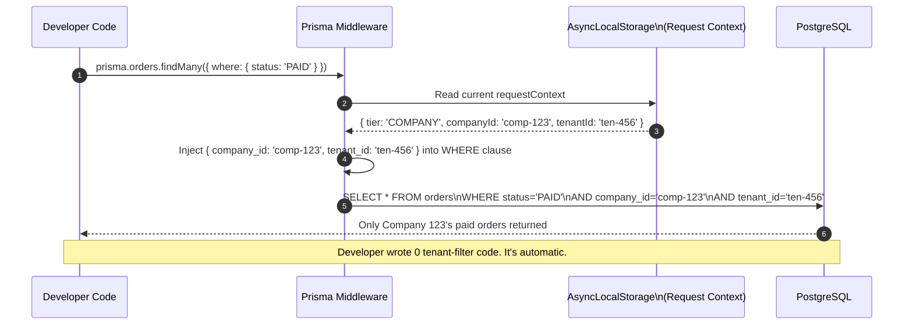
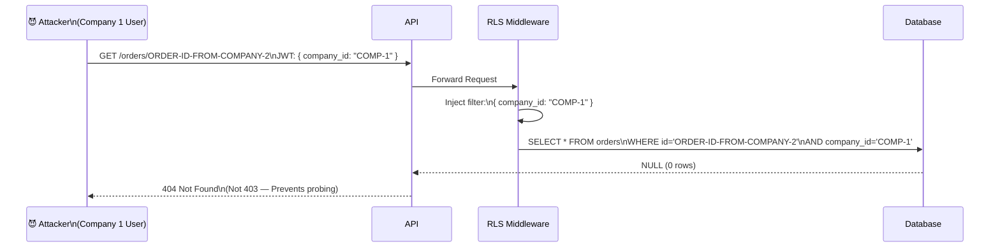
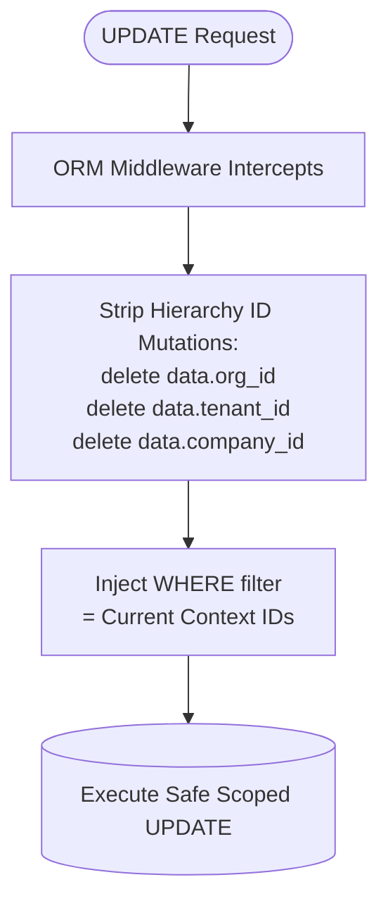
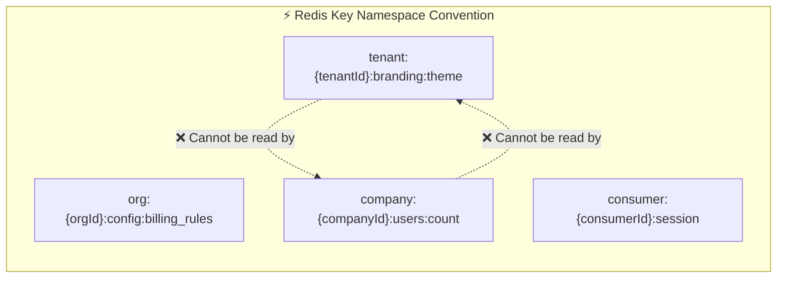

# 02 — Multi-Tier Tenancy Architecture

> **Data isolation is the most critical platform concern.** This document explains exactly how data from one tier never leaks to another, at every layer.

---

## The 5-Tier Data Isolation Model

---

## ORM Middleware Filtering Pipeline

Every database query is automatically intercepted and filtered. Developers cannot accidentally bypass tenant scope.

---

## IDOR Attack Prevention — Example

Indirect Object Reference (IDOR) is automatically neutralized by the middleware approach.

---

## Immutable Hierarchy ID Write Rules

Once a record is created with `org_id`, `tenant_id`, `company_id` — these values **cannot be updated**. The middleware strips any attempt.

---

## Multi-Tier Cache Namespace Isolation

**Key Rules:**
- Cache operations always read the `requestContext` from `AsyncLocalStorage` to determine the correct key prefix.
- A Company-tier service can ONLY create / read / delete keys prefixed with `company:{its_own_companyId}`.
