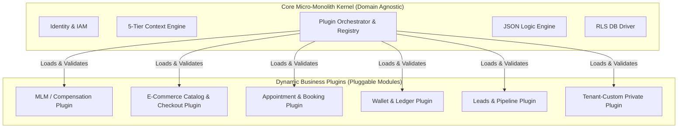

# Plugin & Extension Architecture (Universal Modular Core)

---

## Executive Summary

To make the platform 100% reusable across ANY industry (MLM, E-commerce, Booking, CRM, Fintech, Healthcare), the core application layer remains strictly domain-agnostic. All industry-specific features are implemented as **Dynamic Plugins**.

Plugins can be registered at runtime, hooked into request lifecycles, extend the database schema safely with dynamic fields, and listen to domain events.



---

## 1. Plugin Interface Contract

Every plugin must conform to the universal `IPlatformPlugin` interface:

```typescript
export interface IPlatformPlugin {
  id: string;                    // e.g., "plugin-ecommerce"
  version: string;               // e.g., "1.4.0"
  name: string;                  // e.g., "E-Commerce Core Module"
  tierScope: ('ORGANISATION' | 'TENANT' | 'COMPANY')[]; // Allowed tiers
  
  // Lifecycle Hooks
  onRegister(container: IContainer): Promise<void>;
  onEnable(context: ITenantContext): Promise<void>;
  onDisable(context: ITenantContext): Promise<void>;

  // Execution Hooks
  hooks?: {
    beforeExecute?: (hookName: string, context: IRequestContext) => Promise<void>;
    afterExecute?: (hookName: string, context: IRequestContext, result: any) => Promise<any>;
  };

  // Dynamic Schema Extensions
  schemaExtensions?: ISchemaExtension[];
}
```

---

## 2. Execution Hooks Pipeline

Plugins register hooks on predefined core system interception points:

| Hook Point | Trigger Timing | Use Case |
|---|---|---|
| `auth.onRegister` | When any user registers | Run custom fraud verification or background check |
| `order.beforeCreate` | Before an order is saved to DB | Validate inventory in external ERP or calculate dynamic tax |
| `order.afterCreate` | After an order is saved | Calculate commissions, trigger reward points, dispatch webhooks |
| `billing.onInvoice` | When an invoice is generated | Append custom regional tax line items |
| `user.onDelete` | When a user requests deletion | Trigger GDPR sanitization across plugin data stores |

```typescript
// Plugin Hook Registration Example
@Injectable()
export class CommissionPlugin implements IPlatformPlugin {
  id = 'plugin-mlm-commission';
  version = '2.0.0';
  name = 'MLM Commission Engine Plugin';
  tierScope = ['TENANT' as const];

  async onRegister(container: IContainer) {
    container.registerHook('order.afterCreate', async (context, order) => {
      // Calculate commissions without modifying the core Order module!
      await this.commissionService.processOrderCommissions(context, order);
    });
  }
}
```

---

## 3. Dynamic Field & Schema Extension Strategy

Plugins and Tenants can add custom fields to core entities (`Company`, `Customer`, `Order`, `Product`) without running PostgreSQL schema migrations, using an hybrid JSONB + Indexing pattern.

```json
{
  "entity": "Order",
  "company_id": "comp-123",
  "custom_fields": {
    "gift_wrap_notes": "Happy Birthday!",
    "vat_registration_number": "GB123456789",
    "delivery_time_window": "14:00-16:00"
  }
}
```

- **Validation:** Custom fields are validated against JSON Schema definitions configured per Tenant.
- **Queryability:** Frequently searched custom fields automatically receive PostgreSQL GIN indexes on `custom_fields`.
