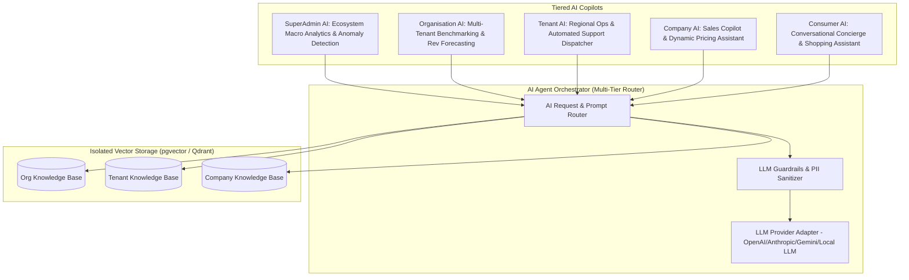

# AI Agent & Intelligence Architecture (Future-Safe AI-Native Platform)

---

## Executive Summary

The platform features an embedded, **Multi-Tier AI Agent Framework**. Rather than treating AI as an afterthought, AI capabilities (Copilots, Automated Insights, Fraud Detection, Customer Support Bots) are built natively into all 5 tiers with strict **Vector DB RAG Data Isolation**.



---

## 1. Multi-Tenant Vector RAG Isolation

To prevent data contamination between competing Tenants or Companies, Vector DB embeddings must enforce tenancy boundaries just like SQL data.

```sql
-- PostgreSQL + pgvector RLS implementation
CREATE TABLE document_embeddings (
    id UUID PRIMARY KEY DEFAULT gen_random_uuid(),
    org_id UUID NOT NULL REFERENCES organisations(id),
    tenant_id UUID NOT NULL REFERENCES tenants(id),
    company_id UUID NOT NULL REFERENCES companies(id),
    
    document_chunk TEXT NOT NULL,
    embedding vector(1536), -- OpenAI / Gemini vector dimensions
    
    metadata JSONB DEFAULT '{}'::jsonb,
    created_at TIMESTAMPTZ DEFAULT NOW()
);

-- Index for HNSW (Hierarchical Navigable Small World) similarity search
CREATE INDEX idx_embeddings_vector ON document_embeddings 
USING hnsw (embedding vector_cosine_ops);

-- RLS policy for tenant vector queries
ALTER TABLE document_embeddings ENABLE ROW LEVEL SECURITY;
CREATE POLICY vector_tenant_isolation ON document_embeddings
    FOR SELECT USING (tenant_id = current_setting('app.current_tenant_id')::uuid);
```

---

## 2. PII Sanitization & Guardrails Layer

Before any prompt is sent to an external LLM (e.g., OpenAI, Anthropic, Gemini), it passes through the **Guardrails & PII Sanitizer**:

1. **PII Masking:** Names, Credit Cards, SSNs, Emails, and Phone Numbers are stripped/masked locally via RegEx / SpaCy NER.
2. **Context Injection:** System injects the requesting user's active RBAC permissions into the prompt (e.g., "User is a Company Manager, do not answer queries about Tenant financials").
3. **Output Sanitization:** LLM response is checked against hallucination and injection policies before returning to the UI.

---

## 3. Tiered AI Agent Capabilities

| Tier | AI Agent Role | Key Capabilities |
|---|---|---|
| **SuperAdmin** | Infrastructure & Platform Copilot | Detects anomalous API traffic, predicts cloud cost spikes, automates tenant fraud bans. |
| **Organisation** | Macro-Business Analyst | Compares tenant performance benchmarks, forecasts quarterly consolidated revenue. |
| **Tenant** | Regional Operations Assistant | Auto-generates local marketing copy, drafts tenant support tickets, optimizes inventory allocation. |
| **Company** | B2B Sales & Ops Assistant | Automated customer follow-ups, dynamic pricing suggestions based on local market rules. |
| **Consumer** | Personal Assistant | Instant multi-lingual support, product recommendations, interactive order tracking. |
