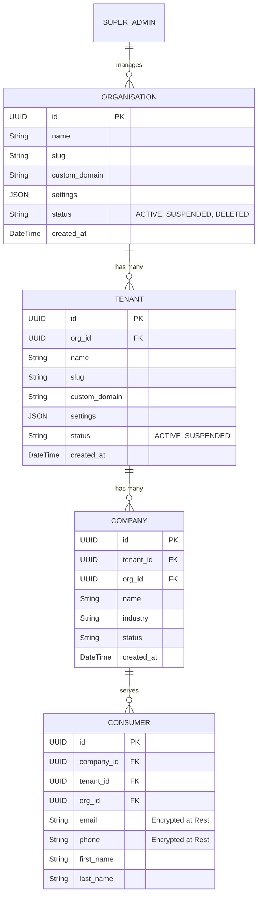
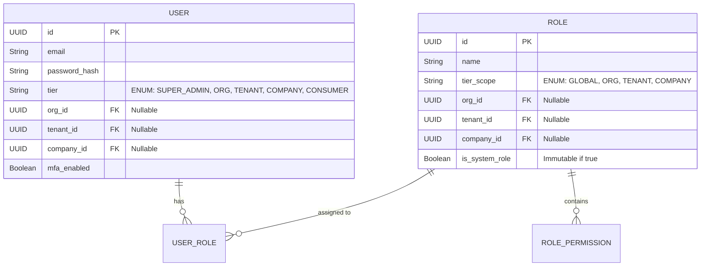

# Core Platform Schema (5-Tier)

---

## The Hierarchy ERD

This represents the foundational entity relationship diagram for the B2B2C multi-tier model. It tracks the structural backbone of the platform.

## Hierarchical User and RBAC Schema

Users are assigned to a specific level of the hierarchy, which dictates their maximum scope of access. The RBAC system is structurally isolated.

### Table Scoping Rules & Data Integrity

1. **Global Tables:** Tables with no relational IDs (e.g., `SuperAdmin`, `GlobalSettings`, `SubscriptionPlans`).
2. **Org-Scoped Tables:** Tables that belong to an Organisation but span its Tenants (e.g., `OrgBillingDetails`, `OrgBranding`).
3. **Tenant-Scoped Tables:** Tables that belong to a Tenant and span its Companies (e.g., `TenantPaymentGateways`, `TenantSupportTickets`).
4. **Company-Scoped Tables:** Tables that belong to a specific B2B Client (e.g., `CompanyProducts`, `CompanyStaff`).
5. **Operational Data Tables:** Must contain `org_id`, `tenant_id`, and `company_id` for reporting and RLS performance (e.g., `Orders`, `Transactions`).

### Advanced Database Concepts

- **Soft Deletes:** Deletions are never physical `DELETE` statements. We use a `deleted_at` timestamp. Prisma middleware automatically filters out `deleted_at IS NOT NULL` records.
- **Encryption at Rest:** All PII (Personally Identifiable Information) on the `Consumer` table (Emails, Phone numbers, Physical Addresses) is encrypted at rest using AES-256 before insertion and decrypted upon retrieval.
- **Audit Logging Table:** A separate `audit_logs` table (or ElasticSearch cluster) tracks every mutation:
  - `entity_type` (e.g., 'COMPANY')
  - `entity_id`
  - `action` (CREATE, UPDATE, DELETE)
  - `actor_id` (The User ID who performed it)
  - `actor_tier` 
  - `old_values` (JSONB)
  - `new_values` (JSONB)
