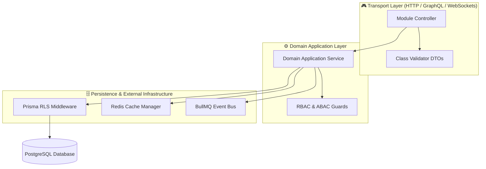

# NestJS Modular Backend Architecture Standards

---

## Executive Summary

The backend architecture follows a **NestJS Micro-Monolith Architecture** adhering strictly to **Domain-Driven Design (DDD)** and **Clean Architecture**. Business logic remains independent of transport layers and framework code.



---

## 1. NestJS Layer Responsibilities Matrix

| Layer | Component | Primary Responsibility | Allowed Dependencies | Forbidden Actions |
|---|---|---|---|---|
| **Transport** | `*.controller.ts` | Route handling, HTTP status codes, Swagger documentation | Services, DTOs | Direct DB queries, business rule execution |
| **Validation** | `*.dto.ts` | Input schema definition, class-validator rules | class-validator decorators | State mutation, external API calls |
| **Application** | `*.service.ts` | Core business logic, transaction orchestration | Prisma ORM, Redis, EventBus | Direct HTTP request/response manipulation |
| **Domain** | `*.entity.ts` | Domain model state, business invariants | Pure TypeScript | NestJS framework imports |
| **Infrastructure**| `*.middleware.ts` | Tenancy context resolution, audit logging | AsyncLocalStorage, Redis | Modifying domain business entities |

---

## 2. Directory & Module Folder Structure

Every module in `src/modules/<module-name>` must conform to this uniform directory layout:

```text
src/modules/wallet/
├── controllers/
│   └── wallet.controller.ts       # HTTP Route handlers & Swagger annotations
├── dto/
│   ├── create-wallet.dto.ts        # Validation DTOs (class-validator)
│   └── transfer-funds.dto.ts
├── entities/
│   └── wallet.entity.ts           # Domain Entity model
├── interfaces/
│   └── wallet-service.interface.ts# Service contract interface
├── services/
│   └── wallet.service.ts          # Core business logic implementation
├── wallet.module.ts               # NestJS Dependency Injection container
└── wallet.service.spec.ts         # Unit & Integration tests
```

---

## 3. Standardized Exception Error Code Table

| HTTP Code | Exception Class | Error Code String | Typical Trigger Scenario |
|---|---|---|---|
| `400` | `BadRequestException` | `INVALID_INPUT_PAYLOAD` | DTO validation fails or malformed JSON |
| `401` | `UnauthorizedException` | `UNAUTHENTICATED_ACCESS` | Missing, invalid, or expired JWT token |
| `403` | `ForbiddenException` | `INSUFFICIENT_PERMISSIONS` | Role lacks access or cross-tenant query blocked |
| `404` | `NotFoundException` | `RESOURCE_NOT_FOUND` | Requested entity ID does not exist in tenant scope |
| `409` | `ConflictException` | `DUPLICATE_RESOURCE` | Unique constraint violation (e.g. Email/Domain taken) |
| `422` | `UnprocessableEntityException` | `BUSINESS_RULE_VIOLATION` | Rule Engine rejects transaction (e.g. Insufficient balance) |
| `429` | `TooManyRequestsException` | `RATE_LIMIT_EXCEEDED` | Tenant or IP exceeds Redis sliding window quota |
| `500` | `InternalServerErrorException` | `INTERNAL_SYSTEM_ERROR` | Unhandled runtime exception (Sanitized envelope) |

---

## 4. Input DTO Validation Rules Table

| Decorator | Target Data Type | Purpose | Example Usage |
|---|---|---|---|
| `@IsUUID()` | String | Validates 36-char UUID format | `@IsUUID() companyId: string;` |
| `@IsEmail()` | String | Enforces valid email syntax | `@IsEmail() email: string;` |
| `@Min(val)` / `@Max(val)` | Number | Enforces numeric boundaries | `@Min(0.01) totalAmount: number;` |
| `@IsEnum(Enum)` | Enum | Restricts string to allowed enum values | `@IsEnum(OrderStatus) status: OrderStatus;` |
| `@ValidateNested()` | Object / Array | Recursively validates nested DTO objects | `@ValidateNested() items: OrderItemDto[];` |
