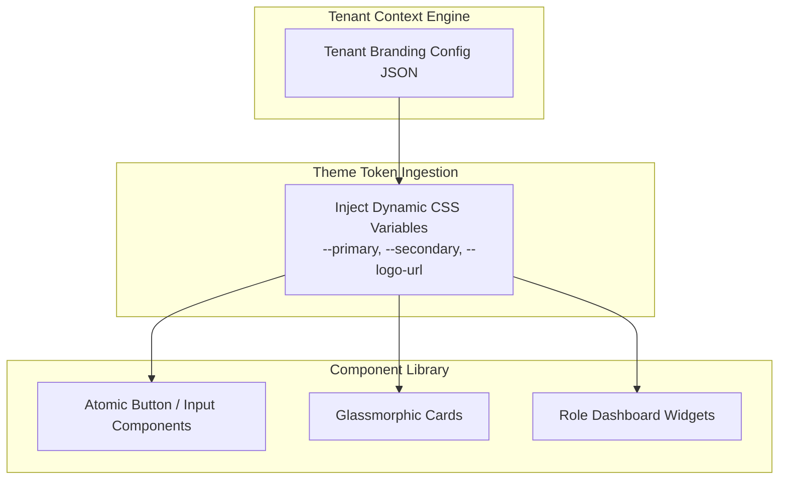

# Frontend Design System & Dynamic Theme Architecture

---

## Executive Summary

The frontend UI is built using Next.js, React, Tailwind CSS, and Framer Motion. To deliver a **luxurious, state-of-the-art visual experience**, all UI components utilize glassmorphism, dynamic gradients, CSS design tokens, and multi-tenant white-label theme overrides.

---

## 1. Dynamic Design Token Specification Table

| Token Variable | Default Value | Usage Scope | Overridable Level |
|---|---|---|---|
| `--color-primary` | `#7c3aed` (Purple) | Primary Buttons, Active States, Nav Highlights | Tenant / Company |
| `--color-secondary` | `#0369a1` (Sky Blue) | Secondary Badges, Charts, Accent Lines | Tenant / Company |
| `--color-bg-dark` | `#0f172a` (Slate 900) | App Background Container | Organisation / Tenant |
| `--color-surface` | `rgba(30, 41, 59, 0.7)` | Glassmorphic Card Surface | Tenant / Company |
| `--color-border` | `rgba(255, 255, 255, 0.1)` | Glass Card Border | Tenant |
| `--font-family` | `'Inter', sans-serif` | Global Typography | Tenant / Company |
| `--logo-url` | `/assets/default-logo.svg` | Header Navigation & Login Screen | Tenant / Company |

---

## 2. Multi-Tenant Branding Override Cascade Table

| Tier Level | Override Priority | Config Source | Applied Fallback Behavior |
|---|---|---|---|
| **Tier 0 (SuperAdmin)** | Priority 4 (Default) | System Default Theme | Root baseline if no lower-level overrides exist |
| **Tier 1 (Organisation)**| Priority 3 | `Organisation.config.branding` | Overrides SuperAdmin defaults for entire franchise group |
| **Tier 2 (Tenant)** | Priority 2 | `Tenant.config.branding` | Overrides Organisation theme for regional division |
| **Tier 3 (Company)** | Priority 1 (Highest) | `Company.config.branding` | Final override for end-user consumer portals |

---

## 3. Dashboard Widget Layout Matrix Table

| Widget Component | Data Source API | Minimum Plan | Supported Roles | Default Grid Size |
|---|---|---|---|---|
| `RevenueOverviewWidget` | `GET /api/v1/analytics/revenue` | Starter | SuperAdmin, Org, Tenant | 2x2 (Large) |
| `MemberTreeWidget` | `GET /api/v1/genealogy/tree` | Starter | All Roles | 3x2 (Full Width) |
| `CommissionPayoutWidget`| `GET /api/v1/commissions/summary`| Growth | Org, Tenant, Company | 2x1 (Medium) |
| `RealtimeWebhooksWidget` | `GET /api/v1/webhooks/health` | Enterprise | SuperAdmin, Tenant Admin | 1x1 (Small) |
| `AICopilotInsightsWidget`| `GET /api/v1/ai/insights` | Growth | All Admin Roles | 2x1 (Medium) |

---

## 4. Glassmorphism Design System Guidelines

- **No Hardcoded Hex Colors:** Components must use CSS variable classes (e.g. `bg-[var(--color-primary)]` or `text-primary`).
- **Glassmorphism Spec:** Surfaces use `backdrop-blur-md bg-white/10 border border-white/20 shadow-xl`.
- **Micro-Animations:** Interactive elements must feature Framer Motion hover/tap spring animations (`whileHover={{ scale: 1.02 }}`).
- **Zero Empty Placeholders:** All demo media is created via image generation tools or SVG tokens.
