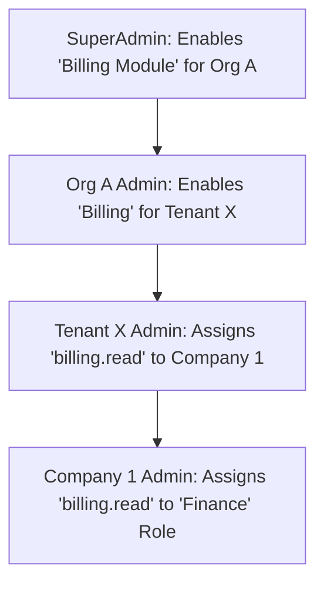

# RBAC & ABAC (Multi-Tier Security)

---

## Cascading Role-Based Access Control

RBAC in a 5-tier system is exceptionally complex because permissions flow downward but boundaries are strictly enforced upward. A naive implementation will result in privilege escalation.

### Role Scopes & Strict Boundaries

Roles are defined at different scopes and are **hard-bounded** by the database to prevent lateral or upward assignment.
1. **Global Roles:** Defined by Super Admin. (e.g., `Platform_Auditor`). Cannot be edited by anyone else.
2. **Org-Scoped Roles:** Created by an Organisation Admin. Only assignable to users whose `org_id` matches.
3. **Tenant-Scoped Roles:** Created by a Tenant Admin. Only assignable to users whose `tenant_id` matches.
4. **Company-Scoped Roles:** Created by a Company Admin for their own staff. Only assignable to users whose `company_id` matches.

### Permission Inheritance & Feature Toggles

Permissions operate on an intersection basis. A user cannot exercise a permission if the layer above them has disabled that feature.



If the SuperAdmin toggles the Billing Module OFF for Org A, all downward access is immediately severed, regardless of the roles assigned at the Company level.

### Advanced Attribute-Based Access Control (ABAC)

Beyond standard RBAC (`resource:action`), the system implements ABAC for fine-grained control:
- **Condition-based Access:** "A Company Manager can view reports *only if* the time is between 9 AM and 5 PM."
- **Resource Ownership:** "A Tenant Support Agent can view a Company's support ticket *only if* the ticket is assigned to their specific department."

### Evaluation Logic (Fail-Closed Architecture)

```typescript
// Example Advanced RBAC Evaluation
function canUserAccess(userContext, resourceContext, requiredPermission) {
   // 0. Fail-Closed Default
   let isAllowed = false;

   // 1. Boundary Enforcement: Ensure user's tier is high enough or matches resource
   if (!isTierAuthorized(userContext, resourceContext)) {
       throw new ForbiddenException('Cross-tier boundary violation attempt.');
   }

   // 2. Feature Toggle Check (Is the module even active for this tenant?)
   if (!isFeatureActiveForHierarchy(userContext, requiredPermission.module)) {
       return false;
   }

   // 3. Check if user's direct roles grant the permission
   isAllowed = evaluateRoles(userContext.roles, requiredPermission);

   // 4. Evaluate ABAC conditions if true
   if (isAllowed) {
       isAllowed = evaluateConditions(userContext, resourceContext);
   }

   return isAllowed;
}
```
