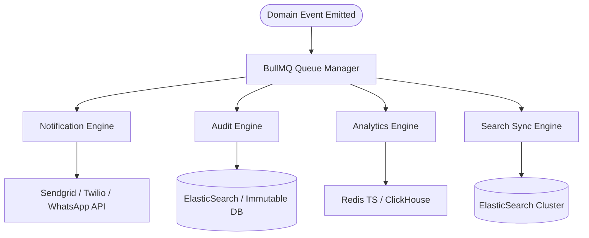

# Core Platform Engines Blueprint Specification

---

## Executive Summary

The platform features 4 primary infrastructure engines to handle asynchronous background workloads:

1. **Multi-Channel Notification Engine:** (Email, SMS, Push, WhatsApp)
2. **Compliance Audit Engine:** (Immutable append-only log recorder)
3. **Analytics & Aggregation Engine:** (Real-time metric calculation)
4. **Search Engine:** (ElasticSearch / PostgreSQL Full-Text Search)

---

## 1. Engine Capabilities & Infrastructure Comparison Table

| Platform Engine | Tech Stack / Driver | Primary Queue Name | Backup / Fallback Policy | Retention Period |
|---|---|---|---|---|
| **Notification Engine** | BullMQ + Sendgrid / Twilio / Meta Graph | `queue:notifications` | Secondary provider failover after 2 retries | 30 Days (Delivery status) |
| **Compliance Audit Engine** | BullMQ + PostgreSQL / ElasticSearch | `queue:audit-logs` | Local file append buffer on DB drop | 7 Years (SOC2 Compliance) |
| **Analytics Engine** | BullMQ + Redis TimeSeries / ClickHouse | `queue:analytics` | Redis memory buffer | 2 Years (Aggregated metrics) |
| **Search Sync Engine** | BullMQ + ElasticSearch / PostgreSQL GIN | `queue:search-sync` | Full DB re-index trigger on failure | Live sync |

---

## 2. Notification Provider Adapter Matrix Table

| Channel Type | Primary Provider Adapter | Fallback Adapter | Supported Media Payload | Throttle Rate Limit |
|---|---|---|---|---|
| **Email** | `SendgridNotificationAdapter` | `AWS SES` | HTML Handlebars + Attachments | 100 emails / sec |
| **SMS** | `TwilioSmsAdapter` | `AWS SNS` | Plain text + Shortlinks | 50 SMS / sec |
| **WhatsApp** | `MetaWhatsAppAdapter` | `Twilio WhatsApp` | Interactive Templates + Buttons | 20 msgs / sec |
| **Push** | `FirebaseFcmAdapter` | `Apple APNS Direct` | JSON Push Notification | 500 pushes / sec |

---

## 3. Compliance Audit Log Data Field Table

| Audit Column Name | Data Type | Requirement | Description | Example Value |
|---|---|---|---|---|
| `id` | UUID v4 | Primary Key | Unique Audit Record Identifier | `a1b2c3d4-...` |
| `tenant_id` | UUID v4 | Mandatory | Tenancy Scoping Identifier | `8c0b3d4e-...` |
| `actor_id` | UUID v4 | Mandatory | ID of User or Service triggering action | `usr_778899` |
| `actor_role` | String | Mandatory | Role of actor at execution time | `TENANT_ADMIN` |
| `action_name` | String | Mandatory | Standardized event string | `user.role_assigned` |
| `before_state` | JSONB | Optional | Snapshot of record before mutation | `{"role": "MEMBER"}` |
| `after_state` | JSONB | Mandatory | Snapshot of record after mutation | `{"role": "MANAGER"}` |
| `ip_address` | INET | Mandatory | Client IP Address | `192.168.1.10` |
| `hash_chain` | VARCHAR(64) | Mandatory | SHA-256 hash of previous row + current row | `9f8a7b6c...` |
