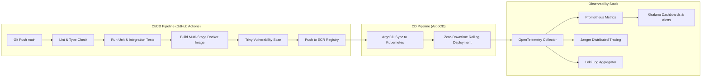

# DevOps, CI/CD Pipeline & Observability Specification

---

## Executive Summary

The platform uses Docker containerization, Kubernetes (EKS / GKE) orchestration, GitHub Actions CI/CD pipelines, and an **OpenTelemetry + Prometheus + Grafana** observability stack.

---

## 1. CI/CD Pipeline Stages Matrix Table

| Pipeline Stage | Tooling Used | Execution Trigger | Failure Condition | Target Duration |
|---|---|---|---|---|
| **Lint & Type Check** | `ESLint` + `tsc --noEmit` | Every Pull Request / Commit | Any syntax or TypeScript type error | < 2 Minutes |
| **Unit & Integration Test**| `Jest` + `Supertest` | Every Pull Request | Any failed assertion or coverage < 80% | < 4 Minutes |
| **Container Build** | `Docker` (Multi-stage) | PR Merge to `main` | Build error or image size > 500MB | < 5 Minutes |
| **Security Vulnerability** | `Trivy` + `Snyk` | Post-Docker Build | Any High or Critical CVE found | < 2 Minutes |
| **Kubernetes Sync** | `ArgoCD` | Git Tag / Release trigger | Health check probe failure | < 3 Minutes |

---

## 2. Observability & Alerting Threshold Matrix Table

| Service Metric | Monitoring Tool | Warning Threshold | Critical Alert Threshold | Action Triggered |
|---|---|---|---|---|
| **API HTTP 5xx Error Rate** | Prometheus / Grafana | > 1.0% over 5 mins | > 5.0% over 2 mins | PagerDuty alert + Auto-rollback |
| **API Latency (P99)** | OpenTelemetry | > 300ms over 5 mins | > 1000ms over 2 mins | Scale out pod replicas |
| **Database CPU Utilization**| AWS CloudWatch | > 70% over 10 mins | > 90% over 5 mins | Failover to Read Replica |
| **Redis Cache Memory** | Redis Exporter | > 80% max memory | > 95% max memory | Trigger memory eviction |
| **Worker Queue Depth** | BullMQ Exporter | > 1,000 pending jobs | > 10,000 pending jobs | Autoscale worker pods |

---

## 3. Disaster Recovery & Backup Metrics Table

| Metric / Procedure | Target Metric | Storage Location | Automated Verification Mechanism |
|---|---|---|---|
| **RPO (Recovery Point Objective)** | 5 Minutes | S3 WAL Logs Bucket | Continuous PostgreSQL WAL Archiving |
| **RTO (Recovery Time Objective)** | 60 Minutes | EKS Multi-AZ Cluster | Automated Terraform Infrastructure Spin-up |
| **Incremental Database Backup**| Hourly | AWS S3 Bucket (Immutable) | Automated AWS Backup Job Verification |
| **Full Database Backup** | Daily | S3 Glacier Deep Archive | Retained for 7 Years (Compliance) |
| **DR Dry-Run Drill** | Monthly | Staging Environment | Automated CI restore testing script |
