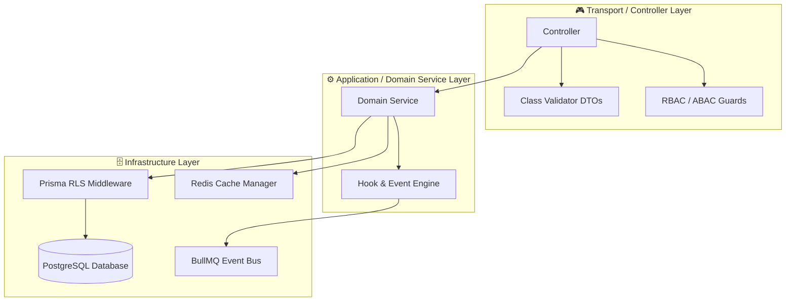

# Enterprise Coding Standards & Architecture Rules

---

## Executive Summary

These directives govern all software engineering practices and code written across the **OrbitoX Business OS** platform. They ensure enterprise code quality, multi-tenant isolation, architectural consistency, high performance, and long-term maintainability across both human engineers and AI coding assistants.

OrbitoX is designed as a modular, white-label, multi-tenant Business Operating System. Every module must be built assuming future seamless interoperability with broader enterprise suites including **CRM, ERP, HRMS, Payroll, and E-commerce** modules without tight coupling to specific domain implementations.

---

## 1. Core AI Directives & Architecture Rules

| Golden Directive | Required Pattern | Forbidden Anti-Pattern (Violation) | Enforcement Mechanism |
|---|---|---|---|
| **1. No Hardcoded Logic** | Store rates, commission matrices, limits & fees in DB or JSON configuration. | `if (rank === 'Gold') return 100;` ❌ | ESLint rule + Automated CI Code Review |
| **2. Multi-Tenancy Isolation** | Every database query must explicitly filter by `tenant_id`, `company_id`, or `org_id`. | `prisma.order.findMany()` without tenant filter ❌ | Prisma RLS Middleware & Tenant Guard |
| **3. Clean Architecture & DDD** | Decouple business logic into pure Domain Services. | Writing raw SQL or business logic inside HTTP Controllers ❌ | Strict Layering & Dependency Injection |
| **4. Validated DTO Inputs** | Decorate all incoming DTO properties with `class-validator` & `class-transformer`. | Accepting raw `any` or unvalidated JSON request body ❌ | NestJS Global `ValidationPipe` |
| **5. Standardized Error Handling** | Throw standard NestJS HTTP exception classes (`BadRequestException`, `ForbiddenException`). | Returning raw strings or unhandled 500 stack traces ❌ | NestJS Global `ExceptionFilter` |
| **6. Extension Points over Monoliths** | Use event emitters, hooks (`usage.pre`, `usage.post`), and plugin architecture. | Hardcoding direct cross-module side effects ❌ | BullMQ Event Bus & Hook Registry |
| **7. API Signature & Spec Verification** | Look up exact API definitions and library method signatures before consuming. | Guessing parameter orders, property keys, or API signatures ❌ | TypeScript Compiler (`tsc --noEmit`) |
| **8. Performance & Anti-N+1** | Batch database queries, use `include`/`select` joins, and leverage Redis L2 caching. | Running database queries inside `for` loops ❌ | Prisma Query Logging & Redis Cache Guard |

---

## 2. Universal Naming Conventions Matrix

| Element Type | Naming Format | Case Style | Good Example | Bad Example (Violation) |
|---|---|---|---|---|
| **Database Tables** | Plural Noun | `snake_case` | `tenant_subscriptions`, `user_wallets` | `TenantSubscription`, `sub_table` |
| **Database Columns** | Singular Noun | `snake_case` | `company_id`, `created_at` | `CompanyID`, `createdAt`, `c_id` |
| **TypeScript Classes** | Singular Noun | `PascalCase` | `WalletService`, `OrderController` | `walletService`, `wallet_service` |
| **TypeScript Files** | Described Resource | `kebab-case` | `wallet-service.ts`, `auth-guard.ts` | `WalletService.ts`, `wallet_service.ts` |
| **React Components** | Component Name | `PascalCase` | `FeatureGate.tsx`, `PaywallCard.tsx` | `featureGate.tsx`, `paywall-card.tsx` |
| **API Endpoints** | Resource (Plural) | `kebab-case` | `POST /api/v1/feature-trials` | `POST /api/v1/getFeatureTrials` |
| **Environment Vars** | Configuration Key | `UPPER_SNAKE_CASE` | `DATABASE_URL`, `REDIS_CACHE_TTL` | `databaseUrl`, `DbUrl`, `redis_ttl` |
| **DTO Classes** | Intent + Resource | `PascalCase` | `CreateOrderDto`, `UpdateTenantConfigDto` | `orderDto`, `CreateOrder` |
| **Interfaces / Types** | Descriptive Entity | `PascalCase` | `ITenantContext`, `ICommissionRule` | `tenantContext`, `i_tenant` |
| **Event Names** | Subject.Action | `dot.notation` | `order.completed`, `user.registered` | `ORDER_COMPLETED`, `OrderDone` |

---

## 3. Layered Architecture Directives

### Layer Rules
1. **Controllers (`*.controller.ts`)**: Pure HTTP routing, status code selection, and OpenAPI/Swagger documentation. Controllers **must not** contain database calls or complex business rules.
2. **Services (`*.service.ts`)**: Pure business logic execution. Inject dependencies via NestJS constructor injection. Return typed domain entities or interfaces.
3. **DTOs (`*.dto.ts`)**: Strict input validation using `class-validator` annotations (`@IsString()`, `@IsUUID()`, `@IsOptional()`). Every field must have an `@ApiProperty()` decorator for Swagger generation.
4. **Guards (`*.guard.ts`)**: Enforce authentication, organization context resolution, RBAC roles, and ABAC permission conditions.

---

## 4. Frontend & Design System Standards

1. **Luxurious & Premium UX**: All user interfaces must present modern visual design including dynamic dark modes, glassmorphism (`backdrop-blur`), subtle gradients, and fluid micro-animations.
2. **Zero Hardcoded Colors**: UI components must consume dynamic white-label theme configuration from the theme context (`theme.json` / `useTheme()`). Direct hex colors (e.g. `#1a202c`) inside component templates are strictly prohibited.
3. **Atomic Reusability**: Components must be structured into atomic, reusable units (Buttons, Inputs, Modals, StatCards, Paywalls) placed within `@/components/ui`.
4. **No Placeholders**: Mock data and interfaces must use rich, realistic default structures or generated visuals instead of empty boxes or `Lorem Ipsum`.

---

## 5. Code Review & Quality Checklist

### Automated Verification Rules
- [ ] **Linting & Formatting**: `npm run lint` yields 0 errors and 0 warnings.
- [ ] **Type Safety**: `npx tsc --noEmit` completes with 0 type errors. The use of `any` casting is strictly forbidden.
- [ ] **Multi-Tenant Isolation**: All Prisma and SQL queries include explicit `tenant_id` context filters.
- [ ] **Unit Test Coverage**: `npm run test` achieves $\ge 80\%$ test coverage across all domain services.
- [ ] **OpenAPI Documentation**: Every public endpoint and DTO property includes complete Swagger annotations.

---

## 6. Pre-Commit Checklist (Before Marking Tasks Complete)

- [ ] **Tenant Safety Audit**: Verified no missing `tenant_id` or `company_id` filters in database operations.
- [ ] **Error Handling Audit**: Replaced raw string exceptions with standard NestJS HTTP Exception classes (`BadRequestException`, `NotFoundException`, `ForbiddenException`).
- [ ] **Config Audit**: Replaced all hardcoded business numbers/strings with database settings or configuration tokens.
- [ ] **Theme Audit**: Verified UI components adapt dynamically to white-label branding variables.
- [ ] **Log & Traceback Audit**: Confirmed zero silent `try/catch` swallow blocks or unhandled promise rejections.
