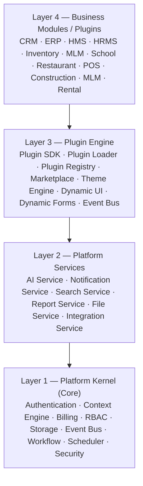

# Part 02 — Platform OS Model
### *OrbitoX as an Operating System for SaaS*

---

## The OS Metaphor — Why It Matters

When you install Microsoft Word, you do not install a networking stack.
You do not install a graphics driver.
You do not install a filesystem.

Word relies on Windows for all of that. Word only worries about documents.

OrbitoX applies the same model to SaaS:

```
Windows OS          →  OrbitoX Platform Kernel
Microsoft Word      →  CRM Plugin
Microsoft Excel     →  Inventory Plugin
Task Manager        →  OrbitoX Admin Dashboard
Windows Registry    →  Context Configuration Store
Windows Store       →  OrbitoX Plugin Marketplace
DLL / COM Objects   →  Shared Platform Services
Device Drivers      →  Capability Adapters (Stripe, Twilio, OpenAI...)
```

The kernel handles the hard, repetitive, infrastructure-level concerns.
The plugins (applications) handle the domain-specific business logic.

---

## The Four Platform Layers



### Layer 1 — Platform Kernel

The kernel is **never modified by plugin developers**.
It is the foundation everything else runs on.

| Service | Responsibility |
|---------|----------------|
| **Authentication** | JWT RS256, MFA, SSO, OAuth2, API Keys |
| **Context Engine** | Universal context graph (replaces fixed tenant tiers) |
| **RBAC** | Role definitions, permission checks, cascading inheritance |
| **Billing** | Subscription management, payment, revenue share |
| **Storage** | S3-compatible object storage, CDN, file lifecycle |
| **Event Bus** | Async message broker (BullMQ / Kafka) |
| **Workflow** | No-code automation engine |
| **Scheduler** | Cron job management, distributed locks |
| **Security** | Encryption, secrets, audit trail, zero-trust |

**Rule:** The kernel knows nothing about CRM, hospitals, schools, or restaurants.

---

### Layer 2 — Platform Services

Shared services that any plugin can consume via internal API or SDK.

| Service | Responsibility |
|---------|----------------|
| **AI Service** | LLM routing, RAG, embeddings, prompt library, AI memory |
| **Notification Service** | Email, SMS, WhatsApp, Push — channel-agnostic |
| **Search Service** | Full-text search, semantic search, faceted search |
| **Report Service** | Report builder, export engine (PDF, CSV, Excel) |
| **File Service** | Upload, transformation, virus scan, CDN delivery |
| **Integration Service** | Third-party connectors (Stripe, Twilio, SendGrid...) |

**Rule:** Platform Services are reused by all plugins. A CRM plugin uses the same Notification Service as a School plugin.

---

### Layer 3 — Plugin Engine

The runtime infrastructure that discovers, loads, validates, and manages plugins.

| Component | Responsibility |
|-----------|----------------|
| **Plugin SDK** | TypeScript SDK for building plugins |
| **Plugin Loader** | Discovers and loads plugins at startup |
| **Plugin Registry** | Tracks installed plugins, versions, dependencies |
| **Marketplace** | Browse, install, upgrade, rollback plugins |
| **Theme Engine** | Per-context branding and layout configuration |
| **Dynamic UI** | Form, table, menu, widget, and page rendering from metadata |
| **Event Bus** | Plugin-level event subscriptions and emissions |

---

### Layer 4 — Business Modules (Plugins)

The only layer plugin developers touch. Each plugin is a complete, independently deployable package.

```
@orbitox/crm
@orbitox/inventory
@orbitox/hms
@orbitox/hrms
@orbitox/payroll
@orbitox/school
@orbitox/restaurant
@orbitox/mlm
@orbitox/pos
@orbitox/construction
@orbitox/rental
@orbitox/real-estate
```

**Rule:** Plugins may not import from other plugins directly. They communicate through the Event Bus or platform APIs.

---

## TurboRepo Structure: The Full Monorepo

```
orbitox/                             # TurboRepo root
│
├── turbo.json                       # Pipeline definitions
├── package.json                     # Root workspace
├── pnpm-workspace.yaml              # pnpm workspaces
├── .env.example                     # Environment variable template
│
├── apps/
│   ├── web/                         # Next.js 15 frontend (App Router)
│   │   ├── app/                     # App Router pages
│   │   ├── components/              # App-level components
│   │   └── package.json
│   │
│   ├── api-gateway/                 # API Gateway (NestJS or Kong config)
│   │   ├── src/
│   │   │   ├── middleware/          # Auth, rate-limit, context-resolution
│   │   │   ├── proxy/               # Service proxy routing
│   │   │   └── main.ts
│   │   └── package.json
│   │
│   └── docs/                        # Documentation site (Nextra / Mintlify)
│       └── package.json
│
├── packages/
│   │
│   ├── core/                        # LAYER 1 — Platform Kernel
│   │   ├── src/
│   │   │   ├── auth/                # JWT, MFA, OAuth, SSO
│   │   │   ├── context/             # Universal Context Engine
│   │   │   ├── rbac/                # Roles, permissions, guards
│   │   │   ├── billing/             # Subscriptions, payments
│   │   │   ├── storage/             # S3 abstraction
│   │   │   ├── events/              # Event bus interface
│   │   │   ├── workflow/            # Workflow engine
│   │   │   ├── scheduler/           # Cron, distributed locks
│   │   │   └── security/            # Encryption, secrets
│   │   └── package.json
│   │
│   ├── services/                    # LAYER 2 — Platform Services
│   │   ├── src/
│   │   │   ├── ai/                  # AI gateway, LLM router, RAG
│   │   │   ├── notifications/       # Multi-channel notification
│   │   │   ├── search/              # Elasticsearch / Typesense
│   │   │   ├── reports/             # Report builder + export
│   │   │   ├── files/               # File management
│   │   │   └── integrations/        # Third-party connectors
│   │   └── package.json
│   │
│   ├── plugin-engine/               # LAYER 3 — Plugin Engine
│   │   ├── src/
│   │   │   ├── loader/              # Plugin discovery + loading
│   │   │   ├── registry/            # Plugin registry
│   │   │   ├── sdk/                 # Plugin builder SDK
│   │   │   ├── marketplace/         # Install, upgrade, rollback
│   │   │   ├── theme/               # Theme engine
│   │   │   └── dynamic-ui/          # Form, table, menu rendering
│   │   └── package.json
│   │
│   ├── ui/                          # Shared Design System
│   │   ├── src/
│   │   │   ├── components/          # Button, Input, Modal, Table...
│   │   │   ├── layouts/             # Shell, Sidebar, Dashboard...
│   │   │   ├── tokens/              # Design tokens (colors, spacing)
│   │   │   └── icons/               # Icon library
│   │   └── package.json
│   │
│   ├── types/                       # Shared TypeScript types
│   │   ├── src/
│   │   │   ├── context.types.ts
│   │   │   ├── plugin.types.ts
│   │   │   ├── event.types.ts
│   │   │   └── api.types.ts
│   │   └── package.json
│   │
│   ├── utils/                       # Shared utilities
│   │   ├── src/
│   │   │   ├── crypto.ts
│   │   │   ├── pagination.ts
│   │   │   ├── validation.ts
│   │   │   └── date.ts
│   │   └── package.json
│   │
│   └── config/                      # Shared tooling configurations
│       ├── eslint/
│       ├── tsconfig/
│       ├── jest/
│       └── prettier/
│
├── plugins/                         # LAYER 4 — Business Plugins
│   ├── crm/
│   │   ├── manifest.json
│   │   ├── backend/
│   │   ├── frontend/
│   │   ├── database/
│   │   ├── events/
│   │   ├── permissions/
│   │   ├── workflows/
│   │   ├── translations/
│   │   ├── docs/
│   │   ├── tests/
│   │   └── package.json
│   │
│   ├── inventory/                   # Same structure
│   ├── hms/                         # Same structure
│   ├── hrms/                        # Same structure
│   ├── payroll/                     # Same structure
│   ├── school/                      # Same structure
│   ├── restaurant/                  # Same structure
│   ├── mlm/                         # Same structure
│   └── pos/                         # Same structure
│
├── infra/
│   ├── k8s/
│   │   ├── base/                    # Base manifests
│   │   ├── overlays/
│   │   │   ├── development/
│   │   │   ├── staging/
│   │   │   └── production/
│   │   └── helm/                    # Helm charts
│   │
│   ├── terraform/
│   │   ├── modules/
│   │   │   ├── eks/                 # AWS EKS cluster
│   │   │   ├── rds/                 # PostgreSQL RDS
│   │   │   ├── elasticache/         # Redis
│   │   │   ├── s3/                  # Object storage
│   │   │   └── vpc/                 # Networking
│   │   └── environments/
│   │       ├── dev/
│   │       ├── staging/
│   │       └── prod/
│   │
│   ├── docker/
│   │   ├── core.Dockerfile
│   │   ├── services.Dockerfile
│   │   ├── web.Dockerfile
│   │   └── docker-compose.yml      # Local development
│   │
│   └── observability/
│       ├── prometheus/
│       ├── grafana/
│       ├── loki/
│       ├── tempo/
│       └── opentelemetry/
│
└── tools/
    ├── cli/                         # orbitox CLI (Part 20)
    │   ├── src/
    │   │   ├── commands/
    │   │   │   ├── new.ts           # orbitox new <project>
    │   │   │   ├── create.ts        # orbitox create <plugin>
    │   │   │   ├── install.ts       # orbitox install <plugin>
    │   │   │   ├── publish.ts       # orbitox publish
    │   │   │   ├── migrate.ts       # orbitox migrate
    │   │   │   └── doctor.ts        # orbitox doctor
    │   │   └── index.ts
    │   └── package.json
    │
    └── codegen/                     # Code generators
        ├── plugin-template/         # Plugin scaffolding template
        ├── entity-generator/        # Entity from metadata
        └── api-generator/           # API from schema
```

---

## turbo.json — Pipeline Configuration

```json
{
  "$schema": "https://turbo.build/schema.json",
  "pipeline": {
    "build": {
      "dependsOn": ["^build"],
      "outputs": ["dist/**", ".next/**"]
    },
    "test": {
      "dependsOn": ["^build"],
      "outputs": ["coverage/**"]
    },
    "lint": {
      "outputs": []
    },
    "dev": {
      "cache": false,
      "persistent": true
    },
    "migrate": {
      "dependsOn": ["^build"],
      "outputs": []
    },
    "type-check": {
      "outputs": []
    }
  }
}
```

---

## pnpm-workspace.yaml

```yaml
packages:
  - "apps/*"
  - "packages/*"
  - "plugins/*"
  - "tools/*"
```

---

## Package Dependency Rules

```
plugins/*         → can import from packages/core, packages/services, packages/plugin-engine, packages/ui, packages/types, packages/utils
packages/services → can import from packages/core, packages/types, packages/utils
packages/plugin-engine → can import from packages/core, packages/types, packages/utils
packages/core     → can import from packages/types, packages/utils ONLY
apps/*            → can import from any package
plugins/*         → MUST NOT import from other plugins directly
packages/core     → MUST NOT import from packages/services or plugin-engine
```

---

## What Happens at Platform Startup

```
1. TurboRepo builds all packages in dependency order
2. Platform Kernel initializes:
   - Connect to PostgreSQL (primary + replicas)
   - Connect to Redis cluster
   - Initialize Event Bus
   - Load Context Engine
   - Initialize RBAC
3. Plugin Engine scans plugins/ directory
4. For each plugin found:
   a. Read manifest.json
   b. Validate plugin contract
   c. Check dependencies
   d. Run pending database migrations
   e. Register API routes
   f. Register permissions
   g. Register menu items
   h. Register dashboard widgets
   i. Register event subscriptions
   j. Register cron jobs
   k. Mark plugin as ACTIVE
5. API Gateway starts routing traffic
6. Frontend loads plugin-registered pages and menus
7. Platform is READY
```

---

*Next: [Part 03 — Core Engineering Principles](./03_Core_Engineering_Principles.md)*
