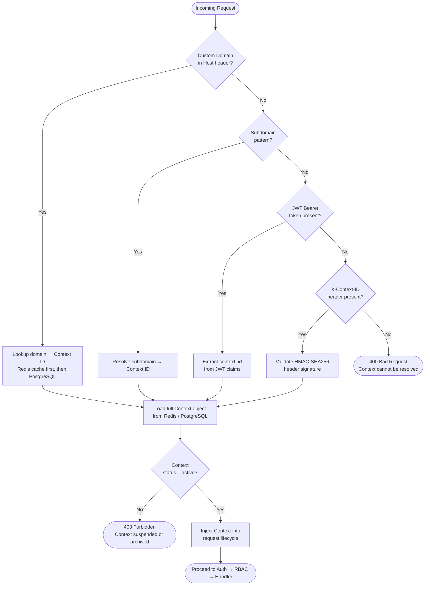

# Part 04 — Universal Context Engine
### *Replacing Fixed Tenant Tiers with a Flexible Context Graph*

---

## The Problem with Fixed Tiers

Most SaaS platforms model their hierarchy as a fixed ladder:

```
Platform → Organization → Tenant → Branch → User
```

This works for simple B2B SaaS. It breaks the moment you need:

| Business Model | Why Fixed Tiers Fail |
|---------------|---------------------|
| **Marketplace** | Vendors and customers are peers — neither is a "branch" |
| **Franchise** | 3+ levels of franchisors before a customer |
| **Government** | Federal → State → District → Municipality → Citizen |
| **Hospital Network** | Group → Hospital → Department → Ward → Patient |
| **University** | University → Faculty → Department → Course → Student |
| **Conglomerate** | Holding → Division → Subsidiary → Branch → Customer |
| **C2C Platform** | Buyers and sellers are the same kind of entity |
| **White-Label SaaS** | Your customer re-sells your platform with their own branding |

Each of these breaks a 5-tier ladder in a different way.

**The solution: Stop thinking in tiers. Start thinking in Contexts.**

---

## What Is a Context?

A Context is any node in the platform hierarchy.

Every Context has the same shape:

```typescript
interface Context {
  // Identity
  id: string;                      // UUID
  type: ContextType;               // 'platform' | 'organisation' | 'tenant' | 'branch' | 'vendor' | 'hospital' | 'school' | ...
  slug: string;                    // URL-friendly identifier

  // Hierarchy
  parentId: string | null;         // null = root context
  rootId: string;                  // always the platform root
  path: string;                    // '/org-a/tenant-1/branch-3' — for queries
  depth: number;                   // 0 = platform, 1 = org, 2 = tenant, etc.

  // Ownership
  ownerId: string;                 // user who owns/administers this context

  // Configuration
  theme: ThemeConfig;              // branding overrides
  locale: string;                  // 'en-IN', 'ar-SA', etc.
  timezone: string;                // 'Asia/Kolkata'
  currency: string;                // 'INR', 'USD'
  settings: Record<string, any>;  // arbitrary context-specific settings

  // Platform Services
  plugins: string[];               // active plugin IDs
  features: Record<string, boolean>; // feature flags
  capabilities: string[];          // active capabilities

  // Billing
  subscriptionId: string | null;
  planId: string | null;
  billingEmail: string | null;

  // Security
  dataScope: DataScope;            // isolation rules for this context
  policies: PolicyRef[];           // attached policy references

  // Metadata
  createdAt: Date;
  updatedAt: Date;
  status: 'active' | 'suspended' | 'archived';
}
```

---

## Context Types

Context types are **registered by plugins** — not hardcoded in the platform.

### Platform-Provided Context Types

```typescript
enum PlatformContextType {
  PLATFORM   = 'platform',     // Root — one per installation
  ORGANISATION = 'organisation', // Top-level customer entity
  TENANT     = 'tenant',       // Brand / division
  BRANCH     = 'branch',       // Physical or logical location
}
```

### Plugin-Registered Context Types

```typescript
// @orbitox/hms registers:
HOSPITAL   = 'hospital'
DEPARTMENT = 'department'
WARD       = 'ward'

// @orbitox/school registers:
UNIVERSITY = 'university'
FACULTY    = 'faculty'
DEPARTMENT = 'department'
CLASSROOM  = 'classroom'

// @orbitox/restaurant registers:
RESTAURANT_GROUP = 'restaurant_group'
RESTAURANT       = 'restaurant'
KITCHEN          = 'kitchen'

// @orbitox/mlm registers:
DISTRIBUTOR = 'distributor'
DOWNLINE    = 'downline'
```

Any plugin can register new context types. The platform treats them all the same.

---

## Context Graph Examples

### B2B SaaS (Traditional)

```
Platform
  └── Organisation: Acme Corp
        └── Tenant: Acme India
              └── Branch: Mumbai Office
                    └── Branch: Andheri Sub-Office
```

### Marketplace

```
Platform
  └── Organisation: ShopX Marketplace
        ├── Tenant (Vendor): Nike Store
        │     └── Context (Listing): Air Max 2026
        ├── Tenant (Vendor): Adidas Store
        │     └── Context (Listing): Ultra Boost
        └── Context (Buyer): Customer A
```

### Franchise

```
Platform
  └── Organisation: Pizza Empire
        └── Tenant: Master Franchise - India
              ├── Tenant: Regional Franchise - South
              │     ├── Branch: Chennai-1
              │     └── Branch: Bangalore-1
              └── Tenant: Regional Franchise - North
                    ├── Branch: Delhi-1
                    └── Branch: Noida-1
```

### Hospital Network

```
Platform
  └── Organisation: Apollo Health Group
        └── Tenant: Apollo Hospitals India
              ├── Hospital: Apollo Chennai
              │     ├── Department: Cardiology
              │     │     └── Ward: ICU
              │     └── Department: Orthopedics
              └── Hospital: Apollo Hyderabad
                    └── Department: Neurology
```

### Government

```
Platform
  └── Organisation: Ministry of Education
        └── Tenant: State of Tamil Nadu
              ├── District: Chennai District
              │     ├── Municipality: Chennai Corporation
              │     └── Municipality: Tambaram
              └── District: Coimbatore District
```

**One architecture. Zero code changes. All supported.**

---

## Context Resolution

Every incoming request resolves its context before processing.



---

## Context-Aware Request Object

Once resolved, the context object is available everywhere in the request lifecycle.

```typescript
// NestJS — accessing context from any service
@Injectable()
export class LeadService {
  constructor(
    private readonly ctx: ContextService,
    private readonly leadRepo: LeadRepository,
  ) {}

  async getLeads(): Promise<Lead[]> {
    const context = this.ctx.current(); // Always available, never null

    return this.leadRepo.findAll({
      contextId: context.id,
      // Data is automatically scoped — no manual tenant_id filtering
    });
  }
}
```

---

## Context Inheritance

Configuration cascades down the context graph.

```
Platform default: { currency: 'USD', locale: 'en' }
    ↓
Organisation override: { currency: 'INR', locale: 'en-IN' }
    ↓
Tenant override: { primaryColor: '#FF5500', logo: '...' }
    ↓
Branch override: { timezone: 'Asia/Kolkata' }
    ↓
Effective config: {
  currency: 'INR',          ← from Organisation
  locale: 'en-IN',          ← from Organisation
  primaryColor: '#FF5500',  ← from Tenant
  logo: '...',              ← from Tenant
  timezone: 'Asia/Kolkata', ← from Branch
}
```

```typescript
// Resolution is automatic
const effectiveConfig = await contextEngine.resolveConfig(
  contextId,
  ['currency', 'locale', 'primaryColor', 'logo', 'timezone']
);
```

---

## Context Scoped Data

All data in OrbitoX belongs to a context.

```sql
-- All tables include context_id (not just tenant_id)
CREATE TABLE crm.leads (
  id            UUID PRIMARY KEY DEFAULT gen_random_uuid(),
  context_id    UUID NOT NULL REFERENCES contexts(id),
  name          VARCHAR(255) NOT NULL,
  email         VARCHAR(255),
  status        VARCHAR(50),
  created_at    TIMESTAMPTZ DEFAULT NOW(),
  updated_at    TIMESTAMPTZ DEFAULT NOW()
);

-- Row-level security enforces context isolation
CREATE POLICY leads_context_isolation ON crm.leads
  USING (context_id = current_setting('app.current_context_id')::UUID);
```

---

## Supported Business Models

| Model | Context Graph Shape | Notes |
|-------|-------------------|-------|
| **B2B SaaS** | Org → Tenant → Branch | Classic |
| **B2C** | Org → Tenant → Customer | Customers are contexts |
| **B2B2C** | Org → Tenant → Company → Consumer | Full hierarchy |
| **C2C** | Org → Seller + Buyer | Peers at same level |
| **Marketplace** | Org → Marketplace → Vendor → Listing | Arbitrary depth |
| **Franchise** | Org → Master → Regional → Local | Multi-level |
| **White-Label** | Org → Reseller → Their-Tenant | Reseller owns children |
| **Government** | Org → Federal → State → District → City | Deep hierarchy |
| **Hospital** | Org → Hospital → Department → Ward | Healthcare specific |
| **Education** | Org → University → Faculty → Class | Education specific |
| **MLM** | Org → Distributor → Downline (n-levels) | Recursive tree |

---

## Database Schema: Contexts Table

```sql
CREATE TABLE contexts (
  id              UUID PRIMARY KEY DEFAULT gen_random_uuid(),
  type            VARCHAR(100) NOT NULL,          -- 'organisation', 'tenant', etc.
  slug            VARCHAR(255) UNIQUE NOT NULL,
  display_name    VARCHAR(255) NOT NULL,

  parent_id       UUID REFERENCES contexts(id),
  root_id         UUID NOT NULL REFERENCES contexts(id),
  path            LTREE,                          -- enables ancestor queries
  depth           INTEGER NOT NULL DEFAULT 0,

  owner_id        UUID,

  theme           JSONB DEFAULT '{}',
  locale          VARCHAR(20) DEFAULT 'en',
  timezone        VARCHAR(100) DEFAULT 'UTC',
  currency        VARCHAR(10) DEFAULT 'USD',
  settings        JSONB DEFAULT '{}',

  plugins         TEXT[] DEFAULT '{}',
  features        JSONB DEFAULT '{}',
  capabilities    TEXT[] DEFAULT '{}',

  subscription_id UUID,
  plan_id         UUID,
  billing_email   VARCHAR(255),

  data_scope      JSONB DEFAULT '{}',

  status          VARCHAR(50) DEFAULT 'active',
  created_at      TIMESTAMPTZ DEFAULT NOW(),
  updated_at      TIMESTAMPTZ DEFAULT NOW()
);

-- Fast ancestor queries using LTREE
CREATE INDEX idx_contexts_path ON contexts USING GIST (path);
CREATE INDEX idx_contexts_parent_id ON contexts (parent_id);
CREATE INDEX idx_contexts_type ON contexts (type);
CREATE INDEX idx_contexts_slug ON contexts (slug);
```

---

*Next: [Part 05 — Metadata Engine](./05_Metadata_Engine.md)*
