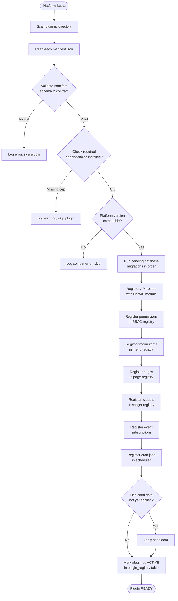

# Part 07 — Plugin Engine
### *The Runtime That Discovers, Loads, Validates, and Manages Every Plugin*

---

## Plugin as a Package

A plugin is an npm-compatible package that follows the OrbitoX Plugin Contract.

```
@orbitox/crm
@orbitox/inventory
@orbitox/hms
@orbitox/restaurant
```

Installing a plugin is identical to installing a package:

```bash
orbitox install @orbitox/crm
```

Everything else — migrations, API routes, menus, permissions, event subscriptions — is handled automatically by the Plugin Engine.

---

## Plugin Anatomy

Every plugin follows this exact directory structure:

```
plugins/crm/
│
├── manifest.json              # Plugin contract — the source of truth
│
├── backend/
│   ├── src/
│   │   ├── crm.module.ts      # NestJS module — registers all services
│   │   ├── leads/
│   │   │   ├── lead.entity.ts
│   │   │   ├── lead.service.ts
│   │   │   ├── lead.repository.ts
│   │   │   ├── lead.controller.ts
│   │   │   └── dto/
│   │   ├── customers/
│   │   ├── pipeline/
│   │   └── activities/
│   └── package.json
│
├── frontend/
│   ├── src/
│   │   ├── pages/             # Next.js pages (registered dynamically)
│   │   ├── components/        # Plugin-specific components
│   │   ├── widgets/           # Dashboard widgets
│   │   └── hooks/             # Plugin-specific hooks
│   └── package.json
│
├── database/
│   ├── migrations/            # Versioned SQL migrations
│   │   ├── 001_create_leads.sql
│   │   ├── 002_create_customers.sql
│   │   └── 003_add_pipeline_stage.sql
│   ├── schema/                # Entity schema definitions
│   └── seeds/                 # Default seed data
│
├── events/
│   ├── emitted.ts             # Events this plugin emits
│   └── subscribed.ts          # Events this plugin listens to
│
├── permissions/
│   └── permissions.json       # All permission keys this plugin defines
│
├── policies/
│   └── policies.json          # Business rules / approval policies
│
├── workflows/
│   └── default-workflows.json # Out-of-box workflow templates
│
├── cron/
│   └── jobs.json              # Scheduled job definitions
│
├── translations/
│   ├── en.json
│   ├── ar.json
│   ├── hi.json
│   └── ta.json
│
├── docs/
│   └── README.md              # Plugin documentation
│
└── tests/
    ├── unit/
    ├── integration/
    └── e2e/
```

---

## manifest.json — The Plugin Contract

```json
{
  "id": "crm",
  "name": "@orbitox/crm",
  "version": "1.2.0",
  "displayName": "CRM",
  "description": "Customer Relationship Management — Leads, Customers, Pipeline",
  "icon": "briefcase",
  "category": "sales",
  "author": "OrbitoX Platform Team",

  "minimumPlatformVersion": "2.0.0",

  "requires": [
    "auth",
    "context",
    "notifications"
  ],

  "incompatibleWith": [],

  "permissions": [
    "crm.leads.create",
    "crm.leads.read",
    "crm.leads.update",
    "crm.leads.delete",
    "crm.leads.export",
    "crm.customers.create",
    "crm.customers.read",
    "crm.customers.update",
    "crm.customers.delete",
    "crm.pipeline.read",
    "crm.pipeline.manage",
    "crm.reports.view",
    "crm.settings.manage"
  ],

  "menus": [
    {
      "id": "crm-root",
      "label": "CRM",
      "icon": "briefcase",
      "sortOrder": 100,
      "children": [
        { "id": "crm-leads",     "label": "Leads",     "path": "/crm/leads",     "permission": "crm.leads.read" },
        { "id": "crm-customers", "label": "Customers", "path": "/crm/customers", "permission": "crm.customers.read" },
        { "id": "crm-pipeline",  "label": "Pipeline",  "path": "/crm/pipeline",  "permission": "crm.pipeline.read" }
      ]
    }
  ],

  "pages": [
    { "id": "crm-leads",     "path": "/crm/leads",         "component": "LeadsListPage" },
    { "id": "crm-lead",      "path": "/crm/leads/:id",     "component": "LeadDetailPage" },
    { "id": "crm-customers", "path": "/crm/customers",     "component": "CustomersListPage" },
    { "id": "crm-pipeline",  "path": "/crm/pipeline",      "component": "PipelinePage" }
  ],

  "widgets": [
    { "id": "crm.leads.count",     "title": "Total Leads",        "size": "1x1" },
    { "id": "crm.pipeline.stages", "title": "Pipeline by Stage",  "size": "2x2" },
    { "id": "crm.leads.recent",    "title": "Recent Leads",       "size": "2x1" }
  ],

  "events": {
    "emits": [
      "crm.lead.created",
      "crm.lead.updated",
      "crm.lead.status_changed",
      "crm.lead.converted",
      "crm.customer.created"
    ],
    "subscribes": [
      "auth.user.created",
      "billing.subscription.activated",
      "notifications.sent"
    ]
  },

  "cron": [
    {
      "id": "crm.leads.stale-check",
      "schedule": "0 9 * * *",
      "handler": "checkStaleLeads",
      "description": "Flag leads with no activity in 7 days"
    }
  ],

  "settings": {
    "schema": [
      {
        "key": "leadExpiryDays",
        "label": "Lead Expiry (Days)",
        "type": "number",
        "default": 30
      },
      {
        "key": "defaultAssignee",
        "label": "Default Lead Assignee",
        "type": "relation",
        "relatedEntity": "user"
      }
    ]
  }
}
```

---

## Plugin Lifecycle



---

## Plugin Registry — Database Schema

```sql
CREATE TABLE platform.plugin_registry (
  id                    UUID PRIMARY KEY DEFAULT gen_random_uuid(),
  plugin_id             VARCHAR(100) NOT NULL,
  context_id            UUID NOT NULL REFERENCES contexts(id),

  version               VARCHAR(20) NOT NULL,
  status                VARCHAR(50) DEFAULT 'active',  -- 'active' | 'disabled' | 'error' | 'installing'

  manifest              JSONB NOT NULL,
  installed_at          TIMESTAMPTZ DEFAULT NOW(),
  updated_at            TIMESTAMPTZ DEFAULT NOW(),
  last_migration        VARCHAR(100),

  settings              JSONB DEFAULT '{}',            -- context-specific plugin settings
  error_message         TEXT,

  UNIQUE (plugin_id, context_id)
);

CREATE TABLE platform.plugin_migrations (
  id                    UUID PRIMARY KEY DEFAULT gen_random_uuid(),
  plugin_id             VARCHAR(100) NOT NULL,
  migration_name        VARCHAR(255) NOT NULL,
  applied_at            TIMESTAMPTZ DEFAULT NOW(),
  checksum              VARCHAR(64),                   -- SHA256 of migration SQL

  UNIQUE (plugin_id, migration_name)
);
```

---

## Plugin Install, Upgrade, Rollback

### Install

```bash
orbitox install @orbitox/crm --context=tenant-123

# Platform Engine:
# 1. Downloads plugin package from marketplace
# 2. Validates manifest
# 3. Checks dependencies
# 4. Runs database migrations
# 5. Registers in plugin_registry
# 6. Hot-reloads routes, menus, pages
# 7. Plugin active — zero downtime
```

### Upgrade

```bash
orbitox upgrade @orbitox/crm@1.3.0

# Platform Engine:
# 1. Downloads new version
# 2. Validates compatibility
# 3. Creates DB snapshot (rollback point)
# 4. Runs new migrations
# 5. Updates plugin_registry
# 6. Hot-reloads changes
# 7. Old version archived (rollback available for 7 days)
```

### Rollback

```bash
orbitox rollback @orbitox/crm

# Platform Engine:
# 1. Restores DB from snapshot
# 2. Re-activates previous version
# 3. Updates plugin_registry
# 4. Hot-reloads previous routes/menus/pages
```

---

## Plugin SDK — Building a Plugin

```typescript
// plugins/crm/backend/src/crm.plugin.ts
import { Plugin, PluginContext } from '@orbitox/plugin-engine';

export default class CrmPlugin extends Plugin {

  // Called once when plugin is installed on a context
  async onInstall(ctx: PluginContext): Promise<void> {
    await this.metadata.registerEntity(leadEntityMetadata);
    await this.metadata.registerEntity(customerEntityMetadata);
    await this.workflows.registerTemplate(leadWonWorkflowTemplate);
  }

  // Called when platform starts — plugin already installed
  async onActivate(ctx: PluginContext): Promise<void> {
    this.logger.info('CRM plugin activated', { contextId: ctx.id });
  }

  // Called before uninstall — cleanup hooks
  async onUninstall(ctx: PluginContext): Promise<void> {
    // Archive data or clean up external resources
    await this.storage.archivePluginData('crm', ctx.id);
  }

  // Called on upgrade — data migrations
  async onUpgrade(ctx: PluginContext, fromVersion: string, toVersion: string): Promise<void> {
    this.logger.info(`CRM upgrading from ${fromVersion} to ${toVersion}`);
  }
}
```

---

## Plugin Communication Rules

```
┌─────────────────────────────────────────────────────┐
│                    ALLOWED                          │
│                                                     │
│  Plugin → Platform Core API     ✅                  │
│  Plugin → Platform Services API ✅                  │
│  Plugin → Event Bus (emit)      ✅                  │
│  Plugin → Event Bus (subscribe) ✅                  │
│  Plugin → Own database          ✅                  │
│                                                     │
├─────────────────────────────────────────────────────┤
│                   FORBIDDEN                         │
│                                                     │
│  Plugin → Another plugin's DB   ❌                  │
│  Plugin → Another plugin's code ❌ (import)         │
│  Plugin → Platform Core DB      ❌ (direct)         │
│                                                     │
└─────────────────────────────────────────────────────┘
```

---

## Inter-Plugin Communication via Events

```typescript
// CRM plugin emits an event
await this.eventBus.emit('crm.lead.converted', {
  leadId: lead.id,
  customerId: customer.id,
  contextId: ctx.id,
  value: lead.dealValue,
  convertedAt: new Date(),
});

// Inventory plugin subscribes to CRM events
// (without importing CRM)
@EventSubscriber('crm.lead.converted')
async onLeadConverted(payload: LeadConvertedPayload) {
  // Create a new quote in inventory for the new customer
  await this.quoteService.createForCustomer(payload.customerId);
}
```

---

*Next: [Part 08 — Capability Engine](./08_Capability_Engine.md)*
