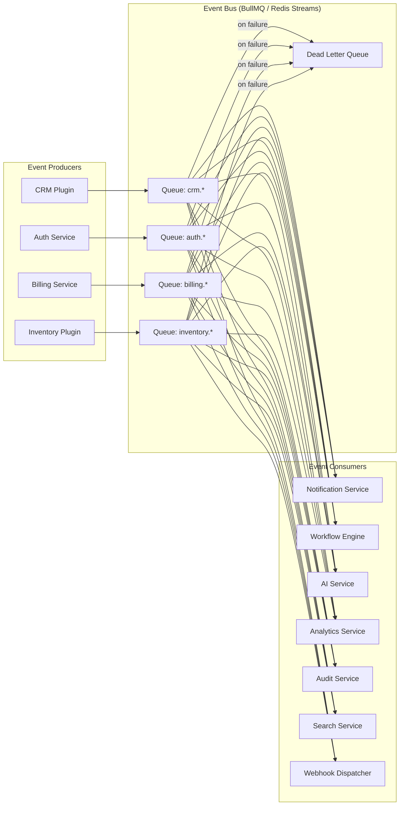

# Part 10 — Event Bus
### *The Nervous System of OrbitoX — How Everything Communicates Without Coupling*

---

## Why Events?

Every significant thing that happens in OrbitoX produces a fact.

```
A user registered.
A lead was converted.
A payment failed.
A plugin was installed.
An inventory item went out of stock.
A patient appointment was confirmed.
```

These facts are **events**. The event bus distributes these facts to every service that cares — without the originator knowing or caring who is listening.

```
❌ Synchronous coupling (tightly coupled):
CRM Service calls → Notification Service directly
CRM Service calls → Billing Service directly
CRM Service calls → AI Service directly

If any service is down → CRM fails
If any service is slow → CRM is slow
If you add a new subscriber → you edit CRM code

✅ Event-driven (decoupled):
CRM Service emits → crm.lead.created

Notification Service subscribes → sends welcome email
Billing Service subscribes       → logs the activity
AI Service subscribes            → scores the lead
Analytics Service subscribes     → tracks the event

CRM doesn't know any of them exist.
Adding a new subscriber → zero changes to CRM.
```

---

## Event Architecture



---

## Event Naming Convention

```
{domain}.{entity}.{action}

Examples:
  auth.user.created
  auth.user.password_changed
  auth.session.revoked
  crm.lead.created
  crm.lead.status_changed
  crm.lead.converted
  crm.customer.created
  billing.subscription.activated
  billing.subscription.cancelled
  billing.payment.succeeded
  billing.payment.failed
  inventory.product.created
  inventory.stock.low
  inventory.stock.out
  hms.appointment.confirmed
  hms.appointment.cancelled
  school.attendance.marked
  platform.plugin.installed
  platform.plugin.uninstalled
  platform.context.created
  platform.context.suspended
```

---

## Event Envelope

Every event has the same structure:

```typescript
interface PlatformEvent<T = Record<string, unknown>> {
  // Event identity
  id: string;                    // UUID — globally unique
  name: string;                  // 'crm.lead.created'
  version: string;               // '1.0' — for schema evolution
  schemaVersion: number;         // integer increment

  // Context
  contextId: string;             // which context this happened in
  tenantId: string;              // resolved tenant
  organisationId: string;        // resolved organisation

  // Tracing
  correlationId: string;         // ties related events together
  causationId?: string;          // event ID that caused this event
  requestId?: string;            // originating HTTP request ID

  // Source
  source: string;                // 'crm-plugin' | 'auth-service' | ...
  userId?: string;               // who triggered this (null = system)

  // Payload
  payload: T;

  // Timestamps
  occurredAt: Date;              // when the fact happened
  publishedAt: Date;             // when it was published to the bus
}
```

---

## Emitting Events

```typescript
// In any service or plugin
@Injectable()
export class LeadService {
  constructor(private readonly eventBus: EventBus) {}

  async convertLead(leadId: string, ctx: RequestContext): Promise<Customer> {
    // ... business logic ...
    const customer = await this.customerRepo.create({...});

    // Emit the fact — fire and forget (async)
    await this.eventBus.emit({
      name: 'crm.lead.converted',
      version: '1.0',
      contextId: ctx.contextId,
      tenantId: ctx.tenantId,
      organisationId: ctx.organisationId,
      correlationId: ctx.requestId,
      source: 'crm-plugin',
      userId: ctx.userId,
      payload: {
        leadId,
        customerId: customer.id,
        dealValue: lead.dealValue,
        convertedAt: new Date(),
      },
    });

    return customer;
  }
}
```

---

## Subscribing to Events

```typescript
// Notification service subscribes to CRM events
@EventSubscriber('crm.lead.created')
export class LeadCreatedHandler {
  constructor(private readonly notify: NotificationCapability) {}

  async handle(event: PlatformEvent<LeadCreatedPayload>): Promise<void> {
    const { payload, contextId } = event;

    await this.notify.send({
      to: { userId: payload.assignedTo },
      template: 'crm.lead.assigned',
      data: { leadName: payload.name },
      channels: ['email', 'push'],
      contextId,
    });
  }
}

// AI service subscribes to CRM events
@EventSubscriber('crm.lead.created')
export class LeadAIScoringHandler {
  async handle(event: PlatformEvent<LeadCreatedPayload>): Promise<void> {
    // Score the lead asynchronously without blocking the CRM response
    await this.aiScoringQueue.add('score-lead', event.payload);
  }
}

// Multiple subscribers to the same event — fully independent
@EventSubscriber('crm.lead.created')
export class LeadAnalyticsHandler {
  async handle(event: PlatformEvent<LeadCreatedPayload>): Promise<void> {
    await this.analytics.track('lead_created', event.contextId, {
      source: event.payload.source,
      assignedTo: event.payload.assignedTo,
    });
  }
}
```

---

## Event Delivery Guarantees

| Guarantee | Implementation |
|-----------|----------------|
| **At-least-once delivery** | BullMQ with acknowledgements |
| **Idempotent consumers** | Each handler checks if event already processed (by `event.id`) |
| **Retry with backoff** | 3 retries: 1s → 5s → 30s delay |
| **Dead Letter Queue** | After max retries → moved to DLQ for inspection |
| **Event ordering** | Within a context, events are ordered by `occurredAt` |
| **Event replay** | Events stored for 30 days — replay to a new subscriber |

---

## Idempotency Pattern

Every event consumer must be idempotent:

```typescript
@EventSubscriber('crm.lead.converted')
export class InvoiceCreationHandler {
  async handle(event: PlatformEvent): Promise<void> {
    // Check if we already processed this event
    const alreadyProcessed = await this.eventLog.exists(event.id);
    if (alreadyProcessed) {
      return; // Safe to skip — already handled
    }

    // Process the event
    await this.invoiceService.createFromLead(event.payload);

    // Mark as processed
    await this.eventLog.mark(event.id, 'invoice-creation-handler');
  }
}
```

---

## Platform Core Events Catalog

### Auth Events
| Event | Payload |
|-------|---------|
| `auth.user.created` | `userId, email, contextId` |
| `auth.user.updated` | `userId, changedFields` |
| `auth.user.deleted` | `userId, contextId` |
| `auth.session.created` | `userId, sessionId, ip` |
| `auth.session.revoked` | `userId, sessionId` |
| `auth.mfa.enabled` | `userId` |
| `auth.password.changed` | `userId` |
| `auth.login.failed` | `email, ip, reason` |

### Billing Events
| Event | Payload |
|-------|---------|
| `billing.subscription.activated` | `subscriptionId, planId, contextId` |
| `billing.subscription.cancelled` | `subscriptionId, reason` |
| `billing.subscription.renewed` | `subscriptionId, periodEnd` |
| `billing.payment.succeeded` | `paymentId, amount, currency` |
| `billing.payment.failed` | `paymentId, reason, nextRetry` |
| `billing.invoice.created` | `invoiceId, amount` |
| `billing.trial.started` | `contextId, trialEndsAt` |
| `billing.trial.expired` | `contextId` |

### Platform Events
| Event | Payload |
|-------|---------|
| `platform.context.created` | `contextId, type, parentId` |
| `platform.context.suspended` | `contextId, reason` |
| `platform.plugin.installed` | `pluginId, contextId, version` |
| `platform.plugin.uninstalled` | `pluginId, contextId` |
| `platform.feature.enabled` | `featureId, contextId` |
| `platform.feature.disabled` | `featureId, contextId` |

---

## Event Replay

```bash
# Replay all events for a context since a given timestamp
orbitox events replay \
  --context=tenant-123 \
  --from="2026-01-01T00:00:00Z" \
  --to="2026-01-31T23:59:59Z" \
  --filter="crm.*"

# Replay to a specific handler (for bootstrapping new subscribers)
orbitox events replay \
  --handler=LeadAIScoringHandler \
  --context=tenant-123 \
  --from="2026-01-01T00:00:00Z"
```

---

## Event Storage Schema

```sql
CREATE TABLE platform.events (
  id               UUID PRIMARY KEY,
  name             VARCHAR(200) NOT NULL,
  version          VARCHAR(10) NOT NULL,
  schema_version   INTEGER NOT NULL DEFAULT 1,

  context_id       UUID NOT NULL,
  tenant_id        UUID,
  organisation_id  UUID,

  correlation_id   UUID,
  causation_id     UUID,
  request_id       UUID,

  source           VARCHAR(100) NOT NULL,
  user_id          UUID,

  payload          JSONB NOT NULL,

  occurred_at      TIMESTAMPTZ NOT NULL,
  published_at     TIMESTAMPTZ NOT NULL DEFAULT NOW()
) PARTITION BY RANGE (occurred_at);
-- Partitioned by month for efficient archival

CREATE INDEX idx_events_name_ctx    ON platform.events (name, context_id, occurred_at);
CREATE INDEX idx_events_correlation ON platform.events (correlation_id);
CREATE INDEX idx_events_occurred    ON platform.events (occurred_at);
```

---

*Next: [Part 11 — Workflow Engine](./11_Workflow_Engine.md)*
