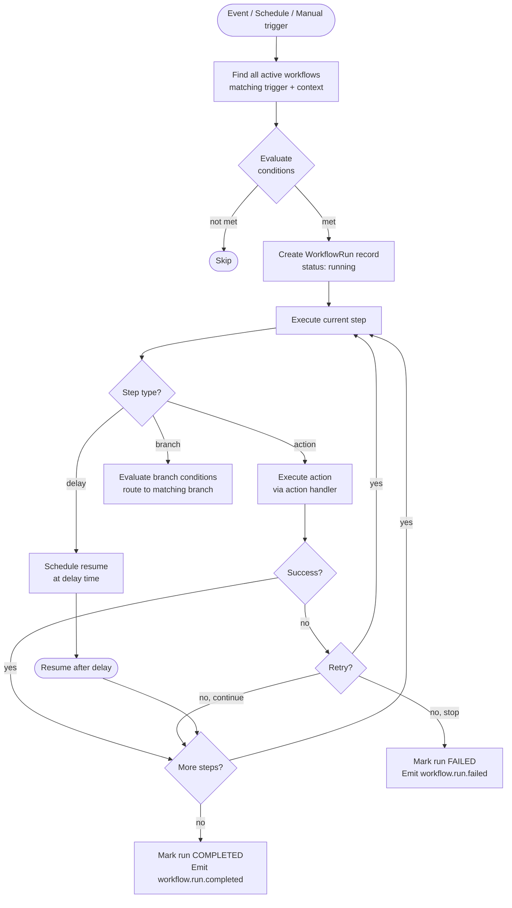

# Part 11 — Workflow Engine
### *Business Automation Without Code Deployments*

---

## The Governing Idea

Business processes change constantly.

```
Today:    Lead Created → Send Email → Assign to Sales Rep
Tomorrow: Lead Created → Send Email → Wait 2 days → Check Score → If score > 7 → Assign to Senior Rep
Next week: Also send WhatsApp + Create Task
```

Without a Workflow Engine, each change requires:
- A developer
- A code change
- A PR review
- A deployment
- A restart

With the Workflow Engine:
- A business admin configures the change in the UI
- It takes effect in minutes
- Zero code. Zero deployment. Zero restarts.

---

## Workflow Concepts

```
Trigger     — what starts the workflow
  └── Conditions — optional filters on when to proceed
        └── Actions — what happens
              └── Delay — optional wait before next action
                    └── Branches — if/else logic
                          └── More Actions → until workflow ends
```

---

## Workflow Definition Schema

```typescript
interface WorkflowDefinition {
  id: string;                        // UUID
  contextId: string;                 // which context this belongs to
  name: string;                      // 'Lead Won → Invoice & Notification'
  description?: string;
  status: 'active' | 'inactive' | 'draft';
  version: number;                   // increments on each save

  trigger: WorkflowTrigger;
  steps: WorkflowStep[];

  settings: {
    maxRuns?: number;                // max times a single entity can trigger this
    runOnce?: boolean;               // only trigger once per entity ever
    timeout?: number;                // max execution time in seconds
  };
}

interface WorkflowTrigger {
  type: 'event' | 'schedule' | 'manual' | 'webhook';

  // For type = 'event'
  eventName?: string;                // 'crm.lead.status_changed'
  conditions?: WorkflowCondition[];  // filter which events actually proceed

  // For type = 'schedule'
  cron?: string;                     // '0 9 * * 1-5' = weekdays at 9am
  entityQuery?: EntityQuery;         // which entities to process on schedule
}

interface WorkflowCondition {
  field: string;                     // 'payload.newStatus'
  operator: 'eq' | 'neq' | 'gt' | 'lt' | 'contains' | 'in' | 'notIn';
  value: any;
}

type WorkflowStep =
  | ActionStep
  | DelayStep
  | BranchStep
  | LoopStep
  | SubWorkflowStep;
```

---

## Workflow Step Types

### Action Step

```typescript
interface ActionStep {
  type: 'action';
  id: string;
  actionType: WorkflowActionType;
  config: Record<string, any>;
  onError: 'continue' | 'stop' | 'retry';
  retryCount?: number;
}

type WorkflowActionType =
  // Notifications
  | 'send_email'
  | 'send_sms'
  | 'send_whatsapp'
  | 'send_push'
  | 'send_in_app'

  // Data operations
  | 'create_record'
  | 'update_record'
  | 'delete_record'

  // Task management
  | 'create_task'
  | 'assign_task'

  // CRM actions (registered by CRM plugin)
  | 'crm.create_activity'
  | 'crm.update_lead_status'
  | 'crm.convert_lead'

  // Billing actions
  | 'billing.create_invoice'
  | 'billing.apply_discount'

  // HTTP
  | 'webhook'           // call external URL

  // AI
  | 'ai.generate_text'
  | 'ai.classify'
  | 'ai.extract'

  // Platform
  | 'emit_event'
  | 'assign_tag'
  | 'set_variable';
```

### Delay Step

```typescript
interface DelayStep {
  type: 'delay';
  id: string;
  duration: {
    value: number;
    unit: 'minutes' | 'hours' | 'days' | 'weeks';
  };
  // OR wait until a specific time
  waitUntil?: {
    field: string;      // e.g., 'entity.followUpDate'
  };
}
```

### Branch Step (If/Else)

```typescript
interface BranchStep {
  type: 'branch';
  id: string;
  branches: Array<{
    id: string;
    label: string;
    conditions: WorkflowCondition[];
    steps: WorkflowStep[];
  }>;
  defaultBranch?: WorkflowStep[];
}
```

---

## Example: Lead Won Workflow

```json
{
  "id": "wf-lead-won",
  "name": "Lead Won → Full Conversion Flow",
  "contextId": "tenant-123",
  "status": "active",

  "trigger": {
    "type": "event",
    "eventName": "crm.lead.status_changed",
    "conditions": [
      { "field": "payload.newStatus", "operator": "eq", "value": "won" }
    ]
  },

  "steps": [
    {
      "type": "action",
      "id": "step-1",
      "actionType": "billing.create_invoice",
      "config": {
        "customerId": "{{payload.customerId}}",
        "amount": "{{payload.dealValue}}",
        "dueInDays": 30
      }
    },
    {
      "type": "action",
      "id": "step-2",
      "actionType": "send_whatsapp",
      "config": {
        "to": "{{entity.phone}}",
        "template": "crm.lead_won_congratulations",
        "data": { "name": "{{entity.name}}" }
      }
    },
    {
      "type": "action",
      "id": "step-3",
      "actionType": "crm.create_activity",
      "config": {
        "leadId": "{{payload.leadId}}",
        "type": "won",
        "note": "Lead converted to customer automatically"
      }
    },
    {
      "type": "action",
      "id": "step-4",
      "actionType": "send_in_app",
      "config": {
        "to": { "userId": "{{entity.assignedTo}}" },
        "title": "🎉 Lead Won!",
        "body": "{{entity.name}} has been marked as Won. Invoice created."
      }
    },
    {
      "type": "delay",
      "id": "step-5",
      "duration": { "value": 7, "unit": "days" }
    },
    {
      "type": "action",
      "id": "step-6",
      "actionType": "create_task",
      "config": {
        "title": "Follow up with {{entity.name}}",
        "assignedTo": "{{entity.assignedTo}}",
        "dueDate": "{{now + 2 days}}"
      }
    }
  ]
}
```

---

## Workflow Engine — Execution Model



---

## Workflow Run Storage

```sql
CREATE TABLE workflow.runs (
  id                UUID PRIMARY KEY DEFAULT gen_random_uuid(),
  workflow_id       UUID NOT NULL,
  context_id        UUID NOT NULL,
  trigger_event_id  UUID,              -- event that triggered this run
  entity_id         UUID,              -- the entity being processed
  entity_type       VARCHAR(100),

  status            VARCHAR(50) NOT NULL DEFAULT 'running',
  current_step_id   VARCHAR(100),
  variables         JSONB DEFAULT '{}', -- runtime variable store

  started_at        TIMESTAMPTZ DEFAULT NOW(),
  completed_at      TIMESTAMPTZ,
  next_resume_at    TIMESTAMPTZ,       -- for delayed steps

  error_message     TEXT,
  step_logs         JSONB DEFAULT '[]' -- execution log per step
);
```

---

## Plugin-Registered Workflow Actions

Plugins extend the workflow engine with domain-specific actions:

```typescript
// CRM plugin registers custom actions
workflowEngine.registerAction({
  id: 'crm.create_activity',
  displayName: 'Create CRM Activity',
  pluginId: 'crm',
  configSchema: {
    leadId: { type: 'string', required: true },
    type: { type: 'select', options: ['call', 'email', 'meeting', 'won'] },
    note: { type: 'text' },
  },
  handler: async (config, ctx) => {
    await leadActivityService.create(config, ctx);
  },
});
```

---

*Next: [Part 12 — Policy Engine](./12_Policy_Engine.md)*
