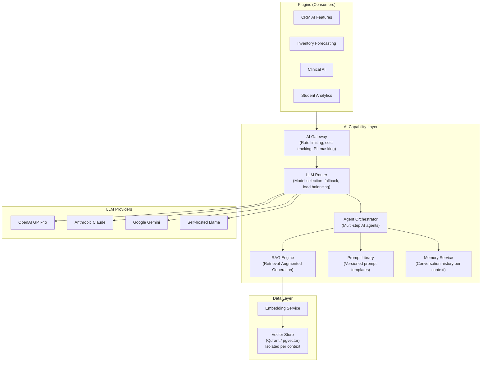
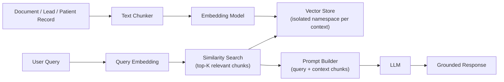

# Part 15 — AI Architecture
### *AI as a Platform Capability — Not a Feature Bolted On*

---

## The Governing Idea

AI in OrbitoX is not a chatbot added to one plugin.

AI is a **platform capability** — a first-class infrastructure layer that every plugin can consume, that every tenant can configure independently, and that every context can isolate for data privacy.

```
❌ The wrong way:
  CRM plugin imports OpenAI SDK directly
  Inventory plugin imports OpenAI SDK separately
  Each plugin manages its own API keys, rate limits, costs

✅ The OrbitoX way:
  AI Service is a platform capability
  CRM, Inventory, HMS, School — all call the same AI capability
  One API key management, one cost dashboard, one rate limiter
  Each context gets isolated data, isolated memory, isolated embeddings
```

---

## AI Architecture Overview



---

## AI Gateway

Every AI request from every plugin goes through the AI Gateway first.

```typescript
interface AIGatewayRequest {
  contextId: string;           // for isolation + cost attribution
  pluginId: string;            // which plugin is making the request
  userId?: string;             // user initiating (for personal memory)

  requestType: 'completion' | 'embedding' | 'classification' | 'extraction' | 'agent';
  model?: string;              // preferred model (gateway may override based on routing)
  maxTokens?: number;
  temperature?: number;

  messages?: ChatMessage[];    // for completion
  text?: string;               // for embedding / classification
  agent?: AgentConfig;         // for multi-step agents
}
```

The Gateway enforces:

| Gate | Description |
|------|-------------|
| **PII Masking** | Strips names, emails, phones, NI numbers before sending to LLM |
| **Rate Limiting** | Per-context requests per minute; per-plan daily token budget |
| **Cost Tracking** | Every token billed to the context; cost dashboard in Admin |
| **Content Policy** | Blocks harmful prompts before they reach the LLM |
| **Audit Logging** | Every AI call is logged (not the content — just metadata) |
| **Fallback** | If primary model is down → route to fallback model |

---

## LLM Router

The LLM Router selects the right model for each request based on:

```typescript
interface RoutingRules {
  // Context-configured default
  defaultModel: string;               // 'gpt-4o' | 'claude-3-5-sonnet' | etc.

  // Task-based routing
  taskRoutes: {
    'classification': 'gpt-3.5-turbo',  // cheaper model for simple tasks
    'extraction': 'claude-3-haiku',
    'long-form': 'gpt-4o',
    'code': 'claude-3-5-sonnet',
    'clinical': 'med-gemini',          // specialized medical model
  };

  // Fallback chain
  fallback: ['gpt-4o', 'claude-3-5-sonnet', 'gemini-1.5-pro'];

  // Cost optimization
  useCheapModelUnder: 500,            // token count — use fast model for short requests
}
```

---

## RAG Engine — Retrieval-Augmented Generation

Each context maintains its own isolated knowledge base in the vector store.



```typescript
// Indexing a document for RAG
await aiCapability.indexDocument({
  contextId: ctx.contextId,
  collection: 'crm_knowledge',
  document: {
    id: customer.id,
    title: customer.name,
    content: `${customer.name} is a customer with ${customer.leadCount} leads.
              Last purchase: ${customer.lastPurchase}.
              Notes: ${customer.notes}`,
    metadata: { type: 'customer', id: customer.id },
  },
});

// RAG-powered query
const response = await aiCapability.chat({
  contextId: ctx.contextId,
  messages: [{ role: 'user', content: userQuery }],
  retrieval: {
    collection: 'crm_knowledge',
    topK: 5,
  },
  systemPrompt: prompts.get('crm.assistant.system'),
});
```

---

## Prompt Library

Prompts are versioned, context-configurable, and never hardcoded.

```typescript
// ❌ Never hardcode prompts
const prompt = `You are a helpful CRM assistant. Answer questions about ${lead.name}.`;

// ✅ Prompts are managed in the Prompt Library
const prompt = await promptLibrary.render('crm.lead.summarize', {
  context: ctx.contextId,
  variables: { leadName: lead.name, leadNotes: lead.notes },
});
```

### Prompt Definition

```json
{
  "id": "crm.lead.summarize",
  "version": "1.2",
  "pluginId": "crm",
  "description": "Summarize a lead's profile and suggest next action",
  "template": "You are a professional CRM assistant for {{contextName}}.\n\nLead profile:\nName: {{leadName}}\nStatus: {{leadStatus}}\nNotes: {{leadNotes}}\nLast activity: {{lastActivity}}\n\nProvide: 1) A 2-sentence summary, 2) The recommended next action.",
  "model": "gpt-4o",
  "maxTokens": 300,
  "temperature": 0.3
}
```

Context administrators can override prompt templates for their context — customizing the AI's behavior without code changes.

---

## Memory Service

The Memory Service gives AI conversations continuity over time.

```
Conversation Memory  — last N messages in a session (short-term)
Entity Memory        — facts remembered about a specific record (long-term)
User Memory          — preferences and style of a specific user
Context Memory       — knowledge specific to this tenant/organisation
```

```typescript
// Retrieve memory before responding
const memory = await aiCapability.recall({
  contextId: ctx.contextId,
  userId: ctx.userId,
  entityId: lead.id,
  entityType: 'lead',
  memoryTypes: ['conversation', 'entity'],
});

// The AI uses this memory as additional context
const response = await aiCapability.chat({
  contextId: ctx.contextId,
  messages: [...memory.conversationHistory, userMessage],
  entityContext: memory.entityFacts,
});

// Store new facts from this conversation
await aiCapability.remember({
  contextId: ctx.contextId,
  entityId: lead.id,
  entityType: 'lead',
  fact: 'User mentioned interest in the Enterprise plan',
});
```

---

## AI Agents

AI Agents perform multi-step tasks autonomously, using tools provided by plugins.

```typescript
// CRM plugin registers AI tools
aiCapability.registerTool({
  pluginId: 'crm',
  tools: [
    {
      name: 'get_lead_details',
      description: 'Retrieve full details of a lead by ID or name',
      parameters: { leadId: { type: 'string' } },
      handler: async ({ leadId }, ctx) => leadService.findById(leadId, ctx),
    },
    {
      name: 'update_lead_status',
      description: 'Update the status of a lead',
      parameters: { leadId: { type: 'string' }, status: { type: 'string' } },
      handler: async ({ leadId, status }, ctx) => leadService.updateStatus(leadId, status, ctx),
    },
    {
      name: 'send_email_to_lead',
      description: 'Send an email to a lead',
      parameters: { leadId: { type: 'string' }, subject: { type: 'string' }, body: { type: 'string' } },
      handler: async (params, ctx) => notificationCapability.send({...}),
    },
  ],
});

// Agent execution
const result = await aiCapability.runAgent({
  contextId: ctx.contextId,
  instruction: 'Find all leads that have not been contacted in 7 days and send each of them a re-engagement email.',
  tools: ['crm'],                  // which plugin tools are available
  maxSteps: 20,                    // prevent infinite loops
});
```

---

## AI Permissions

AI is subject to the same RBAC + ABAC policy system as everything else.

```json
{
  "permissions": [
    "ai.chat.use",               // use the AI chat interface
    "ai.agent.run",              // trigger AI agents (more powerful)
    "ai.documents.index",        // add documents to vector store
    "ai.prompts.manage",         // edit prompt templates
    "ai.usage.view",             // view AI cost/usage dashboard
    "ai.model.configure"         // change the LLM model for context
  ]
}
```

---

## AI Usage Dashboard (Per Context)

```
Tenant Admin → AI → Usage

This Month:
  Total Requests:    4,521
  Total Tokens:      1,234,567
  Estimated Cost:    $18.42

By Plugin:
  CRM:               60%
  Inventory:         25%
  Reports:           15%

By Model:
  GPT-4o:            70%
  GPT-3.5-turbo:     30%

Daily Usage Chart: [line chart]
Budget Alert: $50/month limit → 36% used
```

---

*Next: [Part 16 — Security](./16_Security.md)*
