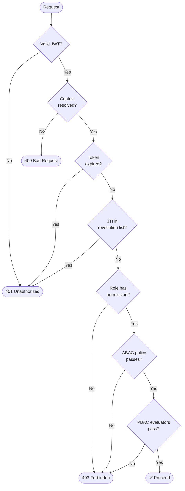

# Part 16 — Security
### *Zero Trust, Defense in Depth — Security as Infrastructure, Not an Afterthought*

---

## Security Philosophy: Zero Trust

> **"Never trust. Always verify."**

Zero Trust means:
- No request is trusted because it comes from inside the network
- Every request must prove its identity
- Every action must be authorized
- Every resource must be protected, regardless of who is asking

```
External user hits API      → Verify JWT
Internal service calls API  → Verify service token (mTLS)
Database connection         → Credentials from secrets manager
Third-party webhook         → Verify HMAC-SHA256 signature
File upload                 → Virus scan + MIME validation
Admin accessing tenant data → Re-verify identity + audit log
```

---

## Authentication

### JWT RS256

```typescript
// Token structure
interface OrbitoXJWT {
  // Standard claims
  sub: string;         // user ID
  iat: number;         // issued at
  exp: number;         // expires (15 minutes for access, 7 days for refresh)
  jti: string;         // JWT ID — used for revocation

  // Platform claims
  ctx: string;         // current context ID
  tid: string;         // tenant ID
  oid: string;         // organisation ID

  // Security
  scp: string[];       // scopes (for API keys)
  mfa: boolean;        // was MFA verified?
  ips: string;         // IP hash (for anomaly detection)
}

// Key rotation: RS256 asymmetric keys
// Private key: stored in AWS KMS / HashiCorp Vault (never in code or env)
// Public key: published at /.well-known/jwks.json (rotated monthly)
```

### Token Lifecycle

```
1. User logs in → Auth service issues:
   - Access Token:  15 min expiry, RS256 signed
   - Refresh Token: 7 day expiry, stored in httpOnly cookie
   - Session record: stored in Redis

2. Access Token used in Authorization: Bearer header
3. Token expires → frontend calls /auth/refresh with cookie
4. Refresh Token used → new Access Token issued
5. Logout → Session deleted from Redis + JTI added to revocation list

6. Revocation check:
   Every request → check JTI in Redis revocation list (TTL = exp - now)
```

### MFA (Multi-Factor Authentication)

```typescript
// Supported MFA methods
enum MFAMethod {
  TOTP    = 'totp',        // Google Authenticator, Authy
  SMS     = 'sms',         // OTP via SMS
  EMAIL   = 'email',       // OTP via email
  WEBAUTHN = 'webauthn',   // Hardware keys (YubiKey, Face ID, Touch ID)
  BACKUP  = 'backup_code', // Single-use backup codes
}

// MFA enforcement policy (configurable per context)
{
  "mfaPolicy": {
    "required": true,               // force MFA for all users
    "requiredForRoles": ["admin"],  // or only for specific roles
    "allowedMethods": ["totp", "webauthn"],
    "rememberDevice": true,          // skip MFA for 30 days on same device
    "rememberDeviceDays": 30
  }
}
```

### SSO / OAuth2

```typescript
// Supported SSO providers
const SSO_PROVIDERS = [
  'google',
  'microsoft-azure-ad',
  'okta',
  'auth0',
  'saml',         // generic SAML 2.0
  'ldap',         // LDAP / Active Directory
];

// SAML and LDAP configured per context — Enterprise plan feature
```

---

## Authorization Flow



---

## API Keys

```typescript
interface APIKey {
  id: string;
  contextId: string;
  name: string;                    // 'Mobile App Key', 'Integration Key'
  keyHash: string;                 // bcrypt hash — never store plaintext
  prefix: string;                  // 'oxk_live_' — shown to user for identification

  scopes: string[];                // ['crm.leads.read', 'crm.customers.read']
  rateLimit: number;               // requests per minute
  allowedIPs?: string[];           // IP whitelist (optional)
  expiresAt?: Date;                // optional expiry

  lastUsedAt?: Date;
  createdBy: string;
  status: 'active' | 'revoked';
}

// Key format: oxk_live_{random 32 chars}
// Never returned after creation — only the plaintext is shown once
```

---

## Secrets Management

```
❌ NEVER store secrets in:
  - Source code
  - Environment files committed to git
  - Docker images
  - Kubernetes ConfigMaps

✅ ALWAYS store secrets in:
  - AWS KMS / Secrets Manager (production)
  - HashiCorp Vault (self-hosted)
  - Kubernetes Secrets (backed by KMS envelope encryption)
```

```typescript
// Secrets are always accessed via the secrets service — never process.env
const stripeKey = await secretsService.get('billing/stripe/secret_key');
const dbPassword = await secretsService.get('database/primary/password');
const jwtPrivateKey = await secretsService.get('auth/jwt/private_key');

// Secrets are rotated on schedule without code changes
// Rotation triggers a pod restart with new secret value
```

---

## Encryption

### Data at Rest

```
PostgreSQL:
  - Column-level encryption for PII: email, phone, national ID, health data
  - Encrypted using AES-256-GCM via application-layer encryption
  - Encryption key per context → stored in KMS
  - Key rotation does not require data re-migration (envelope encryption)

S3 / Object Storage:
  - Server-side encryption: SSE-S3 (default) or SSE-KMS (per-context keys)
  - Files encrypted at rest, decrypted on authorized read

Redis:
  - TLS in transit
  - At-rest encryption for Redis Cluster (AWS ElastiCache: enabled)
```

### Data in Transit

```
External:
  - TLS 1.3 minimum
  - HTTP/2
  - HSTS with preload
  - Certificate pinning for mobile apps

Internal (service-to-service):
  - mTLS (mutual TLS) via service mesh (Istio / Linkerd)
  - Service identity certificates rotated every 24 hours

Database:
  - PostgreSQL connections: TLS required
  - Redis connections: TLS required
```

---

## Rate Limiting

```
Global (API Gateway):  1000 req/min per IP
Per-Tenant:            5000 req/min per tenant (configurable by plan)
Per-Endpoint:
  /auth/login:         10 req/min per IP (brute force protection)
  /auth/register:      5 req/min per IP
  /api/v1/ai/*:        60 req/min per context (AI cost control)
  /api/v1/export/*:    5 req/min per user

Sliding window algorithm (Redis-based)
Limit headers returned: X-RateLimit-Limit, X-RateLimit-Remaining, X-RateLimit-Reset
```

---

## Network Security

```yaml
# Kubernetes NetworkPolicy — zero-trust networking
# API pods can only receive traffic from the API Gateway
apiVersion: networking.k8s.io/v1
kind: NetworkPolicy
metadata:
  name: api-ingress-policy
spec:
  podSelector:
    matchLabels: { app: api-service }
  ingress:
    - from:
        - podSelector:
            matchLabels: { app: api-gateway }
  # Deny all other ingress

# Database pods only accept connections from API pods
apiVersion: networking.k8s.io/v1
kind: NetworkPolicy
metadata:
  name: database-ingress-policy
spec:
  podSelector:
    matchLabels: { app: postgres }
  ingress:
    - from:
        - podSelector:
            matchLabels: { role: backend }
```

---

## OWASP Top 10 Mitigations

| Vulnerability | Mitigation |
|--------------|-----------|
| **A01 Broken Access Control** | RBAC + ABAC + PBAC + Row-Level Security |
| **A02 Cryptographic Failures** | AES-256 at rest, TLS 1.3 in transit, RS256 JWT |
| **A03 Injection** | Parameterized queries only; ORM; input sanitization |
| **A04 Insecure Design** | Fail-closed architecture; threat model per feature |
| **A05 Security Misconfiguration** | Config-as-code; security linting in CI |
| **A06 Vulnerable Components** | Dependabot; weekly `npm audit`; SAST in CI |
| **A07 Auth Failures** | RS256 JWT; short-lived tokens; MFA; account lockout |
| **A08 Data Integrity Failures** | HMAC verification on webhooks; signed uploads |
| **A09 Logging Failures** | Immutable audit log; 5 log streams; SIEM |
| **A10 SSRF** | Block internal IP ranges in webhook/HTTP capability |

---

## Security Incident Response

```
Incident detected (automated alert or human report)
        ↓
1. Contain — disable affected context/user/API key immediately
        ↓
2. Assess — query audit log + security log for blast radius
        ↓
3. Notify — affected tenant, relevant authorities (GDPR 72hr rule)
        ↓
4. Remediate — fix root cause
        ↓
5. Recover — restore from backup if needed; verify integrity
        ↓
6. Post-mortem — document, improve detection, update runbook
```

---

*Next: [Part 17 — Plugin Marketplace](./17_Plugin_Marketplace.md)*
