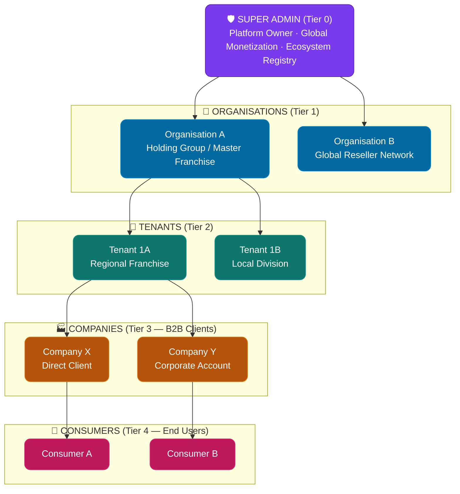

# OrbitoX Universal B2B2C Enterprise Handbook & Boilerplate Blueprint

> **The Ultimate Universal Blueprint & Engineering Reference** for building multi-tenant, white-label, AI-native B2B2C platforms. Copy this `B2B2C_Template_Docs/` directory into any new project to instantly establish a production-grade, SOC2-ready engineering foundation.

| Property | Value |
|---|---|
| **Platform Name** | Universal B2B2C Enterprise Template |
| **Architecture Version** | 4.0 — Fully Integrated 20-Domain Enterprise Blueprint |
| **Classification** | Internal — Engineering Handbook & Standard |
| **Status** | ✅ Production Ready |
| **Compliance Targets** | SOC2 Type II · ISO 27001 · GDPR · CCPA · HIPAA-Ready |

---

## The 5-Tier Universal Hierarchy

Every system instantiated from this template relies on the following 5-tier context stack (`SuperAdmin` → `Organisation` → `Tenant` → `Company` → `Consumer`):

---

## 20-Domain Master Table of Contents

### 01 — Business & Product Specs
| Document | Description |
|---|---|
| [01_Business_Requirements](01_Business/01_Business_Requirements.md) | Multi-tier business goals, role hierarchy tables & permission matrices |
| [02_Flows_and_Lifecycles](01_Business/02_Flows_and_Lifecycles.md) | 9 complete sequence flows: request routing, rule engine, dunning, onboarding |
| [03_Paid_Feature_Gating](02_Product/01_Paid_Feature_Gating_and_Monetization.md) | **[NEW]** Paywalls, 7-day trial timers, plan feature matrices, monetization |

### 03 — Architecture Specs
| Document | Description |
|---|---|
| [01_High_Level_Architecture](03_Architecture/01_High_Level_Architecture.md) | Topology, edge security, load balancers, multi-region failover |
| [02_Multi_Tier_Tenancy](03_Architecture/02_Multi_Tier_Tenancy.md) | Row-level security (RLS), ORM driver injection, IDOR protection |
| [03_Plugin_and_Extension](03_Architecture/03_Plugin_and_Extension_Architecture.md) | Domain-agnostic kernel, runtime dynamic plugins, hook pipeline |
| [04_Workflow_and_Rule_Engine](03_Architecture/04_Workflow_and_Rule_Engine.md) | JSON Logic rule engine, configurable state machines |
| [05_AI_Agent_Framework](03_Architecture/05_AI_Agent_Framework.md) | Multi-tier AI Copilots, Vector RAG isolation, PII masking |

### 04 — Database & Storage Specs
| Document | Description |
|---|---|
| [01_Core_Platform_Schema](04_Database/01_Core_Platform_Schema.md) | ERDs, JSONB dynamic columns, PII encryption at rest, audit tables |

### 05 — Technical Execution Stack
| Document | Description |
|---|---|
| [01_NestJS_Backend_Standards](05_Backend/01_NestJS_Modular_Standards.md) | **[NEW]** Modular NestJS pattern, exception filters, DTO validation pipes |
| [01_Frontend_Design_System](06_Frontend/01_Design_System_and_Theme.md) | **[NEW]** Dynamic theme tokens, glassmorphism, widget layout matrix |
| [01_API_Standards](07_API/01_Universal_API_Standards.md) | **[NEW]** REST response envelopes, pagination, versioning, OpenAPI |

### 08 — Core Functional Modules
| Document | Description |
|---|---|
| [01_Authentication](08_Modules/01_Authentication.md) | RS256 JWTs, MFA, SSO, audited impersonation |
| [02_RBAC_Multi_Tier](08_Modules/02_RBAC_Multi_Tier.md) | Cascading roles, ABAC policy enforcement, fail-closed guards |
| [03_Organisation_Management](08_Modules/03_Organisation_Management.md) | Master franchise controls, aggregated reporting |
| [04_Tenant_Management](08_Modules/04_Tenant_Management.md) | White-label branding, custom domains, automated SSL |
| [05_Company_Management](08_Modules/05_Company_Management.md) | Self-service B2B onboarding, sandbox keys |
| [06_Subscription_and_Billing](08_Modules/06_Subscription_and_Billing.md) | Multi-party rev-share splits, Stripe Connect, anti-fraud |
| [07_Customization_Dynamic_Fields](08_Modules/07_Customization_and_Dynamic_Fields.md) | JSON Schema dynamic form engine, dynamic GIN indexing |
| [08_Event_Bus_and_Webhooks](08_Modules/08_Event_Bus_and_Webhooks.md) | Async BullMQ dispatcher, HMAC webhooks, event replay |

### 09 — Engine Blueprints & Platform Governance
| Document | Description |
|---|---|
| [01_Core_Engines_Blueprint](09_Engines/01_Core_Engines_Blueprint.md) | **[NEW]** Multi-channel notification, audit, search, & analytics engines |
| [01_Security_Threat_Model](10_Security/01_Security_and_Threat_Model.md) | **[NEW]** OWASP mitigations, KMS secret rotation, rate limiting |
| [01_DevOps_CI_CD_Observability](11_DevOps/01_CI_CD_and_Observability.md) | **[NEW]** Docker, K8s, Prometheus, Grafana, backup playbooks |
| [01_Enterprise_Coding_Guidelines](16_Coding_Standards/01_Enterprise_Coding_Guidelines.md) | **[NEW]** SOLID, Clean Architecture, zero-hardcoding rules |

---

## The 5 Golden Engineering Principles

1. **Zero Hardcoded Logic:** All business rules, commission structures, tax rates, and feature gates are loaded dynamically from database configurations or external YAML files.
2. **Strict RLS Data Isolation:** Database queries must automatically include `tenant_id` and `company_id` filters via driver middleware.
3. **Pluggable Domain Features:** The platform core is completely domain-agnostic. Vertical capabilities (E-commerce, MLM, Booking, CRM) load as runtime plugins.
4. **Configuration-Driven UI & Theme:** Frontend UI tokens, colors, logos, and custom fields adapt dynamically based on the resolved 5-tier context.
5. **Fail-Closed Security & Governance:** Any unhandled exception, missing tier header, or unverified JWT claim results in an instant HTTP 403 / 401 response.
