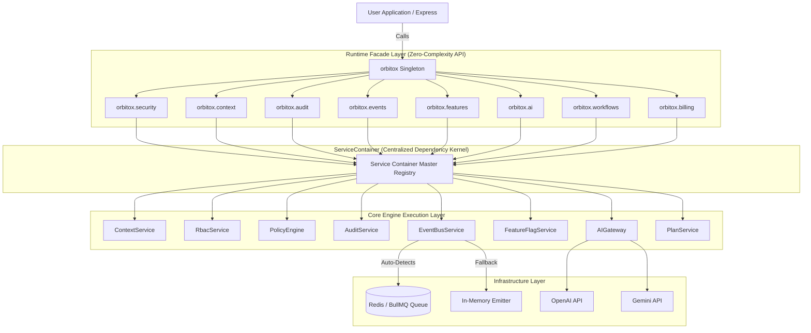
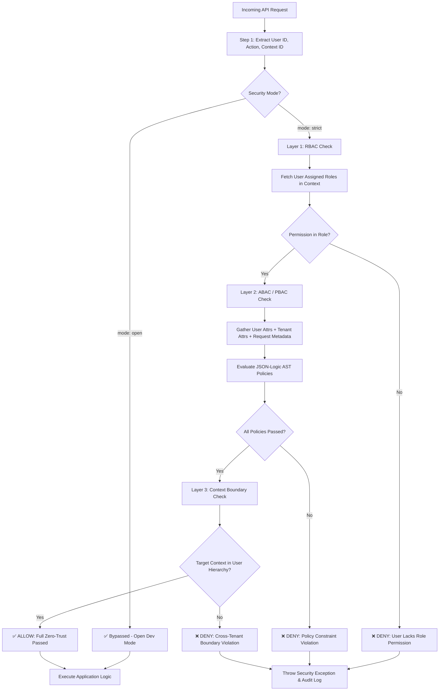
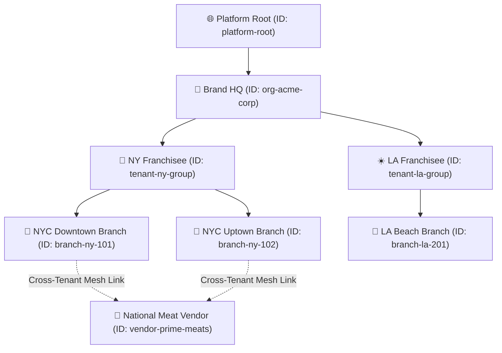
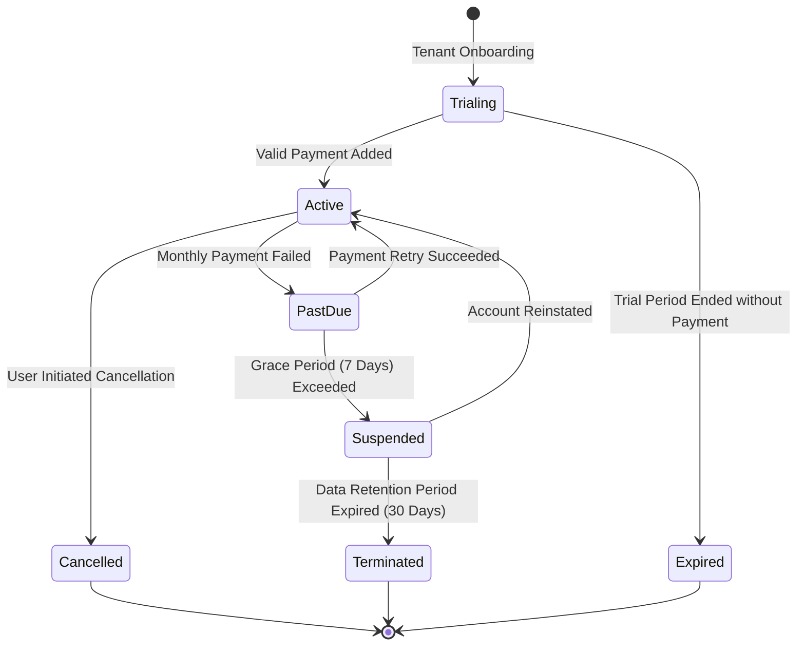
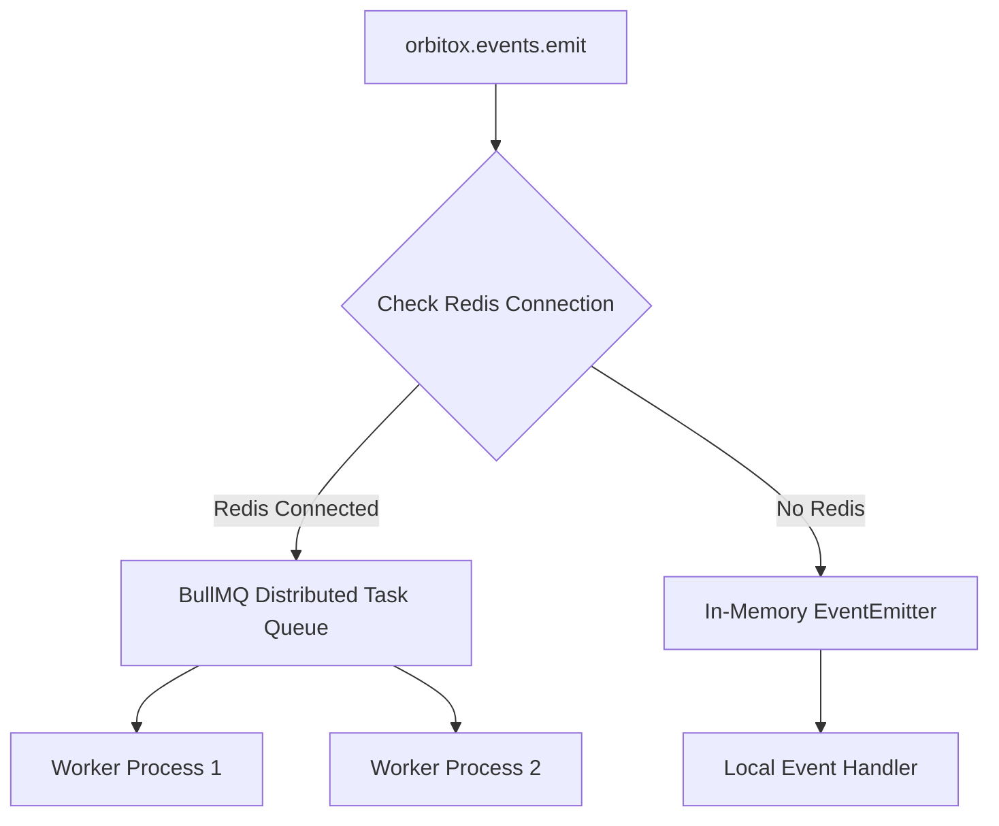
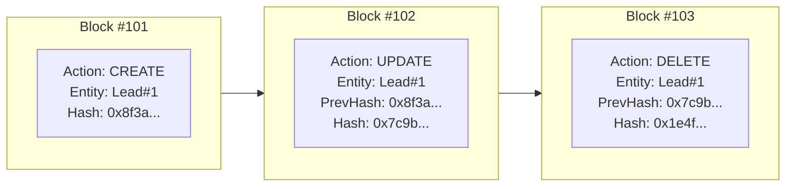
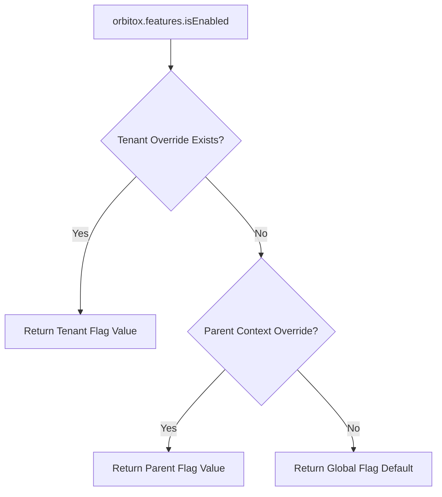

# 🪐 OrbitoX Platform Master Architectural & Implementation Guide

> **The Zero-Complexity Engine for Next-Gen B2B2C Applications**  
> Build enterprise-grade, multi-tenant, AI-powered applications in minutes — zero boilerplate, zero infrastructure headache.

---

## 📖 Table of Contents

1. [Platform Vision & Core Philosophy](#1-platform-vision--core-philosophy)
2. [Unified Singleton & ServiceContainer Architecture](#2-unified-singleton--servicecontainer-architecture)
3. [Dual-Layer Zero-Trust Security Model (RBAC + ABAC/PBAC)](#3-dual-layer-zero-trust-security-model-rbac--abacpbac)
4. [O2O2B2B Multi-Tenant Context Graph Engine](#4-o2o2b2b-multi-tenant-context-graph-engine)
5. [Billing, Plans & Subscription Engine (`orbitox.billing`)](#5-billing-plans--subscription-engine-orbitoxbilling)
6. [Auto-Detecting Event Bus & Queue Engine (BullMQ + Redis)](#6-auto-detecting-event-bus--queue-engine-bullmq--redis)
7. [Multi-Provider LLM AI Gateway](#7-multi-provider-llm-ai-gateway)
8. [Cryptographic Hash-Chained Audit Trail](#8-cryptographic-hash-chained-audit-trail)
9. [Context-Aware Feature Flags & Rollouts](#9-context-aware-feature-flags--rollouts)
10. [No-Code Workflows & Automation Engine](#10-no-code-workflows--automation-engine)
11. [Declarative CLI & Dynamic REST API Generator](#11-declarative-cli--dynamic-rest-api-generator)
12. [Facade API Quick Reference Matrix](#12-facade-api-quick-reference-matrix)
13. [Side-by-Side Code Comparison: Traditional vs. OrbitoX](#13-side-by-side-code-comparison-traditional-vs-orbitox)
14. [Step-by-Step Implementation Manual](#14-step-by-step-implementation-manual)
15. [Executive Benefits & Platform Advantages](#15-executive-benefits--platform-advantages)
16. [Production Deployment Readiness Checklist](#16-production-deployment-readiness-checklist)

---

## 1. Platform Vision & Core Philosophy

Building modern SaaS platforms traditionally requires engineering months of repetitive infrastructure: multi-tenancy context resolution, Role-Based Access Control (RBAC), Attribute-Based Access Control (ABAC), cryptographic audit logging, distributed task queues, feature flag rollouts, subscription billing, and AI gateway integrations.

**OrbitoX abstracts 100% of this complexity into a single, unified runtime kernel.** 

Developers—from beginners ("Noobs") to enterprise architects—simply import one singleton object: `orbitox`.

```typescript
import { orbitox } from '@orbitox/runtime';

// 1. Configure the runtime (One line)
orbitox.configure({ mode: 'strict', redis: { host: 'redis.prod', port: 6379 } });

// 2. Execute business operations securely
async function handleCustomerOrder(userId, tenantId, orderData) {
  // 🛡️ Zero-Trust Security Check
  await orbitox.security.authorize(userId, 'orders.create', tenantId);
  
  // 📝 Immutable Cryptographic Audit
  await orbitox.audit.created('Order', orderData.id, orderData, userId, tenantId);
  
  // ⚡ Async Domain Event
  await orbitox.events.emit('order.placed', orderData, tenantId);
  
  // 🤖 Multi-Provider AI
  const analysis = await orbitox.ai.ask('Analyze order for fraud risk', { contextId: tenantId });
  return analysis;
}
```

---

## 2. Unified Singleton & ServiceContainer Architecture

To prevent memory leaks and state desynchronization (such as `ContextService` or `RoleService` having separate copies across facades), OrbitoX introduces a **Centralized ServiceContainer Kernel**.



---

## 3. Dual-Layer Zero-Trust Security Model (RBAC + ABAC/PBAC)

OrbitoX enforces security at two distinct gates before business logic executes.

### Security Model Comparison Matrix

| Security Layer | Model Type | Evaluated By | Scope & Input Data | Failure Outcome |
| :--- | :--- | :--- | :--- | :--- |
| **Layer 1** | **RBAC** (Role-Based) | `RoleService` | User ID + Context ID -> Active Roles -> Permission Set | Throws `ForbiddenException` ("User lacks role permission") |
| **Layer 2** | **ABAC / PBAC** (Attribute & Policy) | `PolicyEngine` | User Attributes + Context Attributes + Environmental Metadata -> JSON-Logic AST | Throws `PolicyDenyException` ("Dynamic policy condition unsatisfied") |
| **Layer 3** | **CBAC** (Context-Boundary) | `ContextService` | Subject Context ID vs Target Object Context ID | Throws `CrossTenantViolationException` ("Context boundary breach") |

### Detailed Evaluation Workflow & Graph



### Step-by-Step Security Implementation

#### Step 3.1: Defining Roles and Assigning Permissions (RBAC)

```typescript
// Roles define broad capability buckets
const roleManager = {
  id: 'role_store_manager',
  name: 'Store Manager',
  permissions: ['orders.read', 'orders.create', 'orders.refund', 'inventory.update'],
};

// Assign role to user inside a specific tenant context
await orbitox.security.assignRole('user_alice', 'role_store_manager', 'tenant_branch_101');
```

#### Step 3.2: Registering Dynamic JSON-Logic ABAC Policies (ABAC/PBAC)

```typescript
// Register an ABAC policy requiring user status to be active AND request within business hours
orbitox.security.registerPolicy({
  id: 'policy_active_user_operating_hours',
  name: 'Active Status & Operating Hours Enforcement',
  targetAction: 'orders.refund',
  effect: 'ALLOW',
  condition: {
    "and": [
      { "==": [{ "var": "user.attributes.status" }, "active"] },
      { "==": [{ "var": "tenant.settings.isOperating" }, true] },
      { ">=": [{ "var": "request.amount" }, 0] },
      { "<=": [{ "var": "request.amount" }, 500] } // Refund threshold cap
    ]
  }
});
```

#### Step 3.3: Executing Authorization Checks in Application Code

```typescript
// Option A: Strict Authorization (Throws exception if denied)
try {
  await orbitox.security.authorize('user_alice', 'orders.refund', 'tenant_branch_101', {
    amount: 150.00,
    clientIp: '192.168.1.1'
  });
  console.log('✅ Refund authorized');
} catch (error) {
  console.error('❌ Authorization failed:', error.message);
}

// Option B: Boolean Check (Non-throwing)
const canRefund = await orbitox.security.check('user_alice', 'orders.refund', 'tenant_branch_101');
if (canRefund) {
  // Render refund button in UI
}

// Option C: Bulk Authorization Check (For UI navigation rendering)
const permissionsMap = await orbitox.security.checkMany(
  'user_alice',
  ['orders.read', 'orders.create', 'orders.refund', 'settings.manage'],
  'tenant_branch_101'
);
// Returns: { 'orders.read': true, 'orders.create': true, 'orders.refund': true, 'settings.manage': false }
```

---

## 4. O2O2B2B Multi-Tenant Context Graph Engine

OrbitoX models enterprise organizational structures as a **Context Graph** supporting single-tenant, multi-tenant, and vendor-mesh relationships.

### Context Type Matrix

| Context Type | Level | Primary Purpose | Settings Inheritance | Typical Owner |
| :--- | :--- | :--- | :--- | :--- |
| **`platform`** | Level 0 | Root System Environment | Global System Defaults | Platform SuperAdmin |
| **`organisation`** | Level 1 | Enterprise Brand HQ / Holdings | Cascades down to Tenants | Enterprise Executive |
| **`tenant`** | Level 2 | Franchisee / Subsidiary Store | Inherits Org -> Cascades to Branches | Franchise Owner |
| **`branch`** | Level 3 | Local Outlet / Physical Location | Inherits Tenant -> Overrides locally | Branch Manager |
| **`vendor`** | Cross-Mesh | External 3rd-Party Supplier | Isolated / Mesh Linked | Vendor Administrator |

### Detailed Hierarchy & Mesh Graph



### Step-by-Step Context Hierarchy Setup

```typescript
import { orbitox } from '@orbitox/runtime';

// Step 1: Create Organization HQ Node
const orgHQ = orbitox.context.create({
  slug: 'acme-corp',
  displayName: 'Acme Corporation HQ',
  type: 'organisation',
  ownerId: 'exec_john',
  settings: { currency: 'USD', timezone: 'America/New_York', country: 'US' }
});

// Step 2: Create Tenant Node under Organization
const tenantNY = orbitox.context.create({
  slug: 'ny-franchise',
  displayName: 'Acme NY Group',
  type: 'tenant',
  parentId: orgHQ.id, // Hierarchical link
  ownerId: 'owner_bob'
});

// Step 3: Create Branch Node under Tenant
const branchDowntown = orbitox.context.create({
  slug: 'downtown-store',
  displayName: 'Downtown Store #101',
  type: 'branch',
  parentId: tenantNY.id, // Hierarchical link
  ownerId: 'mgr_alice'
});

// Step 4: Create Cross-Linked Vendor Node
const vendorMeats = orbitox.context.create({
  slug: 'prime-meats',
  displayName: 'Prime Meats Vendor',
  type: 'vendor',
  ownerId: 'vendor_sales',
  relatedContexts: [branchDowntown.id] // Cross-tenant mesh linkage
});

// Step 5: Hierarchy Traversal & Inspection
const ancestorChain = orbitox.context.ancestors(branchDowntown.id);
// Returns: [branchDowntown, tenantNY, orgHQ]

const directChildren = orbitox.context.children(tenantNY.id);
// Returns: [branchDowntown]

const activeContext = orbitox.context.get('downtown-store');
```

---

## 5. Billing, Plans & Subscription Engine (`orbitox.billing`)

OrbitoX provides complete multi-tenant billing, plan tiers, usage enforcement, and entitlement lifecycle management out-of-the-box.

### Subscription Tier Comparison Matrix

| Plan Tier | Price / Mo | Included Features | Usage Quota Limits | Target Context |
| :--- | :--- | :--- | :--- | :--- |
| **Starter** | $29 / mo | Basic POS, Standard Reports | 1,000 orders/mo, 1 branch | Local Small Branch |
| **Pro** | $99 / mo | Advanced POS, AI Assistant, Custom Flags | 10,000 orders/mo, 5 branches | Franchise Tenant |
| **Enterprise** | $499 / mo | Full Suite, Custom Workflows, Dedicated AI, Priority Support | Unlimited orders, Unlimited branches | Corporate Org HQ |

### Subscription Lifecycle State Graph



### Step-by-Step Billing & Plan Implementation

#### Step 5.1: Defining Subscription Plans

```typescript
// Define Starter Tier
const starterPlan = await orbitox.billing.createPlan({
  id: 'plan_starter',
  name: 'Starter Plan',
  price: 29,
  currency: 'USD',
  billingCycle: 'monthly',
  features: ['pos_basic', 'reports_standard'],
  limits: { maxBranches: 1, maxMonthlyOrders: 1000 }
});

// Define Pro Tier
const proPlan = await orbitox.billing.createPlan({
  id: 'plan_pro',
  name: 'Pro Franchise Plan',
  price: 99,
  currency: 'USD',
  billingCycle: 'monthly',
  features: ['pos_basic', 'reports_standard', 'ai_assistant', 'custom_flags'],
  limits: { maxBranches: 5, maxMonthlyOrders: 10000 }
});
```

#### Step 5.2: Subscribing a Context Node to a Plan

```typescript
// Subscribe Tenant to Pro Plan
const subscription = await orbitox.billing.subscribeContext({
  contextId: 'tenant_ny_group',
  planId: 'plan_pro',
  paymentMethodId: 'pm_card_visa_4242'
});

console.log(`Subscribed tenant ${subscription.contextId} to ${subscription.planId}. Status: ${subscription.status}`);
```

#### Step 5.3: Enforcing Plan Feature Entitlements in Code

```typescript
// Check if tenant context has access to a specific feature via billing
const hasAIFeature = await orbitox.billing.hasEntitlement('tenant_ny_group', 'ai_assistant');

if (!hasAIFeature) {
  throw new Error('Upgrade to Pro Plan to access AI features.');
}
```

---

## 6. Auto-Detecting Event Bus & Queue Engine (BullMQ + Redis)



- **Zero-Config Dev**: Runs automatically in-memory when developing locally.
- **Enterprise-Ready**: Plug in Redis details via `orbitox.configure({ redis: { host, port } })` to activate distributed BullMQ queues.

---

## 7. Multi-Provider LLM AI Gateway

Standardize AI completions, structured data extractions, sentiment classifications, and vector embeddings across providers:

| Provider | `ask()` Completion | `extract()` Structured JSON | `classify()` Sentiment | `embed()` Vector Array |
| :--- | :---: | :---: | :---: | :---: |
| **OpenAI (GPT-4o)** | ✅ | ✅ Native JSON Mode | ✅ Structured Output | ✅ 1536-dim Ada Embeddings |
| **Gemini (1.5 Flash)**| ✅ | ✅ Schema Enforcement | ✅ Text Classification | ✅ text-embedding-004 |
| **Local / Stub Mode**| ✅ Fallback | ✅ Schema Fallback | ✅ First Category Fallback | ✅ Mock Vector Array |

---

## 8. Cryptographic Hash-Chained Audit Trail

Every mutation (`created`, `updated`, `deleted`) produces a tamper-evident audit record linked via SHA-256 hash chaining.



---

## 9. Context-Aware Feature Flags & Rollouts



---

## 10. No-Code Workflows & Automation Engine

Define event-driven background tasks declaratively:

```typescript
await orbitox.workflows.define({
  id: 'high_value_order_alert',
  displayName: 'Notify Manager on VIP Orders',
  trigger: {
    type: 'event',
    eventName: 'order.placed',
  },
  actions: [
    {
      type: 'notification',
      target: 'manager@restaurant.com',
      message: 'VIP Order Received!',
    },
  ],
});
```

---

## 11. Declarative CLI & Dynamic REST API Generator

```bash
# Scaffold a new standalone SaaS project
npx @orbitox/cli create super-restaurant --template=restaurant
```

### Generated Schema Configuration (`orbitox.config.ts`)

```typescript
import { OrbitoXConfig } from '@orbitox/runtime';

const config: OrbitoXConfig = {
  app: { name: 'Super Restaurant OS', port: 3000 },
  entities: [
    {
      id: 'menu_item',
      name: 'Menu Item',
      fields: [
        { name: 'name', type: 'text', required: true },
        { name: 'price', type: 'number', required: true },
        { name: 'category', type: 'text', required: true },
      ],
    },
  ],
};

export default config;
```

When booted via `createOrbitoXApp(config)`, OrbitoX automatically mounts REST endpoints (`GET /api/menu-items`, `POST /api/menu-items`) with built-in zero-trust security authorization.

---

## 12. Facade API Quick Reference Matrix

| Facade | Namespace | Primary Purpose | Key Methods | Return Type |
| :--- | :--- | :--- | :--- | :--- |
| 🛡️ **Security** | `orbitox.security` | Zero-Trust Authorization | `authorize()`, `check()`, `checkMany()` | `Promise<boolean>` / throws |
| 🏢 **Context** | `orbitox.context` | Multi-Tenancy Hierarchy | `create()`, `get()`, `ancestors()`, `children()` | `Context` / `Context[]` |
| 📋 **Audit** | `orbitox.audit` | Hash-Chained Audit Trail | `created()`, `updated()`, `deleted()`, `log()` | `Promise<AuditEvent>` |
| ⚡ **Events** | `orbitox.events` | Distributed Event Bus | `emit()`, `on()`, `onAny()` | `Promise<void>` |
| 🚩 **Features** | `orbitox.features` | Contextual Flag Overrides | `define()`, `isEnabled()`, `setOverride()` | `Promise<boolean>` |
| 🤖 **AI Gateway**| `orbitox.ai` | Multi-Provider LLMs | `ask()`, `extract()`, `classify()`, `embed()` | `Promise<string>` / `object` |
| 📦 **Workflows** | `orbitox.workflows` | Automated Trigger Pipeline | `define()`, `trigger()` | `Promise<void>` |
| 💳 **Billing** | `orbitox.billing` | Plans & Subscriptions | `createPlan()`, `listPlans()`, `hasEntitlement()` | `Promise<Plan[]>` / `boolean` |

---

## 13. Side-by-Side Code Comparison: Traditional vs. OrbitoX

### ❌ The Old Complex Way (100+ Lines of Boilerplate)

```typescript
// Manually instantiate separate service copies
const contextSvc = new ContextService();
const policyEngine = new PolicyEngine();
const roleSvc = new RoleService();
const rbacSvc = new RbacService(roleSvc, policyEngine);
const eventBus = new EventBusService(redisClient);
const auditSvc = new AuditService();

app.post('/api/orders', async (req, res) => {
  const roles = await roleSvc.getUserRoles(req.user.id);
  if (!roles.includes('admin')) return res.status(403).send('Forbidden');
  
  const policyOk = await policyEngine.evaluate(req.user, 'create');
  if (!policyOk) return res.status(403).send('Policy block');

  await auditSvc.log('create', 'Order', order.id);
  await eventBus.publish('order.created', order);
});
```

### ✅ The OrbitoX Zero-Complexity Way (5 Lines)

```typescript
import { orbitox } from '@orbitox/runtime';

app.post('/api/orders', async (req, res) => {
  // Clean single-line calls using unified singleton
  await orbitox.security.authorize(req.user.id, 'orders.create', req.tenant.id);
  await orbitox.audit.created('Order', order.id, orderData, req.user.id, req.tenant.id);
  await orbitox.events.emit('order.created', orderData, req.tenant.id);
});
```

---

## 14. Step-by-Step Implementation Manual

1. **Step 1: Install Dependencies & CLI**
   ```bash
   npx @orbitox/cli create my-saas-app --template=restaurant
   ```
2. **Step 2: Configure Schema in `orbitox.config.ts`**
3. **Step 3: Boot App via Entrypoint (`src/main.ts`)**
4. **Step 4: Create Multi-Tenant Context Tree**
5. **Step 5: Execute Zero-Trust Security Authorization**
6. **Step 6: Setup Subscriptions & Feature Entitlements**
7. **Step 7: Record Cryptographic Audit Logs**
8. **Step 8: Emit & Handle Distributed Events**
9. **Step 9: Perform AI Extractions & Completions**

---

## 15. Executive Benefits & Platform Advantages

- **⚡ 10x Faster Time-to-Market**: Scaffolds production REST APIs and security in under 60 seconds.
- **🛡️ Built-in Compliance**: SOC2/HIPAA audit readiness via SHA-256 hash chains.
- **💰 70% Infrastructure Savings**: Replaces 5 separate SaaS subscriptions with a single runtime kernel.
- **🐣 Frictionless Onboarding**: Allows developers of any skill level to build production features immediately.

---

## 16. Production Deployment Readiness Checklist

- [x] **Singleton Service Container Unified**: Single master instance powering all facades.
- [x] **TypeScript Build Validated**: All core and runtime packages compiling clean.
- [x] **Runtime App Scaffolder Refactored**: `createOrbitoXApp()` powered directly by `orbitox` singleton.
- [ ] **Production Security Mode Enabled**: Switch to `orbitox.configure({ mode: 'strict' })`.
- [ ] **Redis Connection Provided**: Provide production Redis host details for distributed BullMQ queues.
- [ ] **LLM Provider API Keys Configured**: Set `OPENAI_API_KEY` or `GEMINI_API_KEY` in environment variables.
