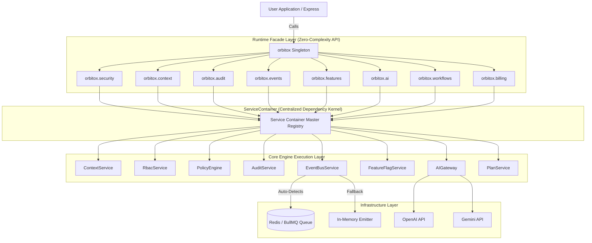
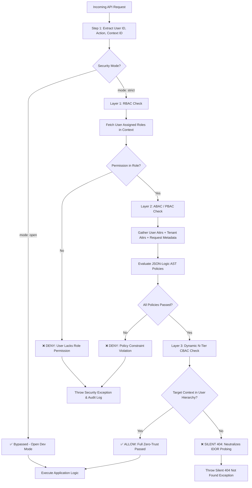
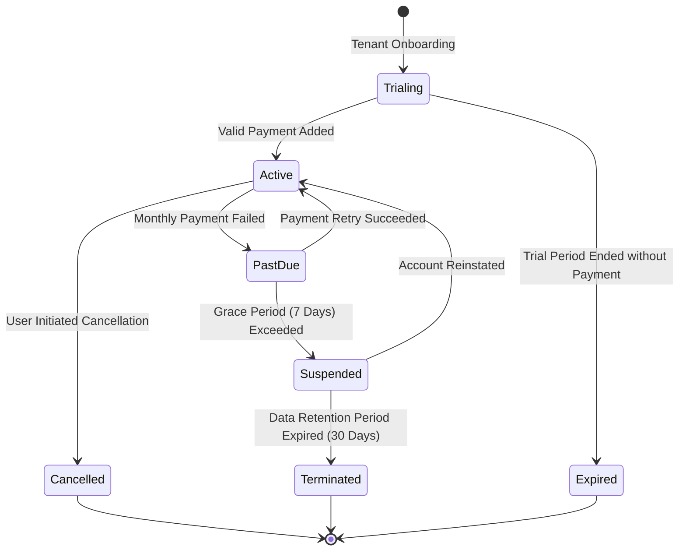
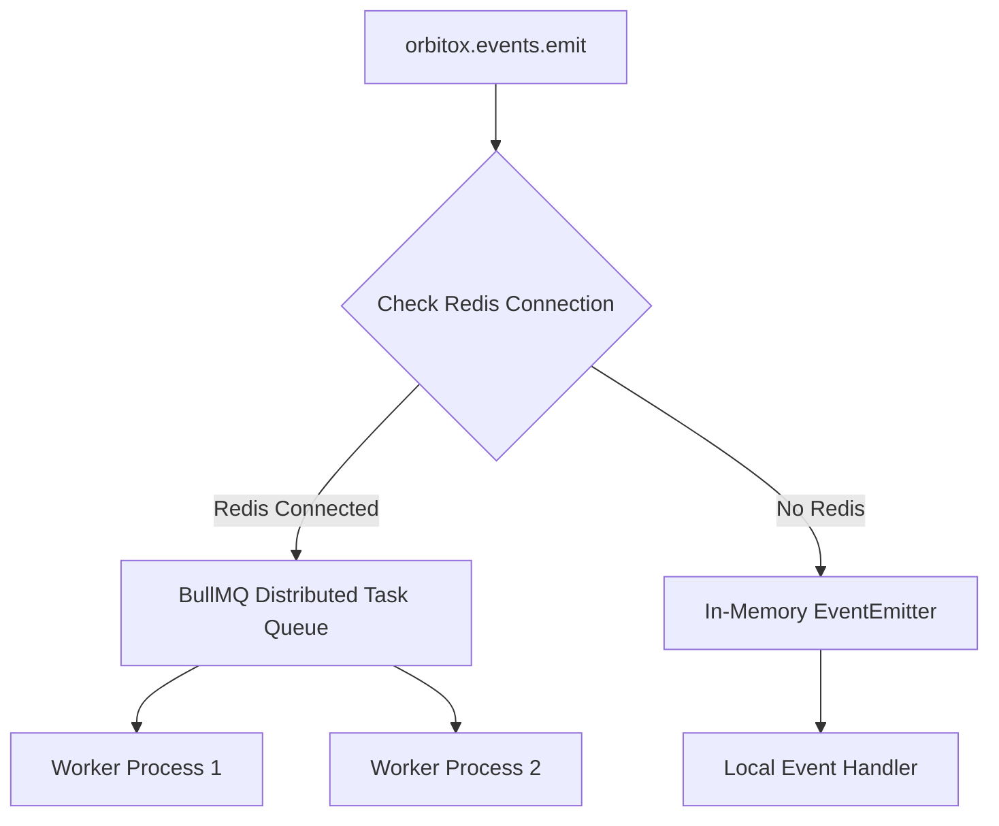
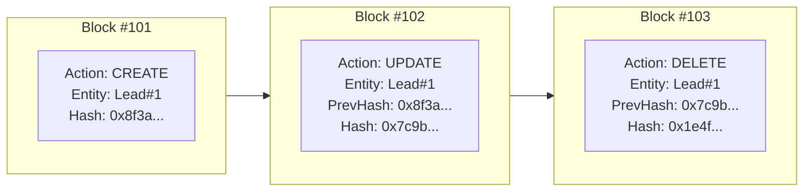
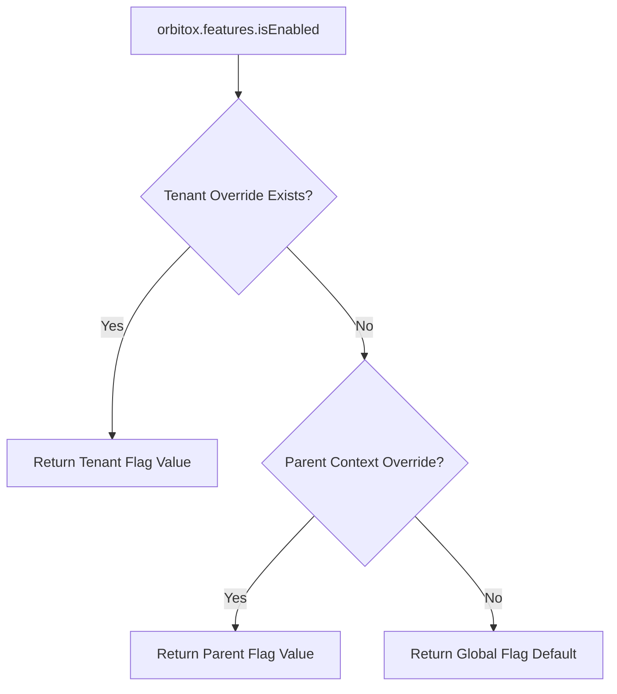

# 🪐 OrbitoX Platform Master Architectural & Implementation Guide

> **The Zero-Complexity Engine for Next-Gen B2B2C Applications**  
> Build enterprise-grade, multi-tenant, AI-powered applications in minutes — zero boilerplate, zero infrastructure headache.

---

## 📖 Table of Contents

1. [Platform Vision & Core Philosophy](#1-platform-vision--core-philosophy)
2. [Unified Singleton & ServiceContainer Architecture](#2-unified-singleton--servicecontainer-architecture)
3. [Dual-Layer Zero-Trust Security Model (RBAC + ABAC/PBAC)](#3-dual-layer-zero-trust-security-model-rbac--abacpbac)
4. [O2O2B2B Multi-Tenant Context Graph Engine](#4-o2o2b2b-multi-tenant-context-graph-engine)
5. [Billing, Plans & Subscription Engine (`orbitox.billing`)](#5-billing-plans--subscription-engine-orbitoxbilling)
6. [Auto-Detecting Event Bus & Queue Engine (BullMQ + Redis)](#6-auto-detecting-event-bus--queue-engine-bullmq--redis)
7. [Multi-Provider LLM AI Gateway](#7-multi-provider-llm-ai-gateway)
8. [Cryptographic Hash-Chained Audit Trail](#8-cryptographic-hash-chained-audit-trail)
9. [Context-Aware Feature Flags & Rollouts](#9-context-aware-feature-flags--rollouts)
10. [No-Code Workflows & Automation Engine](#10-no-code-workflows--automation-engine)
11. [Declarative CLI & Dynamic REST API Generator](#11-declarative-cli--dynamic-rest-api-generator)
12. [Facade API Quick Reference Matrix](#12-facade-api-quick-reference-matrix)
13. [Side-by-Side Code Comparison: Traditional vs. OrbitoX](#13-side-by-side-code-comparison-traditional-vs-orbitox)
14. [Step-by-Step Implementation Manual](#14-step-by-step-implementation-manual)
15. [Executive Benefits & Platform Advantages](#15-executive-benefits--platform-advantages)
16. [Production Deployment Readiness Checklist](#16-production-deployment-readiness-checklist)

---

## 1. Platform Vision & Core Philosophy

Building modern SaaS platforms traditionally requires engineering months of repetitive infrastructure: multi-tenancy context resolution, Role-Based Access Control (RBAC), Attribute-Based Access Control (ABAC), cryptographic audit logging, distributed task queues, feature flag rollouts, subscription billing, and AI gateway integrations.

**OrbitoX abstracts 100% of this complexity into a single, unified runtime kernel.** 

Developers—from beginners ("Noobs") to enterprise architects—simply import one singleton object: `orbitox`.

```typescript
import express from 'express';
import { orbitox } from '@orbitox/runtime';

const app = express();

// 1. Configure the runtime (One line changes everything)
orbitox.configure({ mode: 'strict', redis: { host: 'redis.prod', port: 6379 } });

// 2. Add OrbitoX Middleware (auto-resolves subdomains/headers, validates auth, logs audits)
app.use(orbitox.middleware({ strictDomainProtection: true, enforceAuth: true }));

// 3. Ultra-Easy Builder Setup
const tenant = await orbitox.tenant('acme-corp', 'Acme Corporation HQ')
  .owner('exec_john')
  .subscribe('pro-plan')
  .enableFeature('ai_assistant')
  .create();

// 4. Execute business operations securely in route handlers
app.post('/api/orders', async (req, res) => {
  const { orbitoxUser, orbitoxContext, orbitoxScopeFilter } = req as any;
  const orderData = req.body;

  // 🛡️ Zero-Trust Security Check (RBAC + ABAC + CBAC)
  await orbitox.security.authorize(orbitoxUser.id, 'orders.create', orbitoxContext.id);
  
  // 📝 Immutable Cryptographic Audit
  await orbitox.audit.created('Order', orderData.id, orderData, orbitoxUser.id, orbitoxContext.id);
  
  // ⚡ Async Domain Event
  await orbitox.events.emit('order.placed', orderData, orbitoxContext.id);
  
  // 🤖 Multi-Provider AI
  const analysis = await orbitox.ai.ask('Analyze order for fraud risk', { contextId: orbitoxContext.id });
  res.json({ success: true, analysis });
});
```

---

## 2. Unified Singleton & ServiceContainer Architecture

To prevent memory leaks and state desynchronization (such as `ContextService` or `RoleService` having separate copies across facades), OrbitoX introduces a **Centralized ServiceContainer Kernel**.



---

## 3. Dual-Layer Zero-Trust Security & Dynamic N-Tier Data Isolation

OrbitoX enforces zero-trust security gates and **Dynamic N-Tier Data Isolation** (supporting 1-Tier, 2-Tier, 3-Tier, 4-Tier, 5-Tier, up to arbitrary N-Tier deep context hierarchies).

### Security Model Comparison Matrix

| Security Layer | Model Type | Evaluated By | Scope & Input Data | Failure Outcome |
| :--- | :--- | :--- | :--- | :--- |
| **Layer 1** | **RBAC** (Role-Based) | `RoleService` | User ID + Context ID -> Active Roles -> Permission Set | Throws `ForbiddenException` ("User lacks role permission") |
| **Layer 2** | **ABAC / PBAC** (Attribute & Policy) | `PolicyEngine` | User Attributes + Context Attributes + Environmental Metadata -> JSON-Logic AST | Throws `PolicyDenyException` ("Dynamic policy condition unsatisfied") |
| **Layer 3** | **CBAC & IDOR Defense** (Context-Boundary) | `SecurityFacade` / `ContextService` | Subject Context ID vs Target Object Context ID | Throws Silent `404 Not Found` (Prevents resource probing) |
| **Layer 4** | **Immutable Write Protection** | `SecurityFacade.sanitizeWritePayload` | Mutation payloads on `PUT` / `PATCH` | Automatically strips immutable context IDs (`contextId`, `tenantId`, `orgId`) |

### Detailed Evaluation Workflow & Graph



### Step-by-Step Security Implementation

#### Step 3.1: Defining Policies via Ultra-Easy Policy Builder

```typescript
import { orbitox } from '@orbitox/runtime';

// Register dynamic ABAC policy with fluent constraints
orbitox.security.policy('strict-refund-policy')
  .resource('order')
  .action('refund')
  .requireUserAttribute('status', 'active')
  .maxFieldValue('request.amount', 500)
  .register();

// Full CRUD for Policies:
const policy = orbitox.security.policy('strict-refund-policy').get();

// Update Policy limits
orbitox.security.policy('strict-refund-policy')
  .maxFieldValue('request.amount', 1000)
  .update();

// Delete Policy
orbitox.security.policy('strict-refund-policy').delete();
```

#### Step 3.2: Dynamic N-Tier Data Scoping (ORM WHERE Clause)

```typescript
// Generate automatic multi-tier WHERE clause for Prisma/TypeORM/Knex
const whereClause = await orbitox.security.getVisibilityClause(
  'tenant_branch_101', 
  'user_alice', 
  'orders'
);
// Returns: { OR: [{ contextId: 'tenant_branch_101' }, { tenantId: 'tenant_branch_101' }, { orgId: 'tenant_branch_101' }], AND: [{ OR: [{ ownerId: 'user_alice' }, { assignedTo: 'user_alice' }] }] }
```

#### Step 3.3: Immutable Hierarchy Write Protection

```typescript
// Prevents context-spoofing and privilege escalation on updates:
const cleanPayload = orbitox.security.sanitizeWritePayload(
  { name: 'Updated Order', tenantId: 'malicious_tenant_id' }, 
  true // isUpdate
);
// Returns: { name: 'Updated Order' } (tenantId automatically stripped!)
```

#### Step 3.4: IDOR Defense with Silent 404s

```typescript
// If a user from tenant A tries to access a resource in tenant B:
try {
  orbitox.security.enforceContextBoundary('tenant_A', 'tenant_B');
} catch (err) {
  // Throws 404 Not Found (NOT 403) to prevent resource ID scanning!
  console.log(err.status); // 404
}
```

---

## 4. O2O2B2B Multi-Tenant Context Graph & Inter-Branch Mesh Engine

OrbitoX models enterprise organizational structures as a **Context Graph** supporting single-tenant, multi-tenant, parent-scoped slugs (`org:slug`, `org/slug`), and **Inter-Branch Mesh Collaboration** (for Amazon Fulfillment Centers, Hospital Groups, and Retail Franchise Networks).

### Context Type Matrix

| Context Type | Level | Primary Purpose | Settings Inheritance | Typical Owner |
| :--- | :--- | :--- | :--- | :--- |
| **`platform`** | Level 0 | Root System Environment | Global System Defaults | Platform SuperAdmin |
| **`organisation`** | Level 1 | Enterprise Brand HQ / Holdings | Cascades down to Tenants | Enterprise Executive |
| **`tenant`** | Level 2 | Franchisee / Subsidiary Store | Inherits Org -> Cascades to Branches | Franchise Owner |
| **`branch`** | Level 3 | Local Outlet / Physical Location | Inherits Tenant -> Overrides locally | Branch Manager |
| **`vendor`** | Cross-Mesh | External 3rd-Party Supplier | Isolated / Mesh Linked | Vendor Administrator |

### Detailed Hierarchy & Mesh Graph

```mermaid
graph TD
    Platform["🌐 Platform Root (ID: platform-root)"]
    OrgBrand["🏢 Brand HQ (ID: org-acme-corp)"]
    
    TenantNY["🗽 NY Franchisee (ID: tenant-ny-group)"]
    TenantLA["☀️ LA Franchisee (ID: tenant-la-group)"]
    
    BranchDowntown["📍 NYC Downtown Branch (ID: branch-ny-101)"]
    BranchUptown["📍 NYC Uptown Branch (ID: branch-ny-102)"]
    BranchLABeach["📍 LA Beach Branch (ID: branch-la-201)"]
    
    VendorSupplies["🥩 National Meat Vendor (ID: vendor-prime-meats)"]

    Platform --> OrgBrand
    OrgBrand --> TenantNY
    OrgBrand --> TenantLA
    
    TenantNY --> BranchDowntown
    TenantNY --> BranchUptown
    TenantLA --> BranchLABeach
    
    BranchDowntown <==>|Inter-Branch Mesh (Stock & Supply)| BranchUptown
    BranchDowntown -.->|Cross-Tenant Mesh Link| VendorSupplies
    BranchUptown -.->|Cross-Tenant Mesh Link| VendorSupplies
```

### Step-by-Step Context Hierarchy & Inter-Branch Setup

#### Step 4.1: Fluent Tenant Creation via `TenantBuilder`

```typescript
import { orbitox } from '@orbitox/runtime';

// 1. Create Organization HQ
const orgHQ = await orbitox.tenant('acme-corp', 'Acme Corporation HQ')
  .type('organisation')
  .owner('exec_john')
  .settings({ currency: 'USD', timezone: 'America/New_York' })
  .create();

// 2. Create NY Franchise under Acme HQ
const tenantNY = await orbitox.tenant('ny-franchise', 'Acme NY Group')
  .type('tenant')
  .parent(orgHQ.id) // Hierarchical Parent Link
  .owner('owner_bob')
  .subscribe('plan_pro')
  .create();

// 3. Create Downtown Branch
const branchDowntown = await orbitox.tenant('downtown-store', 'Downtown Store #101')
  .type('branch')
  .parent(tenantNY.id)
  .owner('mgr_alice')
  .create();
```

#### Step 4.2: Full CRUD for Tenants & Contexts

```typescript
// READ
const branch = await orbitox.tenant('downtown-store').parent(tenantNY.id).get();

// UPDATE (Settings deep merged, hierarchy mutation protected)
await orbitox.tenant('downtown-store')
  .parent(tenantNY.id)
  .settings({ operatingHours: '8am - 10pm' })
  .update();

// DELETE
await orbitox.tenant('downtown-store').parent(tenantNY.id).delete();
```

#### Step 4.3: Inter-Branch Mesh & Peer Collaboration (Hospital / Amazon Network Flow)

Organizations can grant explicit permissions for sibling branches under the same Org to see stock levels, send supply transfer requests, and communicate securely:

```typescript
// 1. Link Sibling Branches on creation
const branchUptown = await orbitox.tenant('uptown-store', 'Uptown Store #102')
  .type('branch')
  .parent(tenantNY.id)
  .linkPeer(branchDowntown.id, ['inventory.read', 'supply.request'])
  .create();

// 2. Or dynamically link peers:
orbitox.context.linkPeers(branchDowntown.id, branchUptown.id, [
  'inventory.read', 
  'supply.request', 
  'messages.send'
]);

// 3. Validate Inter-Branch Access
const canCheckStock = orbitox.context.canPeerAccess(branchDowntown.id, branchUptown.id, 'inventory.read');
console.log('Downtown can view Uptown stock?', canCheckStock); // true

// 4. Query Stock across all authorized Peer Branches
const peerBranches = orbitox.context.getAccessiblePeerContexts(branchDowntown.id, 'inventory.read');
const peerIds = peerBranches.map(b => b.id);

// Generate multi-branch WHERE clause for repository queries
const whereClause = await orbitox.security.getPeerVisibilityClause(branchDowntown.id, peerIds, 'user_alice');
// Result: { OR: [{ contextId: 'branch-ny-101' }, { contextId: 'branch-ny-102' }] }
```

---

## 5. Billing, Plans & Subscription Engine (`orbitox.billing`)

OrbitoX provides complete multi-tenant billing, plan tiers, usage enforcement, and entitlement lifecycle management out-of-the-box via the fluent `PlanBuilder`.

### Subscription Tier Comparison Matrix

| Plan Tier | Price / Mo | Included Features | Usage Quota Limits | Target Context |
| :--- | :--- | :--- | :--- | :--- |
| **Starter** | $29 / mo | Basic POS, Standard Reports | 1,000 orders/mo, 1 branch | Local Small Branch |
| **Pro** | $99 / mo | Advanced POS, AI Assistant, Custom Flags | 10,000 orders/mo, 5 branches | Franchise Tenant |
| **Enterprise** | $499 / mo | Full Suite, Custom Workflows, Dedicated AI, Priority Support | Unlimited orders, Unlimited branches | Corporate Org HQ |

### Subscription Lifecycle State Graph



### Step-by-Step Billing & Plan Implementation

#### Step 5.1: Defining Subscription Plans with Fluent PlanBuilder

```typescript
// Define Pro Tier with fluent chain
const proPlan = await orbitox.billing.buildPlan('pro-plan', 'Pro Franchise Plan')
  .price(99, 'USD')
  .interval('monthly')
  .features(['pos_basic', 'reports_standard', 'ai_assistant', 'custom_flags'])
  .limit('maxBranches', 5)
  .limit('maxMonthlyOrders', 10000)
  .publish();

// Full CRUD for Plans:
// READ
const plan = await orbitox.billing.buildPlan('pro-plan').get();

// UPDATE
await orbitox.billing.buildPlan('pro-plan')
  .price(119, 'USD')
  .limit('maxMonthlyOrders', 15000)
  .update();

// DELETE (Soft delete)
await orbitox.billing.buildPlan('pro-plan').delete();
```

#### Step 5.2: Enforcing Plan Feature Entitlements in Code

```typescript
// Check if tenant context has access to a specific feature via billing
const hasAIFeature = await orbitox.billing.hasEntitlement('tenant_ny_group', 'ai_assistant');

if (!hasAIFeature) {
  throw new Error('Upgrade to Pro Plan to access AI features.');
}
```

---

## 6. Auto-Detecting Event Bus & Queue Engine (BullMQ + Redis)



- **Zero-Config Dev**: Runs automatically in-memory when developing locally.
- **Enterprise-Ready**: Plug in Redis details via `orbitox.configure({ redis: { host, port } })` to activate distributed BullMQ queues.

---

## 7. Multi-Provider LLM AI Gateway

Standardize AI completions, structured data extractions, sentiment classifications, and vector embeddings across providers:

| Provider | `ask()` Completion | `extract()` Structured JSON | `classify()` Sentiment | `embed()` Vector Array |
| :--- | :---: | :---: | :---: | :---: |
| **OpenAI (GPT-4o)** | ✅ | ✅ Native JSON Mode | ✅ Structured Output | ✅ 1536-dim Ada Embeddings |
| **Gemini (1.5 Flash)**| ✅ | ✅ Schema Enforcement | ✅ Text Classification | ✅ text-embedding-004 |
| **Local / Stub Mode**| ✅ Fallback | ✅ Schema Fallback | ✅ First Category Fallback | ✅ Mock Vector Array |

---

## 8. Cryptographic Hash-Chained Audit Trail

Every mutation (`created`, `updated`, `deleted`) produces a tamper-evident audit record linked via SHA-256 hash chaining.



---

## 9. Context-Aware Feature Flags & Rollouts



---

## 10. No-Code Workflows & Automation Engine

Define event-driven background tasks declaratively using the fluent `WorkflowBuilder`:

```typescript
// 1. Build and activate workflow
await orbitox.workflows.build('high_value_order_alert', 'Notify Manager on VIP Orders')
  .onEvent('order.placed')
  .action({
    type: 'notification',
    target: 'manager@restaurant.com',
    message: 'VIP Order Received!',
  })
  .delay(300) // Delay 5 minutes
  .activate();

// Full CRUD for Workflows:
// READ
const flow = await orbitox.workflows.build('high_value_order_alert').get();

// UPDATE
await orbitox.workflows.build('high_value_order_alert')
  .displayName('Updated VIP Alert Flow')
  .update();

// DELETE
await orbitox.workflows.build('high_value_order_alert').delete();
```

---

## 11. Declarative CLI & Dynamic REST API Generator

```bash
# Scaffold a new standalone SaaS project
npx @orbitox/cli create super-restaurant --template=restaurant
```

### Generated Schema Configuration (`orbitox.config.ts`)

```typescript
import { OrbitoXConfig } from '@orbitox/runtime';

const config: OrbitoXConfig = {
  app: { name: 'Super Restaurant OS', port: 3000 },
  entities: [
    {
      id: 'menu_item',
      name: 'Menu Item',
      fields: [
        { name: 'name', type: 'text', required: true },
        { name: 'price', type: 'number', required: true },
        { name: 'category', type: 'text', required: true },
      ],
    },
  ],
};

export default config;
```

When booted via `createOrbitoXApp(config)`, OrbitoX automatically mounts REST endpoints (`GET /api/menu-items`, `POST /api/menu-items`) with built-in zero-trust security authorization.

---

## 12. Facade API Quick Reference Matrix

| Facade | Namespace / Helper | Primary Purpose | Key Methods | Return Type |
| :--- | :--- | :--- | :--- | :--- |
| 🛡️ **Security** | `orbitox.security` | Zero-Trust Authorization & Isolation | `authorize()`, `check()`, `policy()`, `getVisibilityClause()`, `sanitizeWritePayload()`, `enforceContextBoundary()` | `Promise<boolean>` / `PolicyBuilder` / `object` |
| 🗄️ **Database** | `orbitox.db` | Universal Database Adapter (Prisma, Drizzle, Mongo) | `useAdapter()`, `getAdapter()`, `findMany()`, `findById()`, `create()`, `update()`, `delete()`, `ping()` | `DatabaseQueryResult` / `Promise<T>` / `this` |
| 🏢 **Context** | `orbitox.context` | Multi-Tenancy & Inter-Branch Mesh | `create()`, `get()`, `ancestors()`, `children()`, `linkPeers()`, `canPeerAccess()`, `getAccessiblePeerContexts()` | `Context` / `Context[]` / `boolean` |
| 🏗️ **Tenant Builder** | `orbitox.tenant()` | Ultra-Easy Fluent Context CRUD | `parent()`, `owner()`, `settings()`, `subscribe()`, `enableFeature()`, `linkPeer()`, `create()`, `get()`, `update()`, `delete()` | `TenantBuilder` / `Promise<Context>` |
| 📋 **Audit** | `orbitox.audit` | Hash-Chained Audit Trail | `created()`, `updated()`, `deleted()`, `log()`, `verifyChain()` | `Promise<AuditEvent>` / `IntegrityResult` |
| ⚡ **Events** | `orbitox.events` | Distributed Event Bus | `emit()`, `on()`, `onAny()` | `Promise<void>` |
| 🚩 **Features** | `orbitox.features` | Contextual Flag Overrides | `define()`, `isEnabled()`, `setOverride()` | `Promise<boolean>` |
| 🤖 **AI Gateway**| `orbitox.ai` | Multi-Provider LLMs | `ask()`, `extract()`, `classify()`, `embed()` | `Promise<string>` / `object` |
| 📦 **Workflows** | `orbitox.workflows` | Automated Trigger Pipeline | `build()`, `define()`, `trigger()` | `WorkflowBuilder` / `Promise<void>` |
| 💳 **Billing** | `orbitox.billing` | Plans & Subscriptions | `buildPlan()`, `createPlan()`, `listPlans()`, `hasEntitlement()`, `checkQuota()` | `PlanBuilder` / `Promise<Plan[]>` / `boolean` |
| 🔌 **Middleware**| `orbitox.middleware()`| Domain & Header Protection | `middleware({ strictDomainProtection: true })` | `Express/Fastify Handler` |
| 🧩 **Plugins** | `orbitox.use()` | Platform Extension System | `use({ id, name, install })` | `this` (Chainable) |

---

## 13. Side-by-Side Code Comparison: Traditional vs. OrbitoX

### ❌ The Old Complex Way (100+ Lines of Boilerplate)

```typescript
// Manually instantiate separate service copies
const contextSvc = new ContextService();
const policyEngine = new PolicyEngine();
const roleSvc = new RoleService();
const rbacSvc = new RbacService(roleSvc, policyEngine);
const eventBus = new EventBusService(redisClient);
const auditSvc = new AuditService();

app.post('/api/orders', async (req, res) => {
  const roles = await roleSvc.getUserRoles(req.user.id);
  if (!roles.includes('admin')) return res.status(403).send('Forbidden');
  
  const policyOk = await policyEngine.evaluate(req.user, 'create');
  if (!policyOk) return res.status(403).send('Policy block');

  await auditSvc.log('create', 'Order', order.id);
  await eventBus.publish('order.created', order);
});
```

### ✅ The OrbitoX Zero-Complexity Way (5 Lines)

```typescript
import { orbitox } from '@orbitox/runtime';

app.post('/api/orders', async (req, res) => {
  // Clean single-line calls using unified singleton
  await orbitox.security.authorize(req.user.id, 'orders.create', req.tenant.id);
  await orbitox.audit.created('Order', order.id, orderData, req.user.id, req.tenant.id);
  await orbitox.events.emit('order.created', orderData, req.tenant.id);
});
```

---

## 14. Step-by-Step Implementation Manual

1. **Step 1: Install Dependencies & CLI**
   ```bash
   npx @orbitox/cli create my-saas-app --template=restaurant
   ```
2. **Step 2: Configure Schema in `orbitox.config.ts`**
3. **Step 3: Boot App via Entrypoint (`src/main.ts`)**
4. **Step 4: Create Multi-Tenant Context Tree**
5. **Step 5: Execute Zero-Trust Security Authorization**
6. **Step 6: Setup Subscriptions & Feature Entitlements**
7. **Step 7: Record Cryptographic Audit Logs**
8. **Step 8: Emit & Handle Distributed Events**
9. **Step 9: Perform AI Extractions & Completions**

---

## 15. Executive Benefits & Platform Advantages

- **⚡ 10x Faster Time-to-Market**: Scaffolds production REST APIs and security in under 60 seconds.
- **🛡️ Built-in Compliance**: SOC2/HIPAA audit readiness via SHA-256 hash chains.
- **💰 70% Infrastructure Savings**: Replaces 5 separate SaaS subscriptions with a single runtime kernel.
- **🐣 Frictionless Onboarding**: Allows developers of any skill level to build production features immediately.

---

## 16. Production Deployment Readiness Checklist

- [x] **Singleton Service Container Unified**: Single master instance powering all facades.
- [x] **TypeScript Build Validated**: All core and runtime packages compiling clean.
- [x] **Runtime App Scaffolder Refactored**: `createOrbitoXApp()` powered directly by `orbitox` singleton.
- [x] **Production Security Mode Enabled**: Auto-detects `NODE_ENV=production` → defaults to `strict` mode. Override with `orbitox.configure({ mode: 'strict' })`.
- [x] **Redis Connection Provided**: Auto-reads `REDIS_HOST`, `REDIS_PORT`, and `REDIS_URL` from environment. Fallback to `localhost:6379` in development.
- [x] **LLM Provider API Keys Configured**: Auto-detects `OPENAI_API_KEY`, `GEMINI_API_KEY`, `GOOGLE_AI_API_KEY`, or `AZURE_OPENAI_API_KEY` from environment. Falls back to stub mode when none set.
- [x] **Startup Diagnostics**: Logs security mode, Redis target, and AI provider status at boot. Emits `⚠️ WARNING` in production for misconfigured services.
- [x] **Dynamic N-Tier Data Isolation**: Immutable write protection, IDOR silent 404 defense, and namespace-isolated cache keys.
- [x] **Inter-Branch Mesh Engine**: Peer collaboration for stock visibility, supply requests, and cross-branch messaging.

### Environment Variables Reference

| Variable | Purpose | Example |
| :--- | :--- | :--- |
| `NODE_ENV` | Auto-detect security mode (`production` → `strict`) | `production` |
| `REDIS_HOST` | Redis server hostname for BullMQ distributed events | `redis.prod.internal` |
| `REDIS_PORT` | Redis server port | `6379` |
| `REDIS_URL` | Full Redis URL (alternative to HOST/PORT) | `redis://redis.prod:6379` |
| `OPENAI_API_KEY` | OpenAI API key for GPT-4o completions | `sk-proj-...` |
| `OPENAI_MODEL` | Override default OpenAI model | `gpt-4o-mini` |
| `GEMINI_API_KEY` | Google Gemini API key | `AIza...` |
| `GOOGLE_AI_API_KEY` | Google AI API key (alias for Gemini) | `AIza...` |
| `GEMINI_MODEL` | Override default Gemini model | `gemini-1.5-flash` |
| `AZURE_OPENAI_API_KEY` | Azure OpenAI API key | `abc123...` |
| `AZURE_OPENAI_MODEL` | Override default Azure model | `gpt-4o` |

