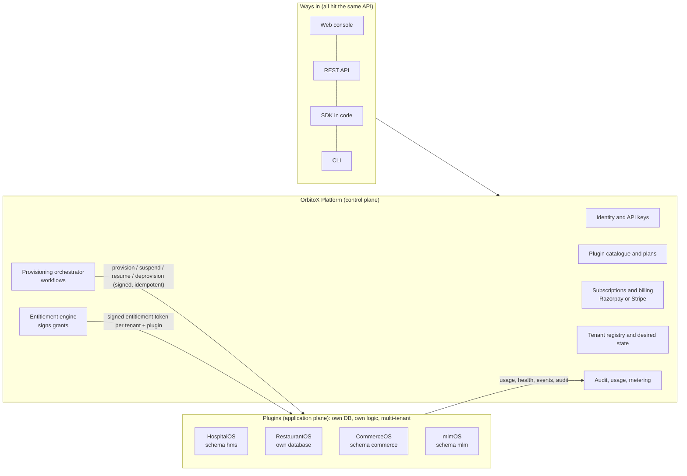

# OrbitoX Plugin Platform Blueprint
*The brain controls; plugins do the work.* Technical lead blueprint, 29 Oct 2026. For the owner and Antigravity.

---

## 0. What you are building, in one paragraph

**OrbitoX Platform** is the brain: it knows every customer, every business (tenant), every plan, subscription and licence, and it decides what each tenant may use. **Plugins** are complete business products such as HospitalOS, RestaurantOS, CommerceOS and mlmOS. Each owns its own data model, database schema, business logic and APIs, and each is multi-tenant inside. A plugin does nothing for a tenant until the platform says that tenant is entitled to it. Anyone can create a new tenant with chosen plugins in about 2 minutes, from the web console, the REST API, the SDK in their code, or a CLI. Using OrbitoX from code needs an OrbitoX licence key. The platform can switch any service on or off for any tenant, change plans, or suspend for non-payment, and every plugin obeys within seconds.

This is the same split AWS calls the **control plane** (onboarding, identity, tenant management, billing, metrics: global and not itself multi-tenant) and the **application plane** (the multi-tenant products). See the AWS SaaS Architecture Fundamentals page on control plane versus application plane. OrbitoX's twist is that the application plane is a *catalogue of installable products* rather than one app, which is closer to Shopify plus its apps, or an ERP with installable modules.

---

## 1. The mental model



Three rules make it work:
1. **The platform never stores plugin business data.** The platform holds no patients, orders or products. It holds only *who* the tenant is and *what they may use*.
2. **A plugin never decides entitlements.** It only *checks* a grant the platform signed, so a plugin cannot give anyone more than they paid for.
3. **Everything is desired state plus reconciliation.** The platform records what should be true ("tenant X: HospitalOS ACTIVE on hms-pro"). Plugins converge to it and report back. If a message is lost, the next reconcile repairs it. This is how Kubernetes controllers work, and the repo's `ControlClient` already has the bones of it (`fetchDesiredState`, heartbeat, `pollAndExecuteCommands`).

---

## 2. Vocabulary (use these words everywhere: code, UI, docs)

| Term | Meaning | Example |
|---|---|---|
| **Customer** (Organization) | Who pays OrbitoX | "Sharma Group" |
| **Tenant** | One business that uses plugins; its id is the universal key in every plugin | `org/sharma/project/city-care/environment/prod` |
| **Plugin** | An installable product with its own data and APIs | `hospital-os@2.3.1` |
| **Installation** | Plugin X enabled for tenant T (state, version, plan) | HospitalOS on City Care: ACTIVE |
| **Plan** | A priced bundle of features and quotas, per plugin or cross-plugin | `hms-pro`: patients, labs, billing; 5,000 patients |
| **Subscription** | A customer paying for plans (billing provider) | Razorpay subscription for hms-pro, monthly |
| **Entitlement** | The *current* rights of a tenant for a plugin, derived from subscriptions | features, quotas, status |
| **Grant** | A signed, short-lived proof of an entitlement that plugins verify locally | Ed25519 token, 15 min |
| **API key** | *Identifies* a caller (customer app or server); not rights | `orb_live_…` |
| **Licence** | Rights for a *customer's own deployment* (self-hosted or embedded) | signed licence file, 30 days, check-in refresh |

Keep **identity** (API key or user token), **rights** (entitlement or licence) and **data** (plugin) separate. Mixing them is the most common way SaaS platforms leak.

---

## 3. Who owns what

| Concern | Platform | Plugin | Never |
|---|---|---|---|
| Customers, tenants, environments | ✅ source of truth | caches tenant id only | plugin creating tenants on its own |
| Plans, prices, subscriptions, invoices to customers | ✅ | — | plugin charging OrbitoX customers |
| Entitlements and grants | ✅ signs | ✅ verifies, enforces | plugin minting grants |
| Users, login, SSO, API keys | ✅ issues | ✅ verifies (public keys) | shared HMAC secrets across plugins for user auth |
| Business data (patients, orders, products, downlines) | ❌ | ✅ own schema or database, RLS by tenant | platform DB holding it; plugin A reading plugin B's tables |
| Business rules (pricing, clinical, commissions) | ❌ | ✅ | |
| Usage metering | aggregates, bills | reports | |
| Audit | central log | emits events | |
| Cross-plugin features (e.g. a restaurant order creates an invoice in Finance) | orchestrates via events | publish and subscribe | direct DB joins between plugins |

Cross-plugin data follows Medusa's module isolation idea: each module sees only its own data models, and modules communicate through links (ids only) and workflows, never direct imports. That keeps every plugin installable and replaceable without side effects.

---

## 4. Plugin contract v2 (what every OS must implement)

The repo already has `defineOrbitoXPlugin` with a manifest, entitlements (features plus quotas), routes with scopes and feature gates, events and migrations. Extend it rather than replace it. Missing today are lifecycle hooks, data ownership, compatibility, health and the tenant state machine.

### 4.1 Manifest (`orbitox.plugin.json`, signed at publish)

```json
{
  "id": "hospital-os",
  "version": "2.3.1",
  "displayName": "HospitalOS",
  "platformCompat": ">=1.4 <2",
  "runtime": { "modes": ["hosted", "self_hosted", "embedded"], "health": "/health" },
  "data": { "ownership": "schema", "schema": "hms", "migrations": "migrations/", "rls": "required", "pii": ["patients.name", "patients.phone"] },
  "features": [
    { "key": "patients", "description": "Patient registry" },
    { "key": "labs", "description": "Lab orders and results" },
    { "key": "billing", "description": "Invoices and payments" },
    { "key": "pharmacy", "description": "Dispensing" }
  ],
  "quotas": [
    { "key": "patients", "window": "none", "unit": "records" },
    { "key": "api_calls", "window": "month", "unit": "requests" }
  ],
  "lifecycle": {
    "provision": "POST /orbitox/lifecycle/provision",
    "suspend": "POST /orbitox/lifecycle/suspend",
    "resume": "POST /orbitox/lifecycle/resume",
    "planChanged": "POST /orbitox/lifecycle/plan-changed",
    "export": "POST /orbitox/lifecycle/export",
    "deprovision": "POST /orbitox/lifecycle/deprovision"
  },
  "events": { "emits": ["hms.patient.created", "hms.payment.recorded"], "subscribes": ["platform.tenant.updated"] },
  "api": { "openapi": "openapi.json", "basePath": "/v1/hms" },
  "ui": { "consoleExtensions": ["tenant-settings", "dashboard-widget"] }
}
```

### 4.2 Lifecycle hooks (all idempotent, all signed by the platform)

| Hook | Called when | Plugin must | Deadline |
|---|---|---|---|
| `provision(tenant, plan, config)` | tenant gets the plugin | create tenant rows and seed defaults (departments, menu skeleton); return READY | ≤ 20 s |
| `planChanged(tenant, newEntitlement)` | upgrade or downgrade | adjust limits; never delete data on downgrade (block new writes over the limit instead) | ≤ 5 s |
| `suspend(tenant, reason)` | non-payment, abuse, admin | stop writes; reads per policy; keep data | ≤ 5 s |
| `resume(tenant)` | paid or admin | re-enable | ≤ 5 s |
| `export(tenant)` | customer request or before deprovision | produce a signed archive (JSON or CSV plus files) | async |
| `deprovision(tenant, retention)` | uninstall or close account | mark deleted; purge after the retention period; return a proof | async |

Each call carries an **idempotency key** and the **entitlement revision**. The plugin stores the highest revision applied and ignores older ones, so retries and out-of-order deliveries are safe.

### 4.3 Request-time contract

Every plugin request must pass three gates, in this order:
1. **Who:** verify the caller (user JWT or platform-signed bridge headers) using the platform's public keys.
2. **What tenant:** take the tenant from the verified token only, never from a client header.
3. **May they:** verify the grant locally with `verifyGrant()` + `canUse(feature, write)`:
   - SUSPENDED → 403 `SERVICE_SUSPENDED`
   - feature not in plan → 403 `FEATURE_NOT_IN_PLAN`
   - READ_ONLY and the request writes → 402 `PAYMENT_REQUIRED`

Then run inside the plugin's tenant transaction (`withTenantTx`, RLS).

---

## 5. Data architecture: each plugin owns its data

**Default: one PostgreSQL cluster, one schema per plugin** (`hms`, `commerce`, `mlm`), each with its own role (`hms_runtime`), forced RLS on `tenantId`, and its own migrations. This is cheap and simple, and the tested HospitalOS pack already follows it.

**Upgrade path: one database (or cluster) per plugin** when a plugin is heavy or separately deployed (RestaurantOS already has its own database). The contract is identical, only the connection string changes.

**Premium path: a dedicated database per large tenant** (a hospital chain that demands isolation). Same plugin code; the platform's tenant registry records the tenant's "cell" (which database), and the plugin connects there.

Rules:
- `tenantId` is the same string everywhere. Plugins never invent their own tenant ids.
- No foreign keys or joins across plugin schemas. Cross-plugin references store ids only, and resolve through the other plugin's API or events.
- Each plugin's database role can see only its own schema (`REVOKE ALL ON SCHEMA hms FROM commerce_runtime`).
- Platform tables (`PlatformProject`, keys, audit) are reachable only by platform roles.

---

## 6. Three ways to run a plugin (and how licensing works in each)

| Mode | Who runs it | How the developer uses it | Enforcement strength |
|---|---|---|---|
| **Hosted** (default) | OrbitoX | REST and SDK calls with an API key | **Strong**: every request checked server-side against grants |
| **Self-hosted runtime** | Customer runs the plugin server (e.g. RestaurantOS in their cloud) | Same APIs, their URL | **Medium**: a signed licence file (≤ 35 days) plus periodic check-in; entitlement grants still come from the platform |
| **Embedded package** | Customer imports `@orbitox-io/hospital-os` into their own Node app | `const hms = await orbitox.plugin('hospital-os').forTenant(id)` | **Weak by nature**: code on their machine can be patched. Licence and grants deter casual misuse and keep honest customers compliant, but they cannot stop a determined pirate. |

The honest design consequence: put the **valuable, hard-to-copy parts server-side**, so embedded mode stays useful but incomplete without the platform. That means updates, AI features, cross-tenant analytics, payments, messaging, backups and multi-location sync. This is why Keygen, the licensing vendor, signs licence files with Ed25519, gives them a TTL (30 days by default) and requires re-checkout. A licence can be verified offline but expires, so a customer must stay connected to keep using it.

---

## 7. The 2-minute tenant (from web, API, SDK or CLI)

One endpoint; every entry point calls it.

```http
POST /v1/tenants
Authorization: Bearer orb_live_…            (customer API key)
Idempotency-Key: 7d1c…                       (safe to retry)
{
  "organizationId": "org_sharma",
  "name": "City Care Hospital",
  "slug": "city-care",
  "environment": "prod",
  "plugins": [{ "id": "hospital-os", "plan": "hms-pro", "config": { "beds": 120, "departments": ["General","ICU"] } }],
  "region": "ap-south-1"
}
→ 202 { "tenantId": "org/sharma/project/city-care/environment/prod", "operationId": "op_…", "status": "PROVISIONING" }
GET /v1/operations/op_…   → steps with status; webhook "tenant.ready" when done
```

The orchestrator runs a durable workflow (saga) with stored step state, retries and compensation. AWS's multi-product control-plane pattern uses the same shape: an admin API starts a state machine, each step does one job, and status is published at the end.

| # | Step | Owner | Budget |
|---|---|---|---|
| 1 | Validate request, licence, plan availability, slug free; reserve the slug | platform | 200 ms |
| 2 | Create organization, project, environment and quota policy (one transaction) | platform | 300 ms |
| 3 | Create or attach a subscription (or a trial); compute the entitlement, revision 1 | platform plus billing | 1–3 s |
| 4 | Issue the tenant's API keys; return them once | platform | 100 ms |
| 5 | For each plugin: signed `provision` call, idempotent, with retries and backoff | plugin | ≤ 20 s each, in parallel |
| 6 | Push the first grant to each plugin; plugins confirm READY | platform ↔ plugin | 1 s |
| 7 | Mark the tenant ACTIVE; emit `tenant.ready`; audit everything | platform | 100 ms |

That is about 30 seconds in practice, so "2 minutes" leaves room for payment.

If a plugin fails, the tenant stays `PARTIAL`, with that installation `FAILED` and a retry button; nothing else is rolled back. If the customer cancels during provisioning, compensation runs `deprovision` on the plugins that already succeeded.

The same call from code and from the CLI:

```ts
import { OrbitoX } from '@orbitox-io/sdk';
const ox = new OrbitoX({ apiKey: process.env.ORBITOX_API_KEY });   // key identifies; plan grants rights
const op = await ox.tenants.create({ organizationId: 'org_sharma', name: 'City Care Hospital', slug: 'city-care',
  plugins: [{ id: 'hospital-os', plan: 'hms-pro' }] }, { idempotencyKey: crypto.randomUUID() });
const tenant = await op.waitUntilReady({ timeoutMs: 120_000 });
const hms = ox.plugin('hospital-os').forTenant(tenant.id);
await hms.patients.create({ mrn: 'CC-0001', name: 'Asha Verma', phone: '+91 98111 22233' });
```

```
$ orbitox tenants create city-care --org org_sharma --plugin hospital-os:hms-pro --wait
✔ tenant org/sharma/project/city-care/environment/prod ACTIVE in 31s
```

---

## 8. Control from the platform: switch anything, everything obeys

### 8.1 Installation state machine (per tenant and plugin)

```
REQUESTED → PROVISIONING → ACTIVE ⇄ READ_ONLY → SUSPENDED → DEPROVISIONING → ARCHIVED → PURGED
                  ↘ FAILED (retry)        ↑ grace period on non-payment
```

| Trigger | Result |
|---|---|
| Payment failed | ACTIVE → READ_ONLY after a grace period, e.g. 7 days. Customers can see data but not write. → SUSPENDED after 30 days. |
| Admin toggles a service off | → SUSPENDED immediately |
| Downgrade | stays ACTIVE with fewer features; over-limit writes refused; **no data deleted** |
| Uninstall | export offered → DEPROVISIONING → ARCHIVED (retention, e.g. 30 days) → PURGED, with a deletion proof |

### 8.2 How a click becomes enforcement in under 5 seconds

1. Admin clicks "Disable HospitalOS for City Care". The platform writes the installation state and bumps the **entitlement revision**, all in one transaction with an outbox row.
2. The outbox publisher pushes `entitlement.updated` (revision 9) to HospitalOS: a signed webhook, or a platform-held stream.
3. HospitalOS fetches the new grant (status SUSPENDED, revision 9), stores it, and stores revision 9 as the minimum acceptable.
4. Every following request fails `canUse` → 403 `SERVICE_SUSPENDED`.

If the push is lost, grants live at most 15 minutes, so the worst case is 15 minutes. **Hosted plugins can also ask the platform directly** for high-risk operations (payments, exports). A plugin that cannot reach the platform keeps serving with its last valid grant until it expires, then fails closed for writes.

**Rollback protection.** Once revision 9 is seen, an older revision 7 grant (say, "hms-pro ACTIVE") is refused (`ROLLBACK`). Replaying old tokens cannot undo a suspension. This is tested.

### 8.3 Entitlements from billing

Plan catalogue (features plus quotas per plugin) → subscription events from the billing provider → the entitlement engine computes the tenant's rights → a new revision → grants.

Stripe's Entitlements model works the same way. Features attach to products, Stripe keeps "active entitlements" per customer, and it fires `entitlements.active_entitlement_summary.updated` on subscribe, upgrade, downgrade or cancel. Stripe recommends persisting entitlements internally for fast checks. For India (RestaurantOS already integrates Razorpay), keep the **entitlement engine in OrbitoX** and treat Razorpay or Stripe as payment *inputs*. Then plans, trials, manual deals and enterprise contracts all flow through one engine.

### 8.4 Quotas without a round trip per request

- **Soft, high-volume quotas** (API calls): plugins count locally and report usage every 30–60 s; the platform aggregates and flips the entitlement to over-quota. A small overshoot is possible and acceptable.
- **Hard quotas** (patients, beds, seats): enforced **inside the plugin database** at write time (count against the grant's limit in the same transaction). No overshoot.
- **Exact cross-server quotas** (Step 4 already proved this for the platform): atomic conditional UPDATE in PostgreSQL. Optionally, **leases** let a plugin take a block of 1,000 calls from the platform and return the unused part.

---

## 9. Identity and trust between the parts

| Link | Mechanism |
|---|---|
| User → platform | Login/SSO; short JWT (`aud`=platform) |
| User → plugin | Same login; JWT with `aud`=plugin id and tenant claim; plugins verify with the platform's **public** keys (JWKS), pinned |
| Customer app → platform/plugin API | API key (identity) → resolved to tenant + scopes server-side |
| Platform → plugin (lifecycle, forwarded calls) | Signed requests (`bridge-signature.ts`, tested): tenant + principal + body hash + timestamp + nonce, replay-protected |
| Platform → plugin (rights) | Entitlement grant (`entitlement-token.ts`, Ed25519, tested) |
| Plugin → platform (usage, health, audit) | Plugin service credential (per plugin, rotatable), signed and rate-limited |
| Customer deployment → platform (self-hosted/embedded) | Licence file (Ed25519, ≤35 days) + check-in |

Plugins hold **no** secret that could mint rights or user tokens, so compromising one plugin cannot compromise the others.

---

## 10. What already exists in the repo, and the gaps (checked in source)

| Exists | Where | Gap |
|---|---|---|
| Plugin contract: manifest, features, quotas, routes with scopes and feature gates, events, migrations | `packages/plugin-engine/src/contract/plugin.contract.ts` | No lifecycle hooks, no data ownership or schema, no platform compatibility, no state machine |
| Marketplace, lifecycle and loader services | `packages/plugin-engine/src/{marketplace,plugin-lifecycle.service.ts,plugin-loader.service.ts}` | Must be re-checked against contract v2 |
| External runtime SDK `ControlClient` (register, heartbeat, `fetchDesiredState`, `syncEntitlements`, command polling) | `packages/external-runtime-sdk` | **Security gap:** the config is called *signed*, but `fetchDesiredState` never verifies its signature; it trusts the JSON. Fix by verifying with pinned Ed25519 public keys (use `verifyGrant` style). Also the config is per *project*, not per *tenant*. |
| RestaurantOS as a separate runtime with its own database, RLS and manifest (`orbitox.project.json`) | `projects/external-os/restaurant-os` | Must adopt the lifecycle hooks plus grant checks; must trust tenant only from signed headers |
| In-repo plugin packages (commerce, crm, finance, hms, hrms, inventory, pos, school) | `orbitox/plugins/*` | Several serve sample data. `apps/web` imports plugin internals directly (e.g. `v1/hms` → `hospitalStore`), which breaks isolation. Route everything through the plugin's API or repository. |
| Platform Step 1–5: Postgres control data, keys, quotas, rate limits, audit, importer | `apps/web` | Becomes the "brain" core; add tenant registry (cells), installations, plans and entitlement engine |

---

## 11. Hard truths and risks (read before building)

1. **Embedded licensing is a deterrent, not a lock.** Price and design around it (section 6).
2. **Schema-per-plugin at hundreds of tenants is fine; per-tenant databases at thousands are an operations project.** Keep per-tenant databases for the premium tier only, and automate migrations per cell.
3. **Plugin versions per tenant.** Allow a tenant to stay on `hospital-os@2.x` while others move to 3.x only if you are ready to run both. Start with one version per plugin and expand-then-contract migrations.
4. **Third-party plugins** (a marketplace) need package signing, review, sandboxing and revenue share. Do first-party only until the contract is stable.
5. **Health data:** HospitalOS handles patient data. Keep encryption, access logs and the minimum-necessary rule (already in the reference pack), and take advice on India's DPDP Act obligations (consent, breach notice, retention) before onboarding real hospitals.
6. **mlmOS is a regulated business type in India.** The Consumer Protection (Direct Selling) Rules, 2021 prohibit pyramid and money-circulation schemes, and ban promoting them. mlmOS should support only compliant direct-selling models (commissions from real product sales, no pay-to-recruit) and keep audit trails. Get legal review before selling it; the platform's licence terms should also forbid illegal schemes.
7. **"All control from platform" means the platform is critical infrastructure.** Grants and local enforcement mean a short platform outage does not stop hospitals or restaurants: plugins keep running on the last valid grant. Never make every plugin request call the platform synchronously.

---

## 12. Build order (fits the current phases)

| Phase | Deliverable | Proves |
|---|---|---|
| **2b** (now) | HospitalOS as the first *true* plugin: own schema, RLS, PHI, contract v2 hooks; RestaurantOS behind signed bridge | plugin isolation works |
| **3: Rights** | Plan catalogue → entitlement engine → revisions → `entitlement-token.ts` grants; installation state machine; grace periods; Razorpay/Stripe as inputs; fix the unsigned desired-state in `ControlClient` | the platform controls everything; plugins enforce locally |
| **4: 2-minute tenant** | `POST /v1/tenants` saga + operations API + webhooks; console wizard; idempotent lifecycle hooks in HospitalOS and RestaurantOS | tenant ready in under 60 s from web, API or SDK |
| **5: Developer surface** | `@orbitox-io/sdk`, `@orbitox-io/cli`, plugin packages, OpenAPI per plugin, docs | "easy to use in code" |
| **6** | CommerceOS, then mlmOS (after legal review) on contract v2; self-hosted licence files; later the marketplace | the model scales to N products |

---

## 13. Decisions for the owner

1. **Billing provider:** Razorpay first (India), Stripe later, with the OrbitoX entitlement engine as the source of truth? *(recommended)*
2. **Grace policy:** 7 days READ_ONLY and 30 days SUSPENDED after a failed payment? Per plugin, or one policy?
3. **Embedded mode at launch,** or hosted plus self-hosted only? *(recommended: hosted first; embedded once the licence-file flow exists)*
4. **Pricing unit:** per tenant per plugin, per bundle, or usage-based? This decides the plan catalogue schema.

---

## Appendix: tested reference code available now
- `entitlement-token.ts`: Ed25519 grants and licence files; audience, tenant and type binding, expiry, lifetime caps, key rotation, **rollback protection**. 7/7 tests: forgery, tampering, alg "none", unknown kid, prototype-key trick, wrong plugin, wrong tenant, expired, future, downgrade replay, rotation, licence/entitlement confusion.
- `bridge-signature.ts`: signed platform → plugin calls (tested).
- HospitalOS plugin schema plus repository (tested, 62 SQL + 12 integration checks).

### Sources
- AWS: [Control plane vs. application plane, SaaS Architecture Fundamentals](https://docs.aws.amazon.com/whitepapers/latest/saas-architecture-fundamentals/control-plane-vs.-application-plane.html)
- AWS: [Manage tenants across multiple SaaS products on a single control plane](https://docs.aws.amazon.com/prescriptive-guidance/latest/patterns/manage-tenants-across-multiple-saas-products-on-a-single-control-plane.html)
- Stripe: [Entitlements](https://docs.stripe.com/billing/entitlements)
- Medusa: [Module isolation](https://docs.medusajs.com/learn/fundamentals/modules/isolation)
- Keygen: [Cryptography: signed keys and licence files](https://keygen.sh/docs/api/cryptography)
- [Consumer Protection (Direct Selling) Rules, 2021 – India (S.S. Rana)](https://ssrana.in/articles/consumer-protection-direct-selling-rules-2021-india/)
