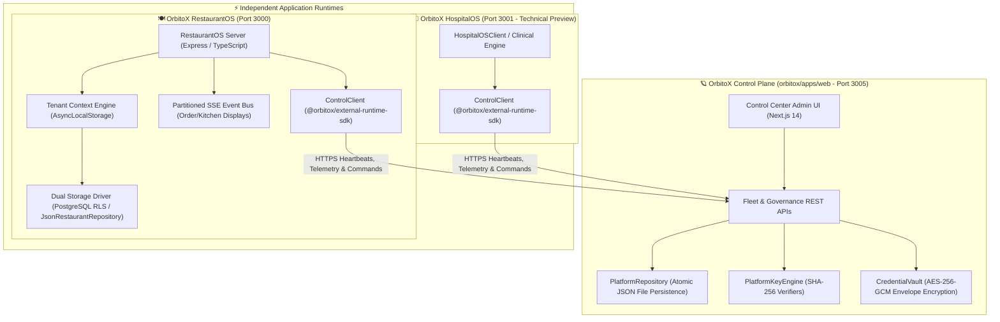

# 🪐 OrbitoX Platform

[](https://github.com/Nikhil-ig/OrbitoX-Platform/actions/workflows/ci.yml)
[](https://nodejs.org/)
[](https://pnpm.io/)
[](https://www.typescriptlang.org/)
[](https://turbo.build/repo)
[](#licensing--governance)

**OrbitoX** is an enterprise-grade multi-tenant SaaS composition engine, unified control plane, and vertical application ecosystem. It empowers engineering teams to assemble and operate bespoke vertical SaaS platforms (hospitality, healthcare, commerce, education) from authoritative, cryptographically signed business logic plugins—eliminating the need to re-implement tenancy, identity, auditing, billing, and fleet orchestration.

---

## 📋 Table of Contents

1. [Architectural Overview & Topology](#-architectural-overview--topology)
2. [Commercial Pilot Release Scope](#-commercial-pilot-release-scope)
3. [System Requirements & Prerequisites](#-system-requirements--prerequisites)
4. [Monorepo Structure & Package Catalog](#-monorepo-structure--package-catalog)
5. [Quickstart & Local Development](#-quickstart--local-development)
6. [Control Plane Persistence & Storage Configuration](#-control-plane-persistence--storage-configuration)
7. [RestaurantOS Runtime & Tenancy Architecture](#-restaurantos-runtime--tenancy-architecture)
8. [Automated Verification & Test Matrix](#-automated-verification--test-matrix)
9. [Cryptographic Security & Zero-Trust Governance](#-cryptographic-security--zero-trust-governance)
10. [Docker & Containerized Stacks](#-docker--containerized-stacks)
11. [Troubleshooting & FAQ](#-troubleshooting--faq)
12. [Documentation & Specifications](#-documentation--specifications)

---

## 🏛️ Architectural Overview & Topology

OrbitoX enforces a strict **Dual-Plane Separation of Concerns**: the **Control Plane** manages global SaaS governance, while **Application Runtimes** operate as decoupled, independent edge microservices.



### 1. The Control Plane (`orbitox/apps/web`)
- **Fleet Observability**: Real-time heartbeat tracking, version drift detection, health probes, and live audit telemetry across all registered microservices.
- **Durable Persistence**: State is stored through an atomic, debounced file-backed persistence engine (`PlatformRepository`), guaranteeing full survivability across server restarts without requiring external database dependencies for basic operation.
- **Machine API Key Engine**: Issues cryptographically secure, high-entropy machine credentials (`orb_live_...`). Plaintext tokens are returned once upon creation; only constant-time verifiable SHA-256 fingerprints are stored.
- **Envelope Credential Vault**: Stores third-party secrets (Stripe, Twilio, OpenAI) using AES-256-GCM encryption with master key derivation.
- **Quota & Rate-Limit Enforcement**: Tracks monthly API call budgets and bursts across individual tenants and environments.

### 2. Application Runtimes (`projects/external-os/*`)
- **Independent Lifecycles**: Application runtimes are isolated services that boot independently of the Control Plane. They connect to the Control Plane asynchronously via `@orbitox/external-runtime-sdk`.
- **Fail-Closed Multi-Tenancy**: Dynamic tenant resolution by custom domain (`bistro.orbitox.live`), subdomain, or `X-Tenant-ID` header. Tenant context is bound using `AsyncLocalStorage`, preventing cross-tenant data leaks.
- **Dual-Storage Driver**: Operates transparently in zero-dependency local JSON file storage mode (`STORAGE_DRIVER=json`) or enterprise PostgreSQL with Row-Level Security (`STORAGE_DRIVER=postgres`).
- **Partitioned Real-Time SSE**: Server-Sent Events are partitioned strictly by `tenantId`, guaranteeing zero event bleed between competing restaurant or hospital tenants.

---

## 🎯 Commercial Pilot Release Scope

The OrbitoX engineering organization has established clear milestone boundaries for commercial readiness:

| Component | Target Directory | Launch Status | Release Classification |
|---|---|---|---|
| **OrbitoX Platform Control Center** | `orbitox/apps/web` | **READY FOR PILOT** | Commercial Core Target |
| **OrbitoX RestaurantOS** | `projects/external-os/restaurant-os` | **READY FOR PILOT** | Commercial Vertical Target |
| **OrbitoX HospitalOS** | `projects/external-os/hospital-os` | **COMPILED & VERIFIED** | Technical Preview (Decoupled from pilot) |
| **OrbitoX Celebrations Studio** | `orbitox/apps/celebrations` | **IN REFACTORING** | Technical Preview (Decoupled from pilot) |

> [!IMPORTANT]
> **Scope Guardrail**: The initial commercial pilot deployment authorizes **OrbitoX Platform Control Center** and **OrbitoX RestaurantOS**. HospitalOS and Celebrations Studio remain technical previews and are not authorized for production commercial release under this milestone.

---

## 💻 System Requirements & Prerequisites

Ensure your environment satisfies these prerequisites before running or building the monorepo:

- **Node.js**: `v20.12.0` or higher (`v22.x LTS` recommended).
- **pnpm**: `v9.15.0` or higher (`corepack enable && corepack prepare pnpm@9.15.0 --activate`).
- **Docker & Docker Compose**: Docker Engine `v24+` with Compose `v2+`.
- **PostgreSQL** *(optional for local dev, mandatory for production)*: `v15+` with `pgcrypto` extension enabled.
- **Git**: `v2.40+`.

---

## 📦 Monorepo Structure & Package Catalog

The OrbitoX codebase is organized as a high-performance Turborepo monorepo:

```
OrbitoX Platform/
├── .github/workflows/         # CI/CD pipelines (Monorepo type-check, unit tests, RestaurantOS E2E)
├── docs/                      # Architectural specifications, audits, guides, and plans
│   ├── audits/                # Audit reports, remediation plans, and readiness matrices
│   └── platform-control-center/ # Control Center system specifications
├── orbitox/                   # Monorepo Workspace Root
│   ├── apps/
│   │   ├── web/               # [PILOT] Platform Control Center (Next.js 14, port 3005)
│   │   └── celebrations/      # [PREVIEW] Celebrations Studio (Visual canvas editor)
│   ├── packages/              # Platform Kernel, SDKs & Shared Services
│   │   ├── core/              # Foundational domain entities, errors, and abstractions
│   │   ├── runtime/           # Micro-kernel runtime and lifecycle execution manager
│   │   ├── plugin-engine/     # Dynamic plugin loader, PlatformRepository, KeyEngine, Vault
│   │   ├── external-runtime-sdk/ # Zero-dependency client SDK for connected apps
│   │   ├── sdk/               # Platform client SDK and high-level facades
│   │   ├── services/          # Shared platform services (audit, events, notifications)
│   │   ├── types/             # Canonical platform TypeScript definitions
│   │   ├── ui/                # Shared enterprise UI design system & components
│   │   ├── utils/             # Cryptographic helpers, string and network utilities
│   │   └── config/            # Shared Jest, ESLint, and TypeScript configurations
│   ├── plugins/               # Authoritative Business Logic Plugins
│   │   ├── pos/               # Point of Sale: orders, menu, tables, kitchen display, bills
│   │   ├── crm/               # Customer Relationship Management: leads, contacts, deals
│   │   ├── external-project-engine/ # External project connector & registration engine
│   │   ├── commerce/          # E-commerce: carts, checkout, promotions
│   │   ├── finance/           # Invoicing, tax ledgers, and multi-currency billing
│   │   ├── inventory/         # Stock levels, warehouses, supplier purchase orders
│   │   ├── hms/               # Hospital Management System: patients, appointments, beds
│   │   ├── hrms/              # Human Resource Management: employees, payroll, shifts
│   │   └── school/            # School Management: students, courses, attendance
│   ├── tools/
│   │   └── cli/               # @orbitox/cli: Project scaffolder and code generator
│   └── scripts/               # Environment initialization, smoke tests, and packaging tools
└── projects/                  # External Connected Applications
    ├── external-os/
    │   ├── restaurant-os/     # [PILOT] Authoritative Multi-Tenant Restaurant Application
    │   └── hospital-os/       # [PREVIEW] Reference Hospital Clinical Workflow Application
    └── examples/
        └── test-consumer-app/ # Standalone external consumer verification app
```

---

## 🚀 Quickstart & Local Development

### 1. Clone & Bootstrap the Monorepo

```bash
# Clone the repository
git clone https://github.com/Nikhil-ig/OrbitoX-Platform.git
cd "OrbitoX Platform/orbitox"

# Install all workspace dependencies
pnpm install

# Build all packages in topological order
pnpm build
```

### 2. Start the OrbitoX Platform Control Center

```bash
cd "OrbitoX Platform/orbitox"

# 1. Initialize environment variables with cryptographically secure random secrets
node scripts/init-env.mjs

# 2. Start the Next.js Control Center dev server (runs on http://localhost:3005)
pnpm dev:web
```

Open **`http://localhost:3005/platform/fleet`** in your browser. When prompted for authentication, enter any username and provide the `ORBITOX_ADMIN_TOKEN` printed in your terminal (or found in `orbitox/.env`).

### 3. Start the RestaurantOS Application

In a separate terminal:

```bash
cd "OrbitoX Platform/projects/external-os/restaurant-os"

# Install dependencies
npm install

# Start the RestaurantOS development server (runs on http://localhost:3000)
npm run dev
```

Test the live endpoints:
- **Health Check Probe**: `curl http://localhost:3000/healthz/live` (Returns `{"status":"ok","uptime":...}`)
- **Multi-Tenant Request**: `curl -H "Host: bistro.orbitox.live" http://localhost:3000/api/restaurant/menu`

---

## 💾 Control Plane Persistence & Storage Configuration

The Control Plane's persistence layer (`PlatformRepository`) uses a robust, atomic file-backed JSON store:

### How It Works
- **Atomic Writes**: Writes are staged into a temporary file (`.tmp.<timestamp>`) and swapped atomically using `fs.renameSync` to prevent file corruption during power failures or sudden process termination.
- **Debounced Sync**: In-memory mutations are batched and synced with a 150ms debounce window; critical paths can trigger synchronous writes via `PlatformRepository.saveImmediate()`.
- **Automatic Seed & Fallback**: If no persisted store exists, the repository initializes default enterprise organizations, demo projects, and sample API keys.

### Storage Directory Selection (`ORBITOX_DATA_DIR`)
Configure the storage location using the `ORBITOX_DATA_DIR` environment variable:

```bash
# In your .env or Docker configuration:
ORBITOX_DATA_DIR=/var/lib/orbitox/data
```

When `ORBITOX_DATA_DIR` is not specified, the repository automatically falls back to:
1. `path.resolve(process.cwd(), 'orbitox/data')`
2. `path.resolve(process.cwd(), 'data')`
3. Embedded `.orbitox_state` directory

---

## 🍽️ RestaurantOS Runtime & Tenancy Architecture

RestaurantOS is a real-world multi-tenant restaurant management engine composed with the authoritative `@orbitox/pos` plugin:

### Tenancy Resolution Flow
```
Incoming HTTP Request
       │
       ▼
Is `/healthz/live` or `/live`? ──[YES]──► Return 200 OK (No tenant required)
       │ [NO]
       ▼
Extract Host header / Subdomain / `X-Tenant-ID`
       │
       ▼
Query Custom Domains / Match Tenant Slug
       │
       ▼
Bind Tenant Context into `AsyncLocalStorage`
       │
       ▼
Dispatch Route Handlers (Storage scoped automatically by tenantId)
```

### Storage Drivers
Set `STORAGE_DRIVER` in `projects/external-os/restaurant-os/.env`:
- `STORAGE_DRIVER=json`: Zero-dependency, file-backed JSON repository (`JsonRestaurantRepository`). Ideal for local testing and isolated CI runs.
- `STORAGE_DRIVER=postgres`: Enterprise PostgreSQL with Row-Level Security via Prisma (`PostgresRestaurantStore`). Requires `DATABASE_URL`.

---

## 🧪 Automated Verification & Test Matrix

The repository features comprehensive automated verification suites covering types, unit logic, cross-tenant isolation, and end-to-end integration:

### 1. Monorepo Type-Checking
Verifies TypeScript compilation across all 29 Turbo tasks:
```bash
cd "OrbitoX Platform/orbitox"
pnpm run type-check
```

### 2. Pilot Package Unit Tests
Runs the test suites for all 5 core pilot packages (168 tests, 100% pass rate):
```bash
cd "OrbitoX Platform/orbitox"

pnpm --filter @orbitox/core test
pnpm --filter @orbitox/plugin-engine test
pnpm --filter @orbitox/pos test
pnpm --filter @orbitox/crm test
pnpm --filter @orbitox/external-project-engine test
```

### 3. RestaurantOS Comprehensive Verification
Runs multi-tenant SSE event bus isolation, 20-stage Milestone 2 integration, and TypeScript verification:
```bash
cd "OrbitoX Platform/projects/external-os/restaurant-os"

# Run all test suites
npm test

# Run individual test suites
npm run test:isolation     # Verifies SSE event partitioning across tenants
npm run test:core          # Verifies 20 integration checkpoints (guest orders, POS, kitchen, billing)
npm run type-check         # Verifies TypeScript typing (tsc --noEmit)
```

### 4. HospitalOS Verification (Technical Preview)
```bash
cd "OrbitoX Platform/projects/external-os/hospital-os"
npm run build              # Compiles clinical TypeScript bundle
npm test                   # Runs 11 clinical workflow test stages
```

---

## 🔒 Cryptographic Security & Zero-Trust Governance

OrbitoX follows strict zero-trust security principles:

### Machine API Keys (`PlatformKeyEngine`)
- **Key Prefixing**: Environment-specific prefixes (`orb_live_...`, `orb_test_...`, `orb_stage_...`).
- **No Plaintext Persistence**: Plaintext secret tokens are returned exactly once upon creation. Only a constant-time verifiable SHA-256 hash (`authVerifier`) is stored.
- **Timing-Safe Verification**: Key verification uses `crypto.timingSafeEqual` over SHA-256 hashes to prevent side-channel timing attacks.

### Envelope Credential Encryption (`CredentialVault`)
- Third-party secrets (payment gateways, API integrations) are encrypted using **AES-256-GCM**.
- Each secret payload includes an initialization vector (IV) and authentication tag.
- Secrets are decrypted only in-memory upon authorized demand.

### Mandatory Environment Secrets
The production server (or a server with missing `NODE_ENV`) **refuses to boot** if any of these secrets are missing or shorter than 32 characters. Setting `NEXT_PHASE` does not bypass runtime validation.

| Variable | Purpose | Minimum Length |
|---|---|---|
| `ORBITOX_ADMIN_TOKEN` | Bearer token for Control Center Admin UI and management APIs | 32 chars |
| `ORBITOX_RUNTIME_TOKEN` | Shared secret for connected applications registering via SDK | 32 chars |
| `ORBITOX_CONTROL_SECRET` | HMAC secret for signing commands dispatched to runtimes | 32 chars |
| `ORBITOX_GUEST_SECRET` | Cryptographic secret for signing guest QR session tokens | 32 chars |
| `ORBITOX_SERVER_PEPPER` | Server-only pepper for API-key verifier derivation | 32 chars |

`NODE_ENV=production` is required for production deployment. `ORBITOX_DATA_DIR` should point to a persistent writable volume so project, key, quota, and audit records survive restarts. Sensitive Hospital API routes return 404 in production unless `ORBITOX_ENABLE_HOSPITAL_ADMIN_ENDPOINTS=true` is explicitly set.

### Authentication Headers

| Caller | Header | Format |
|---|---|---|
| Admin API | `Authorization` | `Bearer <ORBITOX_ADMIN_TOKEN>` |
| Admin browser | `Authorization` | `Basic <base64(username:ORBITOX_ADMIN_TOKEN)>`; username is ignored |
| Admin compatibility | `x-admin-token` | `<ORBITOX_ADMIN_TOKEN>` |
| Customer API | `x-api-key` | Full issued API key, never a prefix |
| Customer API alternative | `Authorization` | `Bearer <customer-api-key>`; an admin token is not treated as a customer key |
| Diner API | `x-guest-token` | Signed, expiring capability returned by guest session bootstrap |

`x-tenant-id` and `x-context-id` are never authentication credentials. If supplied with a customer key, a tenant value is accepted only when it matches that key's persisted tenant scope. See [Phase 1.6 route inventory and verification](docs/PHASE_1_6_SECURITY_VERIFICATION.md) for route ownership and enforcement.

---

## 🐳 Docker & Containerized Stacks

### 1. Control Plane Docker Stack
Run the Control Center inside Docker:

```bash
cd "OrbitoX Platform/orbitox"

# Build and start container
docker compose up -d --build

# Run with PostgreSQL and Redis caching profiles:
docker compose --profile db --profile cache up -d
```

### 2. RestaurantOS Docker Stack
Run RestaurantOS in Docker Compose:

```bash
cd "OrbitoX Platform/projects/external-os/restaurant-os"

# Build and launch with PostgreSQL
docker compose up -d --build
```

---

## ❓ Troubleshooting & FAQ

### Q1: Health check `/healthz/live` returns 404
**Cause**: The request was dispatched without early health probe routing, falling through to tenant resolution.  
**Fix**: Ensure your reverse proxy or load balancer routes `/healthz/live` or `/live` directly. In RestaurantOS, these routes are bypassed before tenant extraction.

### Q2: Control Center crashes on startup with `INSECURE_SECRET_LENGTH`
**Cause**: Production mode (`NODE_ENV=production`) enforces strict 32-character secret lengths.  
**Fix**: Run `node scripts/init-env.mjs` to generate high-entropy secrets or update your environment variables.

### Q3: RestaurantOS fails to boot with `Can't reach database server`
**Cause**: PostgreSQL is not running or `DATABASE_URL` is pointing to an invalid host.  
**Fix**: If running locally without PostgreSQL, set `STORAGE_DRIVER=json` in `.env` to enable the built-in zero-dependency JSON repository.

---

## 📚 Documentation & Specifications

Explore detailed architectural specifications and audit reports:

- **Launch Readiness Matrix**: [`docs/audits/ORBITOX_LAUNCH_READINESS_MATRIX.md`](docs/audits/ORBITOX_LAUNCH_READINESS_MATRIX.md)
- **Architecture Reconciliation**: [`docs/audits/ORBITOX_ARCHITECTURE_RECONCILIATION.md`](docs/audits/ORBITOX_ARCHITECTURE_RECONCILIATION.md)
- **Remediation Roadmap**: [`docs/audits/ORBITOX_REMEDIATION_PLAN.md`](docs/audits/ORBITOX_REMEDIATION_PLAN.md)
- **Repository Audit Report**: [`docs/audits/ORBITOX_REPOSITORY_AUDIT.md`](docs/audits/ORBITOX_REPOSITORY_AUDIT.md)
- **Master API Specification**: [`docs/ORBITOX_MASTER_ARCHITECTURE_AND_API_SPECIFICATION.md`](docs/ORBITOX_MASTER_ARCHITECTURE_AND_API_SPECIFICATION.md)
- **Plugin Contract Specification**: [`docs/20_PLUGIN_CONTRACT.md`](docs/20_PLUGIN_CONTRACT.md)
- **RestaurantOS Feature Specification**: [`docs/RESTAURANTOS_FLOW_FEATURES_AND_USES.md`](docs/RESTAURANTOS_FLOW_FEATURES_AND_USES.md)
- **HospitalOS Clinical Developer Guide**: [`docs/14_HOSPITAL_SAAS_DEVELOPER_GUIDE.md`](docs/14_HOSPITAL_SAAS_DEVELOPER_GUIDE.md)

---

## ⚖️ Licensing & Governance

The OrbitoX Platform and its official plugins are proprietary software owned by Orbito. All rights reserved. Unauthorized copying, distribution, modification, or commercial exploitation is strictly prohibited without an authoritative license agreement.
