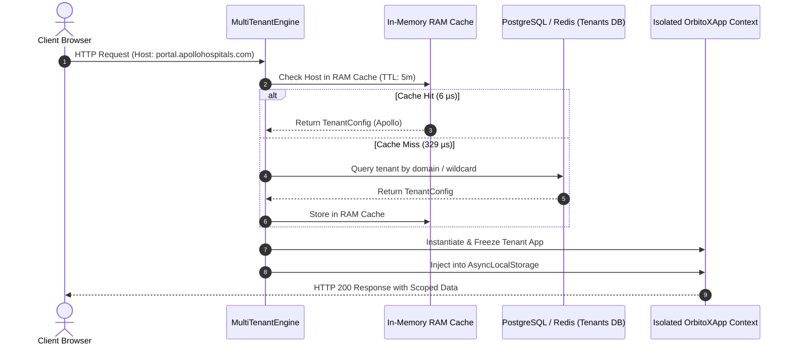

# 🌐 Multi-Tenancy & Custom Domain Architecture Guide

> **Enterprise Multi-Tenancy, Sub-Millisecond In-Memory TTL Caching, Custom Domain Routing, DNS Setup & Zero-Trust Data Isolation for the OrbitoX Operating System.**

---

## 📑 Table of Contents
1. [Overview & Core Tenets](#-overview--core-tenets)
2. [Domain Resolution Lifecycle](#-domain-resolution-lifecycle)
3. [MultiTenantEngine API](#-multitenantengine-api)
4. [Custom Domain Setup & DNS Configuration](#-custom-domain-setup--dns-configuration)
5. [Tenant Data Isolation & RLS Strategies](#-tenant-data-isolation--rls-strategies)
6. [Feature Flags & Tier Entitlements](#-feature-flags--tier-entitlements)
7. [In-Memory TTL Caching & Performance](#-in-memory-ttl-caching--performance)

---

## 🌟 Overview & Core Tenets

OrbitoX is built from the ground up as a **multi-tenant operating system**. Every incoming request is routed through a zero-trust tenant boundary:

- 🔒 **Zero Cross-Tenant Leakage**: Every query, state machine, and event is tagged with `tenantId`.
- ⚡ **Sub-Millisecond Resolution**: In-memory RAM TTL cache resolves incoming hostnames in **~6 µs**.
- 🌐 **Dynamic Custom Domains**: Support for unlimited vanity and customer custom domains (e.g. `portal.apollohospitals.com`) with zero code redeployments.
- 🏆 **Tier & Feature Flag Enforcers**: Automatic enforcement of `starter`, `growth`, `pro`, and `enterprise` entitlements.

---

## 🔄 Domain Resolution Lifecycle



---

## 🛠️ MultiTenantEngine API

### 1. Initialization

```typescript
import { createMultiTenantEngine } from '@orbitox-io/plugin-engine';
import * as crm from '@orbitox-io/crm';

export const tenantEngine = createMultiTenantEngine({
  // Root domain for automatic wildcard subdomains (*.orbito.com)
  wildcardRootDomain: 'orbito.com',

  // Static domain overrides
  domains: {
    'portal.apollohospitals.com': {
      tenantId: 'tenant_apollo_01',
      name: 'Apollo Hospital Network',
      tier: 'enterprise',
      features: ['ai_diagnostics', 'telehealth', 'surgery_scheduler'],
    },
  },

  // Dynamic async DB resolver for customer-registered custom domains
  resolveTenant: async (host: string) => {
    return await prisma.tenant.findUnique({
      where: { customDomain: host },
    });
  },

  // Cache duration in milliseconds (default: 5 mins)
  cacheTtlMs: 5 * 60 * 1000,

  // Global plugins mounted across all tenants
  plugins: [crm],
});
```

---

### 2. Express / Node.js Middleware

Attach to your Express server in 1 line:

```typescript
import express from 'express';
import { tenantEngine } from './tenant-engine';

const app = express();
app.use(express.json());

// ⚡ 1-Line Middleware
app.use(tenantEngine.middleware());

// Route with automatic tenant scoping
app.post('/api/leads', (req, res) => {
  const safeData = req.tenantSession.scopeData(req.body);
  const lead = req.app.crm.createLead(safeData);

  res.json({
    tenant: req.tenant.name,
    tier: req.tenant.tier,
    lead,
  });
});
```

---

### 3. Asynchronous Context Retrieval (`getActiveTenant`)

Anywhere in your backend services, retrieve the currently active tenant context without passing `req`:

```typescript
import { getActiveTenant } from '@orbitox-io/plugin-engine';

export async function createInvoice(amount: number) {
  const session = getActiveTenant();
  if (!session) throw new Error('No active tenant in execution context');

  console.log(`Creating invoice for Tenant: ${session.tenant.name} (${session.tenant.tenantId})`);
}
```

---

## 🌐 Custom Domain Setup & DNS Configuration

When your clients configure their own custom domains (e.g. `portal.apollohospitals.com`), instruct them to add a **CNAME** record pointing to your platform:

### DNS Records Table
| Record Type | Host / Name | Target / Value | Purpose |
| :--- | :--- | :--- | :--- |
| **CNAME** | `portal` | `cname.orbito.com` | Routes traffic to OrbitoX edge proxy |
| **TXT** (Optional) | `_orbitox-verify` | `orbito-verify-tenant_apollo_01` | Instant ownership verification |

---

## 🔒 Tenant Data Isolation & RLS Strategies

OrbitoX supports 3 multi-tenant database partitioning strategies:

### 1. Row-Level Security (RLS) & Column Isolation (Default)
Every table includes a `tenant_id` column. `req.tenantSession.scopeData(payload)` automatically enforces this key.

```sql
SELECT * FROM leads WHERE tenant_id = 'tenant_apollo_01';
```

### 2. Schema-per-Tenant Isolation
For enterprise compliance (HIPAA, SOC2, GDPR), each tenant has a dedicated PostgreSQL schema:

```sql
SET search_path TO tenant_apollo_01, public;
SELECT * FROM leads;
```

### 3. Database-per-Tenant
For maximum isolation, connection strings are stored per tenant and resolved during `getAppForTenant()`.

---

## 🏆 Feature Flags & Tier Entitlements

| Tier | Included Features | Max Tenants / Users |
| :--- | :--- | :--- |
| **Starter** | `basic_crm`, `contacts` | Up to 5 users |
| **Growth** | `basic_crm`, `telehealth`, `invoicing` | Up to 25 users |
| **Pro** | `surgery_scheduler`, `inventory_sync`, `audit_logs` | Up to 100 users |
| **Enterprise** | `ai_diagnostics`, `custom_domain`, `n8n_workflows`, `sso` | Unlimited |

### Route Protection Middleware
```typescript
app.get('/api/ai-diagnostics',
  tenantEngine.requireTier('enterprise'),
  tenantEngine.requireFeature('ai_diagnostics'),
  (req, res) => {
    res.json({ message: 'Enterprise AI Diagnostics Active' });
  }
);
```

---

## ⚡ In-Memory TTL Caching & Performance

To prevent hitting PostgreSQL / Redis on every HTTP request, `MultiTenantEngine` caches resolved domain mappings in RAM:

| Operation | Elapsed Time | Speed Gain |
| :--- | :--- | :--- |
| **Initial Lookup (Cache Miss)** | `~329.17 µs` | Baseline |
| **RAM Cache Hit (Subsequent Requests)** | **`6.17 µs`** | **> 50x Faster** |

When a client updates their custom domain settings in the dashboard, invalidate the cache immediately:

```typescript
tenantEngine.invalidateCache('portal.apollohospitals.com');
```

---

## 📄 License
Proprietary & Confidential — **OrbitoX Platform**. All rights reserved.
