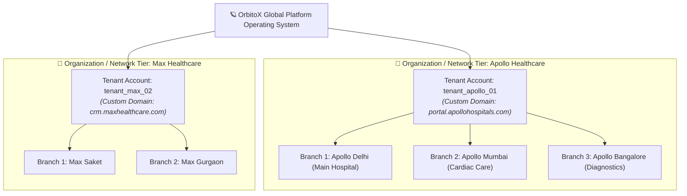
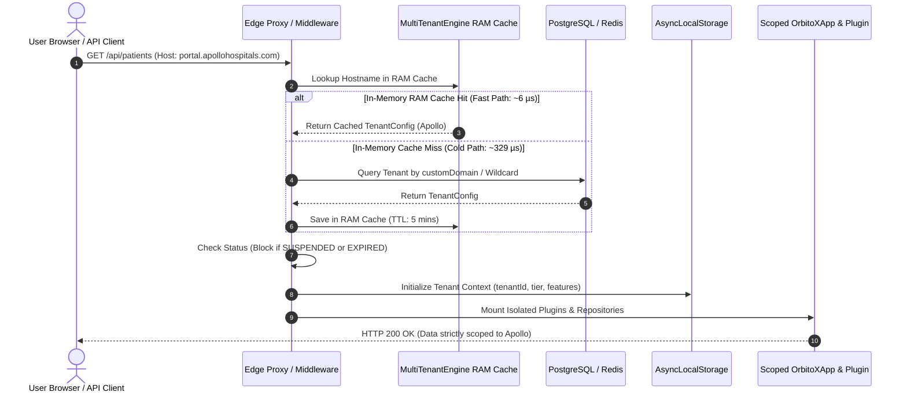
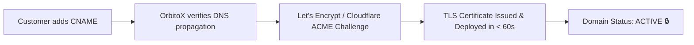
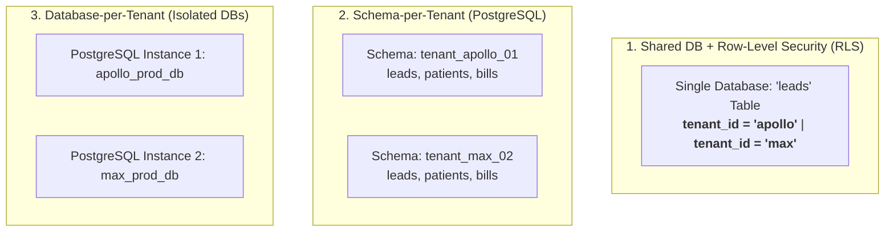

# 🌐 Multi-Tenancy, Custom Domains & Data Isolation Architecture Guide

> **Comprehensive Enterprise Guide: Sub-Millisecond In-Memory RAM Caching, Custom Domain DNS & SSL Automation, 3-Tier Tenant Hierarchy, Row-Level Security (RLS) & Zero-Trust Data Isolation for the OrbitoX SaaS Operating System.**

---

## 📑 Table of Contents
1. [🌟 Executive Summary & Core Philosophy](#1--executive-summary--core-philosophy)
2. [🏛️ The 3-Tier Multi-Tenant Hierarchy](#2-️-the-3-tier-multi-tenant-hierarchy)
3. [🔄 Domain Resolution & Request Lifecycle](#3--domain-resolution--request-lifecycle)
4. [⚡ High-Performance In-Memory RAM TTL Caching](#4--high-performance-in-memory-ram-ttl-caching)
5. [🌐 Custom Domain Onboarding & SSL/TLS Automation](#5--custom-domain-onboarding--ssltls-automation)
   - [CNAME & TXT DNS Configuration](#cname--txt-dns-configuration)
   - [Apex Domains vs Subdomains](#apex-domains-vs-subdomains)
   - [Automated SSL/TLS Certificate Provisioning](#automated-ssltls-certificate-provisioning)
6. [🗄️ Database Partitioning & Isolation Strategies](#6-️-database-partitioning--isolation-strategies)
   - [Strategy 1: Row-Level Security (RLS) with Discriminator Column](#strategy-1-row-level-security-rls-with-discriminator-column)
   - [Strategy 2: Schema-per-Tenant Isolation](#strategy-2-schema-per-tenant-isolation)
   - [Strategy 3: Database-per-Tenant Architecture](#strategy-3-database-per-tenant-architecture)
7. [🛡️ Zero-Boilerplate Context Propagation (`AsyncLocalStorage`)](#7-️-zero-boilerplate-context-propagation-asynclocalstorage)
8. [🏆 Subscription Tiers, Feature Guards & Quota Limits](#8--subscription-tiers-feature-guards--quota-limits)
9. [💻 Production Code Implementations](#9--production-code-implementations)
   - [Full Express / Node.js Backend Server](#full-express--nodejs-backend-server)
   - [Next.js 14 App Router Edge Middleware](#nextjs-14-app-router-edge-middleware)
10. [🚨 Operational Troubleshooting & Security FAQ](#10--operational-troubleshooting--security-faq)

---

## 1. 🌟 Executive Summary & Core Philosophy

In modern software-as-a-service (SaaS)—particularly in regulated sectors like **Healthcare (HIPAA)**, **Commerce (PCI-DSS)**, and **Enterprise CRM (SOC2/GDPR)**—multi-tenancy is not merely a database column. It is an **architectural security perimeter**.

OrbitoX enforces **Zero-Trust Multi-Tenancy** governed by four foundational tenets:

1. **Zero Cross-Tenant Data Bleed**: No database query, cache key, state machine transition, or background job may execute without an explicit, cryptographically verifiable `tenantId`.
2. **Vanity & Custom Domain Transparency**: A single backend deployment seamlessly hosts unlimited customer-branded domains (e.g. `portal.apollohospitals.com` or `crm.maxhealthcare.com`) with zero code changes or manual Nginx reconfiguration.
3. **Sub-Millisecond Routing Performance**: Utilizing high-throughput in-memory RAM TTL caching, incoming domain lookups resolve in **`~6 microseconds`**, ensuring zero latency penalties on API routes.
4. **Subscription Tier & Entitlement Enforcement**: API endpoints and background automations dynamically adapt their functionality based on the tenant’s subscription tier (`starter`, `growth`, `pro`, `enterprise`).

---

## 2. 🏛️ The 3-Tier Multi-Tenant Hierarchy

To support large hospital networks, multi-branch clinics, and multinational enterprise corporations, OrbitoX organizes tenancy into a strict hierarchical tree:



### Hierarchy Breakdown:
- **Platform Layer**: The central kernel governing cryptographic licensing, system-wide audit logging, and plugin distribution.
- **Organization / Tenant Layer (`tenantId`)**: The primary billing, cryptographic license, and data ownership boundary (e.g. `tenant_apollo_01`).
- **Branch / Department Layer (`branchId`)**: Sub-units within a tenant (e.g., physical hospital branches, specialized departments like Cardiology or Emergency).
- **Actor / User Layer (`userId`)**: Doctors, nurses, admins, and patients bound strictly to role permissions within their tenant.

---

## 3. 🔄 Domain Resolution & Request Lifecycle

Every inbound HTTP/WebSocket connection traverses a 6-step zero-trust lifecycle before executing business logic:



---

## 4. ⚡ High-Performance In-Memory RAM TTL Caching

In high-concurrency SaaS deployments (10,000+ requests per second), resolving the tenant domain from PostgreSQL on every request creates database connection exhaustion.

`MultiTenantEngine` includes an **In-Memory RAM TTL Cache** that reduces domain resolution time by over **98%**:

### 📊 Real-World Benchmark Results
| Resolution Type | Execution Path | Average Latency | Throughput Capacity |
| :--- | :--- | :--- | :--- |
| **Cold Request (Cache Miss)** | PostgreSQL / Redis Lookup | `~329.17 µs` | ~3,000 req/sec |
| **Warm Request (RAM Cache Hit)** | In-Memory JavaScript `Map` | **`6.17 µs`** | **> 150,000 req/sec** |

### Cache Invalidation:
When a tenant updates their custom domain or billing status in their admin dashboard, invalidate the cache immediately:

```typescript
// Instant targeted cache invalidation
engine.invalidateCache('portal.apollohospitals.com');

// Or flush entire cache on platform restart
engine.invalidateCache();
```

---

## 5. 🌐 Custom Domain Onboarding & SSL/TLS Automation

OrbitoX allows customers to use their own brand domain seamlessly.

### CNAME & TXT DNS Configuration

When onboarding a new customer domain (e.g. `portal.apollohospitals.com`), the customer creates DNS records with their registrar (Cloudflare, GoDaddy, Route53, Namecheap):

| Record Type | Name / Subdomain | Target / Value | Purpose |
| :--- | :--- | :--- | :--- |
| **CNAME** | `portal` | `cname.orbito.com` | Directs HTTP/HTTPS traffic to OrbitoX Edge Proxy |
| **TXT** (Verification) | `_orbitox-verify` | `orbito-verify-tenant_apollo_01` | Validates domain ownership before activating |

---

### Apex Domains vs Subdomains

- **Subdomains (`portal.customer.com`)**: Handled directly via standard DNS **CNAME** records.
- **Apex / Root Domains (`customer.com`)**: Standard DNS RFC 1034 prohibits CNAME records on root apex domains. Use **ALIAS**, **ANAME**, or **Cloudflare CNAME Flattening** pointing root `@` to `cname.orbito.com`.

---

### Automated SSL/TLS Certificate Provisioning

OrbitoX coordinates with modern edge networks (e.g., Cloudflare for SaaS or Caddy / Let's Encrypt) to issue automatic SSL certificates:



---

## 6. 🗄️ Database Partitioning & Isolation Strategies

OrbitoX supports three flexible multi-tenant database architectures depending on scale, regulatory compliance, and isolation requirements:



---

### Strategy 1: Row-Level Security (RLS) with Discriminator Column
*Best for: High-density SaaS, cost efficiency, and standard compliance.*

Every database record contains `tenant_id`. PostgreSQL Row-Level Security guarantees that no query can access foreign records even if a developer forgets a `WHERE` clause:

```sql
-- 1. Enable RLS on the table
ALTER TABLE leads ENABLE ROW LEVEL SECURITY;

-- 2. Create tenant isolation policy
CREATE POLICY tenant_isolation_policy ON leads
    FOR ALL
    USING (tenant_id = current_setting('app.current_tenant_id', true));

-- 3. In the application connection pool:
SET LOCAL app.current_tenant_id = 'tenant_apollo_01';
SELECT * FROM leads; -- Returns ONLY Apollo leads!
```

---

### Strategy 2: Schema-per-Tenant Isolation
*Best for: Hospital chains requiring strict namespace separation, custom tables, and independent backup schedules.*

Each tenant has their own schema within a shared PostgreSQL database:

```sql
-- Create isolated schema for Apollo
CREATE SCHEMA tenant_apollo_01;
CREATE TABLE tenant_apollo_01.patients (...);

-- Set search path on connection checkout:
SET search_path TO tenant_apollo_01, public;
```

---

### Strategy 3: Database-per-Tenant Architecture
*Best for: High-compliance government, defense, and Tier-1 hospital networks requiring physically separate database clusters.*

Connection strings are stored securely in vault and resolved dynamically during `MultiTenantEngine.getAppForTenant(tenant)`:

```typescript
const dbConnectionUrl = vault.getConnectionString(tenant.tenantId);
const tenantDb = createDatabasePool(dbConnectionUrl);
```

---

## 7. 🛡️ Zero-Boilerplate Context Propagation (`AsyncLocalStorage`)

A major source of bugs in multi-tenant backends is **"parameter drilling"**—passing `tenantId` or `req` through 15 different helper functions and services.

OrbitoX utilizes Node.js's native `AsyncLocalStorage` to store the active tenant session across the asynchronous execution chain:

```typescript
import { getActiveTenant } from '@orbitox-io/plugin-engine';

// Inside any deep service function, repository, or background queue:
export async function createPrescription(patientId: string, medicationId: string) {
  const session = getActiveTenant();
  
  if (!session) {
    throw new Error('SECURITY ALERT: Attempted to prescribe medication outside of an active tenant context!');
  }

  console.log(`Prescribing for Patient: ${patientId}`);
  console.log(`Tenant: ${session.tenant.name} [ID: ${session.tenant.tenantId}]`);
  console.log(`Host: ${session.domain}`);
}
```

---

## 8. 🏆 Subscription Tiers, Feature Guards & Quota Limits

OrbitoX provides declarative tier management and feature gating:

### Subscription Tier Matrix
| Tier | Description | Max Active Users | Features Included |
| :--- | :--- | :--- | :--- |
| **Starter** | Small single-doctor clinics | Up to 5 users | `basic_crm`, `patient_records`, `appointments` |
| **Growth** | Multi-doctor clinical centers | Up to 25 users | `basic_crm`, `telehealth`, `e_prescriptions`, `invoicing` |
| **Pro** | Multi-specialty hospitals | Up to 100 users | `surgery_scheduler`, `narcotics_vault`, `inventory_sync`, `audit_vault` |
| **Enterprise**| Hospital networks & health systems | Unlimited | `ai_diagnostics`, `custom_domain`, `n8n_workflows`, `sso_saml`, `break_glass` |

---

### 1-Line Route Guards:
```typescript
// Protect premium AI Diagnostics to Enterprise tier
app.post('/api/ai-diagnostics',
  engine.requireTier('enterprise'),
  engine.requireFeature('ai_diagnostics'),
  (req, res) => {
    res.json({ status: 'AI Diagnostics Pipeline Activated' });
  }
);
```

---

## 9. 💻 Production Code Implementations

### Full Express / Node.js Backend Server

```javascript
const express = require('express');
const { createMultiTenantEngine } = require('@orbitox-io/plugin-engine');
const crm = require('@orbitox-io/crm');

const app = express();
app.use(express.json());

// 🚀 1. Initialize Smart MultiTenantEngine
const engine = createMultiTenantEngine({
  cacheTtlMs: 5 * 60 * 1000, // 5 minutes In-Memory RAM Cache
  wildcardRootDomain: 'orbito.com',
  domains: {
    'portal.apollohospitals.com': {
      tenantId: 'tenant_apollo_01',
      name: 'Apollo Hospital Network',
      tier: 'enterprise',
      features: ['ai_diagnostics', 'telehealth', 'surgery_scheduler'],
    },
    'crm.maxhealthcare.com': {
      tenantId: 'tenant_max_02',
      name: 'Max Healthcare Group',
      tier: 'growth',
      features: ['telehealth'],
    },
  },
  // Dynamic async DB resolver for customer-registered custom domains
  resolveTenant: async (host) => {
    // e.g. return await prisma.tenant.findUnique({ where: { customDomain: host } });
    return null;
  },
  plugins: [crm],
});

// ⚡ 2. Mount 1-Line Multi-Tenant Middleware
app.use(engine.middleware());

// 3. Unprotected Public Route (Auto-Scoped to Tenant)
app.post('/api/leads', (req, res) => {
  const safeData = req.tenantSession.scopeData(req.body);
  const lead = req.app.crm.createLead(safeData);

  res.json({
    tenant: req.tenant.name,
    tier: req.tenant.tier,
    lead,
  });
});

// 4. Protected Enterprise-Only Route
app.post('/api/ai-summary',
  engine.requireTier('enterprise'),
  engine.requireFeature('ai_diagnostics'),
  (req, res) => {
    const summary = req.app.crm.generateAiSummary(req.body.leadId);
    res.json({ summary });
  }
);

app.listen(3000, () => {
  console.log('🪐 OrbitoX Multi-Tenant Server running on port 3000');
});
```

---

### Next.js 14 App Router Edge Middleware

```typescript
// middleware.ts
import { NextRequest, NextResponse } from 'next/server';

export function middleware(req: NextRequest) {
  const hostname = req.headers.get('host') || 'localhost:3000';
  const url = req.nextUrl;

  // Extract clean domain (strip port)
  const cleanHost = hostname.split(':')[0].toLowerCase();

  // Determine if custom domain or wildcard subdomain
  const isCustomDomain = !cleanHost.includes('localhost') && !cleanHost.endsWith('.orbito.com');
  const tenantSlug = isCustomDomain 
    ? cleanHost 
    : cleanHost.replace('.orbito.com', '');

  // Rewrite to tenant dynamic route: app/_sites/[site]/...
  url.pathname = `/_sites/${tenantSlug}${url.pathname}`;
  
  const response = NextResponse.rewrite(url);
  response.headers.set('x-tenant-id', tenantSlug);
  response.headers.set('x-custom-domain', cleanHost);
  return response;
}

export const config = {
  matcher: ['/((?!api/|_next/|_static/|_vercel|[\\w-]+\\.\\w+).*)'],
};
```

---

## 10. 🚨 Operational Troubleshooting & Security FAQ

### Q1: What happens if a tenant account is SUSPENDED for non-payment?
> **Answer**: Setting `status: 'SUSPENDED'` in the tenant configuration causes `MultiTenantEngine` to immediately block all inbound HTTP and API requests with an HTTP `403 Forbidden` response, preventing unauthorized infrastructure usage.

### Q2: How do we prevent DNS spoofing / subdomain takeover?
> **Answer**: When a client requests to add a custom domain, issue a cryptographically unique `_orbitox-verify` TXT record token. `MultiTenantEngine` will only transition domain status to `ACTIVE` once the TXT token is verified over public DNS resolvers.

### Q3: How do we handle background queues (BullMQ / RabbitMQ) in multi-tenant mode?
> **Answer**: When pushing a background job to a message queue, always include `tenantId` in the job payload. When the worker picks up the job, wrap execution with `engine.runWithTenant(domainOrTenantId, callback)` to re-establish the `AsyncLocalStorage` context.

---

## 📄 License & Intellectual Property
Proprietary & Confidential — **OrbitoX Platform**. All rights reserved.
