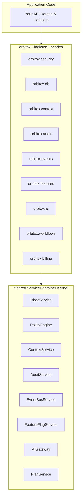

# 🪐 OrbitoX Core Platform Developer Guide

> **Deep-dive on the Kernel Architecture, `orbitox` Singleton, Facade API Surface, Workflows Engine, and Event Bus.**

---

## 📑 Table of Contents
1. [The Unified Singleton Pattern (`orbitox`)](#1-the-unified-singleton-pattern-orbitox)
2. [ServiceContainer: The Shared Kernel Engine](#2-servicecontainer-the-shared-kernel-engine)
3. [Facade API Surface Reference](#3-facade-api-surface-reference)
4. [Ultra-Easy Fluent Builders (`orbitox.tenant()`, `orbitox.workflows`)](#4-ultra-easy-fluent-builders-orbitoxtenant-orbitoxworkflows)
5. [Distributed Event Bus & Workflows Automation](#5-distributed-event-bus--workflows-automation)

---

## 1. The Unified Singleton Pattern (`orbitox`)

OrbitoX exposes a single, unified entry point:
```typescript
import { orbitox } from '@orbitox/runtime';
```

All 9 core facades (`security`, `database`, `context`, `audit`, `events`, `features`, `ai`, `workflows`, `billing`) are powered by a shared, singleton **`ServiceContainer`**. This guarantees that a context created in `orbitox.context` is instantly visible to `orbitox.features`, `orbitox.security`, `orbitox.db`, and `orbitox.billing`.

---

## 2. ServiceContainer: The Shared Kernel Engine



---

## 3. Facade API Surface Reference

| Facade | Key Methods | Purpose |
| :--- | :--- | :--- |
| **`orbitox.security`** | `authorize()`, `check()`, `policy()`, `getVisibilityClause()` | 3-Layer Zero-Trust authorization & data isolation |
| **`orbitox.db`** | `useAdapter()`, `getAdapter()`, `findMany()`, `create()` | Universal Database Adapter (Prisma, Drizzle, Mongo) |
| **`orbitox.context`** | `create()`, `get()`, `descendants()`, `linkPeers()` | N-Tier tenancy hierarchy & inter-branch mesh |
| **`orbitox.audit`** | `created()`, `updated()`, `deleted()`, `verifyChain()` | SHA-256 cryptographic compliance audit vault |
| **`orbitox.events`** | `emit()`, `on()`, `onAny()` | Distributed BullMQ / in-memory event bus |
| **`orbitox.features`** | `define()`, `isEnabled()`, `setOverride()` | Context-cascading feature flags |
| **`orbitox.ai`** | `ask()`, `extract()`, `classify()`, `embed()` | Unified multi-provider LLM gateway (OpenAI / Gemini) |
| **`orbitox.workflows`**| `build()`, `trigger()` | Event-triggered and cron-scheduled automation |
| **`orbitox.billing`** | `createPlan()`, `checkQuota()`, `hasEntitlement()` | Tiered subscription plans & quota enforcement |

---

## 4. Ultra-Easy Fluent Builders

### 4.1 Tenant Builder (`orbitox.tenant()`)
```typescript
const tenant = await orbitox.tenant('acme-ny', 'Acme New York')
  .type('tenant')
  .parent('org_acme_hq')
  .owner('user_123')
  .subscribe('enterprise-plan')
  .enableFeature('ai_diagnostics')
  .create();
```

### 4.2 Workflow Builder (`orbitox.workflows.build()`)
```typescript
await orbitox.workflows.build('vip_alert', tenant.id)
  .name('VIP Alert Automation')
  .onEvent('order.created')
  .action('email', 'admin@hospital.com', { template: 'urgent_alert' })
  .activate();
```
