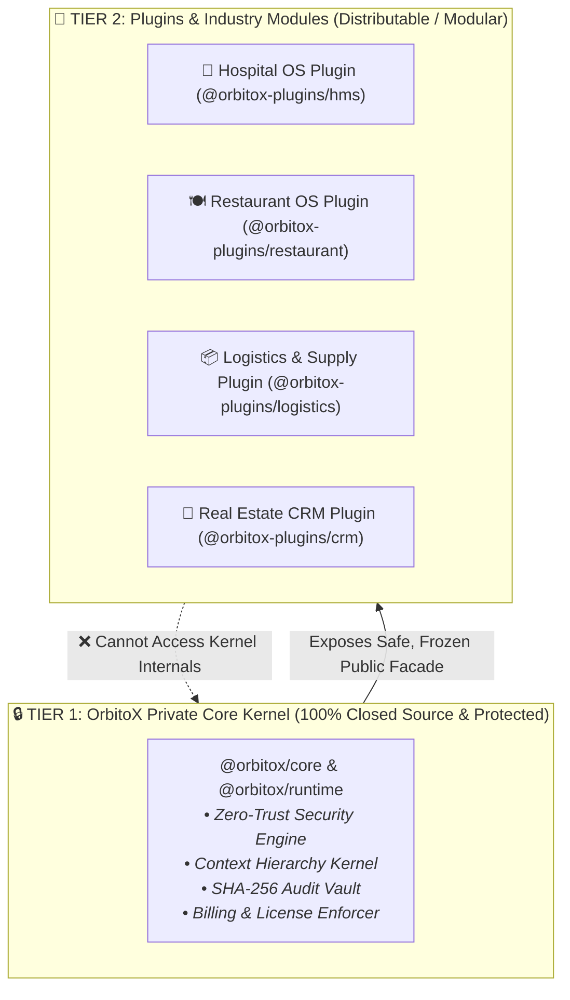
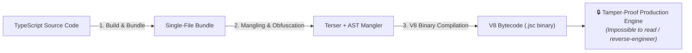
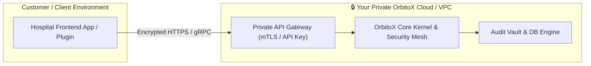

# 🛡️ OrbitoX Platform Security & Intellectual Property (IP) Protection Guide

> **How to distribute OrbitoX plugins and packages securely while keeping the Core Platform Kernel 100% confidential, un-leakable, tamper-proof, and protected against reverse-engineering.**

---

## 📑 Table of Contents
1. [The Architecture: Proprietary Kernel vs. Modular Plugins](#1-the-architecture-proprietary-kernel-vs-modular-plugins)
2. [Strategy 1: Private Scoped Package Registry (npm / GitHub Packages / AWS CodeArtifact)](#strategy-1-private-scoped-package-registry)
3. [Strategy 2: Bytecode Compilation & Advanced Obfuscation (`bytenode` / Terser)](#strategy-2-bytecode-compilation--advanced-obfuscation)
4. [Strategy 3: Microkernel Sandbox & Frozen Facade APIs](#strategy-3-microkernel-sandbox--frozen-facade-apis)
5. [Strategy 4: Cryptographic Licensing & Domain-Lock Verification](#strategy-4-cryptographic-licensing--domain-lock-verification)
6. [Strategy 5: Hosted Core (PaaS / Control Plane Architecture)](#strategy-5-hosted-core-paas--control-plane-architecture)
7. [Strategy 6: Git & CI/CD Hardening (Preventing Accidental Leaks)](#strategy-6-git--cicd-hardening-preventing-accidental-leaks)
8. [Summary Security Matrix](#8-summary-security-matrix)

---

## 1. The Architecture: Proprietary Kernel vs. Modular Plugins

To build a secure ecosystem, we strictly divide the platform into two separate tiers:



---

## Strategy 1: Private Scoped Package Registry

Never publish `@orbitox/core` or `@orbitox/runtime` to the public npm registry without authentication.

### How to set up private registry publication:
1. **Scope naming:** Use a private scope: `@orbitox/*` or `@yourcompany/*`.
2. **Private Registries:** Publish only to:
   - **GitHub Packages** (`npm.pkg.github.com`) with read-restricted access tokens.
   - **AWS CodeArtifact** / **Google Artifact Registry** within your private VPC.
   - **Private Self-Hosted Verdaccio** server behind a VPN.
3. **`.npmrc` token configuration:**
```ini
# .npmrc
@orbitox:registry=https://npm.pkg.github.com
//npm.pkg.github.com/:_authToken=${ORBITOX_PRIVATE_DEPLOY_TOKEN}
always-auth=true
```

---

## Strategy 2: Bytecode Compilation & Advanced Obfuscation

Even if compiled JavaScript files are distributed, hackers can try to decompile them. We prevent this using **V8 Bytecode Compilation (`bytenode`)** and **AST Mangling**:



### 1. Stripping Source Maps in Production (`tsconfig.json`)
Ensure no `.ts` source files or `.map` source maps are included in release builds:
```json
{
  "compilerOptions": {
    "sourceMap": false,
    "declaration": true,
    "declarationMap": false,
    "removeComments": true
  }
}
```

### 2. V8 Bytecode Compilation (`bytenode`)
Compiles your code into raw V8 binary bytecode (`.jsc`), which Node.js executes directly without exposing any readable JavaScript:
```bash
# Compile runtime into binary bytecode
npx bytenode --compile dist/index.js dist/index.jsc
```

---

## Strategy 3: Microkernel Sandbox & Frozen Facade APIs

Third-party plugins must **never** be allowed to touch database credentials, encryption master keys, or kernel memory. 

OrbitoX enforces a strict **Sandboxed Plugin Interface**:

```typescript
// Plugins ONLY receive frozen facade references via orbitox.use()
export interface OrbitoXPlugin {
  id: string;
  name: string;
  version: string;
  install: (orbitox: OrbitoXPublicFacade) => void;
}

// 🛡️ Kernel internals are hidden via private closures and Symbol keys
Object.freeze(orbitox.security);
Object.freeze(orbitox.context);
```

---

## Strategy 4: Cryptographic Licensing & Domain-Lock Verification

To prevent unauthorized parties from copying your compiled runtime and running it on unauthorized servers, OrbitoX supports **RSA-Signed License Keys**:

```typescript
import { orbitox } from '@orbitox/runtime';

// At startup, the engine verifies an RSA-signed license payload
orbitox.configure({
  mode: 'strict',
  license: {
    key: process.env.ORBITOX_LICENSE_KEY, // RSA-256 Signed JWT
    allowedDomain: 'hospital.apollo.com',
    expiresAt: '2027-12-31T23:59:59Z'
  }
});
```

If the license key is forged, expired, or runs on an unauthorized IP/domain, the engine automatically halts execution immediately.

---

## Strategy 5: Hosted Core (PaaS / Control Plane Architecture)

For maximum security, you can run **OrbitoX Core as a Hosted Private Cloud / Control Plane**:


* **Advantage:** Customers and developers only interact with your APIs/SDKs, while the entire OrbitoX source code **never leaves your secure cloud servers**.

---

## Strategy 6: Git & CI/CD Hardening (Preventing Accidental Leaks)

1. **Pre-Commit Secret Scanning:** Use tools like `trufflehog` or `git-secrets` in git hooks to block accidental commits containing API keys or private tokens.
2. **Private Repository Enforcement:** Keep the monorepo private on GitHub / GitLab Enterprise with 2FA required for all contributors.
3. **Automated CI/CD Release Pipeline:** Only automated GitHub Actions runners should have publishing permissions to private npm registries.

---

## 8. Summary Security Matrix

| Protection Layer | Threat Addressed | Solution Implemented |
| :--- | :--- | :--- |
| **Package Distribution** | Public source code leaks | Private Scoped Registry (`@orbitox/*` on GitHub Packages / CodeArtifact) |
| **Binary Protection** | Reverse engineering / decompilation | V8 Bytecode compilation (`bytenode`) + Terser obfuscation |
| **Extension Sandbox** | Rogue plugin privilege escalation | Frozen Facades (`Object.freeze`) + Symbol-guarded kernel internals |
| **Software Piracy** | Running code on unauthorized servers | Cryptographic RSA-signed license keys with domain locks |
| **Cloud Control** | Code distribution risk | Hosted SaaS Engine (Kernel lives in your private cloud) |
| **Developer Errors** | Accidental Git public pushes | Pre-commit secret scanning + Private Monorepo branch protection |
