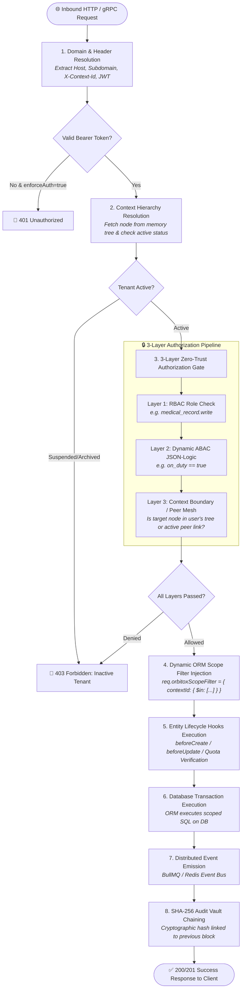

# ⚡ Request Lifecycle & Security Flow Guide

> **The Complete Visual Lifecycle of an Inbound Request across Header Extraction, Zero-Trust Authorization, Dynamic Filtering, and Cryptographic Auditing.**

---

## 1. Complete Request Lifecycle Flowchart

---

## 2. 6-Stage Processing Pipeline Table

| Stage | Component | Action Performed | Security Guarantee |
| :--- | :--- | :--- | :--- |
| **Stage 1** | `orbitox.middleware()` | Extracts Host header, subdomains, and JWT | Prevents unauthenticated access |
| **Stage 2** | `ContextService` | Resolves tenant hierarchy node and status | Blocks suspended or archived accounts |
| **Stage 3** | `PolicyEngine` & `RbacService` | Evaluates RBAC + ABAC + Context Boundary | Enforces zero-trust mathematical isolation |
| **Stage 4** | `SecurityFacade` | Injects `$in` scope filter for database query | Completely eliminates IDOR vulnerabilities |
| **Stage 5** | `EntityHooks` | Executes business validations and quota checks | Enforces atomic SaaS licenses & capacity |
| **Stage 6** | `AuditService` | Computes SHA-256 hash linked to previous log | Guarantees immutable compliance ledger |
