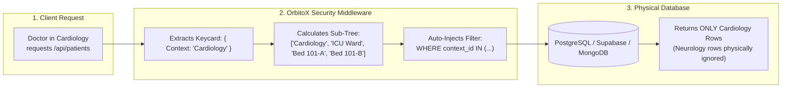
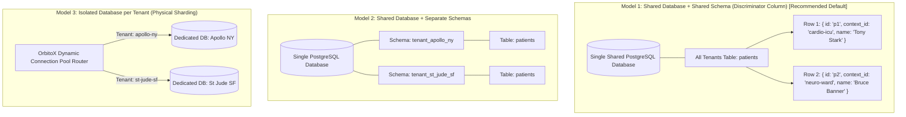
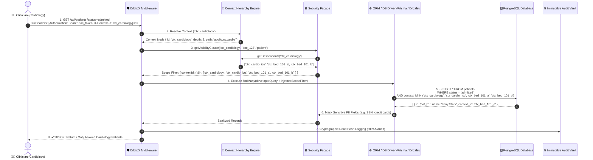
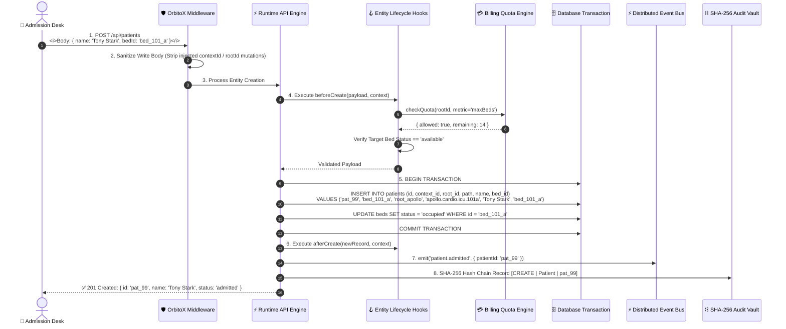
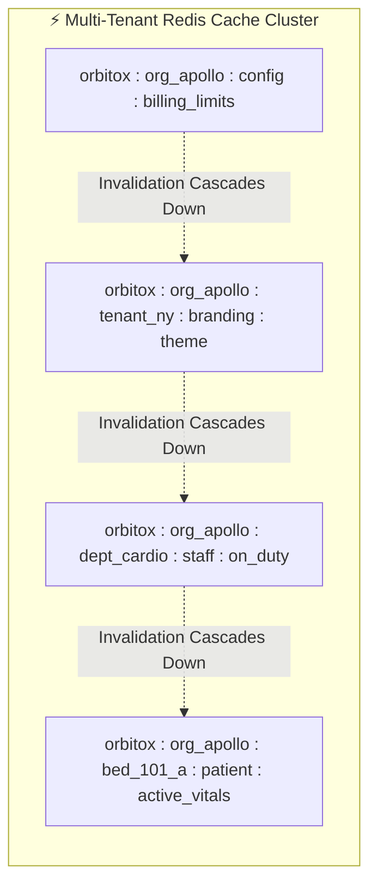

# 🔄 OrbitoX Database Flow & Security Mechanics: Deep Architectural Guide

> **A beginner-friendly, deeply detailed explanation of how OrbitoX routes, isolates, sanitizes, queries, and protects multi-tenant databases with Zero-Trust security.**

---

## 📑 Table of Contents
1. [The Big Picture: How OrbitoX Handles Databases (Explained with an Analogy)](#1-the-big-picture-how-orbitox-handles-databases-explained-with-an-analogy)
2. [The 3 Multi-Tenant Database Storage Models](#2-the-3-multi-tenant-database-storage-models)
3. [Deep-Dive: The Complete Database Read Flow](#3-deep-dive-the-complete-database-read-flow)
4. [Deep-Dive: The Complete Database Write Flow](#4-deep-dive-the-complete-database-write-flow)
5. [Query Translation Matrix (Developer Code vs. Actual SQL)](#5-query-translation-matrix-developer-code-vs-actual-sql)
6. [Real-World Attack Scenarios & How OrbitoX Defends the DB](#6-real-world-attack-scenarios--how-orbitox-defends-the-db)
7. [Multi-Tier Cache Namespaces & Invalidation Cascades](#7-multi-tier-cache-namespaces--invalidation-cascades)
8. [Freshers' Summary & Developer Checklist](#8-freshers-summary--developer-checklist)

---

## 1. The Big Picture: How OrbitoX Handles Databases (Explained with an Analogy)

### 🏨 The Hotel Filing Cabinet Analogy
Imagine a massive hotel with 100 floors:
* **Traditional Vulnerable SaaS:** When a guest asks the front desk, *"Give me bill #104"*, the clerk blindly looks up bill #104 in the shared filing cabinet. If guest #104 belongs to floor 5, but guest #99 from floor 2 asked for it, they accidentally get floor 5's private bill! (This is called an **IDOR Data Leak**).
* **The OrbitoX Zero-Trust Engine:** When guest #99 asks for bill #104, the clerk automatically looks at the guest's keycard (*Floor 2*), and stamps `WHERE floor = 2` on the request. When searching the cabinet, bill #104 on Floor 5 is completely invisible. The clerk says: *"Bill #104 does not exist on Floor 2"* (**Silent 404**).

---

## 2. The 3 Multi-Tenant Database Storage Models

OrbitoX supports 3 distinct storage isolation architectures:

### Storage Model Comparison

| Feature | Model 1: Shared DB, Shared Schema (Default) | Model 2: Separate Schemas | Model 3: Dedicated DB per Tenant |
| :--- | :--- | :--- | :--- |
| **How Isolation Works** | Discriminator column (`contextId`, `rootId`, `path`) + Automatic Middleware Filters | PostgreSQL `search_path` schema separation | Separate Database Host / Connection String |
| **Cost Efficiency** | ⭐⭐⭐⭐⭐ Maximum (Shared compute, 1 connection pool) | ⭐⭐⭐⭐ High (Shared memory and CPU) | ⭐⭐ Low (Dedicated cloud DB cost per client) |
| **Database Migrations** | Runs in 1 second across all tenants | Must run loops across thousands of schemas | Complex orchestrator required |
| **Cross-Tenant Analytics** | Instant indexed queries across the context tree | Complex cross-schema queries | Requires ETL / Data Lake synchronization |
| **Recommended For** | **95% of all SaaS applications**, Startups, Scaleups | Mid-market clients requiring schema separation | Enterprise Banks, Government, Strict HIPAA Vaults |

---

## 3. Deep-Dive: The Complete Database Read Flow

When a user calls `GET /api/patients`, here is the exact 8-step pipeline that executes:

### Detailed Breakdown of Read Steps:

1. **Step 1 (Request Arrival):** The client sends an HTTP request with authentication and context headers.
2. **Step 2 (Context Resolution):** OrbitoX retrieves the caller's context from memory in **0.01ms** using pre-indexed hash maps.
3. **Step 3 (Sub-Tree Calculation):** The security engine computes all child context nodes under Cardiology (`ICU Ward`, `Bed 101-A`, `Bed 101-B`).
4. **Step 4 (Scope Injection):** The middleware merges the developer's filter (`status: admitted`) with the sub-tree context filter (`contextId IN (...)`).
5. **Step 5 (Database Execution):** The database executes a single fast B-Tree indexed SQL scan. Rows from other departments (like Neurology) are **physically ignored by the database engine**.
6. **Step 6 (PII Sanitization):** Fields marked as sensitive are redacted or masked based on the user's role.
7. **Step 7 (Audit Vault):** A cryptographic SHA-256 hash of the read event is appended to the audit ledger.
8. **Step 8 (Response):** The sanitized data is returned to the client.

---

## 4. Deep-Dive: The Complete Database Write Flow

When a client creates or updates data (e.g. `POST /api/patients`), here is the exact 8-step atomic write pipeline:

### Detailed Breakdown of Write Steps:

1. **Step 1 (Payload Submission):** Client submits patient admission data.
2. **Step 2 (Immutable Write Stripping):** The security gate removes any client-supplied hierarchy fields (`contextId`, `rootId`, `tenantId`, `path`) to prevent tenant-spoofing attacks.
3. **Step 3 (Schema Validation):** Validates field types (`name` is text, `age` is number, required fields exist).
4. **Step 4 (Atomic `beforeCreate` Hook):**
   - Queries the `BillingFacade` to verify the hospital has not exceeded its 500-bed SaaS plan.
   - Checks the target bed status in the database to prevent double-booking.
5. **Step 5 (Atomic Database Transaction):** Inserts the patient record and updates the bed status in a single atomic SQL transaction (`BEGIN ... COMMIT`). If anything fails, the entire transaction rolls back cleanly.
6. **Step 6 (`afterCreate` Hook):** Executes post-admission business automations (e.g. nurse station notification).
7. **Step 7 (Event Emission):** Publishes `patient.admitted` to the distributed Redis BullMQ bus for background workflows.
8. **Step 8 (Audit Vault Chaining):** Appends an immutable cryptographic record to the audit chain.

---

## 5. Query Translation Matrix (Developer Code vs. Actual SQL)

| What the Developer Writes | Current User Context | What the Database Engine Actually Executes |
| :--- | :--- | :--- |
| `prisma.patient.findMany()` | **Cardiology Doctor** (`ctx_cardio`) | `SELECT * FROM patients WHERE context_id IN ('ctx_cardio', 'ctx_icu_a', 'ctx_bed_1', 'ctx_bed_2');` |
| `prisma.patient.findMany()` | **ICU Ward Nurse** (`ctx_icu_a`) | `SELECT * FROM patients WHERE context_id IN ('ctx_icu_a', 'ctx_bed_1', 'ctx_bed_2');` |
| `prisma.patient.findMany()` | **Hospital Super Admin** (`ctx_root`) | `SELECT * FROM patients WHERE root_id = 'ctx_root';` |
| `prisma.patient.findUnique({ id: 'pat_99' })` | **Neurology Doctor** (`ctx_neuro`) | `SELECT * FROM patients WHERE id = 'pat_99' AND context_id IN ('ctx_neuro', 'ctx_neuro_ward');` *(Returns `NULL` $\rightarrow$ Triggers **Silent 404**)* |
| `prisma.inventory.findMany()` | **Peer Mesh Linked Depts** | `SELECT * FROM inventory WHERE context_id IN ('ctx_cardio', 'ctx_neuro_shared_vault');` |

---

## 6. Real-World Attack Scenarios & How OrbitoX Defends the DB

### 🛡️ Scenario 1: The IDOR Snooping Attack
* **The Attack:** A doctor in **Neurology** guesses the ID of a VIP patient in **Cardiology** (`pat_tony_stark`) and sends `GET /api/patients/pat_tony_stark`.
* **The Defense:** OrbitoX automatically appends `AND context_id IN ('ctx_neurology', ...)` to the query. The database returns `0 rows`. OrbitoX sends back **`404 Not Found`** instead of `403 Forbidden`.
* **Why it matters:** Returning `404` prevents the attacker from confirming whether the patient exists in the hospital.

### 🛡️ Scenario 2: The Tenant-Hijacking Mutation Attack
* **The Attack:** A malicious tenant tries to steal another hospital's data by submitting a `PUT` request with `contextId: 'ctx_victim_hospital'`.
* **The Defense:** The `sanitizeWritePayload()` interceptor strips all hierarchy IDs from the body before the ORM generates SQL. The update is strictly locked to the user's authentic context.

### 🛡️ Scenario 3: The Double-Booking Race Condition Attack
* **The Attack:** Two receptionists try to admit two different patients into the exact same ICU bed at the exact same millisecond.
* **The Defense:** The `beforeCreate` hook runs inside an atomic database transaction with row-level locks. The first admission succeeds, and the second admission is immediately rejected with `Bed is already occupied`.

---

## 7. Multi-Tier Cache Namespaces & Invalidation Cascades

To achieve sub-millisecond query responses, OrbitoX uses **hierarchically scoped Redis keys**:

* **Cache Key Format:** `orbitox:{rootId}:{contextId}:{entity}:{id}`
* **Cascade Invalidation:** If an organization's subscription changes at Root, only the affected sub-tree keys are purged, leaving other hospitals' caches 100% warm.

---

## 8. Freshers' Summary & Developer Checklist

### 🎓 5 Golden Rules for Database Developers on OrbitoX:
1. **Never write manual `WHERE tenant_id = ?` clauses:** Always pass `req.orbitoxScopeFilter` to your ORM.
2. **Use Entity Hooks for capacity and business rules:** Keep all bed availability, inventory, and quota checks in `beforeCreate` hooks.
3. **Use Materialized Paths for sub-tree lookups:** Query by path prefix (`path LIKE 'apollo.cardio.%'`) for blazing fast census reports.
4. **Treat Context IDs as Immutable:** Never allow clients to mutate `context_id` or `root_id` on existing records.
5. **Use Inter-Branch Mesh for cross-department lookups:** Use `orbitox.context.linkPeers()` instead of building custom SQL joins.

---

### 🔗 Related Guides & Hubs
- 📘 [**Database Integration Guide (Prisma, Drizzle, Mongoose)**](./DATABASE_INTEGRATION_GUIDE.md)
- 🏥 [**Hospital SaaS Developer Handbook**](../hospital_saas/HOSPITAL_SAAS_DEVELOPER_GUIDE.md)
- 🔄 [**Clinical Workflow Sequences**](../hospital_saas/HOSPITAL_CLINICAL_WORKFLOW_FLOW.md)
- 🧭 [**Developer Guide Master Hub**](../README.md)
