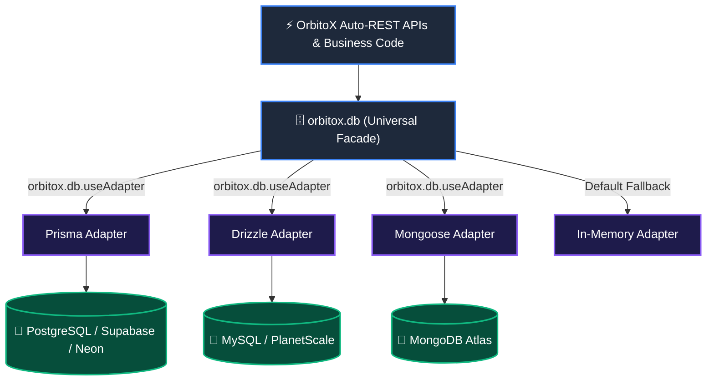

# 🗄️ Universal Database Integration Guide: Connecting Any DB in 1 Line

> **The ultra-simple, plug-and-play guide to connecting PostgreSQL, MySQL, Supabase, Neon, MongoDB, or SQLite to OrbitoX with Prisma, Drizzle, Mongoose, or TypeORM.**

---

## 📑 Table of Contents
1. [The 1-Line Database Plugin Philosophy](#1-the-1-line-database-plugin-philosophy)
2. [Ready-to-Use Copy-Paste Adapters](#2-ready-to-use-copy-paste-adapters)
   - [A. Prisma Database Adapter (PostgreSQL / Supabase / MySQL)](#a-prisma-database-adapter-postgresql--supabase--mysql)
   - [B. Drizzle ORM Database Adapter (PostgreSQL / Neon)](#b-drizzle-orm-database-adapter-postgresql--neon)
   - [C. Mongoose Database Adapter (MongoDB Atlas)](#c-mongoose-database-adapter-mongodb-atlas)
   - [D. Turso & SQLite Database Adapter (libSQL at the Edge)](#d-turso--sqlite-database-adapter-libsql-at-the-edge)
3. [Booting Auto-REST APIs with Your Database (`createOrbitoXApp`)](#3-booting-auto-rest-apis-with-your-database-createorbitoxapp)
4. [Direct Facade CRUD Operations (`orbitox.db`)](#4-direct-facade-crud-operations-orbitoxdb)
5. [Multi-Database Polyglot Architecture (Postgres + Mongo + Redis)](#5-multi-database-polyglot-architecture-postgres--mongo--redis)
6. [Database-per-Tenant Connection Pool Sharding](#6-database-per-tenant-connection-pool-sharding)

---

## 1. The 1-Line Database Plugin Philosophy

OrbitoX includes a **Universal Database Facade (`orbitox.db`)** that decouples business logic and REST APIs from physical database storage.



### 💡 To switch your database in OrbitoX, you only need 1 line of code:
```typescript
import { orbitox, createDatabaseAdapter } from '@orbitox/runtime';

// Switch to Prisma, Drizzle, or Mongo instantly!
orbitox.db.useAdapter(myDatabaseAdapter);
```

---

## 2. Ready-to-Use Copy-Paste Adapters

You can copy any of the following 5-line adapters directly into your project:

---

### A. Prisma Database Adapter (PostgreSQL / Supabase / MySQL)

```typescript
import { PrismaClient } from '@prisma/client';
import { createDatabaseAdapter, OrbitoXDatabaseAdapter } from '@orbitox/runtime';

export function createPrismaAdapter(prisma: PrismaClient): OrbitoXDatabaseAdapter {
  return createDatabaseAdapter('prisma', {
    findMany: async (entity, opts) => {
      const model = (prisma as any)[entity];
      const where: any = { ...opts.filter };
      if (opts.allowedContextIds?.length) where.contextId = { in: opts.allowedContextIds };
      else if (opts.contextId) where.contextId = opts.contextId;

      const [data, total] = await Promise.all([
        model.findMany({
          where,
          skip: ((opts.page || 1) - 1) * (opts.limit || 20),
          take: opts.limit || 20,
          orderBy: opts.sort ? { [opts.sort.replace('-', '')]: opts.sort.startsWith('-') ? 'desc' : 'asc' } : undefined
        }),
        model.count({ where })
      ]);

      return {
        data,
        meta: { page: opts.page || 1, limit: opts.limit || 20, total, filters: opts.filter }
      };
    },
    findById: async (entity, id, contextId) => {
      const where: any = { id };
      if (contextId) where.contextId = contextId;
      return (prisma as any)[entity].findFirst({ where });
    },
    create: async (entity, data, contextId) => {
      return (prisma as any)[entity].create({
        data: { ...data, contextId: contextId || (data as any).contextId }
      });
    },
    update: async (entity, id, data, contextId) => {
      const where: any = { id };
      if (contextId) where.contextId = contextId;
      return (prisma as any)[entity].update({ where, data });
    },
    delete: async (entity, id, contextId) => {
      const where: any = { id };
      if (contextId) where.contextId = contextId;
      await (prisma as any)[entity].delete({ where });
      return true;
    },
    ping: async () => {
      await prisma.$queryRaw`SELECT 1`;
      return true;
    }
  });
}
```

---

### B. Drizzle ORM Database Adapter (PostgreSQL / Neon)

```typescript
import { createDatabaseAdapter, OrbitoXDatabaseAdapter } from '@orbitox/runtime';
import { eq, and, inArray } from 'drizzle-orm';

export function createDrizzleAdapter(db: any, tables: Record<string, any>): OrbitoXDatabaseAdapter {
  return createDatabaseAdapter('drizzle', {
    findMany: async (entity, opts) => {
      const table = tables[entity];
      const conditions: any[] = [];
      
      if (opts.allowedContextIds?.length) {
        conditions.push(inArray(table.contextId, opts.allowedContextIds));
      } else if (opts.contextId) {
        conditions.push(eq(table.contextId, opts.contextId));
      }

      const data = await db.select().from(table).where(and(...conditions)).limit(opts.limit || 20);
      return {
        data,
        meta: { page: opts.page || 1, limit: opts.limit || 20, total: data.length }
      };
    },
    findById: async (entity, id) => {
      const table = tables[entity];
      const rows = await db.select().from(table).where(eq(table.id, id)).limit(1);
      return rows[0] || null;
    },
    create: async (entity, data, contextId) => {
      const table = tables[entity];
      const [inserted] = await db.insert(table).values({ ...data, contextId }).returning();
      return inserted;
    },
    update: async (entity, id, data) => {
      const table = tables[entity];
      const [updated] = await db.update(table).set(data).where(eq(table.id, id)).returning();
      return updated;
    },
    delete: async (entity, id) => {
      const table = tables[entity];
      await db.delete(table).where(eq(table.id, id));
      return true;
    }
  });
}
```

---

### C. Mongoose Database Adapter (MongoDB Atlas)

```typescript
import mongoose from 'mongoose';
import { createDatabaseAdapter, OrbitoXDatabaseAdapter } from '@orbitox/runtime';

export function createMongooseAdapter(models: Record<string, mongoose.Model<any>>): OrbitoXDatabaseAdapter {
  return createDatabaseAdapter('mongoose', {
    findMany: async (entity, opts) => {
      const Model = models[entity];
      const query: any = { ...opts.filter };
      if (opts.allowedContextIds?.length) query.contextId = { $in: opts.allowedContextIds };
      else if (opts.contextId) query.contextId = opts.contextId;

      const page = opts.page || 1;
      const limit = opts.limit || 20;

      const [data, total] = await Promise.all([
        Model.find(query).skip((page - 1) * limit).limit(limit).lean(),
        Model.countDocuments(query)
      ]);

      return {
        data,
        meta: { page, limit, total, totalPages: Math.ceil(total / limit) }
      };
    },
    findById: async (entity, id, contextId) => {
      const query: any = { _id: id };
      if (contextId) query.contextId = contextId;
      return models[entity].findOne(query).lean();
    },
    create: async (entity, data, contextId) => {
      const doc = await models[entity].create({ ...data, contextId });
      return doc.toObject();
    },
    update: async (entity, id, data, contextId) => {
      const query: any = { _id: id };
      if (contextId) query.contextId = contextId;
      return models[entity].findOneAndUpdate(query, data, { new: true }).lean();
    },
    delete: async (entity, id, contextId) => {
      const query: any = { _id: id };
      if (contextId) query.contextId = contextId;
      const res = await models[entity].deleteOne(query);
      return res.deletedCount > 0;
    }
  });
}
```

---

### D. Turso & SQLite Database Adapter (libSQL at the Edge)

```typescript
import { createClient } from '@libsql/client';
import { createDatabaseAdapter, OrbitoXDatabaseAdapter } from '@orbitox/runtime';

export function createTursoAdapter(client: ReturnType<typeof createClient>): OrbitoXDatabaseAdapter {
  return createDatabaseAdapter('turso', {
    findMany: async (entity, opts) => {
      let sql = `SELECT * FROM ${entity}`;
      const params: any[] = [];

      if (opts.contextId) {
        sql += ` WHERE context_id = ?`;
        params.push(opts.contextId);
      }

      sql += ` LIMIT ?`;
      params.push(opts.limit || 20);

      const res = await client.execute({ sql, args: params });
      return {
        data: res.rows as any[],
        meta: { page: 1, limit: opts.limit || 20, total: res.rows.length }
      };
    },
    findById: async (entity, id) => {
      const res = await client.execute({
        sql: `SELECT * FROM ${entity} WHERE id = ? LIMIT 1`,
        args: [id]
      });
      return (res.rows[0] as any) || null;
    },
    create: async (entity, data, contextId) => {
      const id = (data as any).id || `${entity}_${Date.now()}`;
      const fields = ['id', 'context_id', ...Object.keys(data)];
      const placeholders = fields.map(() => '?').join(',');
      const values = [id, contextId, ...Object.values(data)];

      await client.execute({
        sql: `INSERT INTO ${entity} (${fields.join(',')}) VALUES (${placeholders})`,
        args: values
      });
      return { id, contextId, ...data };
    },
    delete: async (entity, id) => {
      const res = await client.execute({ sql: `DELETE FROM ${entity} WHERE id = ?`, args: [id] });
      return res.rowsAffected > 0;
    }
  });
}
```

---

## 3. Booting Auto-REST APIs with Your Database (`createOrbitoXApp`)

When using `createOrbitoXApp`, pass your database adapter in `database.adapter`. The auto-generated REST routes will **read and write directly to your database**:

```typescript
import { createOrbitoXApp } from '@orbitox/runtime';
import { PrismaClient } from '@prisma/client';
import { createPrismaAdapter } from './prisma-adapter';

const prisma = new PrismaClient();

// 🚀 Boot App with Prisma Database Integration in 1 step!
const { app, server } = await createOrbitoXApp({
  app: { name: 'Hospital SaaS Engine', port: 3000 },
  database: {
    adapter: createPrismaAdapter(prisma) // 🗄️ Plugged into Prisma!
  },
  entities: [
    {
      id: 'patient',
      name: 'Patient',
      fields: [
        { name: 'name', type: 'text', required: true },
        { name: 'bedId', type: 'text', required: true }
      ]
    }
  ]
});

// Now:
// POST /api/patients -> Saves directly into PostgreSQL via Prisma!
// GET  /api/patients -> Reads directly from PostgreSQL with multi-tenant context filters!
```

---

## 4. Direct Facade CRUD Operations (`orbitox.db`)

You can also use `orbitox.db` directly anywhere in your code:

```typescript
import { orbitox } from '@orbitox/runtime';

// 1. Create a record (tagged to context)
const newPatient = await orbitox.db.create('patient', {
  name: 'Tony Stark',
  age: 48
}, 'ctx_cardio_icu');

// 2. Query records with context isolation
const result = await orbitox.db.findMany('patient', {
  contextId: 'ctx_cardio_icu',
  page: 1,
  limit: 10
});
console.log(`Found ${result.data.length} patients in ICU`);

// 3. Find one by ID
const patient = await orbitox.db.findById('patient', newPatient.id, 'ctx_cardio_icu');

// 4. Update
await orbitox.db.update('patient', newPatient.id, { status: 'discharged' });

// 5. Delete
await orbitox.db.delete('patient', newPatient.id);
```

---

## 5. Multi-Database Polyglot Architecture (Postgres + Mongo + Redis)

```typescript
import { orbitox } from '@orbitox/runtime';

// 1. Setup Redis for Distributed BullMQ Events & Caching
orbitox.configure({
  mode: 'strict',
  redis: { host: 'redis.prod.internal', port: 6379 }
});

// 2. Set Prisma as the primary transactional adapter
orbitox.db.useAdapter(createPrismaAdapter(prisma));

// 3. Use Mongo Mongoose directly for flexible medical charts
app.post('/api/charts', async (req: any, res) => {
  const chart = await MongooseChartModel.create({
    ...req.body,
    contextId: req.orbitoxContext.id // 🛡️ Protected by OrbitoX Context
  });
  
  await orbitox.events.emit('chart.created', { chartId: chart.id }, req.orbitoxContext.id);
  res.json({ data: chart });
});
```

---

## 6. Database-per-Tenant Connection Pool Sharding

```typescript
import { Pool } from 'pg';

const tenantPools = new Map<string, Pool>([
  ['apollo-ny', new Pool({ connectionString: process.env.DB_APOLLO_NY_URL })],
  ['st-jude-sf', new Pool({ connectionString: process.env.DB_ST_JUDE_SF_URL })],
]);

export function getTenantDbPool(tenantSlug: string): Pool {
  return tenantPools.get(tenantSlug) || defaultGlobalPool;
}
```

---

## 🎯 Summary Matrix

| Database Goal | How to do it in OrbitoX | Code Snippet |
| :--- | :--- | :--- |
| **Connect Prisma (Postgres/MySQL)** | Pass `createPrismaAdapter(prisma)` | `orbitox.db.useAdapter(createPrismaAdapter(prisma))` |
| **Connect Drizzle (Neon/PlanetScale)** | Pass `createDrizzleAdapter(db, tables)` | `orbitox.db.useAdapter(createDrizzleAdapter(db, tables))` |
| **Connect Mongoose (MongoDB)** | Pass `createMongooseAdapter(models)` | `orbitox.db.useAdapter(createMongooseAdapter(models))` |
| **Connect Turso / SQLite (Edge)** | Pass `createTursoAdapter(client)` | `orbitox.db.useAdapter(createTursoAdapter(client))` |
| **Auto-REST APIs to DB** | Pass `database.adapter` in `createOrbitoXApp` | `createOrbitoXApp({ database: { adapter: myAdapter } })` |
| **Direct DB Calls** | Use `orbitox.db.*` methods | `await orbitox.db.findMany('patient', { contextId })` |
