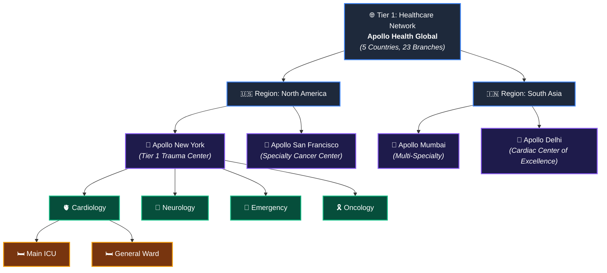
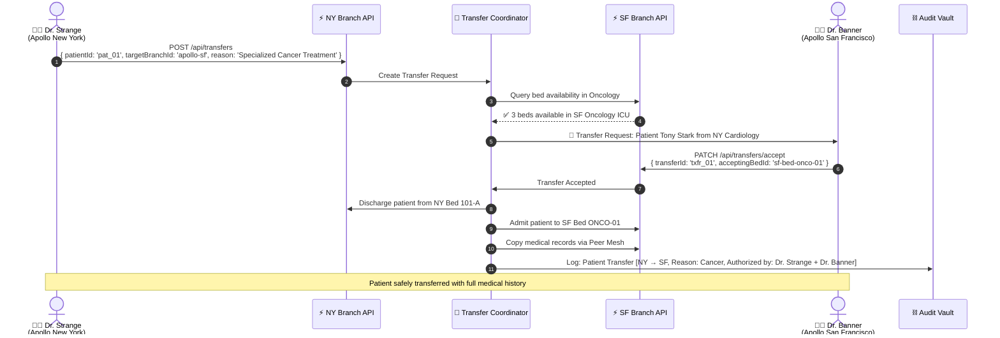
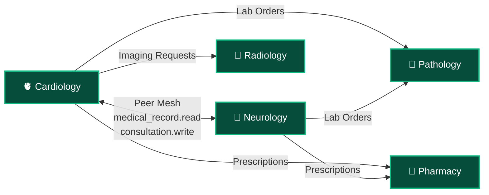

# 🏢 Branches & Departments: Multi-Hospital Network Management Guide

> **How to set up multi-branch hospital networks, configure departments, manage wards, handle cross-branch transfers, and scale hospital operations across cities and countries.**

---

## 📑 Table of Contents
1. [Multi-Branch Architecture](#1-multi-branch-architecture)
2. [Department Types & Configuration](#2-department-types--configuration)
3. [Ward Types & Capacity Planning](#3-ward-types--capacity-planning)
4. [Setting Up a Complete Hospital Branch](#4-setting-up-a-complete-hospital-branch)
5. [Cross-Branch Patient Transfers](#5-cross-branch-patient-transfers)
6. [Department–Department Communication (Peer Mesh)](#6-departmentdepartment-communication-peer-mesh)
7. [Branch-Level KPIs & Comparison Analytics](#7-branch-level-kpis--comparison-analytics)
8. [Real-World Problem Solving](#8-real-world-problem-solving)

---

## 1. Multi-Branch Architecture



### Key Principles

| Principle | Description |
| :--- | :--- |
| **Data Isolation** | Apollo New York **cannot see** Apollo Mumbai patient data (separate tenant contexts) |
| **Central Licensing** | SaaS quota (max beds, max staff) is managed at the Organization level, distributed to branches |
| **Cross-Branch Transfer** | A formal transfer protocol moves patient context from one branch to another with audit trail |
| **Shared Formulary** | Drug catalogs can be shared at the Organization level so all branches use the same medication database |
| **Local Compliance** | Each branch can have different regulatory configs (HIPAA for US, NABH for India, JCI for international) |

---

## 2. Department Types & Configuration

### 2.1 Complete Department Taxonomy

| Category | Department | `departmentType` | Key Entities | Staff Roles |
| :--- | :--- | :--- | :--- | :--- |
| **Clinical - Medicine** | General Medicine | `general_medicine` | Patients, Records, Treatments | Attending Doctor, Staff Nurse |
| **Clinical - Medicine** | Cardiology | `cardiology` | + ECG, Cath Lab Records | Cardiologist, Cath Lab Tech |
| **Clinical - Medicine** | Neurology | `neurology` | + EEG, Stroke Scale | Neurologist, Neuro Nurse |
| **Clinical - Medicine** | Pulmonology | `pulmonology` | + PFT, ABG, Ventilators | Pulmonologist, RT |
| **Clinical - Medicine** | Gastroenterology | `gastroenterology` | + Endoscopy Records | Gastroenterologist |
| **Clinical - Medicine** | Nephrology | `nephrology` | + Dialysis Sessions | Nephrologist, Dialysis Tech |
| **Clinical - Medicine** | Oncology | `oncology` | + Chemo Protocols, Staging | Oncologist, Chemo Nurse |
| **Clinical - Medicine** | Pediatrics | `pediatrics` | + Growth Charts, Vaccines | Pediatrician, Peds Nurse |
| **Clinical - Medicine** | Psychiatry | `psychiatry` | + Mental Status Exam | Psychiatrist, Counselor |
| **Clinical - Surgery** | General Surgery | `general_surgery` | + OT Scheduling, Consent | Surgeon, Anesthetist |
| **Clinical - Surgery** | Orthopedics | `orthopedics` | + Implant Tracking | Orthopedic Surgeon |
| **Clinical - Surgery** | Neurosurgery | `neurosurgery` | + Neuro-Navigation | Neurosurgeon |
| **Clinical - Surgery** | Cardiac Surgery | `cardiac_surgery` | + ECMO, Bypass Records | Cardiac Surgeon |
| **Clinical - OB/GYN** | Obstetrics & Gynecology | `obgyn` | + Fetal Monitoring, Labor | OB/GYN, Midwife |
| **Emergency** | Emergency Department | `emergency` | + Triage, Trauma Codes | ER Physician, Triage Nurse |
| **Diagnostics** | Pathology Lab | `pathology_lab` | Lab Orders, Sample Tracking | Lab Technician, Pathologist |
| **Diagnostics** | Radiology & Imaging | `radiology` | DICOM Images, Reports | Radiologist, Rad Tech |
| **Support** | Central Pharmacy | `pharmacy` | Drug Inventory, Dispensing | Pharmacist |
| **Support** | Blood Bank | `blood_bank` | Blood Units, Cross-Match | Blood Bank Tech |
| **Support** | Physical Therapy | `physiotherapy` | Rehab Sessions, PT Plans | Physiotherapist |
| **Admin** | Billing & Finance | `billing` | Invoices, Insurance Claims | Billing Admin |
| **Admin** | HR & Administration | `hr_admin` | Staff Records, Payroll | HR Manager |
| **Facility** | Biomedical Engineering | `biomedical_engineering` | Equipment Registry | Biomed Engineer |
| **Facility** | Housekeeping & Sanitation | `housekeeping` | Room Turnover Tasks | Housekeeping Lead |

### 2.2 Department Entity Structure

```typescript
export interface DepartmentEntity {
  id: string;
  name: string;
  type: string;                // From taxonomy above
  branchId: string;            // Which hospital branch
  headOfDepartment: string;    // Staff ID
  category: 'clinical' | 'diagnostic' | 'support' | 'admin' | 'facility';

  // Operational Config
  config: {
    maxBeds: number;                  // Bed quota for this department
    maxStaff: number;                 // Staff quota
    allowEmergencyOverride: boolean;  // Can ER doctors break-glass into this dept?
    peerMeshEnabled: boolean;         // Can other depts request consultations?
    operatingHours: {
      weekday: { start: string; end: string };
      weekend: { start: string; end: string };
    };
    complianceFramework: 'HIPAA' | 'NABH' | 'JCI' | 'ISO_15189';
  };
}
```

---

## 3. Ward Types & Capacity Planning

| Ward Type | Nurse:Patient Ratio | Typical Bed Count | Equipment Level | Notes |
| :--- | :---: | :---: | :--- | :--- |
| **ICU** | 1:1 or 1:2 | 8–20 | Full (monitors, vents, pumps) | 24/7 intensivist coverage |
| **CCU** | 1:2 | 6–12 | Full cardiac | Continuous ECG monitoring |
| **NICU** | 1:1 to 1:3 | 10–30 | Incubators, warmers, cpap | Level I/II/III nurseries |
| **PICU** | 1:1 or 1:2 | 6–15 | Pediatric-sized equipment | Child life specialist |
| **General Ward** | 1:5 or 1:6 | 20–40 | Basic (nurse call, O2) | Most common ward type |
| **Semi-Private** | 1:6 | 10–20 | Basic + privacy curtain | 2 beds per room |
| **Private / VIP** | 1:3 | 5–10 | Enhanced amenities | Single occupancy, family area |
| **Emergency** | 1:3 | 15–30 trauma bays | Full resuscitation | Triage-based flow |
| **Post-Op (PACU)** | 1:2 | 6–12 | Monitoring + warming | Anesthesia recovery |
| **Burn Unit** | 1:1 | 4–8 | Specialized | Sterile airflow, hydrotherapy |
| **Isolation** | 1:2 | 4–10 | Neg/Pos pressure | PPE requirements |
| **Labor & Delivery** | 1:1 to 1:2 | 6–15 | Fetal monitors, birthing | Neonatal resuscitation standby |
| **Dialysis** | 1:3 | 10–20 stations | Dialysis machines | 3–4 hour sessions |
| **Psychiatry** | 1:4 | 10–20 | Safe room design | No ligature points |

---

## 4. Setting Up a Complete Hospital Branch

### Step-by-Step: Creating Apollo New York from Scratch

```typescript
import { orbitox } from '@orbitox/runtime';

// ─── 1. Create Organization & Branch ───────────────────────────
const apolloGlobal = await orbitox.tenant('apollo-global', 'Apollo Health Global').type('organisation').create();
const apolloNY = await orbitox.tenant('apollo-ny', 'Apollo Hospital New York').type('tenant').parent(apolloGlobal.id).create();

// ─── 2. Create All Departments ─────────────────────────────────
const departments = {
  cardiology: await orbitox.tenant('ny-cardio', 'Cardiology').type('department').parent(apolloNY.id).create(),
  neurology:  await orbitox.tenant('ny-neuro', 'Neurology').type('department').parent(apolloNY.id).create(),
  emergency:  await orbitox.tenant('ny-er', 'Emergency').type('department').parent(apolloNY.id).create(),
  oncology:   await orbitox.tenant('ny-onco', 'Oncology').type('department').parent(apolloNY.id).create(),
  obgyn:      await orbitox.tenant('ny-obgyn', 'Obstetrics & Gynecology').type('department').parent(apolloNY.id).create(),
  orthopedics: await orbitox.tenant('ny-ortho', 'Orthopedics').type('department').parent(apolloNY.id).create(),
  pharmacy:   await orbitox.tenant('ny-pharmacy', 'Central Pharmacy').type('department').parent(apolloNY.id).create(),
  lab:        await orbitox.tenant('ny-lab', 'Pathology Lab').type('department').parent(apolloNY.id).create(),
  radiology:  await orbitox.tenant('ny-radiology', 'Radiology').type('department').parent(apolloNY.id).create(),
  billing:    await orbitox.tenant('ny-billing', 'Billing & Finance').type('department').parent(apolloNY.id).create(),
};

// ─── 3. Create Wards for Cardiology ────────────────────────────
const cardioICU = await orbitox.tenant('ny-cardio-icu', 'Cardiac ICU').type('ward').parent(departments.cardiology.id).create();
const cardioGeneral = await orbitox.tenant('ny-cardio-gen', 'Cardiology General Ward').type('ward').parent(departments.cardiology.id).create();
const cardioCCU = await orbitox.tenant('ny-cardio-ccu', 'Coronary Care Unit').type('ward').parent(departments.cardiology.id).create();

// ─── 4. Create Rooms & Beds ────────────────────────────────────
const room101 = await orbitox.tenant('ny-room-101', 'Room 101').type('room').parent(cardioICU.id).create();
const bed101A = await orbitox.tenant('ny-bed-101-a', 'Bed 101-A').type('bed').parent(room101.id).create();
const bed101B = await orbitox.tenant('ny-bed-101-b', 'Bed 101-B').type('bed').parent(room101.id).create();

console.log('✅ Apollo New York fully initialized with 10 departments, wards, rooms, and beds');
```

---

## 5. Cross-Branch Patient Transfers



```typescript
export async function initiateTransfer(params: {
  patientId: string;
  fromBranchId: string;
  toBranchId: string;
  reason: string;
  requestingDoctorId: string;
}) {
  // 1. Create transfer record
  const transfer = await orbitox.db.create('transfer', {
    ...params, status: 'pending', createdAt: new Date().toISOString()
  });

  // 2. Check bed availability at target branch
  const targetBeds = await orbitox.db.findMany('bed', {
    filter: { status: 'available' }, contextId: params.toBranchId
  });

  if (targetBeds.data.length === 0) {
    throw new Error(`No available beds at target branch ${params.toBranchId}`);
  }

  // 3. Notify target branch doctors
  await orbitox.events.emit('transfer.request.incoming', {
    transferId: transfer.id,
    patientId: params.patientId,
    fromBranch: params.fromBranchId,
    availableBeds: targetBeds.data.map(b => ({ id: b.id, label: b.label, type: b.type }))
  }, params.toBranchId);

  return transfer;
}
```

---

## 6. Department–Department Communication (Peer Mesh)



```typescript
// Request cross-department specialist consultation
async function requestConsultation(params: {
  patientId: string;
  requestingDoctorId: string;
  requestingDeptId: string;
  targetDeptId: string;
  clinicalQuestion: string;
  validForHours: number;
}) {
  // Create time-limited peer mesh tunnel
  const permissions = ['medical_record.read', 'treatment.write', 'consultation.write'];
  await orbitox.context.linkPeers(params.requestingDeptId, params.targetDeptId, permissions);

  const consultation = await orbitox.db.create('consultation', {
    ...params,
    status: 'pending',
    validUntil: new Date(Date.now() + params.validForHours * 3600000).toISOString(),
    grantedPermissions: permissions
  });

  // Notify target department
  await orbitox.events.emit('consultation.request.new', {
    consultationId: consultation.id, ...params
  }, params.targetDeptId);

  return consultation;
}
```

---

## 7. Branch-Level KPIs & Comparison Analytics

### Super Admin Dashboard: Cross-Branch Comparison

| KPI | Apollo NY | Apollo SF | Apollo Mumbai | Apollo Delhi |
| :--- | :---: | :---: | :---: | :---: |
| **Bed Occupancy Rate** | 87% | 72% | 94% | 81% |
| **Average Length of Stay** | 4.2 days | 3.8 days | 5.1 days | 4.5 days |
| **ER Wait Time** | 28 min | 18 min | 45 min | 35 min |
| **Mortality Rate** | 1.2% | 0.9% | 1.5% | 1.3% |
| **Patient Satisfaction** | 4.3/5 | 4.7/5 | 3.9/5 | 4.1/5 |
| **Staff Utilization** | 78% | 65% | 91% | 82% |
| **Revenue This Month** | $12.3M | $8.7M | ₹89.2Cr | ₹67.1Cr |
| **Insurance Claims Pending** | 142 | 89 | 234 | 178 |
| **Equipment Downtime** | 2.1% | 1.4% | 4.3% | 3.1% |

---

## 8. Real-World Problem Solving

| Problem | Scenario | OrbitoX Solution |
| :--- | :--- | :--- |
| **Branch capacity overflow** | Apollo NY ICU is 100% full, patient needs ICU bed | Auto-query sibling branches (SF, etc.) for ICU bed availability → initiate cross-branch transfer |
| **Department data silos** | Cardiologist needs neurology consult but zero-trust blocks access | Peer Mesh creates time-limited tunnel with specific `read` permissions + full audit trail |
| **New branch onboarding** | Apollo opens new branch in Chicago | Template-based setup: clone department structure from NY, customize staff and bed counts |
| **Regulatory compliance mismatch** | US branch needs HIPAA, India needs NABH | Per-branch `complianceFramework` config; audit report generators adapt to local regulations |
| **Cross-branch medication consistency** | Drug formulary differences cause prescription errors during transfers | Organization-level shared drug catalog synced to all branches via `orbitox.config.shared` |
| **Director visibility gap** | Facility Director cannot compare their branch performance against network average | Branch KPI aggregation at Organization level → real-time comparison dashboards |

---

### 🔗 Related Guides:
- 🏥 [**Hospital SaaS Master Guide**](./HOSPITAL_SAAS_DEVELOPER_GUIDE.md)
- 👨‍⚕️ [**Doctors & Clinical Staff**](./DOCTORS_AND_CLINICAL_STAFF.md)
- 🛏️ [**Rooms, Beds & Equipment**](./ROOMS_BEDS_AND_EQUIPMENT.md)
- 📊 [**Admin Dashboards & KPIs**](./PLATFORM_ADMIN_AND_DASHBOARDS.md)
