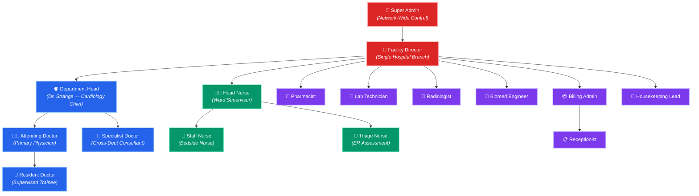
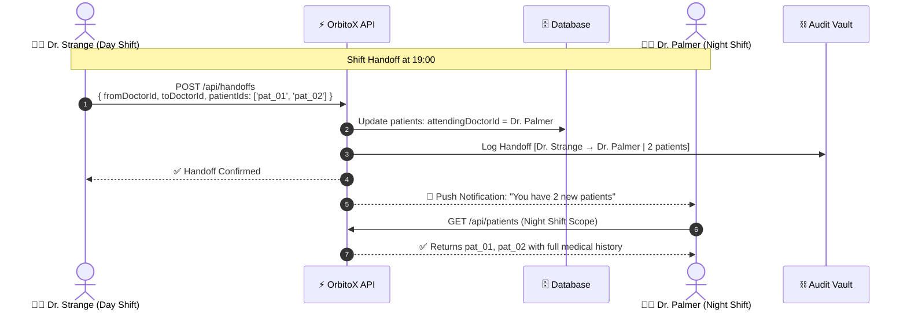
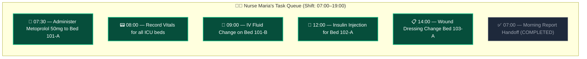
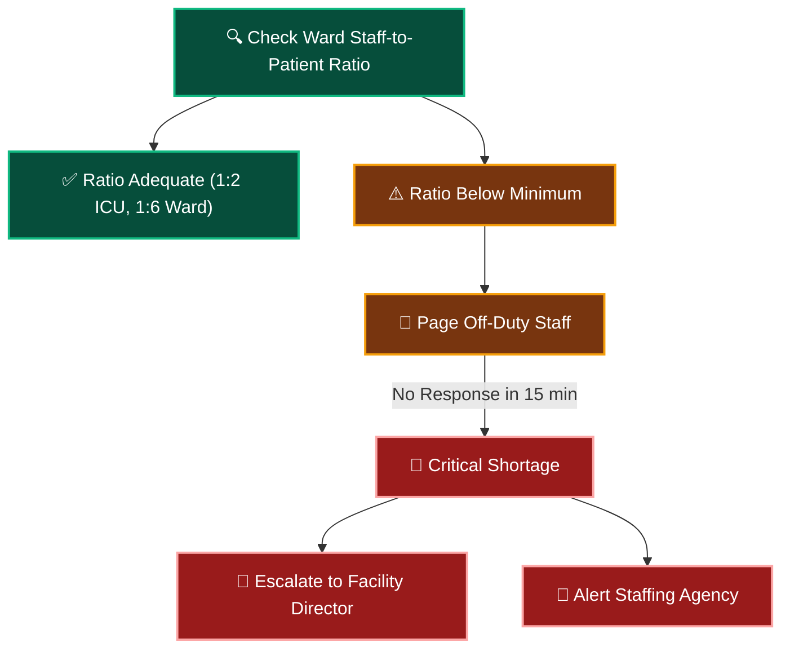

# 👨‍⚕️ Doctors & Clinical Staff: Complete Role Management Guide

> **Everything about registering, managing, scheduling, and scoping clinical staff — Doctors, Nurses, Pharmacists, Lab Technicians, Biomed Engineers, and Administrative Personnel.**

---

## 📑 Table of Contents
1. [The Staff Hierarchy & Reporting Chain](#1-the-staff-hierarchy--reporting-chain)
2. [All 16 Clinical Roles Explained](#2-all-16-clinical-roles-explained)
3. [Doctor Specializations & Sub-Specializations](#3-doctor-specializations--sub-specializations)
4. [Shift Management & On-Call Scheduling](#4-shift-management--on-call-scheduling)
5. [Registering Staff (Step-by-Step Code)](#5-registering-staff-step-by-step-code)
6. [Doctor–Patient Assignment & Handoff Workflows](#6-doctorpatient-assignment--handoff-workflows)
7. [Nurse Task Queue & Medication Round System](#7-nurse-task-queue--medication-round-system)
8. [Real-World Problem: Staff Shortage & Auto-Escalation](#8-real-world-problem-staff-shortage--auto-escalation)

---

## 1. The Staff Hierarchy & Reporting Chain



---

## 2. All 16 Clinical Roles Explained

| # | Role | `StaffRole` Value | Context Scope | What They Can Do | What They Cannot Do |
| :---: | :--- | :--- | :--- | :--- | :--- |
| 1 | **Super Admin** | `super_admin` | Entire hospital network | Configure SaaS plans, manage all branches, view audit trails, manage licensing | Write medical records |
| 2 | **Facility Director** | `facility_director` | Single hospital branch | Manage departments, approve staff, view branch KPIs, manage bed capacity | Access other branches |
| 3 | **Department Head** | `department_head` | Their department + sub-wards | Manage ward staff, approve consultations, view all dept patient records | Access other departments |
| 4 | **Attending Doctor** | `attending_doctor` | Assigned patients only | Diagnose, prescribe, order labs, request consultations, sign discharge | View other doctors' patients |
| 5 | **Specialist Doctor** | `specialist_doctor` | Via Peer Mesh only | Write consultation notes, prescribe via peer tunnel (time-limited) | Direct admission, discharge |
| 6 | **Resident Doctor** | `resident_doctor` | Supervised scope | Write progress notes (requires attending co-sign), assist procedures | Prescribe controlled substances |
| 7 | **Head Nurse** | `head_nurse` | Entire ward | Manage nurse assignments, verify bed sanitization, approve overtime | Write diagnoses |
| 8 | **Staff Nurse** | `staff_nurse` | Assigned beds only | Administer medications, record vitals, update patient status | Prescribe medications |
| 9 | **Triage Nurse** | `triage_nurse` | ER department | Initial patient assessment, assign severity (ESI 1–5), route to dept | Final diagnosis |
| 10 | **Pharmacist** | `pharmacist` | Pharmacy department | Verify prescriptions, flag drug interactions, dispense medications | Modify prescriptions |
| 11 | **Lab Technician** | `lab_technician` | Pathology lab | Collect samples, run tests, report results, flag critical values | View medical records |
| 12 | **Radiologist** | `radiologist` | Imaging department | Perform X-Ray/CT/MRI, write imaging reports, flag findings | Prescribe treatments |
| 13 | **Billing Admin** | `billing_admin` | Finance scope | Generate invoices, process insurance claims, manage payments | Access medical records |
| 14 | **Receptionist** | `receptionist` | Front desk | Register new patients, schedule appointments, print ID badges | View diagnoses |
| 15 | **Biomed Engineer** | `biomed_engineer` | Equipment scope | Calibrate devices, schedule maintenance, update firmware, condemn equipment | Access patient data |
| 16 | **Housekeeping Lead** | `housekeeping_lead` | Facility scope | Mark beds as sanitized, manage room turnover queue | Access clinical data |

---

## 3. Doctor Specializations & Sub-Specializations

| Department | Specialization | Sub-Specializations | Common Procedures |
| :--- | :--- | :--- | :--- |
| **Cardiology** | Cardiologist | Interventional, Electrophysiology, Heart Failure | Angioplasty, Pacemaker implant, Echo |
| **Neurology** | Neurologist | Stroke, Epilepsy, Neuromuscular | EEG, Lumbar Puncture, TPA administration |
| **Orthopedics** | Orthopedic Surgeon | Spine, Joint Replacement, Sports Medicine | Knee/Hip replacement, ACL repair |
| **Pulmonology** | Pulmonologist | Critical Care, Sleep Medicine, Interventional | Bronchoscopy, Ventilator management |
| **Gastroenterology** | Gastroenterologist | Hepatology, IBD, Motility | Endoscopy, Colonoscopy, ERCP |
| **Nephrology** | Nephrologist | Dialysis, Transplant | Hemodialysis, Peritoneal dialysis |
| **Oncology** | Oncologist | Medical, Surgical, Radiation | Chemotherapy, Biopsy, Radiation therapy |
| **Pediatrics** | Pediatrician | Neonatology, Pediatric ICU | Neonatal resuscitation, Growth monitoring |
| **OB/GYN** | Obstetrician | Maternal-Fetal, Reproductive | C-Section, Labor induction, Ultrasound |
| **Psychiatry** | Psychiatrist | Addiction, Forensic, Child | Psychiatric evaluation, ECT |
| **Emergency** | Emergency Physician | Trauma, Toxicology | Resuscitation, Intubation, Chest tube |
| **Anesthesiology** | Anesthesiologist | Cardiac, Neuro, Pain Mgmt | General/Regional anesthesia, Nerve blocks |
| **Radiology** | Radiologist | Interventional, Neuroradiology | CT/MRI interpretation, Biopsy guidance |
| **Pathology** | Pathologist | Histopathology, Microbiology | Tissue analysis, Culture & sensitivity |

---

## 4. Shift Management & On-Call Scheduling

```mermaid
gantt
    title ICU Doctor On-Call Schedule (Weekly)
    dateFormat HH:mm
    axisFormat %H:%M

    section Dr. Strange
    Day Shift (07:00-19:00)    :active, d1, 07:00, 12h

    section Dr. Palmer
    Night Shift (19:00-07:00)  :crit, n1, 19:00, 12h

    section Dr. Banner
    On-Call Backup (24h)       :done, oc1, 00:00, 24h
```

### Shift Types & Rules

| Shift Type | Hours | Key Rules |
| :--- | :--- | :--- |
| **Day Shift** | 07:00 – 19:00 | Primary patient responsibility; can discharge and admit |
| **Night Shift** | 19:00 – 07:00 | Full authority; must hand off critical patients to incoming day shift |
| **On-Call** | 24h standby | Backup for emergencies; system pages via `orbitox.events.emit('staff.page.urgent')` |
| **Rotating** | Alternating Day/Night weekly | Schedule stored in `shiftSchedule: 'rotating'` |

```typescript
// Auto-verify doctor is on duty before patient admission
export async function verifyDoctorOnDuty(doctorId: string): Promise<boolean> {
  const doctor = await orbitox.db.findById('staff', doctorId);
  if (!doctor) throw new Error('Doctor not found');
  if (!doctor.isOnDuty) {
    // Auto-escalate to on-call backup
    const onCallDoc = await orbitox.db.findMany('staff', {
      filter: { role: 'attending_doctor', shiftSchedule: 'on_call', isOnDuty: true },
      contextId: doctor.departmentId, limit: 1
    });
    if (onCallDoc.data.length > 0) {
      console.log(`⚠️ Dr. ${doctor.name} is off duty. Routing to On-Call: Dr. ${onCallDoc.data[0].name}`);
      return true;
    }
    throw new Error(`No doctors available in ${doctor.departmentId}. ESCALATE to Facility Director.`);
  }
  return true;
}
```

---

## 5. Registering Staff (Step-by-Step Code)

```typescript
import { orbitox } from '@orbitox/runtime';

// ─── Register Department Head ──────────────────────────────────
const deptHead = await orbitox.db.create('staff', {
  name: 'Dr. Stephen Strange',
  role: 'department_head',
  departmentId: cardioDept.id,
  email: 'strange@apollo-hospital.com',
  phone: '+1-212-555-0199',
  licenseNumber: 'MD-CARDIO-9988',
  specialization: 'Interventional Cardiology',
  shiftSchedule: 'day',
  isOnDuty: true
}, cardioDept.id);

// ─── Register Attending Doctor ─────────────────────────────────
const attendingDoc = await orbitox.db.create('staff', {
  name: 'Dr. Christine Palmer',
  role: 'attending_doctor',
  departmentId: cardioDept.id,
  email: 'palmer@apollo-hospital.com',
  phone: '+1-212-555-0202',
  licenseNumber: 'MD-CARDIO-7721',
  specialization: 'Electrophysiology',
  shiftSchedule: 'night',
  isOnDuty: false
}, cardioDept.id);

// ─── Register Head Nurse ───────────────────────────────────────
const headNurse = await orbitox.db.create('staff', {
  name: 'Nurse Maria Hill',
  role: 'head_nurse',
  departmentId: cardioDept.id,
  email: 'hill@apollo-hospital.com',
  phone: '+1-212-555-0303',
  licenseNumber: 'RN-ICU-4421',
  shiftSchedule: 'rotating',
  isOnDuty: true
}, icuWard.id); // Scoped to ICU Ward

// ─── Register Pharmacist ──────────────────────────────────────
const pharmacist = await orbitox.db.create('staff', {
  name: 'Dr. Pepper Singh',
  role: 'pharmacist',
  departmentId: pharmacy.id,
  email: 'singh@apollo-hospital.com',
  phone: '+1-212-555-0404',
  licenseNumber: 'RPH-NY-8812',
  shiftSchedule: 'day',
  isOnDuty: true
}, pharmacy.id);

// ─── Register Biomed Engineer ─────────────────────────────────
const biomedEngineer = await orbitox.db.create('staff', {
  name: 'Tony Rhodes',
  role: 'biomed_engineer',
  departmentId: hospital.id,
  email: 'rhodes@apollo-hospital.com',
  phone: '+1-212-555-0505',
  licenseNumber: 'BME-NY-1122',
  shiftSchedule: 'day',
  isOnDuty: true
}, hospital.id); // Scoped to entire hospital
```

---

## 6. Doctor–Patient Assignment & Handoff Workflows



---

## 7. Nurse Task Queue & Medication Round System



```typescript
// Auto-generate nurse medication rounds from treatment orders
orbitox.events.on('treatment.ordered', async (payload) => {
  if (payload.record.type === 'medication') {
    await orbitox.db.create('nurse_task', {
      nurseId: getAssignedNurseForBed(payload.record.bedId),
      patientId: payload.record.patientId,
      taskType: 'administer_medication',
      description: `Administer ${payload.record.procedureOrDrug} ${payload.record.dosage} (${payload.record.route})`,
      scheduledAt: calculateNextDoseTime(payload.record.frequency),
      status: 'pending'
    });
  }
});
```

---

## 8. Real-World Problem: Staff Shortage & Auto-Escalation



```typescript
// Run every 30 minutes via cron workflow
export async function checkStaffingLevels(wardId: string) {
  const onDutyNurses = await orbitox.db.findMany('staff', {
    filter: { role: 'staff_nurse', isOnDuty: true }, contextId: wardId
  });
  const occupiedBeds = await orbitox.db.findMany('bed', {
    filter: { status: 'occupied' }, contextId: wardId
  });

  const ratio = occupiedBeds.data.length / Math.max(onDutyNurses.data.length, 1);
  const isICU = wardId.includes('icu');
  const maxRatio = isICU ? 2 : 6; // ICU: 1:2, General: 1:6

  if (ratio > maxRatio) {
    await orbitox.events.emit('staffing.shortage.alert', {
      wardId, currentRatio: ratio, requiredRatio: maxRatio,
      severity: ratio > maxRatio * 2 ? 'CRITICAL' : 'WARNING'
    });
  }
}
```

---

### 🔗 Related Guides:
- 🏥 [**Hospital SaaS Master Guide**](./HOSPITAL_SAAS_DEVELOPER_GUIDE.md)
- 🔄 [**Clinical Workflow Flows**](./HOSPITAL_CLINICAL_WORKFLOW_FLOW.md)
- 🛏️ [**Rooms, Beds & Equipment Guide**](./ROOMS_BEDS_AND_EQUIPMENT.md)
- 📊 [**Admin Dashboards & KPIs**](./PLATFORM_ADMIN_AND_DASHBOARDS.md)
