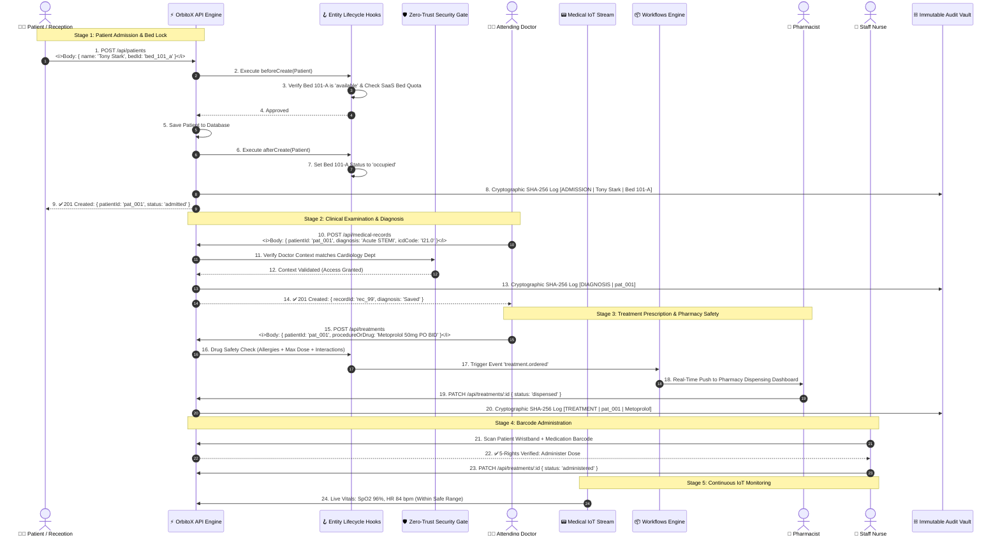
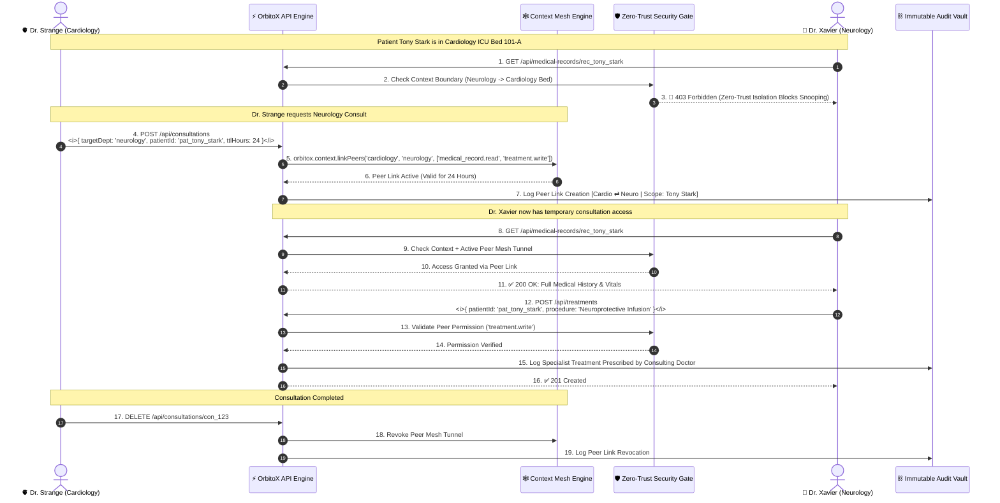
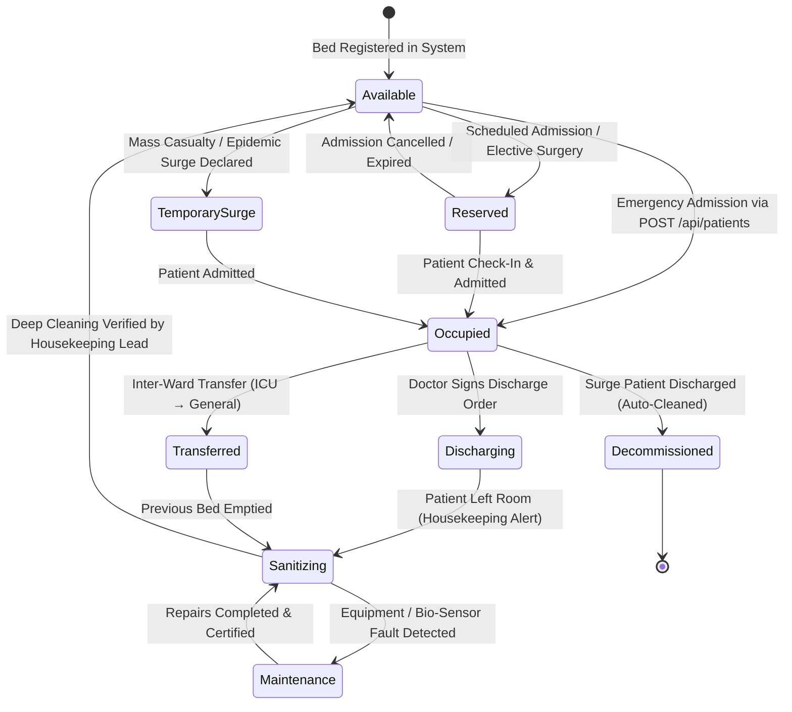
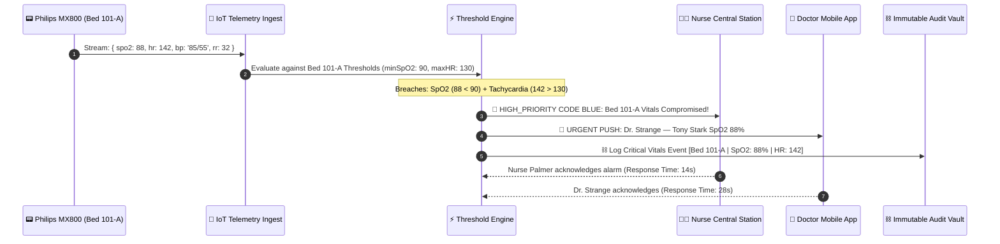
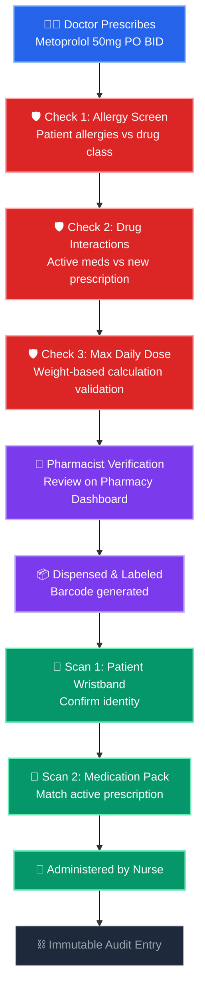
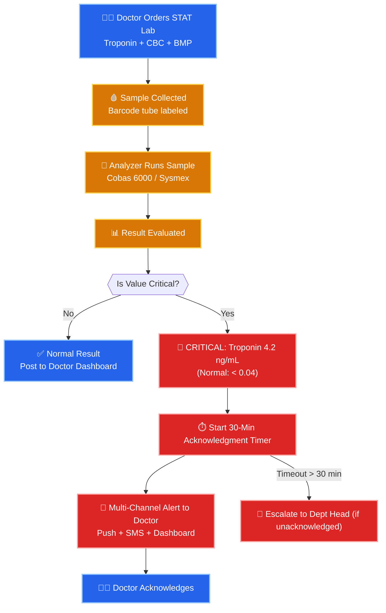
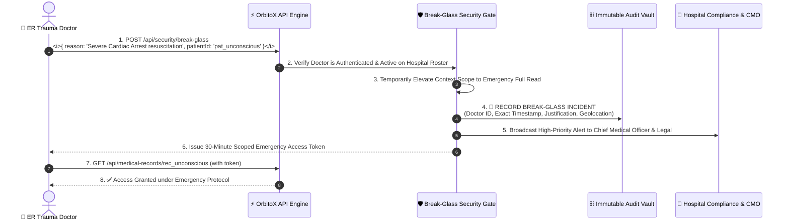

# 🏥 Clinical Workflows & Operational Execution Flow Guide

> **A beginner-friendly, deeply detailed visual guide to clinical lifecycles, cross-department specialist consultations, real-time bed capacity state machines, IoT telemetry alarms, pharmacy medication safety pipelines, and emergency break-glass protocols in OrbitoX.**

---

## 📑 Table of Contents
1. [The Big Picture: A Real Patient's Journey (The Story)](#1-the-big-picture-a-real-patients-journey-the-story)
2. [End-to-End Clinical Lifecycle Flow (9 Stages Explained)](#2-end-to-end-clinical-lifecycle-flow-9-stages-explained)
3. [Cross-Department Specialist Consultation (Peer Mesh Flow)](#3-cross-department-specialist-consultation-peer-mesh-flow)
4. [Real-Time Bed State Machine & Capacity Orchestrator](#4-real-time-bed-state-machine--capacity-orchestrator)
5. [Real-Time IoT Medical Telemetry & Alarms Flow](#5-real-time-iot-medical-telemetry--alarms-flow)
6. [Pharmacy Medication Dispensing & 5-Rights Safety Pipeline](#6-pharmacy-medication-dispensing--5-rights-safety-pipeline)
7. [Pathology Lab Order & Critical Value Escalation Flow](#7-pathology-lab-order--critical-value-escalation-flow)
8. [Emergency "Break-Glass" Protocol (Trauma Override)](#8-emergency-break-glass-protocol-trauma-override)
9. [Edge Cases & Error Handling Reference](#9-edge-cases--error-handling-reference)

---

## 1. The Big Picture: A Real Patient's Journey (The Story)

To understand how clinical data moves through OrbitoX, let's follow a real-world patient scenario:

> **The Story of Patient Tony Stark:**
> 1. **Arrival & Triage:** Tony arrives at the Emergency Department with acute cardiac trauma (ESI-1: Resuscitation).
> 2. **Admission & Bed Lock:** The reception team admits Tony. OrbitoX automatically checks bed capacity, reserves **Bed 101-A (Cardiology ICU)**, and locks the bed so nobody else can take it.
> 3. **Medical Device Pairing:** A **Philips IntelliVue MX800 Vitals Monitor** and **Hamilton-G5 Ventilator** are paired with Bed 101-A, streaming continuous telemetry.
> 4. **Doctor Diagnosis:** Dr. Strange (Cardiology) creates Tony's medical record (`STEMI - ICD-10: I21.0`).
> 5. **Cross-Department Need:** Dr. Strange notices neurological symptoms and requests a consultation from Dr. Xavier (Neurology).
> 6. **Secure Peer Mesh:** OrbitoX creates a temporary **24-hour peer tunnel** between Cardiology and Neurology so Dr. Xavier can review records and prescribe neuroprotective therapy.
> 7. **Treatment & Pharmacy Safety:** Dr. Strange prescribes cardiac medication; the safety engine checks allergies/interactions, pushes to the Pharmacy Queue, and the nurse verifies via barcode scanner.
> 8. **Discharge & Sanitization:** Once healed, Tony is discharged. The bed status automatically transitions to `Sanitizing` for housekeeping and the final itemized bill is generated.
> 9. **HIPAA Compliance:** Every single action is permanently recorded in an immutable, cryptographic SHA-256 audit ledger.

---

## 2. End-to-End Clinical Lifecycle Flow (9 Stages Explained)

---

## 3. Cross-Department Specialist Consultation (Peer Mesh Flow)

In modern healthcare, specialists from different departments frequently need to consult on the same patient. **OrbitoX solves this using Inter-Branch Peer Mesh Links.**

---

## 4. Real-Time Bed State Machine & Capacity Orchestrator

### Bed State Definitions & Business Rules:

| Bed State | Description | Can Admit Patient? | Automatic Triggers & Actions |
| :--- | :--- | :---: | :--- |
| **`available`** | Fully sanitized, inspected, and ready for occupancy. | ✅ **Yes** | Instant admission allowed. |
| **`reserved`** | Held for an incoming elective surgery or scheduled patient. | ⚠️ **Only for Reserved Patient** | Auto-releases if patient does not check in within 2 hours. |
| **`occupied`** | Patient currently assigned and receiving care. | ❌ **No** | Blocks any duplicate admission in `beforeCreate` hook. |
| **`discharging`** | Doctor signed discharge paperwork; billing finalizing. | ❌ **No** | Generates final pharmacy & billing statements. |
| **`sanitizing`** | Patient has departed; housekeeping team cleaning. | ❌ **No** | Emits `housekeeping.dispatch` event with room number. |
| **`maintenance`** | Bed telemetry, oxygen monitor, or motor malfunctioning. | ❌ **No** | Creates urgent work-order ticket for biomedical team. |
| **`transferred`** | Patient moved to another department/ward. | ❌ **No** | Immediately transitions previous bed to `sanitizing`. |
| **`temporary_surge`** | Overflow bed during disasters. | ✅ **Yes** | Automatically destroyed on patient discharge. |

---

## 5. Real-Time IoT Medical Telemetry & Alarms Flow

---

## 6. Pharmacy Medication Dispensing & 5-Rights Safety Pipeline

---

## 7. Pathology Lab Order & Critical Value Escalation Flow

---

## 8. Emergency "Break-Glass" Protocol (Trauma Override)

When an unconscious trauma patient arrives in the Emergency Room, there is no time to wait for administrative context permissions. **OrbitoX provides a cryptographic Break-Glass protocol:**

---

## 9. Edge Cases & Error Handling Reference

| Edge Case / Failure Scenario | What OrbitoX Does | HTTP Status Code | Developer Log Output |
| :--- | :--- | :---: | :--- |
| **Two nurses admit patients to the same bed simultaneously** | `beforeCreate` hook detects race condition via atomic DB lock. Second request is safely rejected. | `400 Bad Request` | `[Bed Hook] Error: Bed bed_101_a is already OCCUPIED!` |
| **Hospital exceeds licensed SaaS bed capacity** | `orbitox.billing.checkQuota()` detects quota limit. | `402 Payment Required` | `[Billing] Quota exceeded for metric 'maxBeds'` |
| **Neurology doctor accesses Cardiology patient without consult** | Zero-Trust policy engine returns empty sub-tree. | `404 Not Found` *(Silent IDOR Defense)* | `[Security] Unauthorized access attempt blocked` |
| **Peer mesh consultation expires after 24 hours** | Context mesh engine invalidates link; doctor is safely restricted back to their home department. | `403 Forbidden` | `[ContextMesh] Peer link expired at 2026-08-20T12:00:00Z` |
| **Patient is prescribed a drug they are allergic to** | Drug safety engine halts order before submission. | `422 Unprocessable Entity` | `[DrugSafety] CRITICAL: Patient allergic to Penicillin class!` |
| **Biomedical ventilator telemetry stream drops offline** | Telemetry ingest detects heartbeat timeout (>30s) and emits device offline alert. | WebSocket Event | `[Telemetry] Device dev_vent_01 on Bed 101-A is OFFLINE` |
| **Temporary surge bed discharged** | Context node is destroyed; equipment returned to pool; billing captures overflow rate. | `200 OK` | `[SurgeEngine] Decommissioned temporary bed context node ctx_surge_01` |

---

### 🔗 Related Guides:
- 📖 [**Hospital SaaS Master Guide**](./HOSPITAL_SAAS_DEVELOPER_GUIDE.md)
- 👨‍⚕️ [**Doctors & Clinical Staff**](./DOCTORS_AND_CLINICAL_STAFF.md)
- 🛏️ [**Rooms, Beds & Medical Equipment**](./ROOMS_BEDS_AND_EQUIPMENT.md)
- 🏢 [**Branches & Departments**](./BRANCHES_AND_DEPARTMENTS.md)
- 📊 [**Admin Dashboards & KPIs**](./PLATFORM_ADMIN_AND_DASHBOARDS.md)
- 🏃 [**Patient Lifecycle Flow**](./PATIENT_LIFECYCLE_FLOW.md)
- 💊 [**Pharmacy, Lab & Billing**](./PHARMACY_LAB_AND_BILLING.md)
- 🔐 [**Security & Compliance**](./SECURITY_AND_COMPLIANCE.md)
- 🧭 [**Developer Guide Master Hub**](../README.md)
