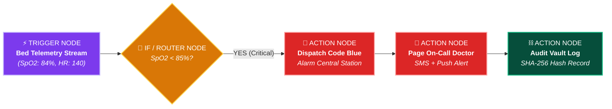
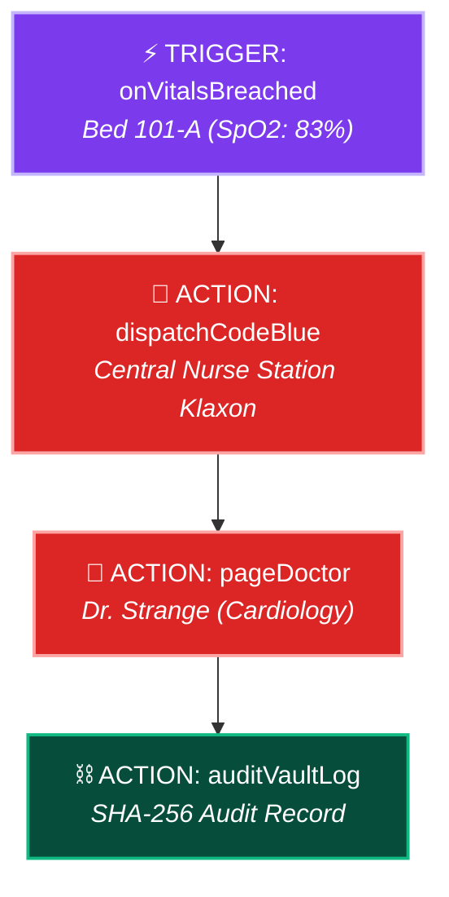
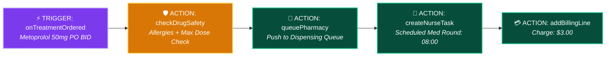
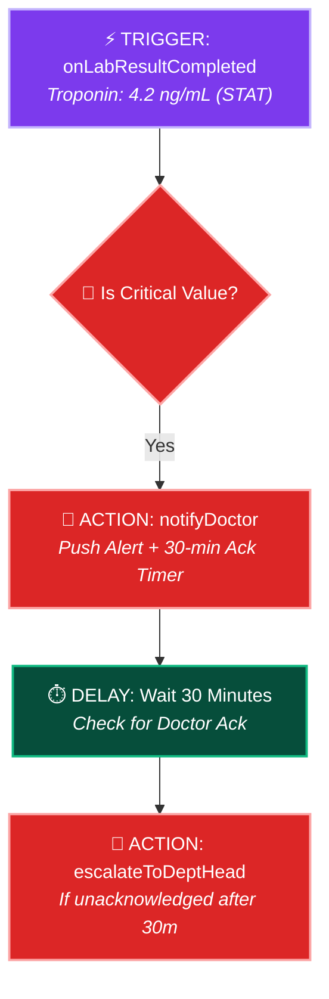
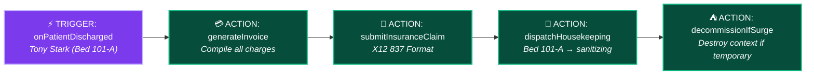
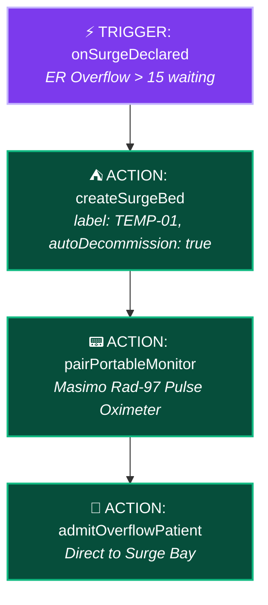
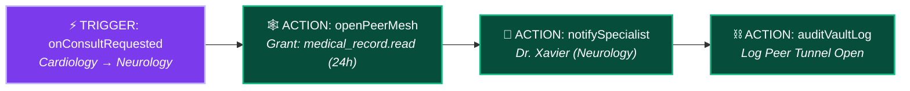

# ⚡ n8n-Style Hospital Automation & Node Engine Guide

> **How Hospital SaaS works like n8n — visual drag-and-drop workflow nodes, pre-built clinical triggers & actions, fluent TypeScript pipelines, and 6 ready-to-use hospital automation recipes.**

---

## 📑 Table of Contents
1. [The Mental Model: How Hospital SaaS Works Like n8n](#1-the-mental-model-how-hospital-saas-works-like-n8n)
2. [Hospital Node Catalog: Triggers & Actions Reference](#2-hospital-node-catalog-triggers--actions-reference)
3. [Visual Canvas vs Code Pipeline (The Two Ways to Build)](#3-visual-canvas-vs-code-pipeline-the-two-ways-to-build)
4. [6 Pre-Built Hospital Automation Recipes](#4-6-pre-built-hospital-automation-recipes)
   - [Recipe 1: Critical Vitals Alarm → Code Blue Escalation](#recipe-1-critical-vitals-alarm--code-blue-escalation)
   - [Recipe 2: Doctor Prescription → Pharmacy Queue → Nurse Barcode Round](#recipe-2-doctor-prescription--pharmacy-queue--nurse-barcode-round)
   - [Recipe 3: STAT Lab Result → 30-Minute Critical Value Escalator](#recipe-3-stat-lab-result--30-minute-critical-value-escalator)
   - [Recipe 4: Discharge Patient → Auto-Invoice → Housekeeping Turnover](#recipe-4-discharge-patient--auto-invoice--housekeeping-turnover)
   - [Recipe 5: Epidemic Surge Bed Auto-Provisioning & Cleanup](#recipe-5-epidemic-surge-bed-auto-provisioning--cleanup)
   - [Recipe 6: Cross-Department Consult → 24h Peer Mesh Tunnel](#recipe-6-cross-department-consult--24h-peer-mesh-tunnel)
5. [Building Custom Nodes in 10 Lines of TypeScript](#5-building-custom-nodes-in-10-lines-of-typescript)
6. [Importing & Exporting n8n-Compatible JSON Workflows](#6-importing--exporting-n8n-compatible-json-workflows)

---

## 1. The Mental Model: How Hospital SaaS Works Like n8n

If you have used **n8n**, you know how simple and powerful workflow automation is:
1. You pick a **Trigger Node** (e.g. *When patient admitted*, *When vitals breached*).
2. You connect **Action Nodes** (e.g. *Lock Bed*, *Notify Pharmacy*, *Page Doctor*).
3. You add **Logic / IF-ELSE Nodes** (e.g. *If SpO2 < 85%, trigger Code Blue*).
4. You run it visually or programmatically with **zero glue code**.



### In OrbitoX, `@orbitox/plugin-hospital-os` gives you:
* **Pre-Built Medical Triggers:** Real-time IoT vitals breaches, admissions, lab completions, drug orders, discharge requests.
* **Pre-Built Medical Actions:** Lock beds, dispense drugs, page trauma teams, generate invoices, open peer mesh tunnels.
* **Declarative JSON & Visual Canvas:** Drag-and-drop nodes in the OrbitoX UI Studio or define them in clean TypeScript.

---

## 2. Hospital Node Catalog: Triggers & Actions Reference

### ⚡ 7 Clinical Trigger Nodes (Events that Start a Flow)

| Node Name | Node Identifier | Trigger Condition | Output Payload Data |
| :--- | :--- | :--- | :--- |
| **On Patient Admitted** | `hospital.trigger.patientAdmitted` | Patient check-in or ER walk-in | `{ patientId, name, bedId, attendingDoctorId, triageLevel }` |
| **On Vitals Threshold Breach** | `hospital.trigger.vitalsBreached` | SpO2 < 90%, HR > 130 bpm, etc. | `{ bedId, bedLabel, vitals: { spo2, hr, bp, temp }, alarms }` |
| **On Medication Prescribed** | `hospital.trigger.treatmentOrdered` | Doctor signs prescription | `{ treatmentId, patientId, drugName, dosage, route, frequency }` |
| **On Lab Result Ready** | `hospital.trigger.labResultCompleted`| Analyzer finishes test | `{ labOrderId, patientId, testType, resultValue, isCritical }` |
| **On Patient Discharged** | `hospital.trigger.patientDischarged` | Doctor signs discharge summary | `{ patientId, bedId, totalDaysAdmitted, totalDue }` |
| **On Equipment Malfunction** | `hospital.trigger.deviceOffline` | Device heartbeat lost > 30s | `{ deviceId, model, bedId, lastHeartbeat }` |
| **On Break-Glass Activated** | `hospital.trigger.breakGlassOverride`| ER doctor overrides access | `{ doctorId, reason, esiLevel, expiresAt }` |

---

### 🛠️ 10 Clinical Action Nodes (Tasks Executed by Flow)

| Node Name | Node Identifier | Required Inputs | What It Does |
| :--- | :--- | :--- | :--- |
| **Lock Bed Status** | `hospital.action.lockBed` | `bedId`, `status: 'occupied'` | Transitions bed state and prevents double-booking |
| **Dispatch Code Blue** | `hospital.action.dispatchCodeBlue` | `bedId`, `severity`, `team` | Blasts high-priority alarms to Central Nurse Station |
| **Page Doctor on Duty** | `hospital.action.pageDoctor` | `doctorId` or `role`, `message` | Sends multi-channel alert (SMS + Mobile Push + Loud Sound) |
| **Queue Pharmacy Order** | `hospital.action.queuePharmacy` | `treatmentId`, `priority` | Pushes prescription to pharmacist dispensing queue |
| **Verify 5-Rights Barcode** | `hospital.action.verify5Rights` | `patientBarcode`, `drugBarcode`| Validates patient match before nurse injection |
| **Auto-Generate Invoice** | `hospital.action.generateInvoice` | `patientId` | Calculates bed charges, medication fees, and lab costs |
| **Decommission Surge Bed** | `hospital.action.destroySurgeBed`| `bedId` | Removes temporary overflow bed context node |
| **Trigger Housekeeping** | `hospital.action.dispatchHousekeeping`| `bedId`, `roomLabel` | Creates turnover sanitization task for housekeeping crew |
| **Open Peer Mesh Tunnel** | `hospital.action.openPeerMesh` | `fromDept`, `toDept`, `ttlHours` | Creates 24-hour audited tunnel for cross-department consult |
| **Record Audit Vault** | `hospital.action.auditVaultLog` | `event`, `staffId`, `payload` | Writes tamper-proof SHA-256 hash to compliance ledger |

---

## 3. Visual Canvas vs Code Pipeline (The Two Ways to Build)

### Method A: Fluent Code Pipeline (n8n-Style in TypeScript)

```typescript
import { orbitox } from '@orbitox/runtime';
import { HospitalNodes } from '@orbitox/plugin-hospital-os';

// Define an automation pipeline in 6 lines:
orbitox.flow('critical-vitals-escalation')
  .when(HospitalNodes.Triggers.onVitalsBreached({ minSpO2: 90 }))
  .if((data) => data.vitals.spo2 < 85)
    .then(HospitalNodes.Actions.dispatchCodeBlue({ severity: 'CODE_BLUE' }))
    .then(HospitalNodes.Actions.pageDoctor({ role: 'attending_doctor', urgent: true }))
  .else()
    .then(HospitalNodes.Actions.notifyNurseStation({ sound: 'warning' }))
  .always()
    .then(HospitalNodes.Actions.auditVaultLog());
```

### Method B: Visual Drag-and-Drop Canvas (OrbitoX Studio UI)

```
[ 📟 Bed Telemetry ] ──(Trigger)──> [ 🔀 SpO2 < 85%? ]
                                            │
                       ┌────────────────────┴────────────────────┐
                       ▼ YES                                     ▼ NO
            [ 🚨 Dispatch Code Blue ]               [ 🔔 Nurse Station Warning ]
                       │                                         │
            [ 📱 Page On-Call Doctor ]                           ▼
                       │                            [ ⛓️ Audit Vault Hash ]
                       └─────────────────────────────────────────┘
```

---

## 4. 6 Pre-Built Hospital Automation Recipes

### Recipe 1: Critical Vitals Alarm → Code Blue Escalation



```typescript
// 🚀 Runnable Recipe 1 Code:
orbitox.flow('recipe-code-blue')
  .when(HospitalNodes.Triggers.onVitalsBreached({ minSpO2: 90 }))
  .then(HospitalNodes.Actions.dispatchCodeBlue({ team: 'cardiac_resuscitation' }))
  .then(HospitalNodes.Actions.pageDoctor({ role: 'attending_doctor' }))
  .then(HospitalNodes.Actions.auditVaultLog());
```

---

### Recipe 2: Doctor Prescription → Pharmacy Queue → Nurse Barcode Round



```typescript
// 🚀 Runnable Recipe 2 Code:
orbitox.flow('recipe-prescription-pipeline')
  .when(HospitalNodes.Triggers.onTreatmentOrdered())
  .then(HospitalNodes.Actions.checkDrugSafety())
  .then(HospitalNodes.Actions.queuePharmacy({ priority: 'routine' }))
  .then(HospitalNodes.Actions.createNurseTask({ taskType: 'administer_medication' }))
  .then(HospitalNodes.Actions.addBillingLine({ lineType: 'medication' }));
```

---

### Recipe 3: STAT Lab Result → 30-Minute Critical Value Escalator



```typescript
// 🚀 Runnable Recipe 3 Code:
orbitox.flow('recipe-critical-lab-escalator')
  .when(HospitalNodes.Triggers.onLabResultCompleted({ criticalOnly: true }))
  .then(HospitalNodes.Actions.notifyDoctor({ timeoutMinutes: 30 }))
  .delay({ minutes: 30, waitUntil: 'acknowledged' })
  .if((data) => !data.isAcknowledged)
    .then(HospitalNodes.Actions.escalateToDeptHead({ reason: 'Unacknowledged STAT Troponin' }));
```

---

### Recipe 4: Discharge Patient → Auto-Invoice → Housekeeping Turnover



```typescript
// 🚀 Runnable Recipe 4 Code:
orbitox.flow('recipe-discharge-turnover')
  .when(HospitalNodes.Triggers.onPatientDischarged())
  .then(HospitalNodes.Actions.generateInvoice())
  .then(HospitalNodes.Actions.submitInsuranceClaim({ autoSubmit: true }))
  .then(HospitalNodes.Actions.dispatchHousekeeping({ priority: 'high' }))
  .then(HospitalNodes.Actions.destroySurgeBed());
```

---

### Recipe 5: Epidemic Surge Bed Auto-Provisioning & Cleanup



---

### Recipe 6: Cross-Department Consult → 24h Peer Mesh Tunnel



---

## 5. Building Custom Nodes in 10 Lines of TypeScript

Developers can write their own custom hospital trigger or action nodes in seconds:

```typescript
import { defineWorkflowAction } from '@orbitox/sdk';

// Custom Action Node: Send WhatsApp message to patient family
export const SendFamilyWhatsAppAction = defineWorkflowAction({
  id: 'hospital.action.sendFamilyWhatsApp',
  name: 'Send Family WhatsApp Update',
  inputs: {
    phone: { type: 'string', required: true },
    message: { type: 'string', required: true }
  },
  execute: async ({ phone, message }, context) => {
    console.log(`📱 [WhatsApp Node] Sending update to ${phone}: ${message}`);
    // Call WhatsApp API (Twilio / Meta Graph API)...
    return { status: 'sent', timestamp: new Date().toISOString() };
  }
});
```

---

## 6. Importing & Exporting n8n-Compatible JSON Workflows

Workflows can be exported and imported as JSON templates so hospital administrators can share recipes across branches:

```json
{
  "name": "Emergency Code Blue Auto-Escalation",
  "version": 1,
  "trigger": {
    "node": "hospital.trigger.vitalsBreached",
    "config": { "minSpO2": 90, "maxHeartRate": 130 }
  },
  "steps": [
    {
      "node": "hospital.action.dispatchCodeBlue",
      "config": { "severity": "HIGH_PRIORITY", "team": "resuscitation" }
    },
    {
      "node": "hospital.action.pageDoctor",
      "config": { "role": "attending_doctor", "channel": "sms_and_push" }
    },
    {
      "node": "hospital.action.auditVaultLog",
      "config": { "level": "CRITICAL" }
    }
  ]
}
```

```typescript
// Import and activate a JSON workflow in 1 line:
await orbitox.workflows.importWorkflow(codeBlueWorkflowJson);
console.log('✅ Workflow Recipe Active!');
```

---

### 🔗 Related Guides:
- 📦 [**Hospital Plugin & Package Architecture**](./HOSPITAL_PLUGIN_PACKAGE_ARCHITECTURE.md)
- 📖 [**Hospital SaaS Master Developer Handbook**](./HOSPITAL_SAAS_DEVELOPER_GUIDE.md)
- 🔄 [**Clinical Workflow Execution Flows**](./HOSPITAL_CLINICAL_WORKFLOW_FLOW.md)
- 📊 [**Platform Admin & Role Dashboards**](./PLATFORM_ADMIN_AND_DASHBOARDS.md)
- 📚 [**Hospital SaaS Hub Index**](./README.md)
