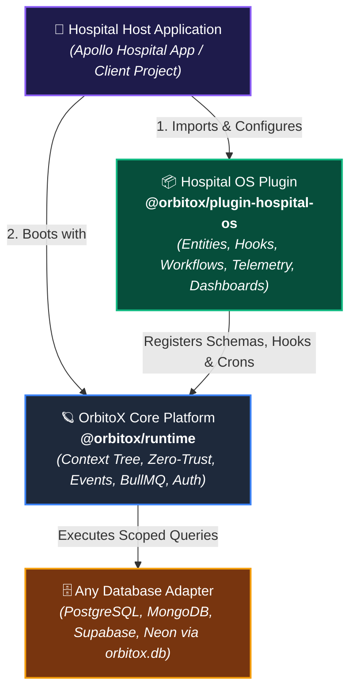
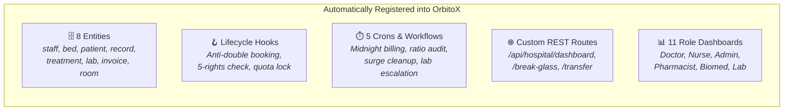
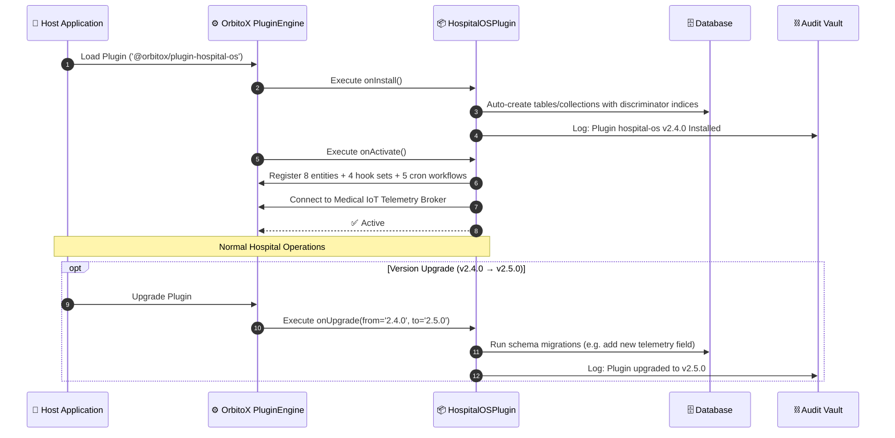
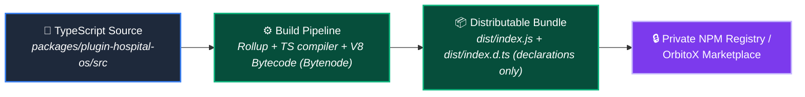

# 📦 Hospital SaaS Plugin & Package Architecture: Developer Guide

> **How to build, package, distribute, and consume Hospital SaaS as a modular, plug-and-play OrbitoX Plugin (`@orbitox/plugin-hospital-os`) — complete with schema auto-registration, lifecycle hooks, IoT telemetry integration, role-based dashboard widgets, and private IP protection.**

---

## 📑 Table of Contents
1. [The Plugin Mental Model in OrbitoX](#1-the-plugin-mental-model-in-orbitox)
2. [Package File & Directory Structure](#2-package-file--directory-structure)
3. [Plugin Manifest & Metadata (`hospital-os.manifest.ts`)](#3-plugin-manifest--metadata-hospital-osmanifestts)
4. [The Plugin Factory & Configuration (`HospitalOSPlugin`)](#4-the-plugin-factory--configuration-hospitalosplugin)
5. [Auto-Registered Components (Entities, Hooks, Crons, Routes)](#5-auto-registered-components-entities-hooks-crons-routes)
6. [Consuming the Plugin in an OrbitoX App (3 Lines of Code)](#6-consuming-the-plugin-in-an-orbitox-app-3-lines-of-code)
7. [Plugin Lifecycle Management (`onInstall`, `onActivate`, `onUpgrade`)](#7-plugin-lifecycle-management-oninstall-onactivate-onupgrade)
8. [Dashboard & UI Widget Auto-Registration](#8-dashboard--ui-widget-auto-registration)
9. [Packaging, IP Protection & Distribution](#9-packaging-ip-protection--distribution)
10. [Customizing & Extending the Plugin](#10-customizing--extending-the-plugin)

---

## 1. The Plugin Mental Model in OrbitoX

In the OrbitoX ecosystem, the **Core Platform** is the proprietary operating engine (`@orbitox/runtime`, `@orbitox/core`). Specialized industry verticals like Hospital Management are built and distributed as **headless, self-contained plugins**:



### Why Package Hospital SaaS as a Plugin?
1. **Zero Core Leakage:** Hospital clients never touch or see the proprietary core engine internals.
2. **One-Line Integration:** Adding clinical capability to any project requires only `plugins: [HospitalOSPlugin()]`.
3. **Database Agnostic:** The plugin works automatically with whatever DB adapter the host selects (`orbitox.db.useAdapter()`).
4. **Independent Versioning:** Update medical rules, ICD-10 catalogs, or telemetry protocols without redeploying the core platform.
5. **Multi-Tenant Licensing:** SaaS quotas (max beds, licensed wards, active doctors) are enforced per tenant automatically.

---

## 2. Package File & Directory Structure

Here is the exact production package layout for `@orbitox/plugin-hospital-os`:

```
packages/plugin-hospital-os/
├── package.json                         # NPM metadata & dependencies
├── tsconfig.json                        # TypeScript build configuration
├── README.md                            # Package usage documentation
│
├── src/
│   ├── index.ts                         # Main package entrypoint (exports plugin & types)
│   ├── manifest.ts                      # Plugin Manifest (permissions, events, capabilities)
│   ├── plugin.ts                        # HospitalOSPlugin factory function
│   │
│   ├── config/
│   │   ├── default-options.ts           # Default plugin configurations
│   │   └── schema.ts                    # Zod schema for plugin options validation
│   │
│   ├── entities/                        # Schema definitions for all 8 clinical models
│   │   ├── staff.entity.ts              # Doctors, Nurses, Pharmacists, Biomed
│   │   ├── bed.entity.ts                # Beds, 17 types, equipment pairing, surge config
│   │   ├── room.entity.ts               # Rooms, infrastructure (HEPA, wall gases)
│   │   ├── patient.entity.ts            # Patients, triage level, insurance, allergies
│   │   ├── medical-record.entity.ts     # Diagnoses, ICD-10, vitals snapshot
│   │   ├── treatment.entity.ts          # Prescriptions, procedures, 5-rights status
│   │   ├── lab-order.entity.ts          # Lab tests, samples, critical value flags
│   │   └── invoice.entity.ts            # Auto-billing items, insurance claims
│   │
│   ├── hooks/                           # Entity lifecycle hooks
│   │   ├── patient.hooks.ts             # Anti-double booking, quota check, bed lock
│   │   ├── bed.hooks.ts                 # State machine validator, equipment pairing
│   │   ├── treatment.hooks.ts           # Drug allergy, interaction, dose limit checks
│   │   └── telemetry.hooks.ts           # IoT threshold alarm triggers
│   │
│   ├── workflows/                       # Automated background jobs & cron schedules
│   │   ├── midnight-billing.cron.ts     # Daily automatic bed charge generator
│   │   ├── staffing-audit.cron.ts       # 30-minute nurse-to-patient ratio auditor
│   │   ├── equipment-maintenance.ts     # Calibration due date notifier
│   │   ├── lab-escalation.cron.ts       # Unacknowledged critical lab result escalator
│   │   └── surge-cleanup.workflow.ts    # Auto-decommission discharged surge beds
│   │
│   ├── telemetry/                       # Medical IoT engine
│   │   ├── ingest.service.ts            # MQTT/WebSocket stream processor
│   │   ├── threshold.engine.ts          # Multi-parameter alarm evaluator
│   │   └── equipment.catalog.ts         # 18-device pre-configured hardware catalog
│   │
│   ├── dashboards/                      # Role-based dashboard aggregators
│   │   ├── dashboard.service.ts         # Multi-role KPI computation
│   │   └── widget-definitions.ts        # UI metadata for 11 clinical dashboards
│   │
│   ├── routes/                          # Custom REST API endpoints
│   │   ├── telemetry.routes.ts          # Ingest & stream endpoints
│   │   ├── emergency.routes.ts          # Break-glass override & trauma bay
│   │   ├── transfer.routes.ts           # Cross-branch patient transfers
│   │   └── dashboard.routes.ts          # GET /api/hospital/dashboard
│   │
│   └── types/                           # Complete exported TypeScript domain types
│       ├── index.ts
│       ├── roles.types.ts
│       ├── bed.types.ts
│       ├── clinical.types.ts
│       └── equipment.types.ts
```

---

## 3. Plugin Manifest & Metadata (`hospital-os.manifest.ts`)

```typescript
import { PluginManifest } from '@orbitox/types';

export const HospitalOSManifest: PluginManifest = {
  id: 'hospital-os',
  name: 'Hospital OS Enterprise Plugin',
  version: '2.4.0',
  description: 'Enterprise Clinical Care, Bed Capacity, Medical IoT Telemetry & Role Dashboards',
  author: 'OrbitoX Healthcare Engineering',
  dependencies: {
    '@orbitox/runtime': '>=2.0.0',
    '@orbitox/core': '>=2.0.0'
  },
  permissions: [
    'patient.read', 'patient.create', 'patient.update', 'patient.delete',
    'medical_record.read', 'medical_record.create',
    'treatment.read', 'treatment.create', 'treatment.update',
    'lab_order.read', 'lab_order.create', 'lab_order.update',
    'bed.read', 'bed.create', 'bed.update', 'bed.manage_equipment',
    'staff.read', 'staff.manage',
    'invoice.read', 'invoice.manage',
    'hospital.break_glass', 'hospital.telemetry_stream'
  ],
  events: {
    emits: [
      'patient.admitted', 'patient.discharged', 'patient.transferred',
      'treatment.ordered', 'treatment.dispensed', 'treatment.administered',
      'vitals.alarm.critical', 'device.status.offline',
      'lab.result.critical', 'lab.result.completed',
      'housekeeping.dispatch', 'equipment.maintenance.overdue',
      'staffing.shortage.alert', 'security.break_glass'
    ],
    subscribes: [
      'iot.telemetry.vitals', 'iot.device.heartbeat',
      'billing.payment.settled', 'user.shift.change'
    ]
  },
  capabilities: [
    'n-tier-context-tree',
    'iot-telemetry-engine',
    'audit-vault-tamper-proof',
    'zero-trust-rbac',
    'cron-scheduler'
  ]
};
```

---

## 4. The Plugin Factory & Configuration (`HospitalOSPlugin`)

The plugin exposes a fluent, type-safe factory function allowing host apps to configure options:

```typescript
import { HeadlessPlugin, definePlugin } from '@orbitox/sdk';
import { HospitalOSManifest } from './manifest';
import { hospitalEntities } from './entities';
import { patientHooks, bedHooks, treatmentHooks } from './hooks';
import { registerHospitalWorkflows } from './workflows';
import { registerHospitalRoutes } from './routes';

export interface HospitalOSPluginOptions {
  // 🏥 Compliance & Regulatory
  complianceFramework?: 'HIPAA' | 'NABH' | 'JCI' | 'ISO_15189';
  
  // 📟 Medical IoT Telemetry
  telemetry?: {
    enabled: boolean;
    brokerUrl?: string;             // MQTT broker URL (e.g., 'mqtt://iot.hospital.internal')
    heartbeatTimeoutSeconds?: number; // Default: 30s
  };

  // ⛺ Surge Bed Automation
  surgeBeds?: {
    allowTemporarySurge: boolean;
    autoDecommissionOnDischarge: boolean;
    maxSurgeDurationDays?: number;  // Default: 14 days
  };

  // 💳 Automated Billing
  billing?: {
    autoDailyBedCharges: boolean;
    bedChargeCronSchedule?: string; // Default: '0 0 * * *' (midnight)
    currency?: string;              // 'USD', 'INR', 'EUR'
  };

  // 🚨 Emergency Break-Glass
  breakGlass?: {
    enabled: boolean;
    tokenTTLMinutes: number;        // Default: 30 minutes
    notifyRoles: string[];          // ['super_admin', 'facility_director']
  };
}

export function HospitalOSPlugin(options: HospitalOSPluginOptions = {}): HeadlessPlugin {
  const mergedOptions: Required<HospitalOSPluginOptions> = {
    complianceFramework: options.complianceFramework || 'HIPAA',
    telemetry: {
      enabled: options.telemetry?.enabled ?? true,
      brokerUrl: options.telemetry?.brokerUrl || 'mqtt://localhost:1883',
      heartbeatTimeoutSeconds: options.telemetry?.heartbeatTimeoutSeconds || 30
    },
    surgeBeds: {
      allowTemporarySurge: options.surgeBeds?.allowTemporarySurge ?? true,
      autoDecommissionOnDischarge: options.surgeBeds?.autoDecommissionOnDischarge ?? true,
      maxSurgeDurationDays: options.surgeBeds?.maxSurgeDurationDays || 14
    },
    billing: {
      autoDailyBedCharges: options.billing?.autoDailyBedCharges ?? true,
      bedChargeCronSchedule: options.billing?.bedChargeCronSchedule || '0 0 * * *',
      currency: options.billing?.currency || 'USD'
    },
    breakGlass: {
      enabled: options.breakGlass?.enabled ?? true,
      tokenTTLMinutes: options.breakGlass?.tokenTTLMinutes || 30,
      notifyRoles: options.breakGlass?.notifyRoles || ['super_admin', 'facility_director']
    }
  };

  return definePlugin({
    ...HospitalOSManifest,
    config: mergedOptions,
    // The plugin engine wires entities, hooks, workflows, and routes automatically
    entities: hospitalEntities,
    hooks: {
      patient: patientHooks,
      bed: bedHooks,
      treatment: treatmentHooks
    },
    onActivate: async (runtime) => {
      console.log('🏥 [HospitalOSPlugin] Initializing Clinical Workflows & Routes...');
      await registerHospitalWorkflows(runtime, mergedOptions);
      await registerHospitalRoutes(runtime, mergedOptions);
      console.log('✅ [HospitalOSPlugin] Active (Compliance: ' + mergedOptions.complianceFramework + ')');
    }
  });
}
```

---

## 5. Auto-Registered Components (Entities, Hooks, Crons, Routes)

When a developer includes `HospitalOSPlugin()`, the plugin automatically registers 5 core layers into the OrbitoX runtime:



---

## 6. Consuming the Plugin in an OrbitoX App (3 Lines of Code)

Here is how an external developer or enterprise hospital client uses the package in their application:

### Step 1: Install Package
```bash
npm install @orbitox/runtime @orbitox/plugin-hospital-os
```

### Step 2: Boot Server (`server.ts`)
```typescript
import { createOrbitoXApp, orbitox } from '@orbitox/runtime';
import { HospitalOSPlugin } from '@orbitox/plugin-hospital-os';

async function main() {
  // 1. Boot Application with Hospital Plugin
  const { app, server } = await createOrbitoXApp({
    app: { name: 'Apollo Health Global OS', port: 3000 },
    plugins: [
      HospitalOSPlugin({
        complianceFramework: 'HIPAA',
        telemetry: { enabled: true, brokerUrl: 'mqtt://iot.apollo.internal:1883' },
        surgeBeds: { allowTemporarySurge: true, autoDecommissionOnDischarge: true },
        billing: { autoDailyBedCharges: true, currency: 'USD' }
      })
    ]
  });

  // 2. Build 6-Tier Hierarchy
  const org = await orbitox.tenant('apollo-global', 'Apollo Health Global').type('organisation').create();
  const branch = await orbitox.tenant('apollo-ny', 'Apollo New York').type('tenant').parent(org.id).create();
  const cardio = await orbitox.tenant('cardio', 'Cardiology Dept').type('department').parent(branch.id).create();
  const icu = await orbitox.tenant('icu-a', 'Cardiac ICU').type('ward').parent(cardio.id).create();
  const room = await orbitox.tenant('room-101', 'Room 101').type('room').parent(icu.id).create();
  const bed = await orbitox.tenant('bed-101-a', 'Bed 101-A').type('bed').parent(room.id).create();

  console.log('🎉 Apollo Hospital OS Live on http://localhost:3000/api');
}

main().catch(console.error);
```

---

## 7. Plugin Lifecycle Management (`onInstall`, `onActivate`, `onUpgrade`)



---

## 8. Dashboard & UI Widget Auto-Registration

The plugin registers widgets into OrbitoX's dynamic frontend widget registry so the UI renders automatically:

```typescript
export const hospitalWidgets = [
  {
    id: 'widget-vitals-monitor-panel',
    name: 'Real-Time Bedside Vitals Panel',
    targetRoles: ['attending_doctor', 'head_nurse', 'staff_nurse'],
    component: 'HospitalVitalsPanelWidget',
    dataEndpoint: '/api/hospital/telemetry/:bedId/live',
    gridSize: { cols: 6, rows: 4 }
  },
  {
    id: 'widget-nurse-medication-round',
    name: 'Medication Administration Queue',
    targetRoles: ['head_nurse', 'staff_nurse'],
    component: 'NurseMedicationQueueWidget',
    dataEndpoint: '/api/hospital/nurse-tasks',
    gridSize: { cols: 6, rows: 6 }
  },
  {
    id: 'widget-pharmacy-dispensing',
    name: 'Pharmacy Verification & Dispensing Queue',
    targetRoles: ['pharmacist'],
    component: 'PharmacyDispenseQueueWidget',
    dataEndpoint: '/api/hospital/pharmacy-queue',
    gridSize: { cols: 12, rows: 6 }
  },
  {
    id: 'widget-biomed-equipment-status',
    name: 'Medical Device Calibration & Status Grid',
    targetRoles: ['biomed_engineer'],
    component: 'BiomedEquipmentGridWidget',
    dataEndpoint: '/api/hospital/equipment-health',
    gridSize: { cols: 12, rows: 6 }
  }
];
```

---

## 9. Packaging, IP Protection & Distribution

To protect your intellectual property when distributing the plugin to clients or on the OrbitoX Marketplace:



### Build Script (`package.json`)
```json
{
  "name": "@orbitox/plugin-hospital-os",
  "version": "2.4.0",
  "description": "Enterprise Hospital OS Plugin for OrbitoX Platform",
  "main": "dist/index.js",
  "types": "dist/index.d.ts",
  "files": [
    "dist"
  ],
  "scripts": {
    "build": "tsc -p tsconfig.build.json",
    "bundle": "rollup -c rollup.config.js",
    "obfuscate": "javascript-obfuscator dist/ --output dist/ --compact true --self-defending true",
    "publish:private": "npm publish --registry https://registry.orbitox.io"
  }
}
```

---

## 10. Customizing & Extending the Plugin

Clients can extend the plugin with custom hooks, custom entities, or custom pricing models without modifying plugin source code:

```typescript
import { HospitalOSPlugin } from '@orbitox/plugin-hospital-os';

const customHospitalPlugin = HospitalOSPlugin({
  complianceFramework: 'NABH', // India NABH Standard
  billing: {
    autoDailyBedCharges: true,
    currency: 'INR'
  }
});

// Adding custom VIP concierge hooks on top of the plugin:
customHospitalPlugin.hooks.patient.afterCreate = async (record, context) => {
  if (record.category === 'vip') {
    await orbitox.events.emit('vip.patient.arrived', {
      patientName: record.name,
      suiteId: record.bedId,
      assignedConcierge: 'staff_vip_desk_01'
    });
  }
};
```

---

### 🔗 Related Guides:
- 📖 [**Hospital SaaS Master Developer Guide**](./HOSPITAL_SAAS_DEVELOPER_GUIDE.md)
- 👨‍⚕️ [**Doctors & Clinical Staff**](./DOCTORS_AND_CLINICAL_STAFF.md)
- 🛏️ [**Rooms, Beds & Medical Equipment**](./ROOMS_BEDS_AND_EQUIPMENT.md)
- 🏢 [**Branches & Departments**](./BRANCHES_AND_DEPARTMENTS.md)
- 📊 [**Admin Dashboards & KPIs**](./PLATFORM_ADMIN_AND_DASHBOARDS.md)
- 🏃 [**Patient Lifecycle Flow**](./PATIENT_LIFECYCLE_FLOW.md)
- 💊 [**Pharmacy, Lab & Billing**](./PHARMACY_LAB_AND_BILLING.md)
- 🔐 [**Security & Compliance**](./SECURITY_AND_COMPLIANCE.md)
- 🔄 [**Clinical Workflows & Flows**](./HOSPITAL_CLINICAL_WORKFLOW_FLOW.md)
- 🧭 [**Developer Guide Master Hub**](../README.md)
