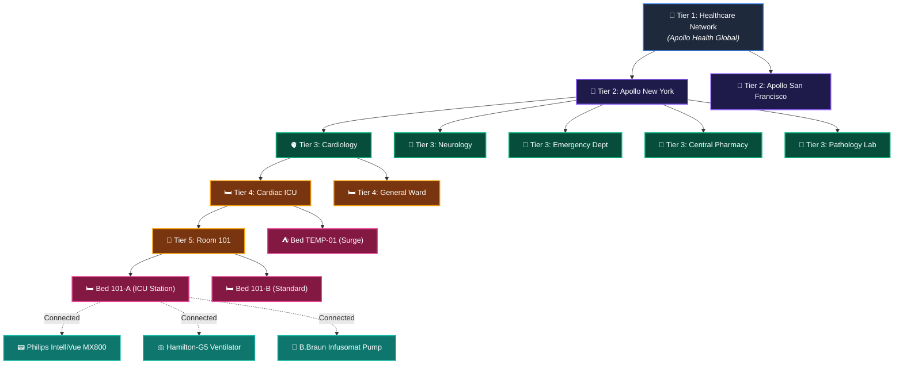
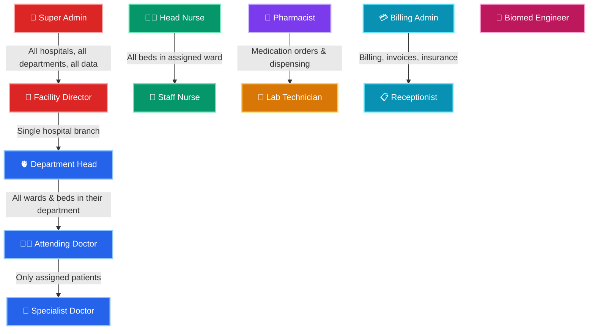

# 🏥 Hospital SaaS Developer Handbook: Enterprise-Grade Guide

> **The definitive guide to building a production-grade, HIPAA-compliant Hospital Management SaaS on OrbitoX — available both as a declarative application and as a modular, plug-and-play package (`@orbitox/plugin-hospital-os`). Features role-based dashboards, real-world medical equipment telemetry, pharmacy workflows, auto-billing, temporary surge beds, and smart clinical automations.**

---

## 📑 Table of Contents
1. [Core Mental Model: The 6-Tier Hospital Hierarchy](#1-core-mental-model-the-6-tier-hospital-hierarchy)
2. [Plugin & Package Architecture (`@orbitox/plugin-hospital-os`)](#2-plugin--package-architecture-orbitoxplugin-hospital-os)
3. [Role-Based Dashboards & Permission Matrix](#3-role-based-dashboards--permission-matrix)
4. [Real-World Problem Solving: 8 Critical Hospital Challenges](#4-real-world-problem-solving-8-critical-hospital-challenges)
5. [Complete TypeScript Domain Types (Enterprise)](#5-complete-typescript-domain-types-enterprise)
6. [Real-World Medical Equipment Reference Catalog](#6-real-world-medical-equipment-reference-catalog)
7. [12-Step Enterprise Implementation Tutorial](#7-12-step-enterprise-implementation-tutorial)
8. [Smart Clinical Automation Workflows](#8-smart-clinical-automation-workflows)
9. [Pharmacy, Lab & Billing Sub-Systems](#9-pharmacy-lab--billing-sub-systems)
10. [Two Ways to Run: Plugin vs Custom App](#10-two-ways-to-run-plugin-vs-custom-app)
11. [Full REST API Reference](#11-full-rest-api-reference)

---

## 1. Core Mental Model: The 6-Tier Hospital Hierarchy



### 💡 The 5 Golden Rules:
1. **Top-Down Visibility:** Hospital Super Admin sees everything; Department Head sees only their department.
2. **Horizontal Isolation:** Cardiology doctors **cannot see** Neurology patients unless a Peer Mesh consult is active.
3. **Bed-Level Binding:** Every patient record is cryptographically bound to a specific Bed context node.
4. **Equipment Pairing:** Each ICU bed tracks exactly which monitors, ventilators, and pumps are physically connected to it.
5. **Temporary Surge Lifecycle:** Overflow beds are auto-decommissioned when the patient is discharged.

---

## 2. Plugin & Package Architecture (`@orbitox/plugin-hospital-os`)

Hospital SaaS is engineered as a **modular, plug-and-play OrbitoX plugin** (`@orbitox/plugin-hospital-os`). Host applications or hospital clients can mount the entire vertical in **3 lines of code**:

```typescript
import { createOrbitoXApp } from '@orbitox/runtime';
import { HospitalOSPlugin } from '@orbitox/plugin-hospital-os';

const { app, server } = await createOrbitoXApp({
  app: { name: 'Apollo Hospital OS', port: 3000 },
  plugins: [
    HospitalOSPlugin({
      complianceFramework: 'HIPAA',
      telemetry: { enabled: true, brokerUrl: 'mqtt://iot.hospital.internal:1883' },
      surgeBeds: { allowTemporarySurge: true, autoDecommissionOnDischarge: true },
      billing: { autoDailyBedCharges: true, currency: 'USD' }
    })
  ]
});
```

When mounted, `HospitalOSPlugin` automatically registers:
- 🗄️ **8 Core Entities:** `staff`, `bed`, `room`, `patient`, `medical_record`, `treatment`, `lab_order`, `invoice`
- 🪝 **Lifecycle Hooks:** Anti-double-booking locks, 5-rights drug checks, quota guards
- ⏱️ **5 Automated Workflows:** Midnight bed-charge billing, 30-minute staffing ratio auditor, surge bed cleanup, equipment calibration notifier, unacknowledged lab escalations
- 📊 **11 Role Dashboards:** Auto-registered into OrbitoX's dynamic frontend widget registry
- 🔒 **Zero Core Leakage:** Protects proprietary OrbitoX Core Platform IP by compiling the plugin into obfuscated / bytecode packages

*(For full plugin manifest specs, build configs, and private npm packaging, see [**Hospital Plugin & Package Architecture**](./HOSPITAL_PLUGIN_PACKAGE_ARCHITECTURE.md).)*

---

## 3. Role-Based Dashboards & Permission Matrix

Every hospital role sees a **different dashboard** based on their context scope. Here is exactly what each role can see and do:



### 📊 Complete Permission Matrix (What Each Role Sees on Dashboard)

| Dashboard Widget / Feature | 🔑 Super Admin | 🏢 Facility Dir | 🫀 Dept Head | 👨‍⚕️ Doctor | 👩‍⚕️ Head Nurse | 💉 Staff Nurse | 💊 Pharmacist | 🔬 Lab Tech | 💳 Billing | 📋 Receptionist | 🔧 Biomed |
| :--- | :---: | :---: | :---: | :---: | :---: | :---: | :---: | :---: | :---: | :---: | :---: |
| Hospital-Wide KPI Overview | ✅ | ✅ | ❌ | ❌ | ❌ | ❌ | ❌ | ❌ | ❌ | ❌ | ❌ |
| Cross-Branch Comparison Analytics | ✅ | ❌ | ❌ | ❌ | ❌ | ❌ | ❌ | ❌ | ❌ | ❌ | ❌ |
| Department Bed Census & Occupancy | ✅ | ✅ | ✅ | ❌ | ✅ | ❌ | ❌ | ❌ | ❌ | ❌ | ❌ |
| Patient Admission & Discharge | ✅ | ✅ | ✅ | ✅ | ✅ | ❌ | ❌ | ❌ | ❌ | ✅ | ❌ |
| Medical Records (View) | ✅ | ❌ | ✅ | ✅ (own) | ❌ | ❌ | ❌ | ❌ | ❌ | ❌ | ❌ |
| Medical Records (Write) | ❌ | ❌ | ✅ | ✅ (own) | ❌ | ❌ | ❌ | ❌ | ❌ | ❌ | ❌ |
| Treatment Prescriptions | ❌ | ❌ | ✅ | ✅ | ❌ | ❌ | 📖 Read | ❌ | ❌ | ❌ | ❌ |
| Real-Time Vitals Monitor Panel | ✅ | ❌ | ✅ | ✅ | ✅ | ✅ | ❌ | ❌ | ❌ | ❌ | ❌ |
| Nurse Task & Medication Round Queue | ❌ | ❌ | ❌ | ❌ | ✅ | ✅ | ❌ | ❌ | ❌ | ❌ | ❌ |
| Pharmacy Dispensing Queue | ❌ | ❌ | ❌ | ❌ | ❌ | ❌ | ✅ | ❌ | ❌ | ❌ | ❌ |
| Lab Order Queue & Results | ❌ | ❌ | ✅ | ✅ | ❌ | ❌ | ❌ | ✅ | ❌ | ❌ | ❌ |
| Invoice & Insurance Claims | ✅ | ✅ | ❌ | ❌ | ❌ | ❌ | ❌ | ❌ | ✅ | ✅ | ❌ |
| Equipment Status & Maintenance | ✅ | ✅ | ❌ | ❌ | ❌ | ❌ | ❌ | ❌ | ❌ | ❌ | ✅ |
| SaaS License & Bed Quota Admin | ✅ | ❌ | ❌ | ❌ | ❌ | ❌ | ❌ | ❌ | ❌ | ❌ | ❌ |
| Break-Glass Emergency Override | ❌ | ❌ | ❌ | ✅ (ER) | ❌ | ❌ | ❌ | ❌ | ❌ | ❌ | ❌ |
| Audit Trail & Compliance Logs | ✅ | ✅ | ❌ | ❌ | ❌ | ❌ | ❌ | ❌ | ❌ | ❌ | ❌ |

---

## 4. Real-World Problem Solving: 8 Critical Hospital Challenges

| # | Real-World Hospital Problem | OrbitoX Solution | Implementation |
| :---: | :--- | :--- | :--- |
| 1 | **Epidemic Surge Overflow** — Hospital runs out of beds during COVID, monsoon disasters, mass casualties | `isTemporary: true` + `surgeConfig.autoDecommissionOnDischarge` automatically destroys temporary context nodes on discharge | Step 4 Example B |
| 2 | **ICU Equipment Tracking** — Losing track of which ventilator / monitor is plugged into which bed | `attachedEquipment[]` array on `BedEntity` pairs device IDs, models, serial numbers, and telemetry topics | Step 4 Example A |
| 3 | **Double-Booking Race Condition** — Two nurses admit two patients to the same bed at the exact same millisecond | `beforeCreate` hook with atomic row-level locking validates bed status before confirming admission | Step 5 |
| 4 | **Critical Vitals Delay** — SpO2 drops to 82% but nurse station is not notified for 6 minutes | Real-time IoT telemetry threshold engine + instant BullMQ `vitals.alarm.critical` broadcast to Central Nurse Station dashboard | Step 6 |
| 5 | **Cross-Department Data Silo** — Cardiologist needs neurology records but zero-trust blocks cross-department access | `orbitox.context.linkPeers()` creates scoped, time-limited peer mesh tunnels with audited access | Step 7 |
| 6 | **Pharmacy Medication Errors** — Wrong drug dispensed because pharmacy has no visibility into treatment orders | `treatment.ordered` event triggers real-time pharmacy dispensing queue with barcode verification | Section 8 |
| 7 | **Delayed Lab Results** — Doctor waits hours for CBC/ABG results with no status visibility | Lab order entity with `status: 'ordered' | 'in_progress' | 'completed'` + real-time event notification | Section 8 |
| 8 | **Billing Leakage** — Discharged patient's bed charges not captured; insurance claim denied for missing audit trail | Auto-generated billing line items via `afterCreate` hooks + SHA-256 cryptographic audit vault | Section 8 |

---

## 5. Complete TypeScript Domain Types (Enterprise)

```typescript
// ═══════════════════════════════════════════════════════════════
//  ORBITOX HOSPITAL SaaS — ENTERPRISE DOMAIN TYPES
// ═══════════════════════════════════════════════════════════════

// ─── 1. Hierarchy & Context Types ──────────────────────────────
export type HospitalContextType = 
  | 'organisation' | 'tenant' | 'department' | 'ward' | 'room' | 'bed';

// ─── 2. Staff & Clinical Roles ─────────────────────────────────
export type StaffRole =
  | 'super_admin'        // Full network access
  | 'facility_director'  // Single hospital branch
  | 'department_head'    // Head of department
  | 'attending_doctor'   // Primary physician
  | 'specialist_doctor'  // Cross-dept consultant
  | 'resident_doctor'    // Medical resident (supervised)
  | 'head_nurse'         // Ward-level nurse supervisor
  | 'staff_nurse'        // Bedside care nurse
  | 'triage_nurse'       // ER initial assessment
  | 'pharmacist'         // Drug dispensing & verification
  | 'lab_technician'     // Pathology & diagnostics
  | 'radiologist'        // Imaging & scans
  | 'billing_admin'      // Invoices, insurance, payments
  | 'receptionist'       // Front desk admissions
  | 'biomed_engineer'    // Equipment maintenance
  | 'housekeeping_lead'; // Sanitization & room turnover

export interface StaffEntity {
  id: string;
  name: string;
  role: StaffRole;
  departmentId: string;
  email: string;
  phone: string;
  licenseNumber: string;
  specialization?: string;
  shiftSchedule: 'day' | 'night' | 'rotating';
  isOnDuty: boolean;
}

// ─── 3. Advanced Bed & Equipment Types ─────────────────────────
export type BedType = 
  | 'standard'                     // General ward
  | 'semi_private'                 // 2-patient room
  | 'private_suite'                // VIP single occupancy
  | 'icu'                          // Intensive Care Unit
  | 'ccu'                          // Coronary Critical Care
  | 'nicu'                         // Neonatal ICU (infant incubator)
  | 'picu'                         // Pediatric ICU
  | 'burn_unit'                    // Specialized burn care
  | 'isolation_negative_pressure'  // Airborne infection quarantine
  | 'isolation_positive_pressure'  // Immunocompromised patient room
  | 'emergency_trauma_bay'         // ER resuscitation station
  | 'operating_theatre_table'      // Surgery table (not a "bed" but tracked)
  | 'recovery_pacu'                // Post-Anesthesia Care Unit
  | 'dialysis_station'             // Renal dialysis recliner
  | 'psychiatric_safe_room'        // Padded behavioral health room
  | 'labor_delivery_suite'         // OB/GYN labor & delivery
  | 'temporary_surge';             // Emergency overflow / field tent

export type BedStatus = 
  | 'available' | 'reserved' | 'occupied' | 'discharging' 
  | 'sanitizing' | 'maintenance' | 'transferred' | 'condemned';

export type MedicalDeviceType = 
  | 'multi_para_vitals_monitor'   // ECG + SpO2 + NIBP + Temperature + EtCO2
  | 'mechanical_ventilator'       // Invasive/Non-Invasive ventilation
  | 'bipap_cpap'                  // Non-invasive positive airway pressure
  | 'infusion_syringe_pump'       // IV drug delivery (B.Braun, Terumo)
  | 'pca_pump'                    // Patient-Controlled Analgesia pump
  | 'feeding_pump'                // Enteral nutrition pump
  | 'dialysis_unit'               // Hemodialysis machine (Fresenius)
  | 'defibrillator_crash_cart'    // AED + Emergency drugs trolley
  | 'ecmo_circuit'                // Extracorporeal Membrane Oxygenation
  | 'iabp'                        // Intra-Aortic Balloon Pump
  | 'hypothermia_unit'            // Targeted Temperature Management
  | 'sequential_compression'      // DVT prevention leg sleeves
  | 'suction_unit'                // Airway/wound suction
  | 'pulse_oximeter_standalone'   // Portable SpO2 clip
  | 'glucometer'                  // Blood glucose meter
  | 'eeg_monitor'                 // Electroencephalogram
  | 'fetal_doppler'               // OB/GYN fetal heart monitor
  | 'portable_xray'              // Bedside X-ray unit
  | 'portable_ultrasound';        // Point-of-care ultrasound (POCUS)

export interface AttachedMedicalDevice {
  deviceId: string;
  deviceType: MedicalDeviceType;
  manufacturer: string;
  model: string;
  serialNumber: string;
  status: 'online' | 'standby' | 'alarm' | 'offline' | 'calibrating';
  lastCalibrationDate: string;
  nextMaintenanceDue: string;
  telemetryTopic?: string;       // MQTT/WebSocket topic for real-time data
  firmwareVersion?: string;
}

export interface BedFeatures {
  hasOxygenPort: boolean;         // Piped O2 from central supply
  hasSuctionPort: boolean;        // Wall suction for airway
  hasCompressedAirPort: boolean;  // Piped compressed air
  hasNurseCallButton: boolean;    // Bedside call bell
  hasBedsideTerminal: boolean;    // EMR computer terminal
  isBariatric: boolean;           // Weight-rated for obese patients (>200kg)
  motorized: boolean;             // Electric height/tilt adjustment
  hasSideRails: boolean;          // Fall prevention rails
  hasWeighingScale: boolean;      // Built-in bed weight sensor
  hasAirMattress: boolean;        // Pressure ulcer prevention
}

export interface TelemetryThresholds {
  minSpO2: number;                // Alarm if SpO2 < this (default: 90)
  maxHeartRate: number;           // Alarm if HR > this (default: 130)
  minHeartRate: number;           // Alarm if HR < this (default: 45)
  maxSystolicBP: number;         // Alarm if Systolic > this (default: 180)
  minSystolicBP: number;         // Alarm if Systolic < this (default: 80)
  maxTemperature: number;        // Alarm if Temp > this (default: 39.5°C)
  minTemperature: number;        // Alarm if Temp < this (default: 35.0°C)
  maxRespiratoryRate: number;    // Alarm if RR > this (default: 30)
}

export interface SurgeConfig {
  reason: string;                         // 'COVID Surge' | 'ER Overflow' | 'Natural Disaster'
  authorizedBy: string;                   // Staff ID who approved
  expiresAt?: string;                     // Auto-cleanup ISO timestamp
  autoDecommissionOnDischarge: boolean;   // Remove context node on discharge
}

export interface BedEntity {
  id: string;
  label: string;
  wardId: string;
  roomId: string;
  type: BedType;
  status: BedStatus;
  isTemporary: boolean;
  surgeConfig?: SurgeConfig;
  attachedEquipment: AttachedMedicalDevice[];
  features: BedFeatures;
  telemetryThresholds?: TelemetryThresholds;
  dailyRate: number;
  lastSanitizedAt?: string;
  lastMaintenanceAt?: string;
}

// ─── 4. Patient ────────────────────────────────────────────────
export type PatientStatus = 'pre_registered' | 'admitted' | 'in_surgery' | 'recovering' | 'discharging' | 'discharged' | 'deceased';
export type PatientCategory = 'general' | 'vip' | 'pediatric' | 'geriatric' | 'maternity' | 'psychiatric' | 'trauma';
export type InsuranceType = 'private' | 'government' | 'corporate' | 'self_pay' | 'charity';

export interface PatientEntity {
  id: string;
  name: string;
  age: number;
  gender: 'M' | 'F' | 'Other';
  bloodGroup: 'A+' | 'A-' | 'B+' | 'B-' | 'AB+' | 'AB-' | 'O+' | 'O-';
  category: PatientCategory;
  bedId: string;
  status: PatientStatus;
  attendingDoctorId: string;
  emergencyContact: { name: string; phone: string; relation: string };
  insurance: { provider: string; policyNumber: string; type: InsuranceType };
  allergies: string[];
  admittedAt: string;
  estimatedDischargeDate?: string;
}

// ─── 5. Medical Records ────────────────────────────────────────
export type RecordType = 'initial_assessment' | 'progress_note' | 'operative_note' | 'discharge_summary' | 'consultation_note';

export interface VitalsSnapshot {
  timestamp: string;
  heartRate: number;        // bpm
  bloodPressure: string;    // '120/80'
  spo2: number;             // %
  temperature: number;      // °C
  respiratoryRate: number;  // breaths/min
  painScore: number;        // 0-10 NRS scale
  glasgowComaScale?: number; // 3-15 GCS for trauma
}

export interface MedicalRecordEntity {
  id: string;
  patientId: string;
  doctorId: string;
  type: RecordType;
  diagnosis: string;
  icdCode: string;          // ICD-10 classification code
  clinicalNotes: string;
  vitals: VitalsSnapshot;
  attachments: string[];     // Paths to X-Ray, MRI, CT images
  createdAt: string;
}

// ─── 6. Treatment & Medication ─────────────────────────────────
export type TreatmentStatus = 'ordered' | 'pharmacy_verified' | 'dispensed' | 'administered' | 'completed' | 'cancelled';
export type TreatmentType = 'medication' | 'procedure' | 'surgery' | 'therapy' | 'transfusion' | 'imaging';

export interface TreatmentEntity {
  id: string;
  recordId: string;
  patientId: string;
  prescribedByDoctorId: string;
  type: TreatmentType;
  procedureOrDrug: string;
  dosage: string;
  frequency: string;         // 'TID' | 'BID' | 'QID' | 'PRN' | 'STAT'
  route: string;             // 'IV' | 'IM' | 'PO' | 'SC' | 'Topical'
  status: TreatmentStatus;
  pharmacyVerifiedBy?: string;
  administeredBy?: string;    // Nurse who gave the medication
  administeredAt?: string;
}

// ─── 7. Lab Orders ─────────────────────────────────────────────
export type LabTestType = 'CBC' | 'BMP' | 'CMP' | 'LFT' | 'ABG' | 'Troponin' | 'D-Dimer' | 'PT_INR' | 'Urinalysis' | 'Blood_Culture' | 'COVID_PCR' | 'HbA1c' | 'TSH' | 'Custom';
export type LabOrderStatus = 'ordered' | 'sample_collected' | 'in_progress' | 'completed' | 'critical_result';

export interface LabOrderEntity {
  id: string;
  patientId: string;
  orderedByDoctorId: string;
  testType: LabTestType;
  priority: 'routine' | 'urgent' | 'stat';
  status: LabOrderStatus;
  sampleCollectedBy?: string;
  resultSummary?: string;
  resultUrl?: string;           // Link to full PDF report
  isCriticalValue: boolean;     // Auto-notifies doctor if abnormal
  orderedAt: string;
  completedAt?: string;
}

// ─── 8. Billing & Invoice ──────────────────────────────────────
export type BillingLineType = 'bed_charge' | 'consultation_fee' | 'procedure_fee' | 'medication' | 'lab_test' | 'imaging' | 'equipment_usage' | 'nursing_care';

export interface BillingLineItem {
  description: string;
  type: BillingLineType;
  quantity: number;
  unitPrice: number;
  totalPrice: number;
  date: string;
}

export interface InvoiceEntity {
  id: string;
  patientId: string;
  admissionId: string;
  lineItems: BillingLineItem[];
  subtotal: number;
  taxAmount: number;
  insuranceCoverage: number;
  patientDue: number;
  status: 'draft' | 'finalized' | 'paid' | 'insurance_pending' | 'overdue';
  generatedAt: string;
}

// ─── 9. Consultation (Peer Mesh) ───────────────────────────────
export interface ConsultationEntity {
  id: string;
  patientId: string;
  requestingDoctorId: string;
  requestingDeptId: string;
  targetDeptId: string;
  specialistDoctorId?: string;
  clinicalQuestion: string;
  status: 'pending' | 'active' | 'completed' | 'expired';
  validUntil: string;
  grantedPermissions: string[];
}
```

---

## 6. Real-World Medical Equipment Reference Catalog

These are actual brands and models used in hospitals worldwide, supported by OrbitoX's `attachedEquipment[]` system:

| Device Category | Real Brand & Model | `deviceType` Value | ICU? | ER? | Ward? | Typical Telemetry Data |
| :--- | :--- | :--- | :---: | :---: | :---: | :--- |
| **Multi-Para Vitals Monitor** | Philips IntelliVue MX800 | `multi_para_vitals_monitor` | ✅ | ✅ | ❌ | ECG, SpO2, NIBP, EtCO2, Temp |
| **Multi-Para Vitals Monitor** | GE CARESCAPE B650 | `multi_para_vitals_monitor` | ✅ | ✅ | ❌ | ECG, SpO2, IBP, Cardiac Output |
| **Portable Pulse Oximeter** | Masimo Rad-97 | `pulse_oximeter_standalone` | ❌ | ✅ | ✅ | SpO2, Pulse Rate |
| **Mechanical Ventilator** | Hamilton-G5 | `mechanical_ventilator` | ✅ | ✅ | ❌ | Tidal Vol, FiO2, PEEP, RR |
| **Mechanical Ventilator** | Dräger Evita V500 | `mechanical_ventilator` | ✅ | ❌ | ❌ | PIP, MAP, Compliance |
| **BiPAP / CPAP** | ResMed AirCurve 10 | `bipap_cpap` | ❌ | ✅ | ✅ | Pressure, Leak, AHI |
| **Infusion Syringe Pump** | B.Braun Infusomat Space | `infusion_syringe_pump` | ✅ | ✅ | ✅ | Flow Rate, VTBI, Occlusion |
| **PCA Pump** | BD Alaris PCA Module | `pca_pump` | ✅ | ❌ | ✅ | Demand Count, Total Dose |
| **Defibrillator + Crash Cart** | ZOLL R Series Plus | `defibrillator_crash_cart` | ✅ | ✅ | ❌ | Shock Count, CPR Depth |
| **ECMO Circuit** | Maquet Cardiohelp | `ecmo_circuit` | ✅ | ❌ | ❌ | Blood Flow, RPM, Gas Exchange |
| **IABP** | Getinge Cardiosave | `iabp` | ✅ | ❌ | ❌ | Augmentation Ratio, Timing |
| **Dialysis Unit** | Fresenius 5008S | `dialysis_unit` | ✅ | ❌ | ❌ | UF Volume, TMP, Blood Flow |
| **Hypothermia Unit** | Bard Arctic Sun 5000 | `hypothermia_unit` | ✅ | ❌ | ❌ | Target Temp, Actual Temp |
| **Portable Ultrasound** | Butterfly iQ+ (POCUS) | `portable_ultrasound` | ✅ | ✅ | ✅ | Images, Clips |
| **Portable X-Ray** | Shimadzu MobileDaRt | `portable_xray` | ✅ | ✅ | ✅ | DICOM Images |
| **Fetal Doppler** | Edan F9 Express | `fetal_doppler` | ❌ | ❌ | ✅ | FHR, Contraction Frequency |
| **EEG Monitor** | Nihon Kohden EEG-1200 | `eeg_monitor` | ✅ | ❌ | ❌ | Brainwave Patterns |
| **Glucometer** | Accu-Chek Inform II | `glucometer` | ✅ | ✅ | ✅ | Blood Glucose mg/dL |

---

## 7. 12-Step Enterprise Implementation Tutorial

### Step 1: Define All Entities & Schema
```typescript
import { OrbitoXConfig } from '@orbitox/runtime';

export const hospitalConfig: OrbitoXConfig = {
  app: { name: 'Apollo Hospital OS', port: 3000 },
  entities: [
    {
      id: 'staff', name: 'Staff',
      fields: [
        { name: 'name', type: 'text', required: true },
        { name: 'role', type: 'text', required: true },
        { name: 'departmentId', type: 'text', required: true },
        { name: 'licenseNumber', type: 'text', required: true },
        { name: 'shiftSchedule', type: 'enum', options: ['day', 'night', 'rotating'], default: 'day' },
        { name: 'isOnDuty', type: 'boolean', default: true }
      ]
    },
    {
      id: 'bed', name: 'Bed',
      fields: [
        { name: 'label', type: 'text', required: true },
        { name: 'wardId', type: 'text', required: true },
        { name: 'type', type: 'enum', options: ['standard', 'semi_private', 'private_suite', 'icu', 'ccu', 'nicu', 'emergency_trauma_bay', 'temporary_surge'], default: 'standard' },
        { name: 'status', type: 'enum', options: ['available', 'reserved', 'occupied', 'sanitizing', 'maintenance', 'condemned'], default: 'available' },
        { name: 'isTemporary', type: 'boolean', default: false },
        { name: 'dailyRate', type: 'number', default: 250 }
      ]
    },
    {
      id: 'patient', name: 'Patient',
      fields: [
        { name: 'name', type: 'text', required: true },
        { name: 'age', type: 'number', required: true },
        { name: 'gender', type: 'enum', options: ['M', 'F', 'Other'], required: true },
        { name: 'bloodGroup', type: 'text', required: true },
        { name: 'category', type: 'enum', options: ['general', 'vip', 'pediatric', 'geriatric', 'maternity', 'trauma'], default: 'general' },
        { name: 'bedId', type: 'text', required: true },
        { name: 'status', type: 'enum', options: ['pre_registered', 'admitted', 'in_surgery', 'recovering', 'discharging', 'discharged'], default: 'admitted' }
      ]
    },
    {
      id: 'medical_record', name: 'MedicalRecord',
      fields: [
        { name: 'patientId', type: 'text', required: true },
        { name: 'doctorId', type: 'text', required: true },
        { name: 'type', type: 'enum', options: ['initial_assessment', 'progress_note', 'operative_note', 'discharge_summary'], default: 'progress_note' },
        { name: 'diagnosis', type: 'text', required: true },
        { name: 'icdCode', type: 'text', required: true }
      ]
    },
    {
      id: 'treatment', name: 'Treatment',
      fields: [
        { name: 'recordId', type: 'text', required: true },
        { name: 'type', type: 'enum', options: ['medication', 'procedure', 'surgery', 'therapy', 'transfusion', 'imaging'], required: true },
        { name: 'procedureOrDrug', type: 'text', required: true },
        { name: 'dosage', type: 'text' },
        { name: 'frequency', type: 'text' },
        { name: 'route', type: 'text' },
        { name: 'status', type: 'enum', options: ['ordered', 'pharmacy_verified', 'dispensed', 'administered', 'completed', 'cancelled'], default: 'ordered' }
      ]
    },
    {
      id: 'lab_order', name: 'LabOrder',
      fields: [
        { name: 'patientId', type: 'text', required: true },
        { name: 'orderedByDoctorId', type: 'text', required: true },
        { name: 'testType', type: 'text', required: true },
        { name: 'priority', type: 'enum', options: ['routine', 'urgent', 'stat'], default: 'routine' },
        { name: 'status', type: 'enum', options: ['ordered', 'sample_collected', 'in_progress', 'completed', 'critical_result'], default: 'ordered' },
        { name: 'isCriticalValue', type: 'boolean', default: false }
      ]
    },
    {
      id: 'invoice', name: 'Invoice',
      fields: [
        { name: 'patientId', type: 'text', required: true },
        { name: 'subtotal', type: 'number', required: true },
        { name: 'status', type: 'enum', options: ['draft', 'finalized', 'paid', 'insurance_pending', 'overdue'], default: 'draft' }
      ]
    }
  ]
};
```

---

### Step 2–4: Build Hierarchy, Register Staff, Provision Beds with Equipment

```typescript
import { orbitox } from '@orbitox/runtime';

// ─── Hierarchy ─────────────────────────────────────────────────
const org      = await orbitox.tenant('apollo-global', 'Apollo Health Global').type('organisation').create();
const hospital = await orbitox.tenant('apollo-ny', 'Apollo New York').type('tenant').parent(org.id).create();
const cardioDept = await orbitox.tenant('cardio', 'Cardiology').type('department').parent(hospital.id).create();
const neuroDept  = await orbitox.tenant('neuro', 'Neurology').type('department').parent(hospital.id).create();
const erDept     = await orbitox.tenant('er', 'Emergency').type('department').parent(hospital.id).create();
const pharmacy   = await orbitox.tenant('pharmacy', 'Central Pharmacy').type('department').parent(hospital.id).create();
const lab        = await orbitox.tenant('lab', 'Pathology Lab').type('department').parent(hospital.id).create();

const icuWard = await orbitox.tenant('cardio-icu', 'Cardiac ICU').type('ward').parent(cardioDept.id).create();
const room101 = await orbitox.tenant('room-101', 'Room 101').type('room').parent(icuWard.id).create();
const bed101A = await orbitox.tenant('bed-101-a', 'Bed 101-A').type('bed').parent(room101.id).create();

// ─── Staff ─────────────────────────────────────────────────────
const drStrange = await orbitox.db.create('staff', {
  name: 'Dr. Stephen Strange', role: 'attending_doctor',
  departmentId: cardioDept.id, licenseNumber: 'MD-CARDIO-9988',
  shiftSchedule: 'day', isOnDuty: true
}, cardioDept.id);

const nurseChristine = await orbitox.db.create('staff', {
  name: 'Nurse Christine Palmer', role: 'head_nurse',
  departmentId: cardioDept.id, licenseNumber: 'RN-ICU-4421',
  shiftSchedule: 'day', isOnDuty: true
}, icuWard.id);

// ─── ICU Bed with Full Equipment ───────────────────────────────
const icuBed = await orbitox.db.create('bed', {
  label: 'Bed 101-A', wardId: icuWard.id, roomId: room101.id,
  type: 'icu', status: 'available', isTemporary: false,
  attachedEquipment: [
    { deviceId: 'dev_01', deviceType: 'multi_para_vitals_monitor', manufacturer: 'Philips', model: 'IntelliVue MX800', serialNumber: 'MX800-44321', status: 'online', telemetryTopic: 'icu/bed-101-a/vitals', lastCalibrationDate: '2026-07-01', nextMaintenanceDue: '2026-10-01' },
    { deviceId: 'dev_02', deviceType: 'mechanical_ventilator', manufacturer: 'Hamilton', model: 'Hamilton-G5', serialNumber: 'HG5-88210', status: 'standby', lastCalibrationDate: '2026-06-15', nextMaintenanceDue: '2026-09-15' },
    { deviceId: 'dev_03', deviceType: 'infusion_syringe_pump', manufacturer: 'B.Braun', model: 'Infusomat Space', serialNumber: 'BS-77901', status: 'online', lastCalibrationDate: '2026-08-01', nextMaintenanceDue: '2026-11-01' },
    { deviceId: 'dev_04', deviceType: 'defibrillator_crash_cart', manufacturer: 'ZOLL', model: 'R Series Plus', serialNumber: 'ZOLL-12001', status: 'standby', lastCalibrationDate: '2026-08-10', nextMaintenanceDue: '2026-11-10' }
  ],
  features: {
    hasOxygenPort: true, hasSuctionPort: true, hasCompressedAirPort: true,
    hasNurseCallButton: true, hasBedsideTerminal: true, isBariatric: false,
    motorized: true, hasSideRails: true, hasWeighingScale: true, hasAirMattress: true
  },
  telemetryThresholds: {
    minSpO2: 90, maxHeartRate: 130, minHeartRate: 45,
    maxSystolicBP: 180, minSystolicBP: 80,
    maxTemperature: 39.5, minTemperature: 35.0, maxRespiratoryRate: 30
  },
  dailyRate: 1500
}, bed101A.id);
```

---

### Step 5: Anti-Double-Booking & Capacity Guard Hooks

```typescript
export const patientHooks = {
  beforeCreate: async (payload: any, context: any) => {
    // 1. Verify bed exists and is available
    const bed = await orbitox.db.findById('bed', payload.bedId, context.id);
    if (!bed) throw new Error(`Bed '${payload.bedId}' not found in this ward.`);
    if (bed.status !== 'available') throw new Error(`⚠️ Bed '${bed.label}' is ${bed.status.toUpperCase()}!`);

    // 2. Enforce SaaS bed quota
    const quota = await orbitox.billing.checkQuota(context.rootId || 'apollo-global', 'maxBeds', 1);
    if (!quota.allowed) throw new Error('⚠️ SaaS Quota Exceeded: Maximum licensed beds capacity reached.');

    // 3. Verify attending doctor is on duty
    const doctor = await orbitox.db.findById('staff', payload.attendingDoctorId);
    if (doctor && !doctor.isOnDuty) throw new Error(`⚠️ Dr. ${doctor.name} is not currently on duty.`);

    return payload;
  },

  afterCreate: async (record: any, context: any) => {
    // Lock bed → occupied
    await orbitox.db.update('bed', record.bedId, { status: 'occupied' }, context.id);

    // Generate initial billing line item
    await orbitox.events.emit('billing.line.add', {
      patientId: record.id, type: 'bed_charge',
      description: `Admission to ${record.bedId}`, unitPrice: 1500
    }, context.id);

    // Dispatch nurse station notification
    await orbitox.events.emit('nurse.station.admission', {
      patientId: record.id, patientName: record.name, bedId: record.bedId
    }, context.id);
  }
};
```

---

### Step 6: Real-Time IoT Telemetry Engine

```typescript
export async function processBedTelemetry(bedId: string, vitals: VitalsSnapshot) {
  const bed = await orbitox.db.findById('bed', bedId);
  if (!bed?.telemetryThresholds) return;
  const t = bed.telemetryThresholds;
  const alarms: string[] = [];

  if (vitals.spo2 < t.minSpO2) alarms.push(`SpO2 CRITICAL: ${vitals.spo2}% (min: ${t.minSpO2}%)`);
  if (vitals.heartRate > t.maxHeartRate) alarms.push(`TACHYCARDIA: ${vitals.heartRate} bpm`);
  if (vitals.heartRate < t.minHeartRate) alarms.push(`BRADYCARDIA: ${vitals.heartRate} bpm`);
  if (vitals.temperature > t.maxTemperature) alarms.push(`HYPERTHERMIA: ${vitals.temperature}°C`);
  if (vitals.temperature < t.minTemperature) alarms.push(`HYPOTHERMIA: ${vitals.temperature}°C`);
  if (vitals.respiratoryRate > t.maxRespiratoryRate) alarms.push(`TACHYPNEA: ${vitals.respiratoryRate} br/min`);

  if (alarms.length > 0) {
    await orbitox.events.emit('vitals.alarm.critical', {
      bedId, bedLabel: bed.label, alarms,
      severity: vitals.spo2 < 85 ? 'CODE_BLUE' : 'HIGH_PRIORITY',
      vitals, timestamp: new Date().toISOString()
    });
  }
}
```

---

## 8. Smart Clinical Automation Workflows

```mermaid
graph TD
    classDef event fill:#1e293b,stroke:#3b82f6,stroke-width:2px,color:#fff;
    classDef action fill:#064e3b,stroke:#10b981,stroke-width:2px,color:#fff;

    E1["patient.admitted"]:::event --> A1["🛏️ Lock Bed → Occupied"]:::action
    E1 --> A2["💳 Generate Billing Line Item"]:::action
    E1 --> A3["👩‍⚕️ Notify Nurse Station Dashboard"]:::action

    E2["treatment.ordered"]:::event --> A4["💊 Push to Pharmacy Queue"]:::action
    E2 --> A5["📋 Create Nurse Task (Medication Round)"]:::action

    E3["lab.result.critical"]:::event --> A6["📱 Push Notification to Doctor Mobile"]:::action
    E3 --> A7["⛓️ Log Critical Value in Audit Vault"]:::action

    E4["vitals.alarm.critical"]:::event --> A8["🚨 Central Nurse Station Alert"]:::action
    E4 --> A9["📱 SMS/Push to On-Call Doctor"]:::action

    E5["patient.discharged"]:::event --> A10["🧹 Trigger Housekeeping Sanitization"]:::action
    E5 --> A11["💳 Finalize Invoice"]:::action
    E5 --> A12["⛺ Decommission Temporary Bed"]:::action
```



---

## 9. Pharmacy, Lab & Billing Sub-Systems

### 💊 Pharmacy Dispensing Workflow
```typescript
// Pharmacist verifies and dispenses medication
orbitox.events.on('treatment.ordered', async (payload) => {
  console.log(`💊 [Pharmacy Queue] New Order: ${payload.record.procedureOrDrug} for Patient ${payload.record.patientId}`);
  // Pharmacist reviews → marks as pharmacy_verified → dispensed
});
```

### 🔬 Lab Order & Critical Value Notification
```typescript
// Lab technician completes test → auto-notifies doctor if critical
orbitox.events.on('lab.result.completed', async (payload) => {
  if (payload.isCriticalValue) {
    await orbitox.events.emit('lab.result.critical', {
      patientId: payload.patientId,
      testType: payload.testType,
      result: payload.resultSummary,
      doctorId: payload.orderedByDoctorId
    });
  }
});
```

### 💳 Auto-Invoice Generation on Discharge
```typescript
export async function generateDischargeInvoice(patientId: string) {
  const patient = await orbitox.db.findById('patient', patientId);
  const treatments = await orbitox.db.findMany('treatment', { filter: { patientId } });
  const labOrders = await orbitox.db.findMany('lab_order', { filter: { patientId } });

  const lineItems: BillingLineItem[] = [];
  // Auto-calculate bed charges, treatment fees, lab fees...
  
  const invoice = await orbitox.db.create('invoice', {
    patientId, subtotal: lineItems.reduce((s, l) => s + l.totalPrice, 0),
    status: patient?.insurance?.type === 'self_pay' ? 'finalized' : 'insurance_pending'
  });
}
```

---

## 10. Two Ways to Run: Plugin vs Custom App

### Method A: Running as a Modular Plugin (`@orbitox/plugin-hospital-os`) [RECOMMENDED]

```typescript
import { createOrbitoXApp, orbitox } from '@orbitox/runtime';
import { HospitalOSPlugin } from '@orbitox/plugin-hospital-os';

async function bootstrapHospitalWithPlugin() {
  // 1. Boot with Plugin
  const { app, server } = await createOrbitoXApp({
    app: { name: 'Apollo Hospital OS', port: 3000 },
    plugins: [
      HospitalOSPlugin({
        complianceFramework: 'HIPAA',
        telemetry: { enabled: true, brokerUrl: 'mqtt://iot.hospital.internal:1883' },
        surgeBeds: { allowTemporarySurge: true, autoDecommissionOnDischarge: true },
        billing: { autoDailyBedCharges: true, currency: 'USD' }
      })
    ]
  });

  // 2. Build 6-Tier Hierarchy Tree
  const hospital = await orbitox.tenant('apollo-ny', 'Apollo NY').type('tenant').create();
  const cardio = await orbitox.tenant('cardio', 'Cardiology').type('department').parent(hospital.id).create();
  const icu = await orbitox.tenant('icu', 'Cardiac ICU').type('ward').parent(cardio.id).create();
  const bed = await orbitox.tenant('bed-101', 'Bed 101-A').type('bed').parent(icu.id).create();

  console.log(`🎉 Hospital SaaS Live via Plugin on http://localhost:3000/api`);
}

bootstrapHospitalWithPlugin().catch(console.error);
```

### Method B: Declarative In-Code Configuration (`server.ts`)

```typescript
import { orbitox, createOrbitoXApp } from '@orbitox/runtime';

async function bootstrapCustomHospitalApp() {
  const { app, server } = await createOrbitoXApp({
    app: { name: 'Apollo Hospital OS', port: 3000 },
    entities: [
      { id: 'staff', name: 'Staff', fields: [{ name: 'name', type: 'text', required: true }, { name: 'role', type: 'text', required: true }] },
      { id: 'bed', name: 'Bed', fields: [{ name: 'label', type: 'text', required: true }, { name: 'type', type: 'text', required: true }] },
      { id: 'patient', name: 'Patient', fields: [{ name: 'name', type: 'text', required: true }, { name: 'bedId', type: 'text', required: true }] },
      { id: 'medical_record', name: 'MedicalRecord', fields: [{ name: 'patientId', type: 'text', required: true }, { name: 'diagnosis', type: 'text', required: true }] },
      { id: 'treatment', name: 'Treatment', fields: [{ name: 'procedureOrDrug', type: 'text', required: true }] },
      { id: 'lab_order', name: 'LabOrder', fields: [{ name: 'patientId', type: 'text', required: true }, { name: 'testType', type: 'text', required: true }] },
      { id: 'invoice', name: 'Invoice', fields: [{ name: 'patientId', type: 'text', required: true }, { name: 'subtotal', type: 'number', required: true }] }
    ]
  });

  const hospital = await orbitox.tenant('apollo-ny', 'Apollo NY').type('tenant').create();
  const cardio = await orbitox.tenant('cardio', 'Cardiology').type('department').parent(hospital.id).create();
  const icu = await orbitox.tenant('icu', 'Cardiac ICU').type('ward').parent(cardio.id).create();
  const bed = await orbitox.tenant('bed-101', 'Bed 101-A').type('bed').parent(icu.id).create();

  console.log(`🎉 Custom Hospital App Live on http://localhost:3000/api`);
}

bootstrapCustomHospitalApp().catch(console.error);
```

---

## 11. Full REST API Reference

| HTTP Method | Endpoint | Purpose | Role Access |
| :--- | :--- | :--- | :--- |
| `POST` | `/api/staffs` | Register clinical staff | Super Admin, Facility Dir |
| `POST` | `/api/beds` | Provision bed with equipment & options | Dept Head, Facility Dir |
| `PATCH` | `/api/beds/:id` | Update bed status / attach equipment | Head Nurse, Biomed Engineer |
| `POST` | `/api/patients` | Admit patient & lock bed | Doctor, Receptionist |
| `PATCH` | `/api/patients/:id` | Update patient status (discharge, transfer) | Doctor, Head Nurse |
| `GET` | `/api/patients` | List patients in caller's scope | Doctor, Nurse (scoped) |
| `POST` | `/api/medical-records` | Create diagnosis / progress note | Doctor only |
| `POST` | `/api/treatments` | Prescribe medication / order procedure | Doctor only |
| `PATCH` | `/api/treatments/:id` | Verify / dispense / administer | Pharmacist, Nurse |
| `POST` | `/api/lab-orders` | Order lab test (CBC, ABG, Troponin) | Doctor only |
| `PATCH` | `/api/lab-orders/:id` | Update lab status / report results | Lab Technician |
| `POST` | `/api/invoices` | Generate discharge invoice | Billing Admin |
| `POST` | `/api/consultations` | Request cross-dept specialist consult | Doctor |
| `POST` | `/api/security/break-glass` | Emergency ER trauma override | ER Doctor |

---

### 🔗 Related Flows & Guides:
- 📦 [**Hospital Plugin & Package Architecture**](./HOSPITAL_PLUGIN_PACKAGE_ARCHITECTURE.md)
- 🔄 [**Clinical Workflow Execution Flows**](./HOSPITAL_CLINICAL_WORKFLOW_FLOW.md)
- 🗄️ [**Database Integration Guide**](../database/DATABASE_INTEGRATION_GUIDE.md)
- 🔐 [**Database Flow & Security**](../database/DATABASE_FLOW_AND_SECURITY.md)
- 🧭 [**Developer Guide Master Hub**](../README.md)
