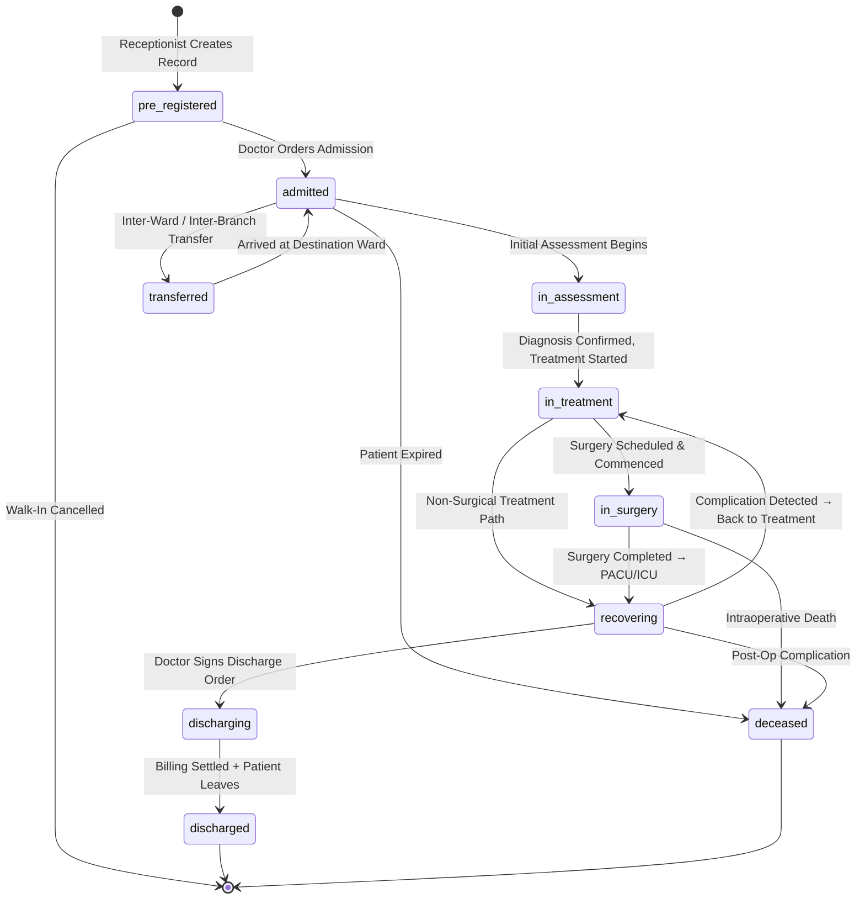
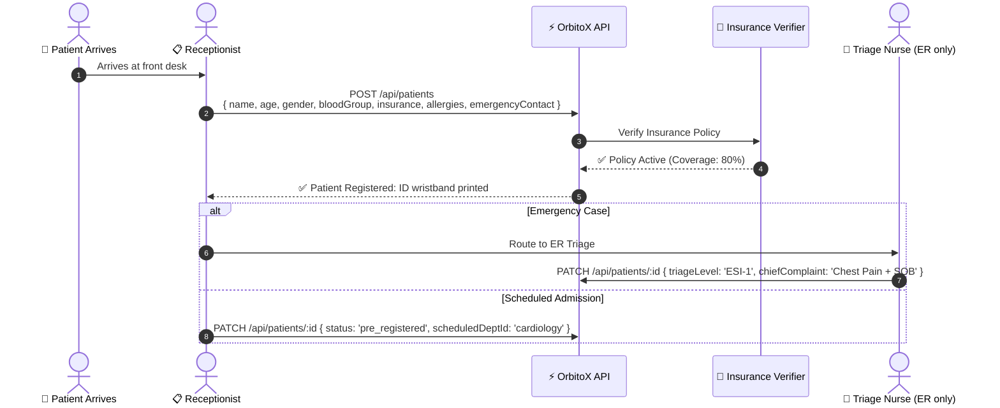
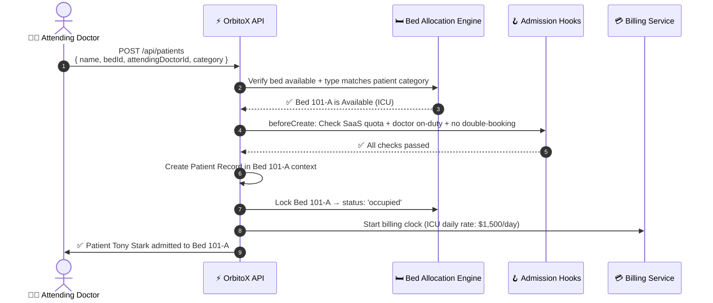
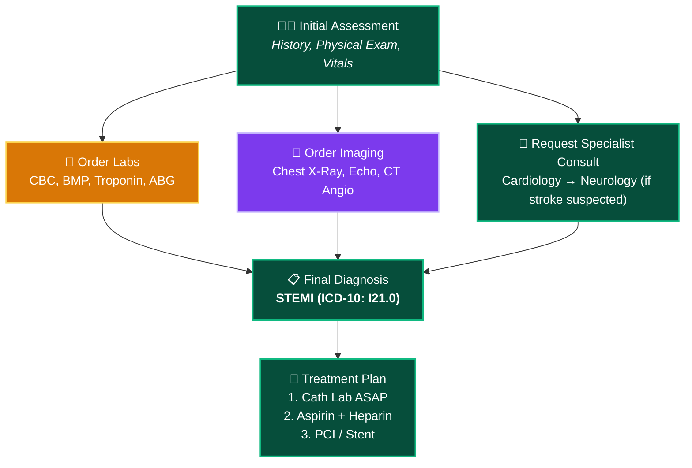
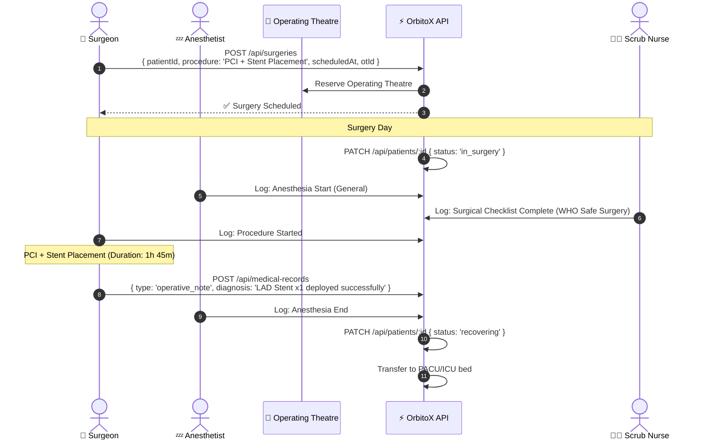
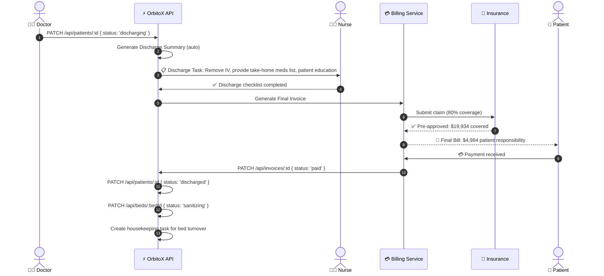
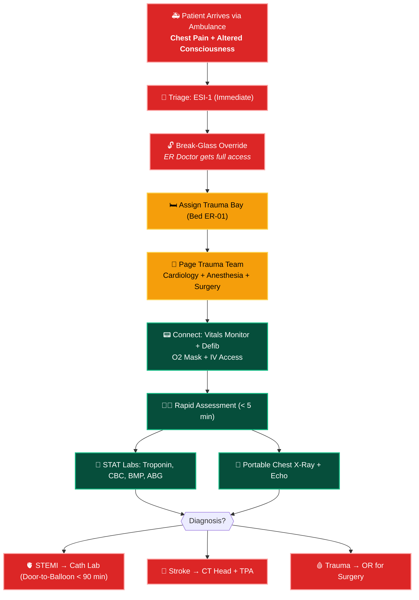

# 🏃 Patient Lifecycle Flow: Complete Journey Guide

> **The complete patient journey from pre-registration to post-discharge follow-up — including admission, triage, diagnosis, treatment, surgery, transfer, discharge, and billing settlement.**

---

## 📑 Table of Contents
1. [Complete Patient Lifecycle Overview](#1-complete-patient-lifecycle-overview)
2. [Patient Status State Machine](#2-patient-status-state-machine)
3. [Phase 1: Registration & Triage](#3-phase-1-registration--triage)
4. [Phase 2: Admission & Bed Assignment](#4-phase-2-admission--bed-assignment)
5. [Phase 3: Clinical Assessment & Diagnosis](#5-phase-3-clinical-assessment--diagnosis)
6. [Phase 4: Treatment & Medication](#6-phase-4-treatment--medication)
7. [Phase 5: Surgery (If Required)](#7-phase-5-surgery-if-required)
8. [Phase 6: Recovery & Monitoring](#8-phase-6-recovery--monitoring)
9. [Phase 7: Discharge & Billing](#9-phase-7-discharge--billing)
10. [Phase 8: Post-Discharge Follow-Up](#10-phase-8-post-discharge-follow-up)
11. [Emergency ER Fast-Track Flow](#11-emergency-er-fast-track-flow)
12. [Patient Transfer Flows (Internal & External)](#12-patient-transfer-flows-internal--external)

---

## 1. Complete Patient Lifecycle Overview

```mermaid
graph LR
    classDef phase fill:#1e293b,stroke:#3b82f6,stroke-width:2px,color:#fff;
    classDef active fill:#064e3b,stroke:#10b981,stroke-width:2px,color:#fff;
    classDef critical fill:#dc2626,stroke:#fca5a5,stroke-width:2px,color:#fff;

    P1["📋 Phase 1<br><b>Registration & Triage</b><br><i>Receptionist / Triage Nurse</i>"]:::phase
    P2["🛏️ Phase 2<br><b>Admission & Bed Lock</b><br><i>Doctor / System</i>"]:::active
    P3["🔬 Phase 3<br><b>Assessment & Diagnosis</b><br><i>Attending Doctor</i>"]:::active
    P4["💊 Phase 4<br><b>Treatment & Medication</b><br><i>Doctor → Pharmacy → Nurse</i>"]:::active
    P5["🔪 Phase 5<br><b>Surgery (if needed)</b><br><i>Surgeon + Anesthetist</i>"]:::critical
    P6["📟 Phase 6<br><b>Recovery & Monitoring</b><br><i>ICU/PACU Nurse + Telemetry</i>"]:::active
    P7["📤 Phase 7<br><b>Discharge & Billing</b><br><i>Doctor + Billing Admin</i>"]:::phase
    P8["📅 Phase 8<br><b>Post-Discharge Follow-Up</b><br><i>Outpatient Scheduler</i>"]:::phase

    P1 --> P2 --> P3 --> P4 --> P5 --> P6 --> P7 --> P8
    P4 -.-> |"No surgery needed"| P6
```



---

## 2. Patient Status State Machine



---

## 3. Phase 1: Registration & Triage

### 3.1 Walk-In Registration Flow



### 3.2 ER Triage Severity Levels (ESI Scale)

| ESI Level | Severity | Response Time | Example | Color Code |
| :---: | :--- | :--- | :--- | :---: |
| **ESI-1** | Immediate / Resuscitation | 0 min (NOW) | Cardiac arrest, massive hemorrhage | 🔴 |
| **ESI-2** | Emergent / High Risk | < 10 min | Chest pain, stroke symptoms, severe trauma | 🟠 |
| **ESI-3** | Urgent / Moderate | < 30 min | Abdominal pain, high fever, fracture | 🟡 |
| **ESI-4** | Less Urgent | < 60 min | Minor laceration, sprain, UTI symptoms | 🟢 |
| **ESI-5** | Non-Urgent | < 120 min | Medication refill, rash, cold symptoms | 🔵 |

```typescript
// Triage assessment
async function triagePatient(patientId: string, assessment: {
  chiefComplaint: string;
  vitalSigns: VitalsSnapshot;
  painScore: number;
  esiLevel: 1 | 2 | 3 | 4 | 5;
  triageNurseId: string;
}) {
  await orbitox.db.update('patient', patientId, {
    triageLevel: assessment.esiLevel,
    chiefComplaint: assessment.chiefComplaint,
    status: 'admitted'
  });

  // ESI-1 & ESI-2: Auto-assign to trauma bay + page on-call doctor
  if (assessment.esiLevel <= 2) {
    const availableBay = await findAvailableTraumaBay();
    await assignBed(patientId, availableBay.id);
    await orbitox.events.emit('er.code.trauma', {
      patientId, esiLevel: assessment.esiLevel, complaint: assessment.chiefComplaint
    });
  }
}
```

---

## 4. Phase 2: Admission & Bed Assignment



### Bed Selection Logic (Smart Matching)

```typescript
async function findBestBed(params: {
  departmentId: string;
  requiredType: BedType;
  patientCategory: PatientCategory;
  needsVentilator: boolean;
  needsIsolation: boolean;
}) {
  const beds = await orbitox.db.findMany('bed', {
    filter: { status: 'available', type: params.requiredType },
    contextId: params.departmentId
  });

  // Score each bed based on requirements
  const scored = beds.data.map(bed => {
    let score = 100;
    if (params.needsVentilator && !bed.attachedEquipment?.some(e => e.deviceType === 'mechanical_ventilator')) score -= 50;
    if (params.needsIsolation && !['isolation_negative_pressure', 'isolation_positive_pressure'].includes(bed.type)) score -= 80;
    if (params.patientCategory === 'vip' && bed.type !== 'private_suite') score -= 30;
    if (params.patientCategory === 'pediatric' && !['picu', 'nicu'].includes(bed.type)) score -= 60;
    if (bed.features?.hasAirMattress) score += 5; // Pressure ulcer prevention
    return { bed, score };
  });

  scored.sort((a, b) => b.score - a.score);
  if (scored[0]?.score < 50) throw new Error('No suitable bed found — consider surge deployment');
  return scored[0].bed;
}
```

---

## 5. Phase 3: Clinical Assessment & Diagnosis

### Initial Assessment Record

```typescript
// Doctor performs initial assessment
const assessment = await orbitox.db.create('medical_record', {
  patientId: patient.id,
  doctorId: drStrange.id,
  type: 'initial_assessment',
  diagnosis: 'Acute ST-Elevation Myocardial Infarction (STEMI)',
  icdCode: 'I21.0',
  clinicalNotes: 'Patient presents with severe substernal chest pain radiating to left arm. ECG shows ST elevation in leads II, III, aVF. Troponin elevated at 4.2 ng/mL.',
  vitals: {
    timestamp: new Date().toISOString(),
    heartRate: 112,
    bloodPressure: '90/60',
    spo2: 94,
    temperature: 37.2,
    respiratoryRate: 22,
    painScore: 9,
    glasgowComaScale: 15
  },
  attachments: []
}, bedContext.id);

// Order urgent labs
await orbitox.db.create('lab_order', {
  patientId: patient.id, orderedByDoctorId: drStrange.id,
  testType: 'Troponin', priority: 'stat', status: 'ordered', isCriticalValue: false
});
await orbitox.db.create('lab_order', {
  patientId: patient.id, orderedByDoctorId: drStrange.id,
  testType: 'CBC', priority: 'stat', status: 'ordered', isCriticalValue: false
});
await orbitox.db.create('lab_order', {
  patientId: patient.id, orderedByDoctorId: drStrange.id,
  testType: 'BMP', priority: 'stat', status: 'ordered', isCriticalValue: false
});
```

### Diagnostic Workflow



---

## 6. Phase 4: Treatment & Medication

### The Medication Pipeline (5 Safety Checks)

```mermaid
graph LR
    classDef doc fill:#2563eb,stroke:#93c5fd,stroke-width:2px,color:#fff;
    classDef pharm fill:#7c3aed,stroke:#c4b5fd,stroke-width:2px,color:#fff;
    classDef nurse fill:#059669,stroke:#6ee7b7,stroke-width:2px,color:#fff;
    classDef check fill:#dc2626,stroke:#fca5a5,stroke-width:2px,color:#fff;

    PRESCRIBE["👨‍⚕️ Doctor Prescribes<br>Aspirin 325mg PO STAT"]:::doc
    CHECK1["🔍 Check 1: Allergy Screen"]:::check
    CHECK2["🔍 Check 2: Drug Interaction"]:::check
    CHECK3["🔍 Check 3: Dose Validation"]:::check
    VERIFY["💊 Pharmacist Verifies"]:::pharm
    DISPENSE["📦 Pharmacy Dispenses"]:::pharm
    CHECK4["🔍 Check 4: Barcode Scan Match"]:::check
    ADMIN["💉 Nurse Administers"]:::nurse
    CHECK5["🔍 Check 5: 5 Rights Verification"]:::check
    LOG["✅ Logged in Audit Trail"]:::nurse

    PRESCRIBE --> CHECK1 --> CHECK2 --> CHECK3 --> VERIFY --> DISPENSE --> CHECK4 --> ADMIN --> CHECK5 --> LOG
```



### The 5 Rights of Medication Administration

| Right | Verification Method |
| :--- | :--- |
| **Right Patient** | Scan patient wristband barcode → match patient ID |
| **Right Drug** | Scan medication barcode → match active prescription |
| **Right Dose** | System validates dose against weight-based calculation |
| **Right Route** | Confirm: PO (oral), IV (intravenous), IM (intramuscular), SC (subcutaneous) |
| **Right Time** | Verify against scheduled administration time |

---

## 7. Phase 5: Surgery (If Required)



### Pre-Operative Checklist (WHO Safe Surgery)

| Step | Responsibility | Verification |
| :--- | :--- | :--- |
| Patient identity confirmed | Surgeon + Nurse | Wristband barcode scan |
| Procedure & site marked | Surgeon | Side/site marking confirmed |
| Consent form signed | Surgeon + Patient | Digital signature in system |
| Anesthesia safety check | Anesthetist | Airway assessment, allergies reviewed |
| Blood products available | Blood Bank | Cross-match completed |
| Antibiotics administered | Nurse | Within 1 hour before incision |
| Equipment sterile | Scrub Nurse | Autoclave indicator verified |
| Imaging available | Radiologist | CT/MRI images loaded in OT |

---

## 8. Phase 6: Recovery & Monitoring

```typescript
// Post-operative monitoring (ICU/PACU)
async function setupPostOpMonitoring(patientId: string, bedId: string) {
  // Set stricter vitals thresholds for post-operative patients
  await orbitox.db.update('bed', bedId, {
    telemetryThresholds: {
      minSpO2: 94,        // Stricter than default 90
      maxHeartRate: 120,   // Lower threshold post-surgery
      minHeartRate: 50,
      maxSystolicBP: 160,
      minSystolicBP: 90,
      maxTemperature: 38.5, // Watch for post-op fever
      minTemperature: 35.5,
      maxRespiratoryRate: 25
    }
  });

  // Schedule frequent vitals checks (every 15 minutes for first 4 hours)
  for (let i = 1; i <= 16; i++) {
    await orbitox.db.create('nurse_task', {
      patientId, taskType: 'record_vitals',
      description: `Post-Op Vitals Check #${i} (q15min)`,
      scheduledAt: new Date(Date.now() + i * 15 * 60000).toISOString(),
      status: 'pending'
    });
  }
}
```

---

## 9. Phase 7: Discharge & Billing



### Discharge Summary (Auto-Generated)

```typescript
async function generateDischargeSummary(patientId: string) {
  const patient = await orbitox.db.findById('patient', patientId);
  const records = await orbitox.db.findMany('medical_record', { filter: { patientId } });
  const treatments = await orbitox.db.findMany('treatment', { filter: { patientId } });
  const labResults = await orbitox.db.findMany('lab_order', { filter: { patientId, status: 'completed' } });

  return await orbitox.db.create('medical_record', {
    patientId, doctorId: patient.attendingDoctorId,
    type: 'discharge_summary',
    diagnosis: records.data[0]?.diagnosis || 'See notes',
    icdCode: records.data[0]?.icdCode || '',
    clinicalNotes: `
      DISCHARGE SUMMARY
      ─────────────────
      Patient: ${patient.name} (${patient.age}Y/${patient.gender})
      Admitted: ${patient.admittedAt}
      Discharged: ${new Date().toISOString()}
      Length of Stay: ${calculateLOS(patient.admittedAt)} days
      
      PRIMARY DIAGNOSIS: ${records.data[0]?.diagnosis}
      
      PROCEDURES PERFORMED:
      ${treatments.data.filter(t => t.type === 'surgery' || t.type === 'procedure').map(t => `- ${t.procedureOrDrug}`).join('\n')}
      
      MEDICATIONS AT DISCHARGE:
      ${treatments.data.filter(t => t.type === 'medication' && t.status !== 'cancelled').map(t => `- ${t.procedureOrDrug} ${t.dosage} ${t.route} ${t.frequency}`).join('\n')}
      
      FOLLOW-UP: Outpatient visit in 7 days with ${patient.attendingDoctorId}
    `,
    vitals: records.data[records.data.length - 1]?.vitals
  });
}
```

---

## 10. Phase 8: Post-Discharge Follow-Up

```typescript
// Schedule follow-up appointments after discharge
async function scheduleFollowUp(patientId: string, doctorId: string) {
  // Follow-up at 7 days
  await orbitox.db.create('appointment', {
    patientId, doctorId, type: 'follow_up',
    scheduledAt: new Date(Date.now() + 7 * 86400000).toISOString(),
    notes: 'Post-discharge wound check, medication review'
  });

  // Follow-up at 30 days
  await orbitox.db.create('appointment', {
    patientId, doctorId, type: 'follow_up',
    scheduledAt: new Date(Date.now() + 30 * 86400000).toISOString(),
    notes: 'Cardiac rehab assessment, echo follow-up'
  });

  // Send discharge instructions via SMS/Email
  await orbitox.events.emit('patient.discharge.instructions', {
    patientId,
    instructions: [
      'Take medications as prescribed',
      'No heavy lifting for 4 weeks',
      'Call 911 if chest pain returns',
      'Follow-up appointment on ' + new Date(Date.now() + 7 * 86400000).toLocaleDateString()
    ]
  });
}
```

---

## 11. Emergency ER Fast-Track Flow



---

## 12. Patient Transfer Flows (Internal & External)

### Internal Transfer (Ward to Ward)

```typescript
async function internalTransfer(params: {
  patientId: string;
  fromBedId: string;
  toBedId: string;
  reason: string;
  orderedByDoctorId: string;
}) {
  // 1. Verify destination bed is available
  const destBed = await orbitox.db.findById('bed', params.toBedId);
  if (destBed.status !== 'available') throw new Error('Destination bed not available');

  // 2. Update patient record
  await orbitox.db.update('patient', params.patientId, {
    bedId: params.toBedId, status: 'transferred'
  });

  // 3. Release source bed → sanitizing
  await orbitox.db.update('bed', params.fromBedId, { status: 'sanitizing' });

  // 4. Lock destination bed → occupied
  await orbitox.db.update('bed', params.toBedId, { status: 'occupied' });

  // 5. Copy context permissions to new bed node
  const patient = await orbitox.db.findById('patient', params.patientId);
  await orbitox.context.moveEntity(params.patientId, params.fromBedId, params.toBedId);

  // 6. Log transfer
  await orbitox.events.emit('patient.transferred', {
    patientId: params.patientId,
    from: params.fromBedId, to: params.toBedId,
    reason: params.reason, orderedBy: params.orderedByDoctorId
  });

  console.log(`🔄 Patient ${patient.name} transferred from ${params.fromBedId} → ${params.toBedId}`);
}
```

### Transfer Reason Categories

| Category | Example Reasons | Typical Flow |
| :--- | :--- | :--- |
| **Step-Up** | Patient deteriorating, needs ICU level care | General Ward → ICU |
| **Step-Down** | Patient improving, no longer needs ICU | ICU → General Ward |
| **Specialty Transfer** | Needs department-specific care | Cardiology → Cardiac Surgery |
| **Isolation** | Infectious disease confirmed | Any Ward → Isolation Room |
| **Capacity** | Current ward is full, but another has space | Ward A → Ward B (same dept) |
| **Cross-Branch** | Specialist treatment only available at another hospital | Branch A → Branch B |

---

### 🔗 Related Guides:
- 🏥 [**Hospital SaaS Master Guide**](./HOSPITAL_SAAS_DEVELOPER_GUIDE.md)
- 👨‍⚕️ [**Doctors & Clinical Staff**](./DOCTORS_AND_CLINICAL_STAFF.md)
- 🛏️ [**Rooms, Beds & Equipment**](./ROOMS_BEDS_AND_EQUIPMENT.md)
- 🏢 [**Branches & Departments**](./BRANCHES_AND_DEPARTMENTS.md)
- 📊 [**Admin Dashboards & KPIs**](./PLATFORM_ADMIN_AND_DASHBOARDS.md)
- 💊 [**Pharmacy, Lab & Billing**](./PHARMACY_LAB_AND_BILLING.md)
