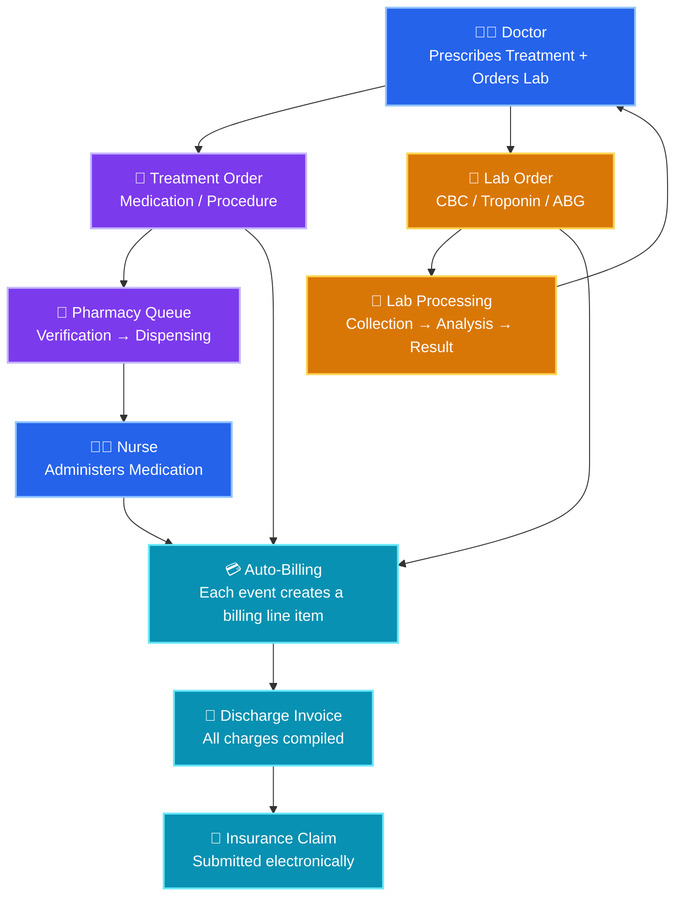
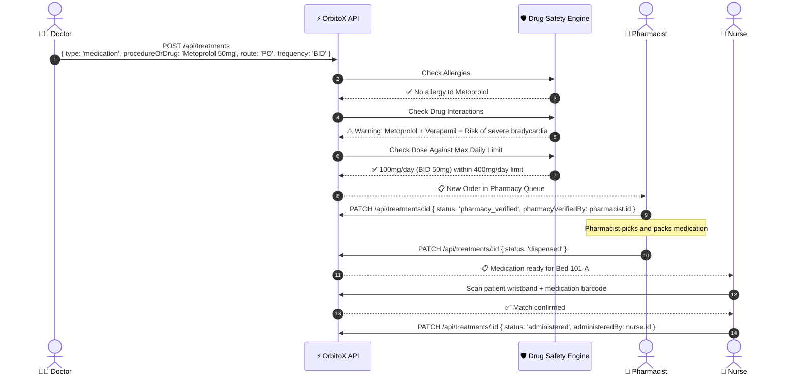
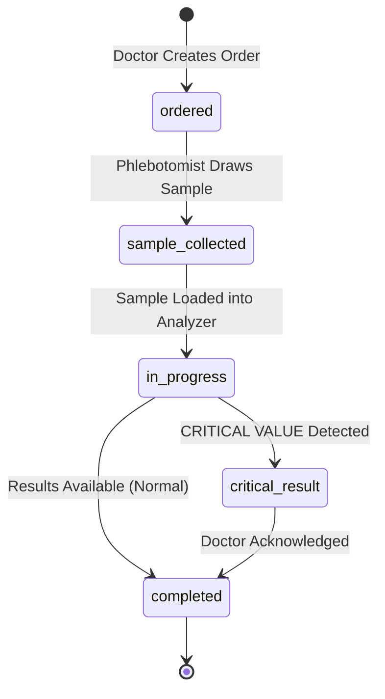
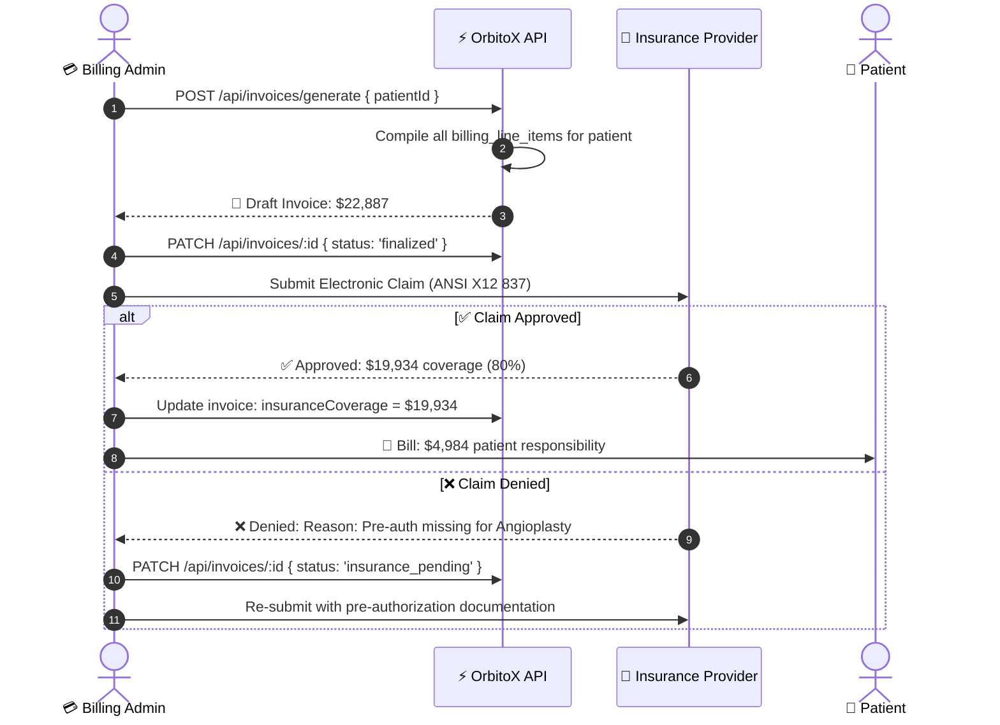
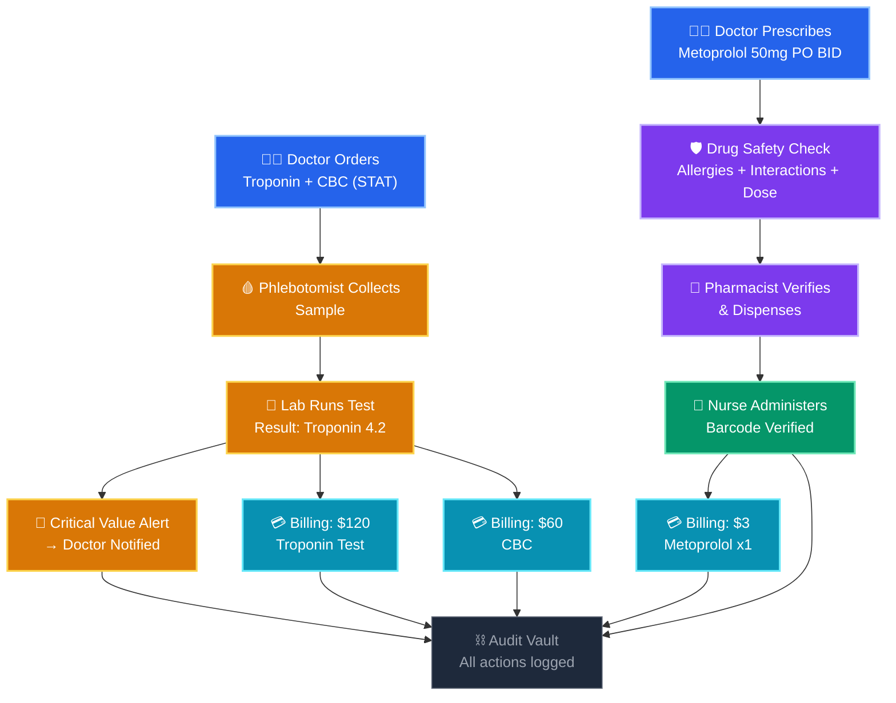

# 💊 Pharmacy, Lab & Billing: Complete Sub-Systems Guide

> **Full implementation guide for the three critical hospital support systems — Pharmacy dispensing & drug safety, Pathology lab order pipeline, and Billing/Invoice/Insurance claims management.**

---

## 📑 Table of Contents
1. [Sub-System Architecture](#1-sub-system-architecture)
2. [Pharmacy: Drug Management & Dispensing](#2-pharmacy-drug-management--dispensing)
3. [Lab: Pathology Orders & Critical Values](#3-lab-pathology-orders--critical-values)
4. [Billing: Invoicing & Insurance Claims](#4-billing-invoicing--insurance-claims)
5. [Integration: How All Three Connect](#5-integration-how-all-three-connect)
6. [Real-World Problem Solving](#6-real-world-problem-solving)

---

## 1. Sub-System Architecture



---

## 2. Pharmacy: Drug Management & Dispensing

### 2.1 Drug Catalog Entity

```typescript
export interface DrugCatalogEntry {
  id: string;
  genericName: string;           // 'Metoprolol Tartrate'
  brandNames: string[];          // ['Lopressor', 'Toprol']
  category: 'cardiovascular' | 'antibiotic' | 'analgesic' | 'anticoagulant' | 'narcotic' | 'insulin' | 'other';
  isControlledSubstance: boolean; // Requires double-verification if true
  defaultDose: string;           // '50mg'
  availableRoutes: string[];     // ['PO', 'IV']
  contraindicatedWith: string[]; // Drug IDs that interact
  maxDailyDose: string;          // '400mg'
  requiresRenal: boolean;        // Dose adjustment for kidney disease
  requiresHepatic: boolean;      // Dose adjustment for liver disease
  stockQuantity: number;
  reorderLevel: number;          // Alert when stock drops below this
  unitPrice: number;
}
```

### 2.2 Pharmacy Dispensing Workflow



### 2.3 Drug Interaction Check

```typescript
async function checkDrugInteractions(patientId: string, newDrugId: string): Promise<{
  safe: boolean; warnings: string[];
}> {
  const activeMeds = await orbitox.db.findMany('treatment', {
    filter: { patientId, status: 'administered', type: 'medication' }
  });
  const newDrug = await orbitox.db.findById('drug_catalog', newDrugId);
  const warnings: string[] = [];

  for (const med of activeMeds.data) {
    const existingDrug = await orbitox.db.findById('drug_catalog', med.drugCatalogId);
    if (existingDrug && newDrug.contraindicatedWith?.includes(existingDrug.id)) {
      warnings.push(`⚠️ ${newDrug.genericName} + ${existingDrug.genericName}: ${getInteractionReason(newDrug.id, existingDrug.id)}`);
    }
  }

  // Check patient allergies
  const patient = await orbitox.db.findById('patient', patientId);
  if (patient.allergies.some(a => newDrug.genericName.toLowerCase().includes(a.toLowerCase()) || newDrug.brandNames.some(b => b.toLowerCase().includes(a.toLowerCase())))) {
    warnings.push(`🚨 CRITICAL: Patient is allergic to ${newDrug.genericName}!`);
  }

  return { safe: warnings.length === 0, warnings };
}
```

### 2.4 Controlled Substance Protocol

| Rule | Implementation |
| :--- | :--- |
| **Double Verification** | Two pharmacists must verify before dispensing narcotics |
| **Witness Administration** | Nurse + witness sign-off for narcotic injections |
| **Inventory Count** | Real-time narcotic count updated on every dispense |
| **Wastage Witness** | Partial-dose wastage requires witness signature + logged reason |
| **Prescribing Limit** | Max 72-hour supply for Schedule II without renewal |

---

## 3. Lab: Pathology Orders & Critical Values

### 3.1 Lab Order Pipeline



### 3.2 Common Lab Tests Reference

| Test | `testType` | Sample Type | TAT (Routine) | TAT (STAT) | Critical Values |
| :--- | :--- | :--- | :--- | :--- | :--- |
| **Complete Blood Count** | `CBC` | Blood (EDTA tube) | 2–4 hours | 30 min | WBC > 30k or < 2k |
| **Basic Metabolic Panel** | `BMP` | Blood (SST tube) | 2–4 hours | 30 min | K+ > 6.5 or < 2.5, Na+ < 120 |
| **Comprehensive Metabolic** | `CMP` | Blood (SST tube) | 4–6 hours | 1 hour | Creatinine > 10, Glucose < 40 |
| **Liver Function Tests** | `LFT` | Blood (SST tube) | 4–6 hours | 1 hour | Bilirubin > 15 |
| **Arterial Blood Gas** | `ABG` | Arterial blood | 30 min | 15 min | pH < 7.20 or > 7.60 |
| **Troponin** | `Troponin` | Blood (SST tube) | 1 hour | 15 min | > 0.04 ng/mL (any elevation) |
| **D-Dimer** | `D-Dimer` | Blood (Citrate tube) | 2 hours | 30 min | > 500 ng/mL |
| **PT/INR** | `PT_INR` | Blood (Citrate tube) | 1 hour | 15 min | INR > 5.0 |
| **Urinalysis** | `Urinalysis` | Urine | 2 hours | 30 min | Positive for drugs of abuse |
| **Blood Culture** | `Blood_Culture` | Blood (2 sets) | 24–72 hours | N/A | Positive (any growth) |
| **COVID-19 PCR** | `COVID_PCR` | Nasopharyngeal swab | 6–24 hours | 2 hours | Positive |
| **HbA1c** | `HbA1c` | Blood (EDTA tube) | 4–6 hours | 1 hour | > 14% |
| **TSH** | `TSH` | Blood (SST tube) | 4–6 hours | 1 hour | > 100 or < 0.01 |

### 3.3 Critical Value Notification Implementation

```typescript
orbitox.events.on('lab.result.completed', async (payload) => {
  const { labOrderId, testType, resultValue, normalRange, isCritical } = payload;

  if (isCritical) {
    const order = await orbitox.db.findById('lab_order', labOrderId);
    
    // 1. Mark as critical
    await orbitox.db.update('lab_order', labOrderId, {
      status: 'critical_result', isCriticalValue: true
    });

    // 2. Immediate doctor notification (multi-channel)
    await orbitox.events.emit('lab.result.critical', {
      labOrderId,
      patientId: order.patientId,
      doctorId: order.orderedByDoctorId,
      testType,
      resultValue,
      normalRange,
      message: `🚨 CRITICAL LAB: ${testType} = ${resultValue} (Normal: ${normalRange})`
    });

    // 3. Start acknowledgment timer (must be acknowledged within 30 minutes)
    await orbitox.events.emit('lab.critical.ack.timer', {
      labOrderId, doctorId: order.orderedByDoctorId,
      deadline: new Date(Date.now() + 30 * 60000).toISOString()
    });

    // 4. Log in audit trail
    console.log(`🚨 [Critical Lab] ${testType}: ${resultValue} for Patient ${order.patientId}`);
  }
});
```

---

## 4. Billing: Invoicing & Insurance Claims

### 4.1 Billing Line Item Types

| Line Type | Source Event | Auto-Generated? | Example |
| :--- | :--- | :---: | :--- |
| `bed_charge` | Patient admitted, daily at midnight | ✅ Auto | "ICU Bed 101-A — Day 3" ($1,500) |
| `consultation_fee` | Medical record created | ✅ Auto | "Cardiology Consult — Dr. Strange" ($350) |
| `procedure_fee` | Treatment with type 'procedure' or 'surgery' | ✅ Auto | "Coronary Angioplasty" ($12,000) |
| `medication` | Treatment dispensed | ✅ Auto | "Metoprolol 50mg x 14 days" ($42) |
| `lab_test` | Lab order completed | ✅ Auto | "Troponin + CBC + BMP" ($360) |
| `imaging` | Radiology order completed | ✅ Auto | "Chest X-Ray + Echocardiogram" ($500) |
| `equipment_usage` | Special equipment hours | Manual | "ECMO Circuit — 48 hours" ($8,000) |
| `nursing_care` | Per-day based on ward type | ✅ Auto | "ICU Nursing Care — Day 5" ($200) |

### 4.2 Auto-Billing Event Listener

```typescript
// Auto-create billing line items from clinical events
orbitox.events.on('treatment.administered', async (payload) => {
  const treatment = payload.record;
  const drug = await orbitox.db.findById('drug_catalog', treatment.drugCatalogId);

  await orbitox.db.create('billing_line_item', {
    patientId: treatment.patientId,
    type: 'medication',
    description: `${treatment.procedureOrDrug} ${treatment.dosage} (${treatment.route})`,
    quantity: 1,
    unitPrice: drug?.unitPrice || 0,
    totalPrice: drug?.unitPrice || 0,
    date: new Date().toISOString()
  });
});

orbitox.events.on('lab.result.completed', async (payload) => {
  await orbitox.db.create('billing_line_item', {
    patientId: payload.patientId,
    type: 'lab_test',
    description: `Lab Test: ${payload.testType}`,
    quantity: 1,
    unitPrice: getLabTestPrice(payload.testType),
    totalPrice: getLabTestPrice(payload.testType),
    date: new Date().toISOString()
  });
});

// Daily bed charge (runs at midnight via cron)
async function generateDailyBedCharges() {
  const occupiedBeds = await orbitox.db.findMany('bed', { filter: { status: 'occupied' } });
  for (const bed of occupiedBeds.data) {
    const patient = await orbitox.db.findMany('patient', { filter: { bedId: bed.id, status: 'admitted' } });
    if (patient.data.length > 0) {
      await orbitox.db.create('billing_line_item', {
        patientId: patient.data[0].id,
        type: 'bed_charge',
        description: `${bed.label} (${bed.type}) — Daily Charge`,
        quantity: 1,
        unitPrice: bed.dailyRate,
        totalPrice: bed.dailyRate,
        date: new Date().toISOString()
      });
    }
  }
}
```

### 4.3 Insurance Claim Workflow



### 4.4 Insurance Types & Coverage Matrix

| Insurance Type | `InsuranceType` | Coverage % | Pre-Auth Required | Claim Process |
| :--- | :--- | :---: | :---: | :--- |
| **Private Insurance** | `private` | 60–90% | Some procedures | Electronic claim (X12 837) |
| **Government (Medicare/Medicaid)** | `government` | 80–100% | Most procedures | CMS submission |
| **Corporate / Employer** | `corporate` | 70–95% | Varies by plan | Direct billing to employer |
| **Self-Pay** | `self_pay` | 0% | N/A | Direct patient payment |
| **Charity / Free** | `charity` | 100% (hospital absorbs) | N/A | Internal write-off |

---

## 5. Integration: How All Three Connect

### The Complete Event Chain (Doctor Prescribes → Pharmacy → Nurse → Billing)



---

## 6. Real-World Problem Solving

| Problem | Scenario | Solution |
| :--- | :--- | :--- |
| **Wrong medication dispensed** | Nurse gives Metformin instead of Metoprolol | Barcode scanning at point-of-administration catches mismatches before drug reaches patient |
| **Drug allergy not caught** | Patient allergic to Penicillin, doctor prescribes Amoxicillin (same class) | Drug safety engine detects cross-reactivity between Penicillin class antibiotics |
| **Critical lab result ignored** | Potassium 7.2 mEq/L (normal: 3.5–5.0) but doctor doesn't see result for 2 hours | Auto-notification with 30-minute acknowledgment deadline; escalation to Dept Head if unacknowledged |
| **Pharmacy stock-out** | Heparin runs out during peak hours | Inventory alert at reorder level → auto-purchase order to supplier |
| **Billing leakage** | ICU bed charge not captured for 2 of 5 days | Midnight cron job auto-generates daily bed charges for all occupied beds |
| **Insurance claim denied** | Missing pre-authorization for emergency surgery | Pre-auth check at treatment.ordered → warn doctor + billing before procedure |
| **Duplicate lab orders** | Two doctors order the same CBC within 30 minutes | Duplicate detection: warn if same test ordered for same patient within configurable window |
| **Narcotic diversion** | Nurse draws morphine but disposes instead of administering | Controlled substance protocol: wastage requires witness + real-time inventory reconciliation |

---

### 🔗 Related Guides:
- 🏥 [**Hospital SaaS Master Guide**](./HOSPITAL_SAAS_DEVELOPER_GUIDE.md)
- 🏃 [**Patient Lifecycle Flow**](./PATIENT_LIFECYCLE_FLOW.md)
- 👨‍⚕️ [**Doctors & Clinical Staff**](./DOCTORS_AND_CLINICAL_STAFF.md)
- 📊 [**Admin Dashboards & KPIs**](./PLATFORM_ADMIN_AND_DASHBOARDS.md)
