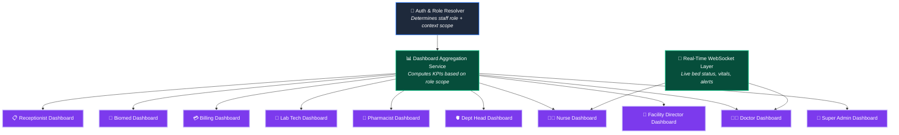
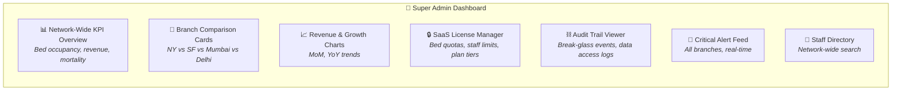
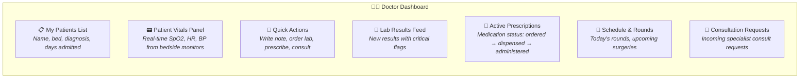
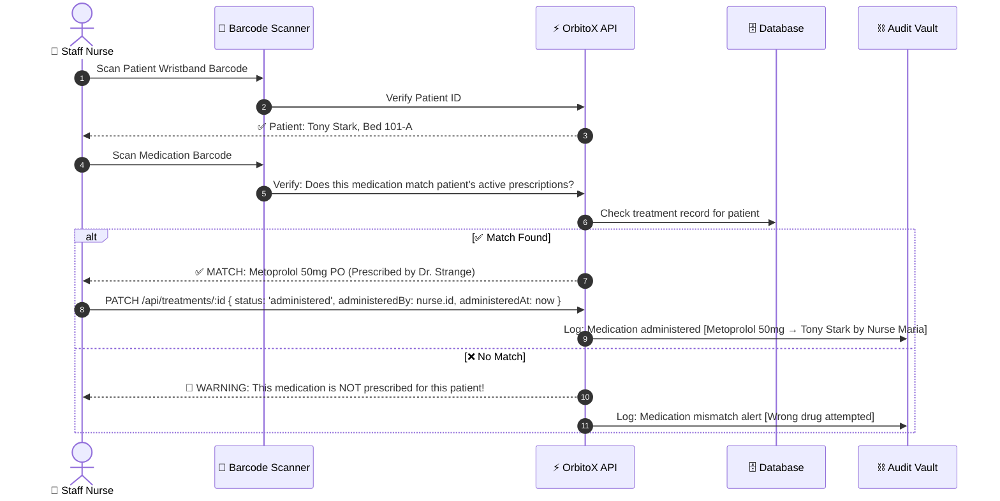
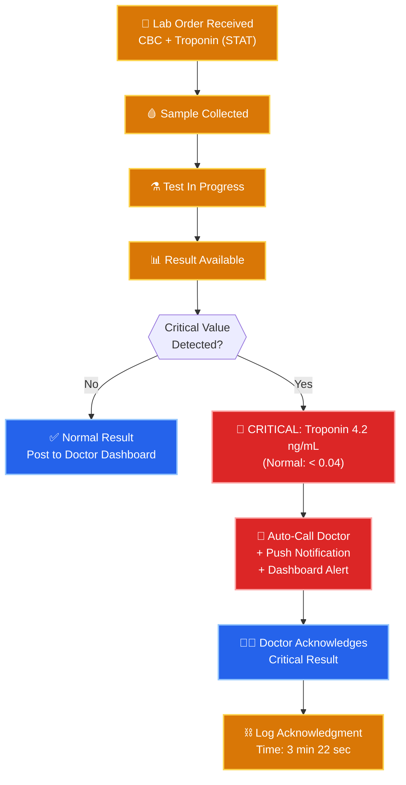
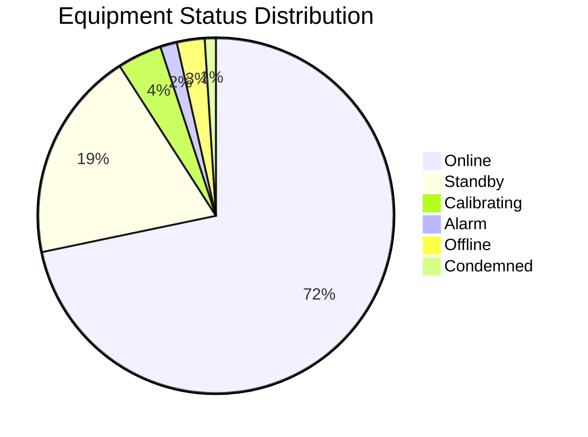

# 📊 Platform Admin & Role-Based Dashboards: Complete Guide

> **How to build and configure role-based dashboards for every hospital role — from Super Admin network-wide analytics to bedside nurse vitals panels. Includes KPI definitions, widget specifications, and implementation code.**

---

## 📑 Table of Contents
1. [Dashboard Architecture Overview](#1-dashboard-architecture-overview)
2. [Super Admin Dashboard](#2-super-admin-dashboard)
3. [Facility Director Dashboard](#3-facility-director-dashboard)
4. [Department Head Dashboard](#4-department-head-dashboard)
5. [Doctor Dashboard (Attending & Specialist)](#5-doctor-dashboard-attending--specialist)
6. [Head Nurse & Staff Nurse Dashboard](#6-head-nurse--staff-nurse-dashboard)
7. [Pharmacist Dashboard](#7-pharmacist-dashboard)
8. [Lab Technician Dashboard](#8-lab-technician-dashboard)
9. [Billing Admin Dashboard](#9-billing-admin-dashboard)
10. [Biomed Engineer Dashboard](#10-biomed-engineer-dashboard)
11. [Receptionist Dashboard](#11-receptionist-dashboard)
12. [Dashboard Data Service Implementation](#12-dashboard-data-service-implementation)

---

## 1. Dashboard Architecture Overview



### How It Works

1. **Staff logs in** → Auth middleware resolves their `StaffRole` and `contextId` (e.g., which department, ward)
2. **Dashboard API call** → `GET /api/dashboard` returns role-specific widgets and data
3. **Context scoping** → OrbitoX automatically filters data to only what the staff member is authorized to see
4. **Real-time updates** → Bed status changes, vitals alarms, and new orders push via WebSocket

---

## 2. Super Admin Dashboard

> **Scope:** Entire hospital network (all branches, all departments, all data)



### Widget Details

| Widget | Data Source | Refresh Rate | Actions Available |
| :--- | :--- | :--- | :--- |
| **Network KPI Overview** | Aggregated from all branches | Every 5 min | Drill down into branch |
| **Branch Comparison** | Per-branch KPI queries | Every 5 min | View branch detail, export report |
| **Revenue Charts** | Billing module aggregation | Daily | Filter by branch, department |
| **SaaS License Manager** | `orbitox.billing` quota service | Real-time | Upgrade plan, adjust quotas |
| **Audit Trail** | Crypto audit vault | Real-time | Search by staff, patient, action type |
| **Critical Alert Feed** | `vitals.alarm.critical` + `staffing.shortage` events | Real-time (WebSocket) | Acknowledge, escalate |
| **Staff Directory** | Staff entity + context tree | On-demand | Search, filter by role/dept/branch |

### KPI Definitions

| KPI | Formula | Target |
| :--- | :--- | :--- |
| **Bed Occupancy Rate** | (Occupied Beds / Total Beds) × 100 | 80–85% |
| **Average Length of Stay (ALOS)** | Total Patient Days / Total Discharges | Varies by dept |
| **ER Door-to-Doctor Time** | Avg time from ER registration to first doctor assessment | < 15 min |
| **Patient Mortality Rate** | (Deaths / Total Admissions) × 100 | < 2% |
| **Staff-to-Patient Ratio** | On-duty staff / Occupied beds (per ward type) | ICU: 1:2, Ward: 1:6 |
| **Equipment Uptime** | (Online Hours / Total Hours) × 100 | > 98% |
| **Revenue per Bed** | Monthly Revenue / Total Beds | Track trend |
| **Insurance Claim Success Rate** | (Approved Claims / Total Claims) × 100 | > 90% |

---

## 3. Facility Director Dashboard

> **Scope:** Single hospital branch (e.g., Apollo New York only)

| Widget | Description |
| :--- | :--- |
| **Branch Bed Census** | Real-time visual grid showing all beds, color-coded by status (green=available, red=occupied, yellow=sanitizing, grey=maintenance) |
| **Department Occupancy Bars** | Horizontal bar chart showing occupancy % per department |
| **ER Live Queue** | Number of patients waiting, average wait time, triage severity breakdown |
| **Staff On-Duty Count** | Bar chart showing on-duty staff per department and role |
| **Today's Admissions & Discharges** | Two-column summary with patient names and bed assignments |
| **Pending Transfers** | Incoming and outgoing cross-branch transfer requests |
| **Monthly Revenue Summary** | Revenue breakdown by department (Cardio, Neuro, etc.) |
| **Compliance Dashboard** | HIPAA/NABH compliance checklist status |

---

## 4. Department Head Dashboard

> **Scope:** Their department + all wards, rooms, beds within it

| Widget | Description |
| :--- | :--- |
| **Ward Bed Grid** | Visual map of all beds in the department, click to view patient details |
| **Patient Census** | Total admitted, discharging, new today, critical patients |
| **Staff Schedule** | Which doctors and nurses are on duty, next shift handoff time |
| **Pending Consultations** | Incoming peer mesh requests from other departments |
| **Lab Results Pending** | Ordered labs not yet completed, with priority flags |
| **Department Revenue** | This month's revenue contribution |
| **Quality Metrics** | Readmission rate, infection rate, medication error rate |

---

## 5. Doctor Dashboard (Attending & Specialist)

> **Scope:** Only their assigned patients (attending) or active consultations (specialist)



### Quick Actions Bar

| Action Button | API Call | Permissions |
| :--- | :--- | :--- |
| **📝 Write Progress Note** | `POST /api/medical-records` with `type: 'progress_note'` | Attending, Dept Head |
| **🔬 Order Lab Test** | `POST /api/lab-orders` with `testType` and `priority` | Attending, Dept Head |
| **💊 Prescribe Medication** | `POST /api/treatments` with `type: 'medication'` | Attending, Dept Head |
| **🧠 Request Consultation** | `POST /api/consultations` with `targetDeptId` | Any Doctor |
| **📤 Initiate Discharge** | `PATCH /api/patients/:id` with `status: 'discharging'` | Attending only |
| **🚨 Emergency Override** | `POST /api/security/break-glass` with `reason` | ER Doctor only |

---

## 6. Head Nurse & Staff Nurse Dashboard

> **Head Nurse Scope:** Entire ward | **Staff Nurse Scope:** Assigned beds only

### Head Nurse Dashboard

| Widget | Description |
| :--- | :--- |
| **Ward Bed Map** | Visual grid of all beds with patient status indicators |
| **Nurse Assignment Table** | Which nurse is assigned to which beds |
| **Medication Round Queue** | All pending medication administrations for the shift |
| **Vitals Alarm Panel** | Active alarms from all monitored beds (SpO2, HR, BP) |
| **Discharge Prep Checklist** | Patients discharging today — pending tasks |
| **Staff Shortage Alert** | Nurse-to-patient ratio vs required minimum |
| **Housekeeping Tracker** | Beds in `sanitizing` status with estimated completion |

### Staff Nurse Dashboard

| Widget | Description |
| :--- | :--- |
| **My Beds** | 2–6 beds assigned this shift, with patient name and key vitals |
| **My Task Queue** | Ordered by time: medication rounds, vitals recording, wound dressing, IV changes |
| **Current Vitals** | Real-time vitals from bedside monitors (SpO2, HR, BP, Temp, RR) |
| **Medication To Administer** | Drug name, dosage, route, time, patient — scan barcode to confirm |
| **Critical Alerts** | Any alarms from assigned beds |

### Medication Administration Workflow



---

## 7. Pharmacist Dashboard

> **Scope:** Central Pharmacy — all treatment orders across hospital

| Widget | Description |
| :--- | :--- |
| **Dispensing Queue** | All `treatment.status === 'ordered'` items, sorted by priority (STAT first) |
| **Drug Interaction Checker** | Flags when new prescription conflicts with patient's current medications |
| **Controlled Substance Log** | Narcotics dispensing with double-verification requirement |
| **Inventory Alerts** | Medications running low or expiring soon |
| **Prescription Verification** | Compare prescribed drug with patient's allergies, weight-based dosing |

### Pharmacy Verification Flow
```typescript
orbitox.events.on('treatment.ordered', async (payload) => {
  const treatment = payload.record;
  const patient = await orbitox.db.findById('patient', treatment.patientId);
  
  // 1. Check drug allergies
  if (patient.allergies.some(a => treatment.procedureOrDrug.toLowerCase().includes(a.toLowerCase()))) {
    await orbitox.events.emit('pharmacy.allergy.alert', {
      patientId: patient.id, drug: treatment.procedureOrDrug, allergies: patient.allergies
    });
  }

  // 2. Check drug interactions with existing medications
  const activeMeds = await orbitox.db.findMany('treatment', {
    filter: { patientId: patient.id, status: 'administered', type: 'medication' }
  });
  // ... drug interaction logic ...

  // 3. Add to pharmacist queue for manual verification
  console.log(`💊 [Pharmacy Queue] ${treatment.procedureOrDrug} for ${patient.name} — awaiting verification`);
});
```

---

## 8. Lab Technician Dashboard

> **Scope:** Pathology Lab — all lab orders across hospital

| Widget | Description |
| :--- | :--- |
| **Order Queue** | All pending lab orders, sorted by priority (STAT → Urgent → Routine) |
| **Sample Collection Tracker** | Which samples have been collected, which are pending |
| **Test In Progress** | Tests currently being processed with ETA |
| **Critical Value Alerts** | Abnormal results that require immediate doctor notification |
| **Equipment Status** | Analyzer status (online/offline/calibrating) |
| **Quality Control Log** | Daily QC checks for analyzers |

### Lab Critical Value Notification Flow


---

## 9. Billing Admin Dashboard

> **Scope:** Finance department — all invoices, claims, payments

| Widget | Description |
| :--- | :--- |
| **Today's Discharges** | Patients discharging today with auto-generated invoice previews |
| **Pending Invoices** | Draft invoices awaiting finalization |
| **Insurance Claims Tracker** | Submitted → Under Review → Approved / Rejected pipeline |
| **Revenue Summary** | Daily, weekly, monthly revenue with department breakdown |
| **Payment Collection** | Outstanding patient dues, payment plans |
| **Overdue Accounts** | Patients with unpaid bills > 30 days |

### Auto-Invoice Breakdown Example

| Line Item | Type | Quantity | Unit Price | Total |
| :--- | :--- | :---: | :---: | :---: |
| ICU Bed 101-A (5 days) | `bed_charge` | 5 | $1,500 | $7,500 |
| Dr. Strange — Cardiology Consult | `consultation_fee` | 3 | $350 | $1,050 |
| Coronary Angioplasty | `procedure_fee` | 1 | $12,000 | $12,000 |
| Nitroglycerin IV Infusion | `medication` | 7 | $45 | $315 |
| Metoprolol 50mg PO | `medication` | 14 | $3 | $42 |
| CBC + BMP + Troponin | `lab_test` | 4 | $120 | $480 |
| Chest X-Ray + Echo | `imaging` | 2 | $250 | $500 |
| Nursing Care (ICU level) | `nursing_care` | 5 | $200 | $1,000 |
| | | | **Subtotal** | **$22,887** |
| | | | Tax (8.875%) | $2,031 |
| | | | Insurance Coverage (80%) | -$19,934 |
| | | | **Patient Due** | **$4,984** |

---

## 10. Biomed Engineer Dashboard

> **Scope:** All medical equipment across the hospital

| Widget | Description |
| :--- | :--- |
| **Equipment Status Grid** | All devices color-coded: 🟢 Online, 🟡 Standby, 🔴 Alarm, ⚫ Offline |
| **Maintenance Calendar** | Upcoming calibrations and preventive maintenance schedule |
| **Overdue Maintenance** | Devices past their maintenance due date — CRITICAL |
| **Work Order Queue** | Repair requests from nurses and doctors |
| **Condemned Equipment** | Devices beyond repair, pending disposal |
| **Inventory Tracker** | Spare parts, replacement device availability |

### Equipment Health Summary



---

## 11. Receptionist Dashboard

> **Scope:** Front desk — patient registration, appointments, visitor management

| Widget | Description |
| :--- | :--- |
| **Patient Registration Form** | Quick admission form with insurance verification |
| **Bed Availability Board** | Real-time availability by department and type |
| **Today's Appointments** | Scheduled visits, OPD queue |
| **Visitor Check-In** | Visitor name, patient they're visiting, visiting hours compliance |
| **Discharge Queue** | Patients cleared for discharge — pending billing settlement |
| **Insurance Pre-Auth** | Real-time insurance verification before admission |

---

## 12. Dashboard Data Service Implementation

### Core Dashboard Service

```typescript
import { orbitox } from '@orbitox/runtime';

export class DashboardService {
  // Get role-specific dashboard data
  static async getDashboard(staffId: string) {
    const staff = await orbitox.db.findById('staff', staffId);
    if (!staff) throw new Error('Staff not found');

    switch (staff.role) {
      case 'super_admin':
        return this.getSuperAdminDashboard();
      case 'facility_director':
        return this.getFacilityDashboard(staff.departmentId);
      case 'department_head':
        return this.getDeptHeadDashboard(staff.departmentId);
      case 'attending_doctor':
      case 'specialist_doctor':
        return this.getDoctorDashboard(staffId, staff.departmentId);
      case 'head_nurse':
        return this.getHeadNurseDashboard(staff.departmentId);
      case 'staff_nurse':
        return this.getStaffNurseDashboard(staffId);
      case 'pharmacist':
        return this.getPharmacistDashboard();
      case 'lab_technician':
        return this.getLabTechDashboard();
      case 'billing_admin':
        return this.getBillingDashboard();
      case 'biomed_engineer':
        return this.getBiomedDashboard();
      case 'receptionist':
        return this.getReceptionistDashboard();
      default:
        throw new Error(`No dashboard configured for role: ${staff.role}`);
    }
  }

  // ─── Super Admin: Network-wide KPIs ──────────────────────────
  static async getSuperAdminDashboard() {
    const allBeds = await orbitox.db.findMany('bed');
    const allPatients = await orbitox.db.findMany('patient', { filter: { status: 'admitted' } });
    const allStaff = await orbitox.db.findMany('staff', { filter: { isOnDuty: true } });

    const totalBeds = allBeds.data.length;
    const occupiedBeds = allBeds.data.filter(b => b.status === 'occupied').length;

    return {
      role: 'super_admin',
      kpis: {
        bedOccupancyRate: Math.round((occupiedBeds / totalBeds) * 100),
        totalPatients: allPatients.data.length,
        staffOnDuty: allStaff.data.length,
        availableBeds: totalBeds - occupiedBeds,
        criticalAlerts: 0 // Populated by WebSocket
      },
      widgets: ['network_kpi', 'branch_comparison', 'revenue_charts', 'license_manager', 'audit_trail', 'alert_feed']
    };
  }

  // ─── Doctor: Patient-scoped data ─────────────────────────────
  static async getDoctorDashboard(doctorId: string, deptId: string) {
    const myPatients = await orbitox.db.findMany('patient', {
      filter: { attendingDoctorId: doctorId, status: 'admitted' }, contextId: deptId
    });
    const pendingLabs = await orbitox.db.findMany('lab_order', {
      filter: { orderedByDoctorId: doctorId, status: 'ordered' }, contextId: deptId
    });
    const activeTreatments = await orbitox.db.findMany('treatment', {
      filter: { prescribedByDoctorId: doctorId, status: 'ordered' }, contextId: deptId
    });

    return {
      role: 'doctor',
      patients: myPatients.data,
      pendingLabOrders: pendingLabs.data.length,
      activePrescriptions: activeTreatments.data.length,
      widgets: ['patient_list', 'vitals_panel', 'quick_actions', 'lab_results', 'prescriptions', 'schedule', 'consultations']
    };
  }

  // ─── Head Nurse: Ward-level data ─────────────────────────────
  static async getHeadNurseDashboard(wardId: string) {
    const wardBeds = await orbitox.db.findMany('bed', { contextId: wardId });
    const occupiedBeds = wardBeds.data.filter(b => b.status === 'occupied');
    const sanitizingBeds = wardBeds.data.filter(b => b.status === 'sanitizing');
    const onDutyNurses = await orbitox.db.findMany('staff', {
      filter: { role: 'staff_nurse', isOnDuty: true }, contextId: wardId
    });

    const ratio = occupiedBeds.length / Math.max(onDutyNurses.data.length, 1);

    return {
      role: 'head_nurse',
      bedSummary: {
        total: wardBeds.data.length,
        occupied: occupiedBeds.length,
        available: wardBeds.data.filter(b => b.status === 'available').length,
        sanitizing: sanitizingBeds.length
      },
      nursesOnDuty: onDutyNurses.data.length,
      nurseToPatientRatio: ratio.toFixed(1),
      widgets: ['ward_bed_map', 'nurse_assignments', 'medication_queue', 'vitals_alarms', 'discharge_prep', 'staffing_alert', 'housekeeping']
    };
  }
}
```

### API Endpoint
```typescript
// GET /api/dashboard — returns role-specific dashboard
app.get('/api/dashboard', async (req, res) => {
  try {
    const staffId = req.headers['x-staff-id'] as string;
    const dashboard = await DashboardService.getDashboard(staffId);
    res.json(dashboard);
  } catch (error) {
    res.status(403).json({ error: error.message });
  }
});
```

---

### 🔗 Related Guides:
- 🏥 [**Hospital SaaS Master Guide**](./HOSPITAL_SAAS_DEVELOPER_GUIDE.md)
- 👨‍⚕️ [**Doctors & Clinical Staff**](./DOCTORS_AND_CLINICAL_STAFF.md)
- 🛏️ [**Rooms, Beds & Equipment**](./ROOMS_BEDS_AND_EQUIPMENT.md)
- 🏢 [**Branches & Departments**](./BRANCHES_AND_DEPARTMENTS.md)
- 🔄 [**Patient Lifecycle Flow**](./PATIENT_LIFECYCLE_FLOW.md)
