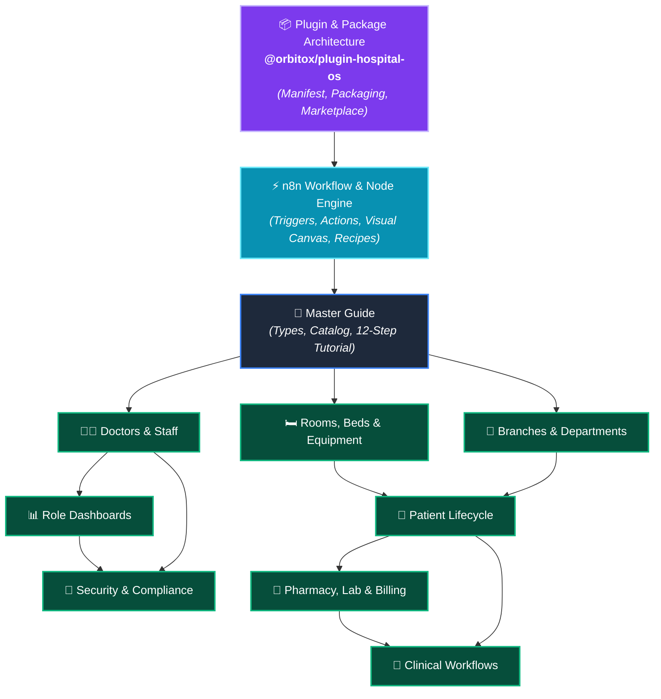

# 🏥 Hospital SaaS — Developer Guide Hub

> **Complete documentation suite for building, packaging, distributing, and running an Enterprise Hospital Management SaaS as a modular, n8n-style Plugin on the OrbitoX Platform.**

---

## 📚 Complete Guide Index (12 Specialized Documents)

| # | Guide | Description | Key Focus Area |
| :---: | :--- | :--- | :--- |
| 📖 | [**Master Developer Handbook**](./HOSPITAL_SAAS_DEVELOPER_GUIDE.md) | Comprehensive overview: Domain types, 18-device medical equipment catalog, 12-step enterprise tutorial, and complete REST API table | Architecture & Code |
| ⚡ | [**n8n-Style Workflow & Node Automation**](./HOSPITAL_N8N_WORKFLOW_AND_NODE_AUTOMATION.md) | How the plugin works like n8n: Clinical trigger & action node catalog, visual canvas, fluent TypeScript pipelines, and 6 automation recipes | Low-Code & Workflows |
| 📦 | [**Plugin & Package Architecture**](./HOSPITAL_PLUGIN_PACKAGE_ARCHITECTURE.md) | How to build, package (`@orbitox/plugin-hospital-os`), distribute on private npm/marketplace, and consume Hospital SaaS as a modular plugin | Plugin & Packaging |
| 👨‍⚕️ | [**Doctors & Clinical Staff**](./DOCTORS_AND_CLINICAL_STAFF.md) | 16 clinical roles, specializations, shift scheduling, on-call rules, doctor handoff workflows, nurse task queues, and staffing shortage escalation | Clinical Personnel |
| 🛏️ | [**Rooms, Beds & Medical Equipment**](./ROOMS_BEDS_AND_EQUIPMENT.md) | 17 bed types, room infrastructure (HEPA, negative pressure), equipment pairing (Philips, Hamilton, ZOLL, Fresenius), telemetry alarms, and surge beds | Infrastructure & IoT |
| 🏢 | [**Branches & Departments**](./BRANCHES_AND_DEPARTMENTS.md) | Multi-hospital networks, 24 department types, ward capacity planning, cross-branch transfers, and inter-department Peer Mesh communication | Multi-Tenancy & Networks |
| 📊 | [**Platform Admin & Role Dashboards**](./PLATFORM_ADMIN_AND_DASHBOARDS.md) | Tailored dashboard specs for all 11 hospital roles, KPI mathematical formulas, and the full `DashboardService` implementation | Frontend & Analytics |
| 🏃 | [**Patient Lifecycle Flow**](./PATIENT_LIFECYCLE_FLOW.md) | Complete 8-phase journey: Registration → ESI 1–5 Triage → Admission matching → Diagnosis → Surgery checklist → Recovery → Discharge | Clinical Journey |
| 💊 | [**Pharmacy, Lab & Billing Sub-Systems**](./PHARMACY_LAB_AND_BILLING.md) | 5-rights medication safety checks, narcotics double-verification, pathology lab pipeline with 30-min critical value escalation, and auto-billing | Support Systems |
| 🔐 | [**Security, Compliance & Break-Glass**](./SECURITY_AND_COMPLIANCE.md) | HIPAA 10-point compliance checklist, full RBAC matrix, 30-minute Break-Glass emergency override protocol, and SHA-256 audit vault | Security & Legal |
| 🔄 | [**Clinical Execution Flows**](./HOSPITAL_CLINICAL_WORKFLOW_FLOW.md) | 9-stage sequence diagrams, real-time IoT medical telemetry alarms, bed state machine, and edge case failure matrices | Workflows & Diagrams |

---

## 🗺️ How the Plugin Guides Connect

---

## 🚀 Suggested Reading Order for Developers

1. **n8n Automation Model** → [n8n Workflow & Node Automation](./HOSPITAL_N8N_WORKFLOW_AND_NODE_AUTOMATION.md) — Learn how clinical triggers and action nodes connect like n8n.
2. **Architecture & Packaging** → [Plugin Architecture](./HOSPITAL_PLUGIN_PACKAGE_ARCHITECTURE.md) — Learn how Hospital OS is packaged and mounted as a plugin.
3. **Master Concepts** → [Master Guide](./HOSPITAL_SAAS_DEVELOPER_GUIDE.md) — Understand the domain types and 12-step enterprise tutorial.
4. **Multi-Tenancy** → [Branches & Departments](./BRANCHES_AND_DEPARTMENTS.md) — Set up multi-branch hospital networks and wards.
5. **Staff Management** → [Doctors & Clinical Staff](./DOCTORS_AND_CLINICAL_STAFF.md) — Configure the 16 clinical roles and shift handoffs.
6. **Infrastructure & IoT** → [Rooms, Beds & Equipment](./ROOMS_BEDS_AND_EQUIPMENT.md) — Provision beds, pair medical devices, and configure surge beds.
7. **Clinical Flow** → [Patient Lifecycle](./PATIENT_LIFECYCLE_FLOW.md) — Follow the 8-phase patient admission and treatment journey.
8. **Support Operations** → [Pharmacy, Lab & Billing](./PHARMACY_LAB_AND_BILLING.md) — Wire drug safety, lab pipelines, and auto-invoicing.
9. **UI & Analytics** → [Admin Dashboards](./PLATFORM_ADMIN_AND_DASHBOARDS.md) — Build role-specific dashboards for each clinical role.
10. **Zero-Trust Security** → [Security & Compliance](./SECURITY_AND_COMPLIANCE.md) — Implement HIPAA, RBAC, and Break-Glass protocols.
11. **Visual Execution** → [Clinical Workflows](./HOSPITAL_CLINICAL_WORKFLOW_FLOW.md) — Review sequence diagrams and error handling matrices.
