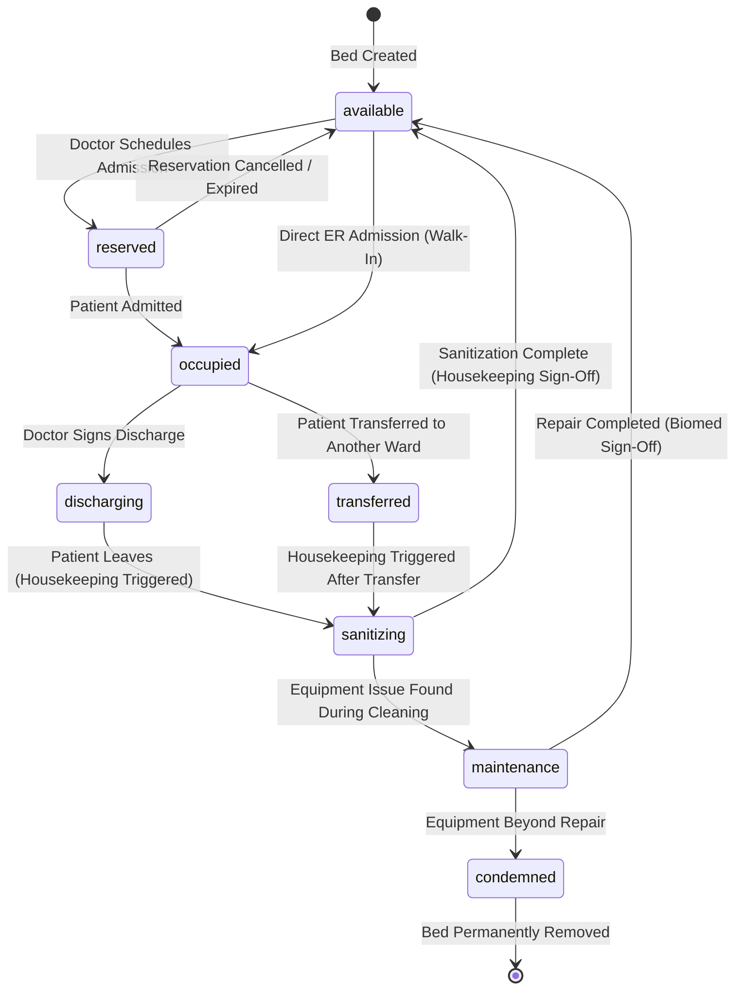
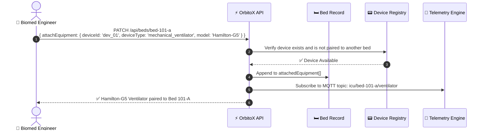
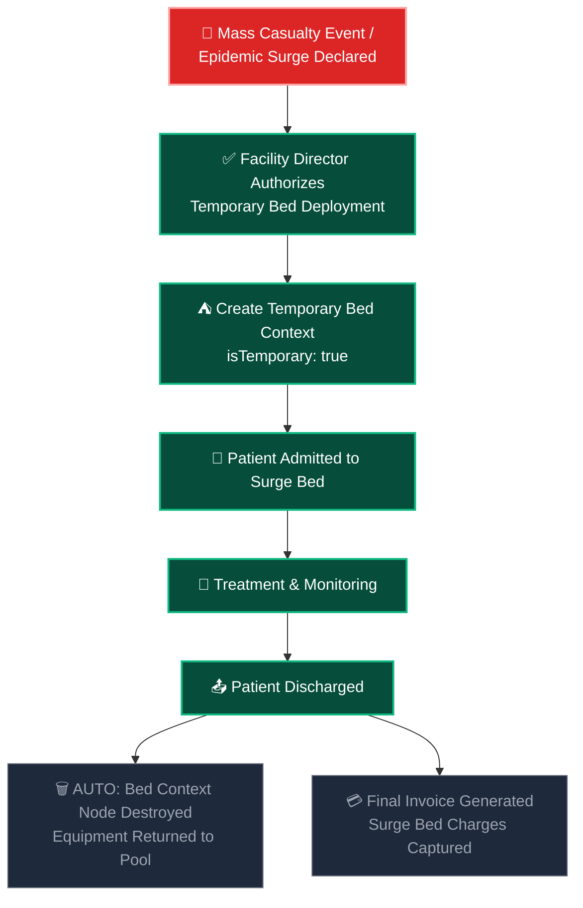
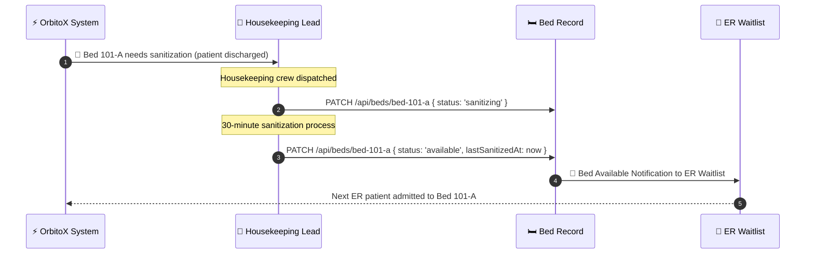

# 🛏️ Rooms, Beds & Medical Equipment: Complete Management Guide

> **How to provision rooms, configure bed types, attach real-world medical equipment, manage telemetry streams, handle bed state transitions, and solve real-world hospital infrastructure problems.**

---

## 📑 Table of Contents
1. [The Room–Bed Architecture](#1-the-roombed-architecture)
2. [All 17 Bed Types Explained](#2-all-17-bed-types-explained)
3. [Bed Status Lifecycle State Machine](#3-bed-status-lifecycle-state-machine)
4. [Room Configuration & Infrastructure](#4-room-configuration--infrastructure)
5. [Medical Equipment Catalog & Pairing](#5-medical-equipment-catalog--pairing)
6. [Provisioning Beds (Step-by-Step Code)](#6-provisioning-beds-step-by-step-code)
7. [Temporary Surge Bed Lifecycle](#7-temporary-surge-bed-lifecycle)
8. [Equipment Maintenance & Calibration Scheduler](#8-equipment-maintenance--calibration-scheduler)
9. [Bed Sanitization & Housekeeping Workflow](#9-bed-sanitization--housekeeping-workflow)
10. [Real-World Problem Solving](#10-real-world-problem-solving)

---

## 1. The Room–Bed Architecture

```mermaid
graph TD
    classDef ward fill:#78350f,stroke:#f59e0b,stroke-width:2px,color:#fff;
    classDef room fill:#1e1b4b,stroke:#8b5cf6,stroke-width:2px,color:#fff;
    classDef bed fill:#831843,stroke:#ec4899,stroke-width:2px,color:#fff;
    classDef dev fill:#0f766e,stroke:#14b8a6,stroke-width:2px,color:#fff;
    classDef infra fill:#1e293b,stroke:#6b7280,stroke-width:1px,color:#9ca3af;

    WARD["🏥 Cardiac ICU Ward"]:::ward

    R101["🚪 Room 101<br><i>(2-Bed ICU Bay)</i>"]:::room
    R102["🚪 Room 102<br><i>(Single Isolation Room)</i>"]:::room
    R103["🚪 Room 103<br><i>(4-Bed General Ward)</i>"]:::room

    B1["🛏️ Bed 101-A<br><b>ICU Station</b>"]:::bed
    B2["🛏️ Bed 101-B<br><b>ICU Station</b>"]:::bed
    B3["🛏️ Bed 102-A<br><b>Neg-Pressure Isolation</b>"]:::bed
    B4["🛏️ Bed 103-A<br><b>Standard</b>"]:::bed
    B5["🛏️ Bed 103-B<br><b>Standard</b>"]:::bed
    B6["🛏️ Bed 103-C<br><b>Semi-Private</b>"]:::bed
    B7["🛏️ Bed 103-D<br><b>Standard</b>"]:::bed
    SURGE["⛺ Bed SURGE-01<br><b>Temporary Overflow</b>"]:::bed

    M1["📟 Philips MX800<br><i>Vitals Monitor</i>"]:::dev
    M2["🫁 Hamilton-G5<br><i>Ventilator</i>"]:::dev
    M3["💉 B.Braun Infusomat<br><i>IV Pump</i>"]:::dev
    M4["💓 ZOLL R Series<br><i>Defib + Crash Cart</i>"]:::dev
    M5["📟 Masimo Rad-97<br><i>Portable SpO2</i>"]:::dev

    HEPA["🌬️ HEPA Filtration"]:::infra
    NEG_P["🔴 Negative Pressure System"]:::infra
    O2["🟢 Central O2 Supply"]:::infra
    SUCTION["🟡 Wall Suction"]:::infra

    WARD --> R101 & R102 & R103
    WARD --> SURGE

    R101 --> B1 & B2
    R102 --> B3
    R103 --> B4 & B5 & B6 & B7

    B1 -. Attached .-> M1 & M2 & M3
    B2 -. Attached .-> M1
    B1 -. Attached .-> M4
    SURGE -. Attached .-> M5

    R102 -. Infrastructure .-> HEPA & NEG_P
    R101 -. Infrastructure .-> O2 & SUCTION
```



---

## 2. All 17 Bed Types Explained

| # | Bed Type | `BedType` Value | Where Used | Daily Rate | Key Features |
| :---: | :--- | :--- | :--- | :---: | :--- |
| 1 | **Standard** | `standard` | General Ward | $250 | Basic bed, nurse call button |
| 2 | **Semi-Private** | `semi_private` | 2-patient room | $400 | Curtain divider, shared bathroom |
| 3 | **Private Suite** | `private_suite` | VIP Floor | $800 | Private room, TV, sofa for family |
| 4 | **ICU** | `icu` | Intensive Care Unit | $1,500 | Motorized, full vitals monitor, ventilator port |
| 5 | **CCU** | `ccu` | Coronary Care Unit | $1,800 | Continuous cardiac monitoring, IABP support |
| 6 | **NICU** | `nicu` | Neonatal ICU | $2,000 | Infant incubator, phototherapy, warmers |
| 7 | **PICU** | `picu` | Pediatric ICU | $1,600 | Child-sized, colorful decor, parent bed nearby |
| 8 | **Burn Unit** | `burn_unit` | Burn Ward | $2,500 | Sterile airflow, specialized mattress, fluid resuscitation |
| 9 | **Neg-Pressure Isolation** | `isolation_negative_pressure` | Infectious Disease | $1,200 | HEPA filters, airlock door, negative air pressure |
| 10 | **Pos-Pressure Isolation** | `isolation_positive_pressure` | Immunocompromised | $1,200 | Positive air pressure to protect patient |
| 11 | **Emergency Trauma Bay** | `emergency_trauma_bay` | ER | $900 | Resuscitation equipment, crash cart, rapid access |
| 12 | **Operating Theatre Table** | `operating_theatre_table` | OT | $3,000/session | Surgical table, anesthesia station, imaging arm |
| 13 | **Recovery (PACU)** | `recovery_pacu` | Post-Anesthesia | $600 | Monitoring, warming blanket, oxygen |
| 14 | **Dialysis Station** | `dialysis_station` | Nephrology | $500/session | Recliner chair, Fresenius 5008S connected |
| 15 | **Psychiatric Safe Room** | `psychiatric_safe_room` | Behavioral Health | $350 | No sharp edges, reinforced walls, observation window |
| 16 | **Labor & Delivery Suite** | `labor_delivery_suite` | OB/GYN | $1,000 | Birthing bed, fetal monitor, neonatal resuscitation cart |
| 17 | **Temporary Surge** | `temporary_surge` | Any (Emergency) | $400 | Lightweight, auto-decommission on discharge |

---

## 3. Bed Status Lifecycle State Machine



### Status Transition Rules

| From | To | Who Can Trigger | Event Emitted | Hook Logic |
| :--- | :--- | :--- | :--- | :--- |
| `available` → `reserved` | Doctor, Receptionist | `bed.reserved` | Hold bed for 2 hours (configurable timeout) |
| `reserved` → `occupied` | System (afterCreate on Patient) | `bed.occupied` | Lock bed, start billing |
| `occupied` → `discharging` | Doctor only | `patient.discharge.initiated` | Generate discharge summary |
| `discharging` → `sanitizing` | System (afterUpdate on Patient) | `housekeeping.task.created` | Create housekeeping task |
| `sanitizing` → `available` | Housekeeping Lead | `bed.ready` | Notify ER waitlist if bed in demand |
| `sanitizing` → `maintenance` | Biomed Engineer | `equipment.maintenance.required` | Remove bed from availability pool |
| `maintenance` → `available` | Biomed Engineer | `bed.maintenance.completed` | Re-add bed to availability pool |

---

## 4. Room Configuration & Infrastructure

Each room type has specific physical infrastructure that OrbitoX tracks:

```typescript
export interface RoomEntity {
  id: string;
  label: string;
  wardId: string;
  type: 'standard' | 'icu_bay' | 'isolation' | 'operating_theatre' | 'labor_suite' | 'dialysis_station';
  maxBeds: number;
  currentBedCount: number;

  // Physical Infrastructure
  infrastructure: {
    hasCentralOxygen: boolean;      // Piped O2 from central plant
    hasCentralSuction: boolean;     // Piped wall suction
    hasCentralAir: boolean;         // Piped compressed air
    hasHEPAFiltration: boolean;     // HEPA air filtration system
    pressureType: 'normal' | 'negative' | 'positive'; // Air pressure control
    hasCodeBlueButton: boolean;     // Wall-mounted emergency button
    hasCCTV: boolean;               // Surveillance camera
    hasIntercom: boolean;           // Nurse-patient intercom
    floorType: 'standard' | 'anti_static' | 'seamless_epoxy'; // OT-grade flooring
    hasPrivateBathroom: boolean;    
    hasGasScavenging: boolean;      // Anesthesia waste gas removal (OT only)
  };

  // Environmental Controls
  climate: {
    temperatureRange: { min: number; max: number };  // °C
    humidityRange: { min: number; max: number };      // %
    isTemperatureControlled: boolean;
  };
}
```

### Example: ICU Bay Room
```typescript
const icuRoom = await orbitox.db.create('room', {
  label: 'Room 101', wardId: icuWard.id, type: 'icu_bay', maxBeds: 2,
  infrastructure: {
    hasCentralOxygen: true, hasCentralSuction: true, hasCentralAir: true,
    hasHEPAFiltration: true, pressureType: 'normal',
    hasCodeBlueButton: true, hasCCTV: true, hasIntercom: true,
    floorType: 'seamless_epoxy', hasPrivateBathroom: false, hasGasScavenging: false
  },
  climate: { temperatureRange: { min: 20, max: 24 }, humidityRange: { min: 40, max: 60 }, isTemperatureControlled: true }
}, icuWard.id);
```

---

## 5. Medical Equipment Catalog & Pairing

### 5.1 Complete Device Pairing Reference

| Category | Brand & Model | `deviceType` | Telemetry Stream | Alarm Conditions |
| :--- | :--- | :--- | :--- | :--- |
| **Vitals Monitor** | Philips IntelliVue MX800 | `multi_para_vitals_monitor` | ECG, SpO2, NIBP, EtCO2, Temp | SpO2 < 90%, HR > 130, HR < 45 |
| **Vitals Monitor** | GE CARESCAPE B650 | `multi_para_vitals_monitor` | ECG, SpO2, IBP, CO | Cardiac output deviation |
| **Portable Pulse Ox** | Masimo Rad-97 | `pulse_oximeter_standalone` | SpO2, Pulse Rate | SpO2 < 90% |
| **Ventilator** | Hamilton-G5 | `mechanical_ventilator` | Tidal Vol, FiO2, PEEP, RR | Apnea, Circuit Disconnect |
| **Ventilator** | Dräger Evita V500 | `mechanical_ventilator` | PIP, MAP, Compliance | High Pressure Limit |
| **BiPAP / CPAP** | ResMed AirCurve 10 | `bipap_cpap` | Pressure, Leak Rate, AHI | High Leak, Apnea |
| **IV Pump** | B.Braun Infusomat Space | `infusion_syringe_pump` | Flow Rate, VTBI, Drug Conc | Occlusion, Air-in-Line |
| **PCA Pump** | BD Alaris PCA Module | `pca_pump` | Demand Count, Total Dose | Excess Demand, Overdose Limit |
| **Feeding Pump** | Abbott Kangaroo ePump | `feeding_pump` | Flow Rate, Volume Delivered | Blockage |
| **Defibrillator** | ZOLL R Series Plus | `defibrillator_crash_cart` | Shock Count, CPR Depth | Low Battery, Pad Disconnect |
| **ECMO** | Maquet Cardiohelp | `ecmo_circuit` | Blood Flow, RPM, SvO2 | Low Flow, Clot Detection |
| **IABP** | Getinge Cardiosave | `iabp` | Augmentation, Timing | Timing Error, Gas Leak |
| **Dialysis** | Fresenius 5008S | `dialysis_unit` | UF Volume, TMP, Blood Flow | TMP High, Air Bubble |
| **Hypothermia** | Bard Arctic Sun 5000 | `hypothermia_unit` | Target Temp, Actual Temp | Temp Deviation > 1°C |
| **POCUS** | Butterfly iQ+ | `portable_ultrasound` | B-Mode Images | N/A (diagnostic) |
| **Portable X-Ray** | Shimadzu MobileDaRt | `portable_xray` | DICOM Images | N/A (diagnostic) |
| **EEG** | Nihon Kohden EEG-1200 | `eeg_monitor` | Brainwave Patterns | Seizure Activity Detected |
| **Fetal Doppler** | Edan F9 Express | `fetal_doppler` | FHR, Contractions | FHR < 110 or > 160 bpm |
| **Glucometer** | Accu-Chek Inform II | `glucometer` | Blood Glucose (mg/dL) | < 70 (Hypo) or > 400 (Hyper) |

### 5.2 How Equipment Pairing Works



```typescript
// Attach equipment to a bed
async function attachEquipmentToBed(bedId: string, device: AttachedMedicalDevice) {
  // Verify device isn't already paired
  const allBeds = await orbitox.db.findMany('bed');
  const alreadyPaired = allBeds.data.find(b => 
    b.attachedEquipment?.some((e: any) => e.deviceId === device.deviceId)
  );
  if (alreadyPaired) {
    throw new Error(`⚠️ Device ${device.model} (${device.serialNumber}) is already paired to ${alreadyPaired.label}`);
  }

  const bed = await orbitox.db.findById('bed', bedId);
  const updatedEquipment = [...(bed.attachedEquipment || []), device];
  await orbitox.db.update('bed', bedId, { attachedEquipment: updatedEquipment });
  console.log(`📟 ${device.model} paired to ${bed.label}`);
}
```

---

## 6. Provisioning Beds (Step-by-Step Code)

### Example A: Full ICU Bed with 4 Devices
```typescript
const icuBedContext = await orbitox.tenant('bed-101-a', 'Bed 101-A').type('bed').parent(room101.id).create();

const icuBed = await orbitox.db.create('bed', {
  label: 'Bed 101-A', wardId: icuWard.id, roomId: room101.id,
  type: 'icu', status: 'available', isTemporary: false, dailyRate: 1500,
  attachedEquipment: [
    { deviceId: 'dev_01', deviceType: 'multi_para_vitals_monitor', manufacturer: 'Philips', model: 'IntelliVue MX800', serialNumber: 'MX800-44321', status: 'online', telemetryTopic: 'icu/bed-101-a/vitals', lastCalibrationDate: '2026-07-01', nextMaintenanceDue: '2026-10-01' },
    { deviceId: 'dev_02', deviceType: 'mechanical_ventilator', manufacturer: 'Hamilton', model: 'Hamilton-G5', serialNumber: 'HG5-88210', status: 'standby', lastCalibrationDate: '2026-06-15', nextMaintenanceDue: '2026-09-15' },
    { deviceId: 'dev_03', deviceType: 'infusion_syringe_pump', manufacturer: 'B.Braun', model: 'Infusomat Space', serialNumber: 'BS-77901', status: 'online', lastCalibrationDate: '2026-08-01', nextMaintenanceDue: '2026-11-01' },
    { deviceId: 'dev_04', deviceType: 'defibrillator_crash_cart', manufacturer: 'ZOLL', model: 'R Series Plus', serialNumber: 'ZOLL-12001', status: 'standby', lastCalibrationDate: '2026-08-10', nextMaintenanceDue: '2026-11-10' }
  ],
  features: {
    hasOxygenPort: true, hasSuctionPort: true, hasCompressedAirPort: true,
    hasNurseCallButton: true, hasBedsideTerminal: true, isBariatric: false,
    motorized: true, hasSideRails: true, hasWeighingScale: true, hasAirMattress: true
  },
  telemetryThresholds: {
    minSpO2: 90, maxHeartRate: 130, minHeartRate: 45,
    maxSystolicBP: 180, minSystolicBP: 80,
    maxTemperature: 39.5, minTemperature: 35.0, maxRespiratoryRate: 30
  }
}, icuBedContext.id);
```

### Example B: Temporary Surge Overflow Bed
```typescript
const surgeBed = await orbitox.db.create('bed', {
  label: 'Bed SURGE-01', wardId: icuWard.id,
  type: 'temporary_surge', status: 'available', isTemporary: true, dailyRate: 400,
  surgeConfig: {
    reason: 'COVID Wave 4 ER Overflow',
    authorizedBy: facilityDirector.id,
    expiresAt: new Date(Date.now() + 7 * 86400000).toISOString(),
    autoDecommissionOnDischarge: true
  },
  attachedEquipment: [
    { deviceId: 'dev_portable_01', deviceType: 'pulse_oximeter_standalone', manufacturer: 'Masimo', model: 'Rad-97', serialNumber: 'RAD97-991', status: 'online', lastCalibrationDate: '2026-08-01', nextMaintenanceDue: '2026-11-01' }
  ],
  features: {
    hasOxygenPort: true, hasSuctionPort: false, hasCompressedAirPort: false,
    hasNurseCallButton: true, hasBedsideTerminal: false, isBariatric: false,
    motorized: false, hasSideRails: true, hasWeighingScale: false, hasAirMattress: false
  }
}, surgeBedContext.id);
```

---

## 7. Temporary Surge Bed Lifecycle



---

## 8. Equipment Maintenance & Calibration Scheduler

```typescript
// Automated maintenance reminder system
export async function checkEquipmentMaintenance() {
  const allBeds = await orbitox.db.findMany('bed');
  const now = new Date();

  for (const bed of allBeds.data) {
    for (const device of bed.attachedEquipment || []) {
      const dueDate = new Date(device.nextMaintenanceDue);
      const daysUntilDue = Math.ceil((dueDate.getTime() - now.getTime()) / 86400000);

      if (daysUntilDue <= 0) {
        // OVERDUE — Mark device as offline
        await orbitox.events.emit('equipment.maintenance.overdue', {
          bedId: bed.id, bedLabel: bed.label, deviceId: device.deviceId,
          model: device.model, serialNumber: device.serialNumber,
          overdueByDays: Math.abs(daysUntilDue)
        });
      } else if (daysUntilDue <= 7) {
        // Due soon — alert biomed team
        await orbitox.events.emit('equipment.maintenance.upcoming', {
          bedId: bed.id, deviceId: device.deviceId, model: device.model, daysRemaining: daysUntilDue
        });
      }
    }
  }
}
```

---

## 9. Bed Sanitization & Housekeeping Workflow



---

## 10. Real-World Problem Solving

| Problem | Scenario | OrbitoX Solution |
| :--- | :--- | :--- |
| **ICU bed shortage during surge** | ER has 15 patients waiting, only 2 ICU beds open | Auto-trigger surge bed creation; track temporary beds separately from permanent inventory |
| **Ventilator goes offline mid-shift** | Hamilton-G5 on Bed 101-A disconnects at 3 AM | Real-time `device.status.offline` alarm → page biomed engineer + nurse |
| **Bed contamination after MRSA patient** | Bed 103-B had MRSA patient, requires deep sanitization | Extended sanitization protocol: `sanitizing` status for 4 hours (configurable), bio-hazard flag |
| **Equipment calibration overdue** | Philips MX800 calibration expired 5 days ago | Auto-mark device as `calibrating` → remove from availability → alert biomed |
| **Wrong bed assigned to wrong patient type** | NICU bed assigned to adult patient | `beforeCreate` hook validates patient age vs bed type: NICU requires age < 0.1 (neonatal) |
| **Bed reserved but patient no-show** | Reservation at 2PM but patient didn't arrive by 4PM | Auto-expire reservation after configurable timeout (default: 2 hours) → release back to `available` |

---

### 🔗 Related Guides:
- 🏥 [**Hospital SaaS Master Guide**](./HOSPITAL_SAAS_DEVELOPER_GUIDE.md)
- 👨‍⚕️ [**Doctors & Clinical Staff**](./DOCTORS_AND_CLINICAL_STAFF.md)
- 📊 [**Admin Dashboards & KPIs**](./PLATFORM_ADMIN_AND_DASHBOARDS.md)
- 🏢 [**Branches & Departments**](./BRANCHES_AND_DEPARTMENTS.md)
