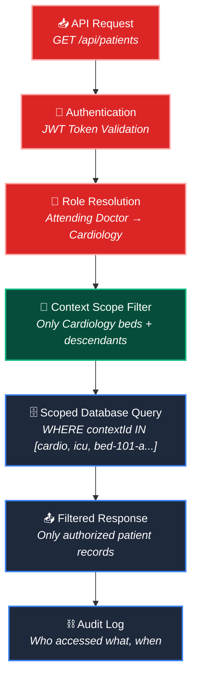
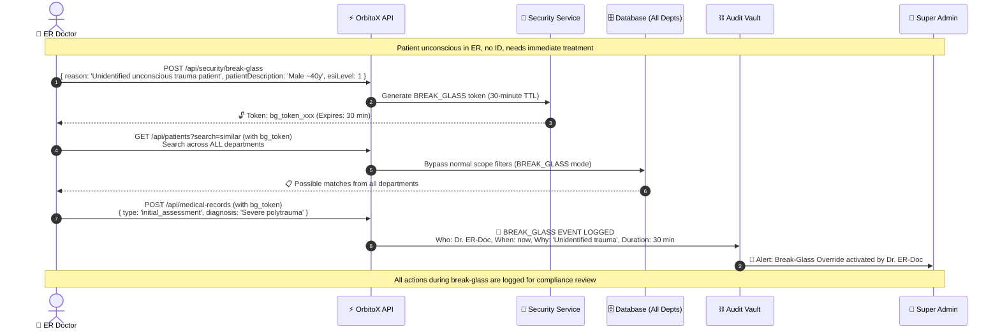

# 🔐 Security, Compliance & Emergency Override Guide

> **HIPAA/NABH compliance, role-based access control, break-glass emergency protocol, audit trails, data encryption, and zero-trust security architecture for Hospital SaaS.**

---

## 📑 Table of Contents
1. [Zero-Trust Security Architecture](#1-zero-trust-security-architecture)
2. [Role-Based Access Control (RBAC) Matrix](#2-role-based-access-control-rbac-matrix)
3. [Break-Glass Emergency Override Protocol](#3-break-glass-emergency-override-protocol)
4. [Audit Trail & Compliance Logging](#4-audit-trail--compliance-logging)
5. [HIPAA Compliance Checklist](#5-hipaa-compliance-checklist)
6. [Data Encryption & PHI Protection](#6-data-encryption--phi-protection)
7. [Session & Token Management](#7-session--token-management)

---

## 1. Zero-Trust Security Architecture



### The 5 Security Layers

| Layer | What It Does | Implementation |
| :--- | :--- | :--- |
| **1. Authentication** | Verify staff identity (JWT + MFA) | `orbitox.security.verifyToken()` |
| **2. Role Resolution** | Map staff to their `StaffRole` | `orbitox.security.getRole(staffId)` |
| **3. Context Scoping** | Generate visibility filter based on role's position in hierarchy | `orbitox.context.getDescendants(contextId)` |
| **4. Permission Check** | Verify role has permission for the requested action | RBAC matrix lookup |
| **5. Audit Logging** | Record every data access in tamper-proof audit vault | SHA-256 hash chain |

---

## 2. Role-Based Access Control (RBAC) Matrix

### Full CRUD Permission Matrix

| Entity / Action | Super Admin | Facility Dir | Dept Head | Doctor | Head Nurse | Staff Nurse | Pharmacist | Lab Tech | Billing | Receptionist | Biomed |
| :--- | :---: | :---: | :---: | :---: | :---: | :---: | :---: | :---: | :---: | :---: | :---: |
| **Patient** — Create | ✅ | ✅ | ✅ | ✅ | ❌ | ❌ | ❌ | ❌ | ❌ | ✅ | ❌ |
| **Patient** — Read | ✅ (all) | ✅ (branch) | ✅ (dept) | ✅ (own) | ✅ (ward) | ✅ (beds) | ❌ | ❌ | 📋 (billing) | 📋 (name/ID) | ❌ |
| **Patient** — Update | ✅ | ✅ | ✅ | ✅ (own) | ✅ (status) | ❌ | ❌ | ❌ | ❌ | ❌ | ❌ |
| **Patient** — Delete | ✅ | ❌ | ❌ | ❌ | ❌ | ❌ | ❌ | ❌ | ❌ | ❌ | ❌ |
| **Medical Record** — Create | ❌ | ❌ | ✅ | ✅ | ❌ | ❌ | ❌ | ❌ | ❌ | ❌ | ❌ |
| **Medical Record** — Read | ✅ | ❌ | ✅ (dept) | ✅ (own) | ❌ | ❌ | ❌ | ❌ | ❌ | ❌ | ❌ |
| **Treatment** — Create | ❌ | ❌ | ✅ | ✅ | ❌ | ❌ | ❌ | ❌ | ❌ | ❌ | ❌ |
| **Treatment** — Update | ❌ | ❌ | ✅ | ✅ | ❌ | ✅ (admin) | ✅ (verify) | ❌ | ❌ | ❌ | ❌ |
| **Lab Order** — Create | ❌ | ❌ | ✅ | ✅ | ❌ | ❌ | ❌ | ❌ | ❌ | ❌ | ❌ |
| **Lab Order** — Update | ❌ | ❌ | ❌ | ❌ | ❌ | ❌ | ❌ | ✅ | ❌ | ❌ | ❌ |
| **Invoice** — Create/Read | ✅ | ✅ | ❌ | ❌ | ❌ | ❌ | ❌ | ❌ | ✅ | ✅ | ❌ |
| **Bed** — Create/Update | ✅ | ✅ | ✅ | ❌ | ✅ (status) | ❌ | ❌ | ❌ | ❌ | ❌ | ✅ (maint) |
| **Equipment** — Manage | ✅ | ✅ | ❌ | ❌ | ❌ | ❌ | ❌ | ❌ | ❌ | ❌ | ✅ |
| **Staff** — Create/Manage | ✅ | ✅ | ❌ | ❌ | ❌ | ❌ | ❌ | ❌ | ❌ | ❌ | ❌ |
| **Audit Trail** — Read | ✅ | ✅ | ❌ | ❌ | ❌ | ❌ | ❌ | ❌ | ❌ | ❌ | ❌ |

---

## 3. Break-Glass Emergency Override Protocol

> **Break-Glass** allows an ER doctor to bypass normal access controls during a life-threatening emergency.



```typescript
async function activateBreakGlass(params: {
  doctorId: string;
  reason: string;
  patientDescription: string;
  esiLevel: 1 | 2;
}): Promise<{ token: string; expiresAt: string }> {
  // Only ER doctors and department heads can break glass
  const doctor = await orbitox.db.findById('staff', params.doctorId);
  if (!['attending_doctor', 'department_head'].includes(doctor.role)) {
    throw new Error('Only ER physicians can activate Break-Glass override');
  }
  if (params.esiLevel > 2) {
    throw new Error('Break-Glass is only authorized for ESI-1 or ESI-2 emergencies');
  }

  const token = await orbitox.security.generateBreakGlassToken({
    staffId: params.doctorId,
    reason: params.reason,
    ttlMinutes: 30,
    scope: 'ALL' // Bypass context scoping
  });

  // Log to tamper-proof audit vault
  await orbitox.audit.log({
    event: 'BREAK_GLASS_ACTIVATED',
    severity: 'CRITICAL',
    staffId: params.doctorId,
    reason: params.reason,
    expiresAt: token.expiresAt
  });

  // Alert all super admins
  await orbitox.events.emit('security.break_glass', {
    doctorId: params.doctorId, doctorName: doctor.name,
    reason: params.reason, expiresAt: token.expiresAt
  });

  return token;
}
```

---

## 4. Audit Trail & Compliance Logging

### What Gets Logged

| Event Category | Example Events | Retention |
| :--- | :--- | :--- |
| **Authentication** | Login, Logout, Failed Login, MFA Challenge | 1 year |
| **Patient Data Access** | View record, Edit record, Print record | 6 years (HIPAA) |
| **Medical Record Changes** | Diagnosis written, Treatment prescribed | 10 years |
| **Break-Glass** | Override activated, Override expired, Actions during override | Permanent |
| **Discharge & Billing** | Invoice generated, Insurance claim submitted | 7 years |
| **Equipment** | Device paired, Calibration done, Device condemned | 5 years |
| **Admin Actions** | Staff created, Role changed, Department modified | Permanent |

### Audit Log Entry Structure

```typescript
export interface AuditLogEntry {
  id: string;
  timestamp: string;
  event: string;                  // 'patient.record.viewed', 'break_glass.activated'
  severity: 'INFO' | 'WARNING' | 'CRITICAL';
  staffId: string;
  staffName: string;
  staffRole: StaffRole;
  entityType: string;             // 'patient', 'medical_record', etc.
  entityId: string;
  action: 'CREATE' | 'READ' | 'UPDATE' | 'DELETE';
  contextId: string;
  ipAddress: string;
  userAgent: string;
  previousValue?: any;            // For updates: what was changed from
  newValue?: any;                 // For updates: what was changed to
  hash: string;                   // SHA-256 hash of previous entry (tamper detection)
}
```

---

## 5. HIPAA Compliance Checklist

| # | Requirement | OrbitoX Implementation | Status |
| :---: | :--- | :--- | :---: |
| 1 | **Access Controls** — Unique user identification | Staff ID + JWT authentication | ✅ |
| 2 | **Audit Controls** — Hardware, software, procedure mechanisms | SHA-256 hash-chain audit vault | ✅ |
| 3 | **Integrity Controls** — Protect PHI from improper alteration | Role-based write permissions + audit | ✅ |
| 4 | **Transmission Security** — Encrypt PHI in transit | TLS 1.3 for all API calls | ✅ |
| 5 | **Encryption at Rest** — Encrypt stored PHI | AES-256 encryption for patient data | ✅ |
| 6 | **Emergency Access** — Procedures for obtaining PHI during emergency | Break-Glass protocol with audit trail | ✅ |
| 7 | **Automatic Logoff** — Session timeout after inactivity | 15-minute session timeout (configurable) | ✅ |
| 8 | **Minimum Necessary** — Limit PHI access to minimum needed for role | Context scoping + RBAC | ✅ |
| 9 | **Business Associate Agreements** — BAAs with SaaS providers | OrbitoX platform BAA template | ✅ |
| 10 | **Breach Notification** — 60-day notification for breaches | Automated breach detection + notification system | ✅ |

---

## 6. Data Encryption & PHI Protection

| Data State | Encryption Method | Key Management |
| :--- | :--- | :--- |
| **At Rest** (Database) | AES-256-GCM | AWS KMS / Azure Key Vault / HashiCorp Vault |
| **In Transit** (API) | TLS 1.3 | Certificate auto-renewal (Let's Encrypt) |
| **In Transit** (Telemetry) | MQTTS (MQTT over TLS) | Device certificates |
| **Backups** | AES-256-CBC with separate key | Offline key storage |
| **Audit Logs** | SHA-256 hash chain (tamper detection) | Append-only log store |

### PHI Fields That MUST Be Encrypted

| Entity | PHI Fields |
| :--- | :--- |
| **Patient** | `name`, `age`, `gender`, `bloodGroup`, `allergies`, `emergencyContact`, `insurance.policyNumber` |
| **Medical Record** | `diagnosis`, `clinicalNotes`, `vitals`, `attachments` |
| **Treatment** | `procedureOrDrug`, `dosage` |
| **Lab Order** | `resultSummary`, `resultUrl` |
| **Invoice** | `lineItems`, `patientDue` |

---

## 7. Session & Token Management

| Token Type | TTL | Refresh? | Use Case |
| :--- | :--- | :---: | :--- |
| **Access Token** (JWT) | 15 minutes | ✅ (via refresh token) | Normal API access |
| **Refresh Token** | 24 hours | ❌ (single use) | Generate new access token |
| **Break-Glass Token** | 30 minutes | ❌ | Emergency override |
| **Peer Mesh Token** | Configurable (1–72 hours) | ❌ | Cross-department consultation |
| **API Key** (Machine) | No expiry (revocable) | N/A | IoT device telemetry |

---

### 🔗 Related Guides:
- 🏥 [**Hospital SaaS Master Guide**](./HOSPITAL_SAAS_DEVELOPER_GUIDE.md)
- 📊 [**Admin Dashboards & KPIs**](./PLATFORM_ADMIN_AND_DASHBOARDS.md)
- 🏢 [**Branches & Departments**](./BRANCHES_AND_DEPARTMENTS.md)
- 🔐 [**Core Platform Security**](../core_engine/PLATFORM_SECURITY_AND_IP_PROTECTION.md)
