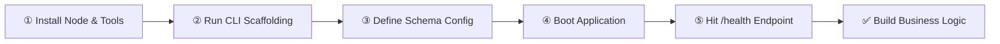
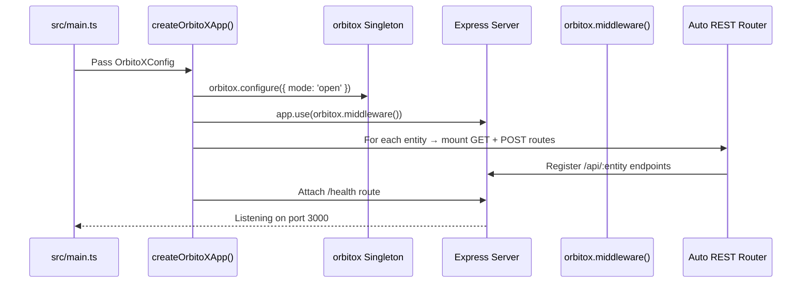

# 🚀 Step 1: Getting Started with OrbitoX

This guide walks you through installing prerequisites, scaffolding your first application, understanding the generated project structure, and verifying everything works.

---

## 🛤️ Developer Journey: From Zero to Running App



---

## 📋 Prerequisites Matrix

| Requirement | Minimum Version | Recommended | Purpose | Notes |
| :--- | :--- | :--- | :--- | :--- |
| **Node.js** | `v18.0.0` | `v20.x LTS` | Runtime execution | Check: `node -v` |
| **npm** | `v9.0.0` | `v10.x` | Package management | Bundled with Node |
| **pnpm** | Optional | `v8.x` | Monorepo workspace | `npm i -g pnpm` |
| **TypeScript** | `v5.0.0` | `v5.3+` | Strict mode compile | `npm i -g typescript` |
| **Redis** | Optional (Dev) | `v7.0+` | Distributed task queues | Required in production |

---

## 🛠️ Step-by-Step Setup

### Step 1: Scaffold a New Application
 
```bash
# Option A: Composed Restaurant SaaS (with @orbitox/pos, Kitchen DAG, Pricing Quotes)
npx @orbitox/cli create my-restaurant --template=restaurant

# Option B: Composed CRM System (with @orbitox/crm, Lead Scoring, State Machines)
npx @orbitox/cli create my-crm --template=crm

# Option C: Minimal Foundation
npx @orbitox/cli create my-app --template=blank
```

### Step 2: Inspect the Generated Project

```text
my-restaurant/
├── docker-compose.yml      ← Local PostgreSQL instance pre-configured
├── orbitox.config.ts       ← Composed plugins, tenancy resolver, auth provider, platform connection
├── package.json            ← Composed plugin dependencies (@orbitox/pos, @orbitox/runtime, ...)
├── tsconfig.json           ← TypeScript strict mode
└── src/
    └── main.ts             ← 1-line bootstrap entrypoint
```

### Step 3: Application Composition (`orbitox.config.ts`)

```typescript
import { createOrbitoXApp, OrbitoXAppConfig } from '@orbitox/runtime';
import { pos } from '@orbitox/pos';

export const config: OrbitoXAppConfig = {
  app: {
    name: 'Artisan Cafe OS',
    port: Number(process.env.PORT) || 4050,
    environment: process.env.NODE_ENV || 'development',
  },
  // 🔌 Host App composes authoritative domain plugins
  plugins: [
    pos(),
  ],
  // 🛡️ Zero-Trust Multi-Tenancy: Host resolves tenant context per request
  tenancy: {
    resolver: async (req) => {
      const tenantId = (req.headers['x-tenant-id'] as string) || 'tenant_main';
      return {
        id: tenantId,
        tenantId,
        name: `Tenant ${tenantId}`,
        status: 'ACTIVE',
        features: ['pos.orders', 'pos.kitchen', 'pos.quotes', 'pos.sessions'],
      };
    },
  },
  // 🔑 Authentic Authentication: Host validates caller credentials
  auth: {
    provider: async (req) => {
      const auth = req.headers['authorization'];
      if (!auth) return null;
      return { id: 'usr_staff_123', roles: ['staff', 'pos.orders.write'] };
    },
  },
  // 🪐 Platform Connection: Auto-registers with control plane & telemetry
  platform: {
    controlPlaneUrl: process.env.ORBITOX_CONTROL_PLANE_URL || 'http://localhost:3005',
    apiKey: process.env.ORBITOX_API_KEY,
    projectId: process.env.ORBITOX_PROJECT_ID,
  },
};
```

### Step 4: Boot the Composed SaaS (`src/main.ts`)

```typescript
import { createOrbitoXApp } from '@orbitox/runtime';
import { config } from '../orbitox.config';

export async function bootstrap() {
  console.log(`🚀 Booting composed SaaS application: ${config.app.name}`);
  const { app, server } = await createOrbitoXApp(config);
  return { app, server };
}

bootstrap().catch((err) => {
  console.error('Fatal bootstrap error:', err);
  process.exit(1);
});
```

### Step 5: Start Application & Place First Order

```bash
# 1. Start local Postgres
docker compose up -d

# 2. Start Application Runtime
npm start

# 3. Verify health
curl http://localhost:4050/health

# 4. Place an order through composed @orbitox/pos engine
curl -X POST http://localhost:4050/api/pos/orders \
  -H "Content-Type: application/json" \
  -H "x-tenant-id: tenant_artisan" \
  -H "Authorization: Bearer <STAFF_BEARER_TOKEN>" \
  -d '{
    "tableNumber": 4,
    "items": [
      { "id": "item_cold_brew", "quantity": 2 },
      { "id": "item_croissant", "quantity": 1 }
    ]
  }'
```

Expected response:
```json
{ "status": "ok", "app": "Super Restaurant OS", "mode": "open", "entities": 2 }
```

---

## 🔄 What `createOrbitoXApp()` Does Internally



---

## 🤔 What Gets Auto-Generated?

| Entity in Config | Auto-Mounted Endpoints | Security Gate Applied |
| :--- | :--- | :--- |
| `menu_item` | `GET /api/menu-items`, `POST /api/menu-items` | `orbitox.security.authorize()` |
| `customer_order` | `GET /api/customer-orders`, `POST /api/customer-orders` | `orbitox.security.authorize()` |
| *(any entity)* | `GET /health` | None (public) |

---

[Back to Index](./README.md) | [Next: Architecture & Kernel ➔](./02_ARCHITECTURE.md)
