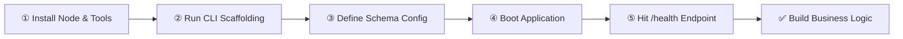
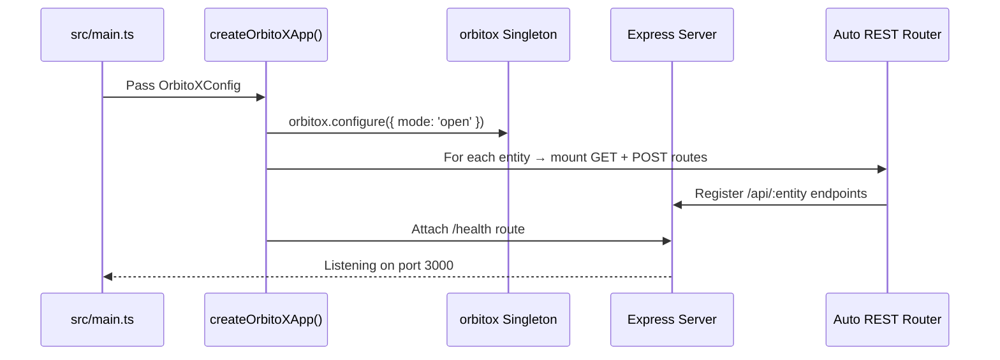

# 🚀 Step 1: Getting Started with OrbitoX

This guide walks you through installing prerequisites, scaffolding your first application, understanding the generated project structure, and verifying everything works.

---

## 🛤️ Developer Journey: From Zero to Running App



---

## 📋 Prerequisites Matrix

| Requirement | Minimum Version | Recommended | Purpose | Notes |
| :--- | :--- | :--- | :--- | :--- |
| **Node.js** | `v18.0.0` | `v20.x LTS` | Runtime execution | Check: `node -v` |
| **npm** | `v9.0.0` | `v10.x` | Package management | Bundled with Node |
| **pnpm** | Optional | `v8.x` | Monorepo workspace | `npm i -g pnpm` |
| **TypeScript** | `v5.0.0` | `v5.3+` | Strict mode compile | `npm i -g typescript` |
| **Redis** | Optional (Dev) | `v7.0+` | Distributed task queues | Required in production |

---

## 🛠️ Step-by-Step Setup

### Step 1: Scaffold a New Application

```bash
# Option A: Industry-specific template
npx @orbitox/cli create my-restaurant --template=restaurant

# Option B: CRM system
npx @orbitox/cli create my-crm --template=crm

# Option C: Hospital management system
npx @orbitox/cli create my-hospital --template=hms

# Option D: Minimal starter
npx @orbitox/cli create my-app --template=default
```

### Step 2: Inspect the Generated Project

```text
my-restaurant/
├── orbitox.config.ts       ← Entity schema, app name, port
├── package.json            ← @orbitox/runtime dependency pre-installed
├── tsconfig.json           ← TypeScript strict mode
└── src/
    └── main.ts             ← 3-line boot entrypoint
```

### Step 3: Schema Definition (`orbitox.config.ts`)

```typescript
import { OrbitoXConfig } from '@orbitox/runtime';

const config: OrbitoXConfig = {
  app: {
    name: 'Super Restaurant OS',
    port: 3000,
  },
  entities: [
    {
      id: 'menu_item',
      name: 'Menu Item',
      fields: [
        { name: 'name',     type: 'text',    required: true  },
        { name: 'price',    type: 'number',  required: true  },
        { name: 'category', type: 'text',    required: true  },
        { name: 'isActive', type: 'boolean', default: true   },
      ],
    },
    {
      id: 'customer_order',
      name: 'Customer Order',
      fields: [
        { name: 'tableNumber', type: 'number', required: true },
        { name: 'totalAmount', type: 'number', required: true },
        { name: 'status',      type: 'text',   default: 'pending' },
      ],
    },
  ],
};

export default config;
```

### Step 4: Boot the Runtime Engine (`src/main.ts`)

```typescript
import { createOrbitoXApp } from '@orbitox/runtime';
import config from '../orbitox.config';

// This single call:
// 1. Initializes the ServiceContainer singleton
// 2. Mounts auto-generated REST API routes for all entities
// 3. Starts Express on the configured port
// 4. Exposes /health endpoint
createOrbitoXApp(config);
```

### Step 5: Start Application & Verify

```bash
npm run dev
# → App running: http://localhost:3000

curl http://localhost:3000/health
```

Expected response:
```json
{ "status": "ok", "app": "Super Restaurant OS", "mode": "open", "entities": 2 }
```

---

## 🔄 What `createOrbitoXApp()` Does Internally



---

## 🤔 What Gets Auto-Generated?

| Entity in Config | Auto-Mounted Endpoints | Security Gate Applied |
| :--- | :--- | :--- |
| `menu_item` | `GET /api/menu-items`, `POST /api/menu-items` | `orbitox.security.authorize()` |
| `customer_order` | `GET /api/customer-orders`, `POST /api/customer-orders` | `orbitox.security.authorize()` |
| *(any entity)* | `GET /health` | None (public) |

---

[Back to Index](./README.md) | [Next: Architecture & Kernel ➔](./02_ARCHITECTURE.md)
