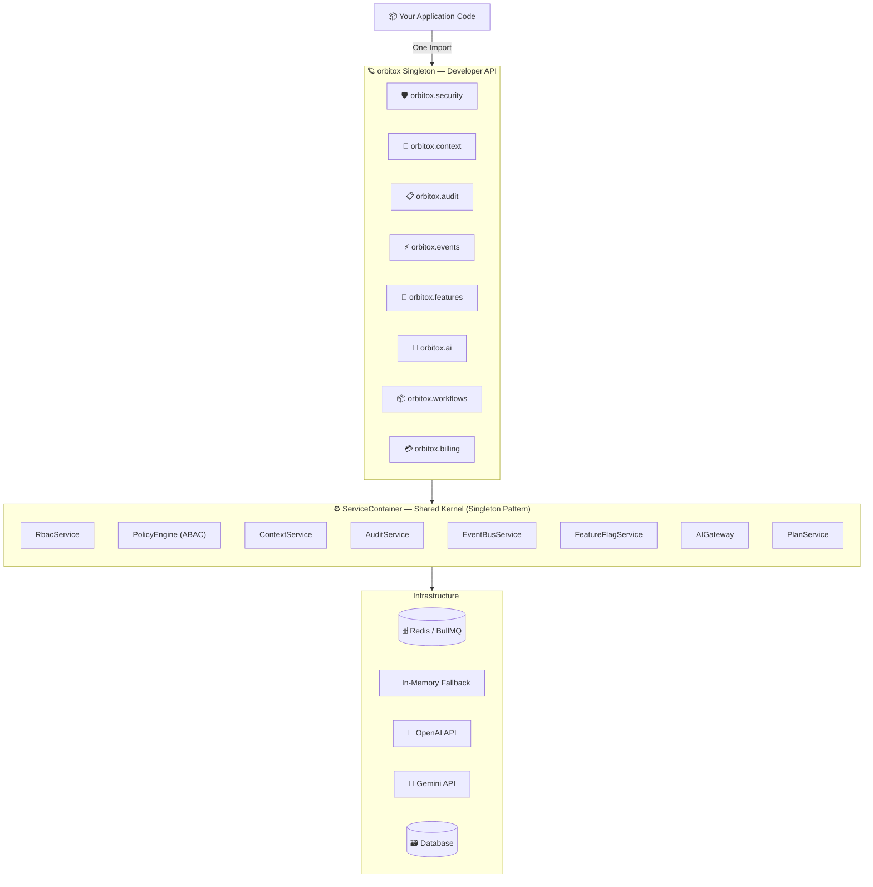
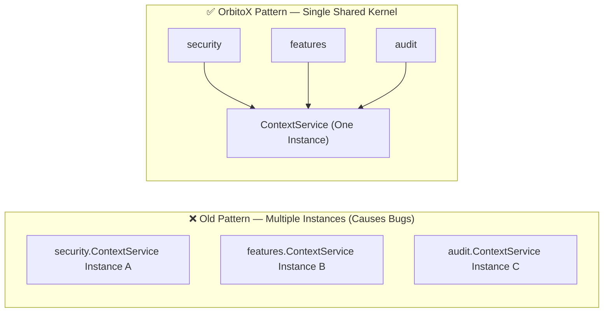
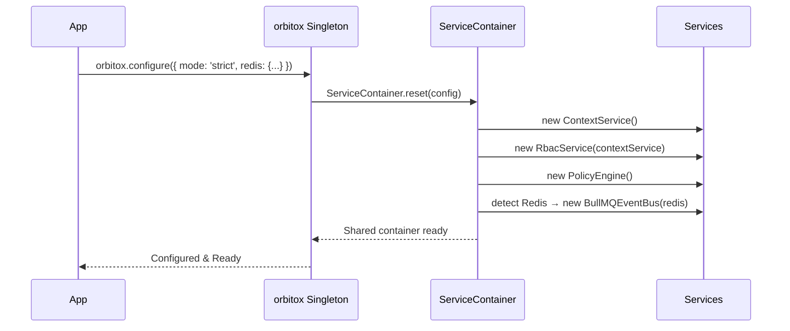

# 🏛️ Step 2: Platform Architecture & Kernel

This guide explains the core engine powering all of OrbitoX: the `orbitox` Singleton, the `ServiceContainer` kernel, and how every facade safely shares a single instance of each service.

---

## 🏛️ Full Architecture Overview



---

## 💡 Why a Singleton Kernel Matters

> [!IMPORTANT]
> Without the `ServiceContainer`, calling `orbitox.security` and `orbitox.features` would each create **separate copies** of `ContextService`. A context node created via `orbitox.context` would be **invisible** to `orbitox.features`. The singleton kernel fixes this permanently.



---

## 📊 Facade API Quick Reference Matrix

| Facade | Namespace | Primary Purpose | Key Methods | Return Type |
| :--- | :--- | :--- | :--- | :--- |
| 🛡️ **Security** | `orbitox.security` | Zero-Trust Authorization | `authorize()`, `check()`, `checkMany()`, `addAbacPolicy()`, `addPolicy()`, `getVisibilityClause()` | `boolean` / throws |
| 🏢 **Context** | `orbitox.context` | Multi-Tenancy Graph | `create()`, `get()`, `ancestors()`, `children()` | `Context` / `Context[]` |
| 📋 **Audit** | `orbitox.audit` | Hash-Chained Audit Trail | `created()`, `updated()`, `deleted()`, `log()` | `Promise<AuditEvent>` |
| ⚡ **Events** | `orbitox.events` | Distributed Event Bus | `emit()`, `on()`, `onAny()` | `Promise<void>` |
| 🚩 **Features** | `orbitox.features` | Contextual Flag Overrides | `define()`, `isEnabled()`, `setOverride()` | `Promise<boolean>` |
| 🤖 **AI Gateway**| `orbitox.ai` | Multi-Provider LLMs | `ask()`, `extract()`, `classify()`, `embed()` | `Promise<string / object>` |
| 📦 **Workflows** | `orbitox.workflows` | Automated Trigger Pipeline | `define()`, `trigger()` | `Promise<void>` |
| 💳 **Billing** | `orbitox.billing` | Plans & Subscriptions | `createPlan()`, `listPlans()`, `subscribeContext()`, `hasEntitlement()`, `checkQuota()` | `Promise<Plan[]>` / `boolean` / `Quota` |
| 🔌 **Plugins** | `orbitox.use()` | Platform Extension System | `use({ id, name, install })` | `this` (Chainable) |

---

## ⚙️ How `ServiceContainer` Works Under the Hood

```typescript
// service-container.ts (simplified)

export class ServiceContainer {
  private static instance: ServiceContainer;

  // Shared, lazily-initialized services
  readonly rbacService: RbacService;
  readonly policyEngine: PolicyEngine;
  readonly contextService: ContextService;
  readonly auditService: AuditService;
  readonly eventBusService: EventBusService;

  private constructor(config: OrbitoXConfig) {
    // Build services once, shared forever
    this.contextService = new ContextService();
    this.rbacService    = new RbacService(this.contextService);
    this.policyEngine   = new PolicyEngine();
    this.auditService   = new AuditService();
    this.eventBusService = config.redis
      ? new BullMQEventBus(config.redis) // Redis distributed
      : new InMemoryEventBus();           // Fallback
  }

  // Returns existing instance or creates on first call
  static shared(): ServiceContainer { ... }

  // Resets & recreates everything (called by orbitox.configure())
  static reset(config: OrbitoXConfig): ServiceContainer { ... }
}
```

---

## 🔄 Initialization Sequence (What `orbitox.configure()` Does)



---

[⬅️ Prev: Getting Started](./01_GETTING_STARTED.md) | [Back to Index](./README.md) | [Next: Multi-Tenancy Graph ➔](./03_MULTI_TENANCY.md)
